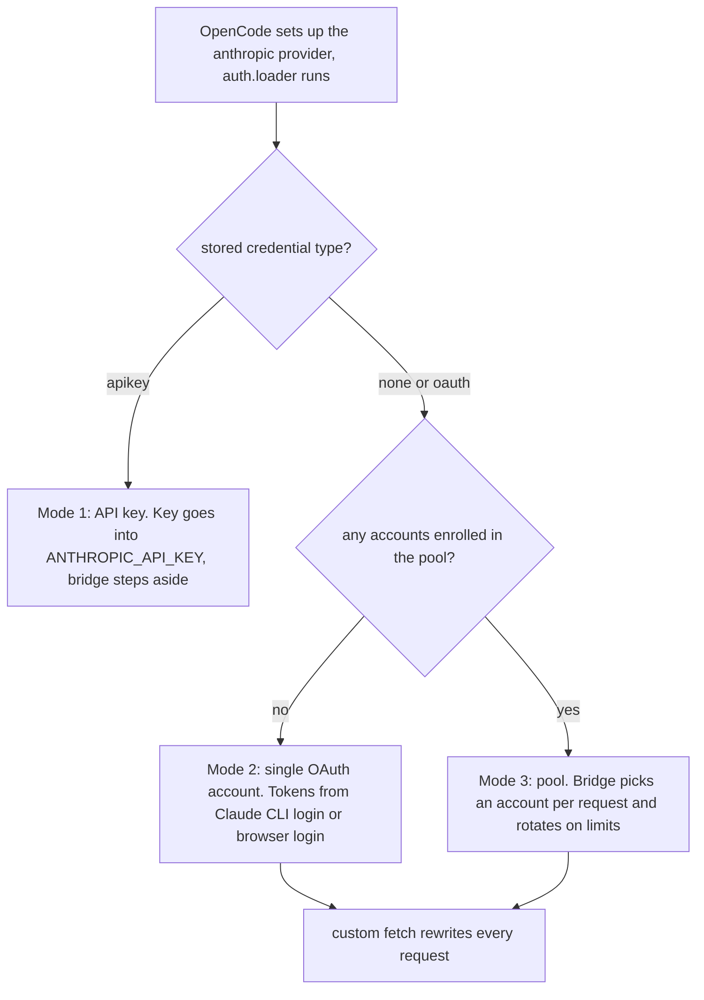
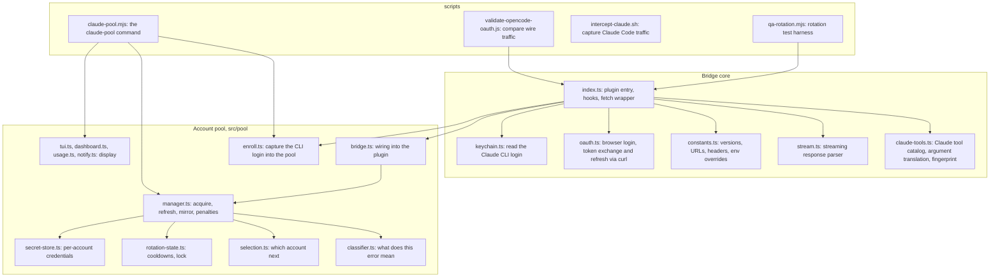
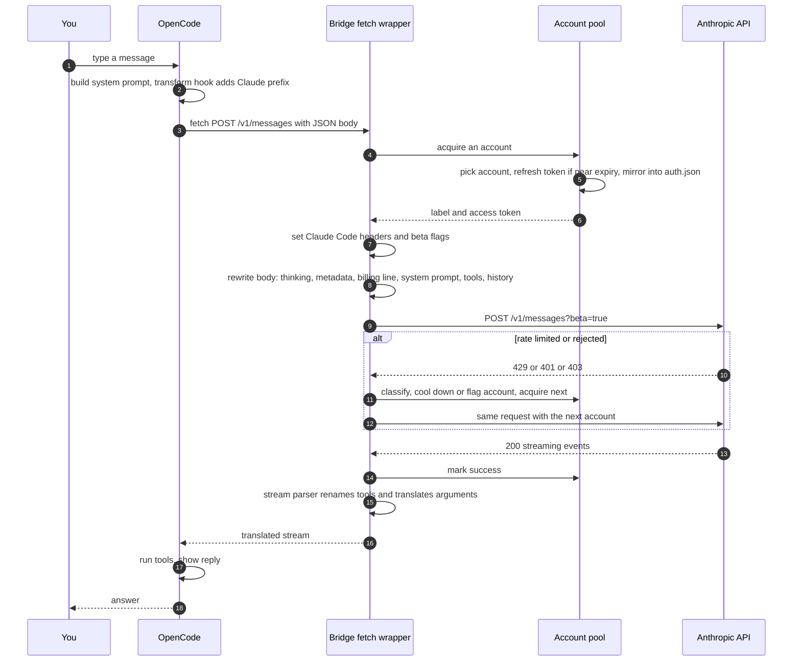
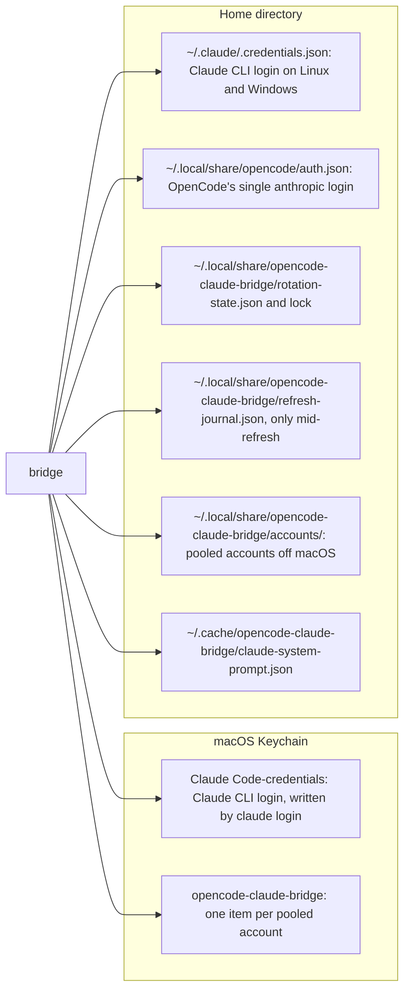

# Chapter 1: The Big Picture

## What this chapter covers

This chapter explains, without assuming background knowledge, what problem this repository solves, the pieces it is made of, the three modes it runs in, and the journey of a single chat message from your keyboard to Anthropic's servers and back. Later chapters zoom into each piece. This one gives you the map.

---

## 1. The problem in plain words

Three products are involved:

- **Claude** is Anthropic's family of AI models. You can pay for it in two ways:
  - an **API key** (a secret string starting `sk-ant-…`), billed per token used, or
  - a **Claude Pro or Max subscription**, a flat monthly fee with usage limits that reset on a rolling 5-hour window and a rolling 7-day window.
- **Claude Code** is Anthropic's own command-line coding agent. When you run `claude login`, it signs you in with your subscription using **OAuth**, a standard "log in through the browser and get a token" protocol. It stores the resulting tokens on your machine.
- **OpenCode** is a separate, open-source coding agent with its own interface and tools. It can talk to many model providers, including Anthropic.

Out of the box, OpenCode would use an API key for Claude. **This plugin lets OpenCode use your Claude subscription instead.** It does that in three ways:

1. It reuses the login that Claude Code already stored on your machine, or runs the same browser login itself.
2. It rewrites every request OpenCode sends to Anthropic so that it closely resembles what Claude Code itself would send: the same identifying headers, feature flags, billing line, system prompt and tool definitions. The README explains that requests not shaped like this can be treated differently, for example as "extra usage" (`README.md:302-307`).
3. It translates the model's tool calls back into OpenCode's conventions, so OpenCode can run them.

On top of that, it adds an optional **account pool**. If you have several subscriptions, it switches to the next one automatically when the current one hits its usage limit.

> The repository's README is explicit that Anthropic's documentation tells third-party tools to use API-key authentication, and that Anthropic may classify traffic on its side regardless of what the bridge does (`README.md:346-348`). Keep that in mind when deciding whether to use it.

---

## 2. What an "OpenCode plugin" is

OpenCode can load JavaScript modules listed under `"plugin"` in `~/.config/opencode/opencode.json`. A plugin exports a function. OpenCode calls it once at startup and gets back an object of **hooks**, which are callbacks OpenCode invokes at specific moments. This plugin's function is `OpenCodeClaudeBridge` (`src/index.ts:725`), the default export of the built file `dist/index.js`. It returns two hooks:

| Hook | When OpenCode calls it | What the bridge does |
|---|---|---|
| `experimental.chat.system.transform` (`src/index.ts:829`) | While building the system prompt for a chat | For Anthropic models, adds "You are a Claude agent, built on Anthropic's Claude Agent SDK." to the start of the prompt |
| `auth` for provider `anthropic` (`src/index.ts:842`) | When OpenCode sets up the Anthropic provider, and when you choose "connect" in its login dialog | `loader` adds models and, in OAuth mode, returns a custom `fetch` function that every API call goes through. `methods` offers two login options: "Claude Pro / Max (OAuth)" and "Claude API Key". |

The custom `fetch` is the heart of the project. OpenCode's Anthropic SDK calls it instead of the normal network `fetch`, which gives the bridge a chance to rewrite each request and each response.

---

## 3. Three operating modes

What the bridge does depends on what kind of credential OpenCode has for Anthropic, and whether you have enrolled accounts in the pool.

| Mode | Credential source | Request rewriting | Rotation |
|---|---|---|---|
| 1. API key | An `sk-ant-…` key, from the "Claude API Key" login option or the environment | None. The bridge returns no custom `fetch`. | No |
| 2. Single OAuth | Claude CLI's stored login (macOS Keychain, or `~/.claude/.credentials.json`), or the plugin's own browser login | Full | No. On a 401 it refreshes once; on a 429 it refreshes and retries twice. |
| 3. Pool | Accounts you enrolled with `claude-pool enroll`, stored by the plugin | Full | Yes, on usage-limit 429s and on confirmed 401/403s |

The pool is **opt-in**: with zero accounts enrolled, mode 3 never activates. The plugin re-checks whether accounts exist every 30 seconds (`src/index.ts:367`, `:779-804`), so enrolling the first account or removing the last takes effect without restarting OpenCode.

---

## 4. The moving parts

| File | Lines | One-line role | Chapter |
|---|---|---|---|
| `src/index.ts` | ~1570 | Plugin entry point, login methods, the fetch wrapper that rewrites requests and handles rotation | 02, 03, 06 |
| `src/claude-tools.ts` | ~980 | Claude Code's 26 captured tool definitions, argument translation both ways, fingerprint | 04 |
| `src/stream.ts` | ~230 | Parses the streamed reply and translates tool calls in it | 04 |
| `src/constants.ts` | ~180 | CLI version detection, OAuth URLs, beta flags, header values, env overrides | 02, 10 |
| `src/oauth.ts` | ~400 | OAuth PKCE login, local callback server, token exchange and refresh via `curl` | 02 |
| `src/keychain.ts` | ~70 | Reads Claude Code's stored login | 02 |
| `src/pool/types.ts` | ~200 | Shared types for the pool | 05 |
| `src/pool/secret-store.ts` | ~370 | Stores each account's tokens (Keychain on macOS, `0600` files elsewhere) | 05 |
| `src/pool/rotation-state.ts` | ~430 | Non-secret state (active account, cooldowns) with atomic writes and a cross-process lock | 05 |
| `src/pool/manager.ts` | ~550 | The pool's brain: pick account, refresh safely, mirror into OpenCode, apply penalties | 05 |
| `src/pool/classifier.ts` | ~410 | Turns an error response into a decision (retry, cool down, disable, pass through) | 06 |
| `src/pool/selection.ts` | ~70 | Chooses the next usable account | 06 |
| `src/pool/bridge.ts` | ~85 | Builds the pool for the plugin, and the synthetic 429/503 responses | 05 |
| `src/pool/enroll.ts` | ~380 | Captures the Claude CLI's current login into the pool, including auto-enroll | 07 |
| `src/pool/usage.ts` | ~130 | Fetches per-account usage percentages | 07 |
| `src/pool/tui.ts`, `dashboard.ts`, `notify.ts` | ~880 | Interactive terminal manager, text status, toast notifications | 07 |
| `scripts/claude-pool.mjs` | ~360 | The `claude-pool` command-line tool | 07 |
| `scripts/validate-opencode-oauth.js` | ~540 | Captures and compares Claude Code vs OpenCode requests; saves Claude Code's system prompt | 08 |
| `scripts/intercept-claude.sh` | ~90 | Quick proxy to capture what Claude Code sends | 08 |
| `scripts/qa-rotation.mjs` | ~410 | End-to-end rotation scenarios against a fake server | 08 |
| `*.test.ts` | ~4000 | Unit and integration tests run with `node:test` | 09 |
| `.github/workflows/*.yml` | ~70 | CI (typecheck and build) and npm publishing | 09 |

---

## 5. The life of one chat message

You type "fix the failing test" in OpenCode, with the Anthropic model `claude-opus-5-5` selected and the pool active. Here is everything that happens, in order. Each step links to the chapter with the details.

1. **System prompt hook.** OpenCode builds its system prompt, and the bridge's transform hook adds the Claude Agent SDK sentence to the start (`src/index.ts:829-840`). See [02](02-plugin-startup-and-login.md).
2. **Fetch is called.** OpenCode's Anthropic SDK calls the bridge's `fetch` with the request URL and a JSON body (`src/index.ts:897`).
3. **Get a token.** In pool mode, `pool.acquire()` picks a healthy account, refreshes its token if it expires within a minute (writing the new tokens to a crash-safe journal first), and copies it into OpenCode's own login slot. In single mode the bridge refreshes only if needed. See [05](05-account-pool-overview.md) and [02](02-plugin-startup-and-login.md).
4. **Headers.** The bridge sets `Authorization: Bearer …` and Claude Code's `user-agent`, `x-app`, session id, Stainless SDK headers and beta flags. It removes `x-api-key`. See [03](03-request-pipeline.md).
5. **Body.** It turns on adaptive thinking for models that support it, adds `context_management` and `output_config`, and sets `metadata.user_id` (device, account, session). It puts an `x-anthropic-billing-header` line first in the system prompt, including a fingerprint of your first message. It replaces OpenCode's system prompt with Claude Code's captured one if a capture exists. It swaps tool definitions for Claude Code's and rewrites earlier tool calls in the history. See [03](03-request-pipeline.md) and [04](04-tools-and-translation.md).
6. **Send.** The request goes to `https://api.anthropic.com/v1/messages?beta=true`.
7. **Failure handling, before any of the reply is read.** A 429 with a long reset cools the account down until it resets and retries on the next account. A short reset retries the same account. A 401/403 is only blamed on the account if a different account then succeeds. See [06](06-rotation-and-failure-handling.md).
8. **Streaming back.** The reply arrives as server-sent events. The stream parser renames tools (`Edit` to `edit`), holds each tool call's argument fragments until the call is complete, translates them (`file_path` to `filePath`), and passes everything else through live. See [04](04-tools-and-translation.md).
9. **OpenCode acts.** It shows the text, runs the tools, and on the next turn sends the whole conversation again, starting at step 2.

---

## 6. Where things are stored

The pool is the source of truth for pooled accounts. OpenCode's `auth.json` only ever holds a copy of the currently active one. The bridge writes to `auth.json` through OpenCode's own API (`client.auth.set`), not directly. Exact paths, permissions and overrides are in [10](10-configuration-and-files-reference.md).

---

## 7. Safety ideas that recur throughout the code

| Idea | Why it matters | Where |
|---|---|---|
| Refresh tokens are single-use | Anthropic issues a new refresh token on every refresh and immediately invalidates the old one. Losing the new one locks you out of that account. | Journal-then-commit in `src/pool/manager.ts`; "in memory first" in `src/index.ts:450-454`; the plugin never refreshes the Claude CLI's own token in `src/keychain.ts:51` |
| Secrets stay out of command lines | Anything in a process's arguments is visible to other users via `ps` | Token requests go to `curl` on stdin (`src/oauth.ts:44`); keychain writes go to `security` on stdin (`src/pool/secret-store.ts`) |
| Several OpenCode windows can run at once | They share one pool and must not spend the same refresh token twice | Cross-process lock in `src/pool/rotation-state.ts` |
| Never rotate mid-stream | Two streamed replies can't be spliced together | Rotation happens before the response body is read (`src/index.ts:1158-1166`) |
| Don't blame the account for a bad request | A malformed request fails identically on every account | Deferred 401/403 penalties (`src/index.ts:1171-1179`) |
| No silent opt-in | Installing the plugin must not quietly capture credentials | Auto-enroll only runs once you've enrolled one account by hand (`src/index.ts:745-748`) |

---

## 8. How the project evolved

The history from `git log`, summarized:

| Period | Versions | What happened |
|---|---|---|
| 2026-03-22 to 03-26 | 1.0.0 to 1.8.0 | First release: keychain sync, OAuth PKCE, header matching, API-key mode, model injection, temperature fix for thinking, first unit tests; CI and auto-publish set up |
| 2026-04-09 to 04-28 | 1.9.0 to 1.10.8 | Wire-matched Claude Code tool definitions, two-way argument translation, dynamic fingerprint, ephemeral-port OAuth callback, Windows fixes, SSE chunk-boundary rewrite, provider-aware tool schemas, model-identity rewrite in the cached prompt, plan-mode tools |
| 2026-05 to 2026-07 | 1.10.9 to 1.10.12 | AskUserQuestion normalization, filtering tools to those active, keychain refresh fix, header alignment, stripping `cache_control` |
| 2026-08-20 | (no version bump) | The whole multi-account pool: types, classifier, selection, store, lock, manager, enrollment, rotation in the bridge, QA harness, CLI, security fixes, auto-enroll; also stopped dropping MCP/plugin tools |
| 2026-09-19 to 09-23 | (no version bump) | Hex keychain decoding, both quota windows, usage fetch, interactive TUI, Linux support, hardening, CLI fixes |
| Uncommitted | | Sonnet 5.5 model entry and its thinking-mode normalization (`src/index.ts`, `src/index.test.ts`) |

`package.json` still says `1.10.12`. The publish workflow only publishes when that number changes (see [09](09-build-test-ci-release.md)), so none of the pool work has gone out to npm from this branch yet.

---

## 9. Mini glossary

A fuller glossary is in [10](10-configuration-and-files-reference.md).

| Term | Meaning |
|---|---|
| OAuth / PKCE | Browser-based login. PKCE is a variant that proves the app finishing the login is the one that started it. |
| Access token | Short-lived credential sent as `Authorization: Bearer …` |
| Refresh token | Longer-lived credential used to get a new access token. Single-use with Anthropic. |
| Beta flag | A value in the `anthropic-beta` header that opts into API features |
| Billing header | A text line `x-anthropic-billing-header: cc_version=…; cc_entrypoint=…; cch=…;` put first in the system prompt |
| Fingerprint | 3 hex characters derived from the first user message, used in `cc_version` |
| SSE | Server-sent events: the streamed reply format |
| Tool / tool_use | A function the model can call, and the block in which it calls it |
| Pool / enrollment | The set of saved subscription accounts, and adding one to it |
| Cooldown | Time an account is skipped because its usage window is exhausted |
| Rotation | Switching the request to another account |
| Mirror | Copying the active pool account into OpenCode's `auth.json` |

---

## Key takeaways

- The project is an OpenCode plugin whose custom `fetch` makes OpenCode's Anthropic traffic look like Claude Code's, so a Claude subscription can be used instead of an API key.
- There are three modes: API key (bridge steps aside), single OAuth account, and an opt-in pool of accounts that rotates on usage limits.
- Every request passes through: get token, rewrite headers, rewrite body (thinking, metadata, billing line, system prompt, tools, history), send, handle failures before streaming, translate the stream back.
- Credentials live in the macOS Keychain or `0600` files. Much of the pool code exists to protect single-use refresh tokens across crashes and concurrent processes.

## Related chapters

Continue with [02-plugin-startup-and-login.md](02-plugin-startup-and-login.md), or jump using the table in [README.md](README.md).
