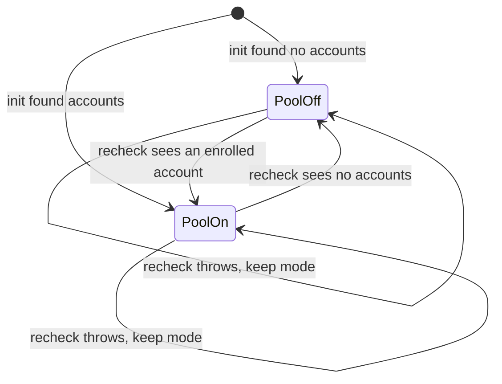
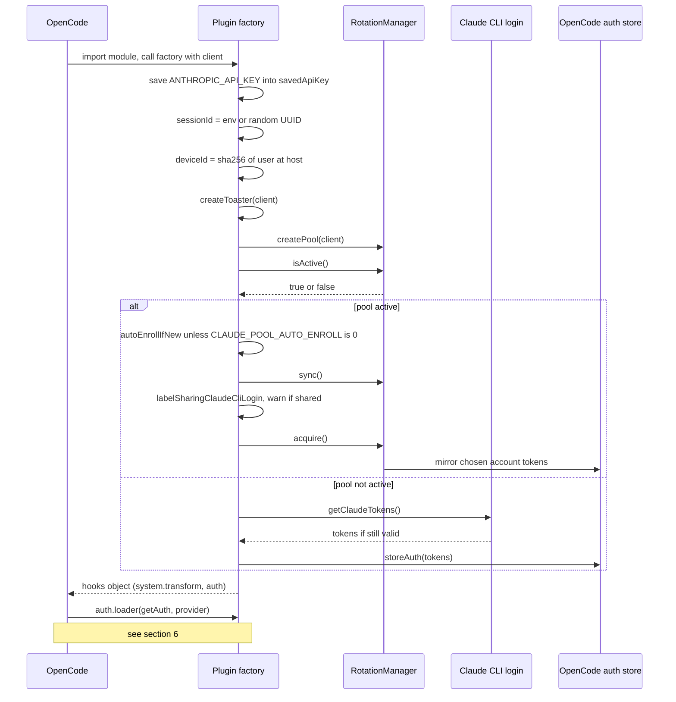
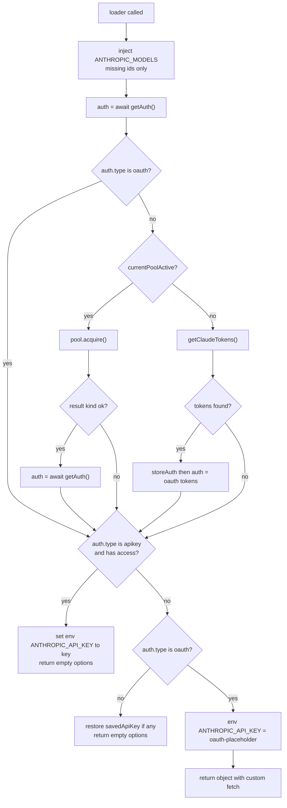
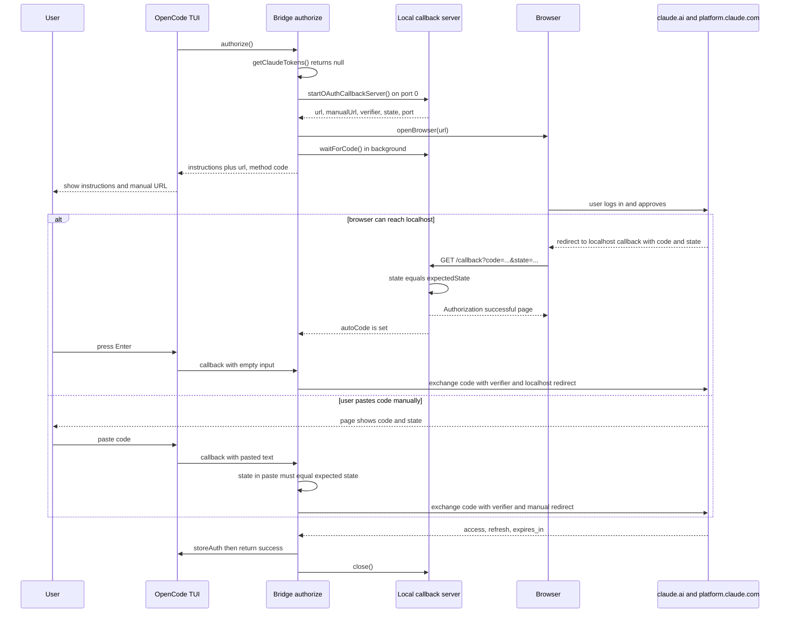
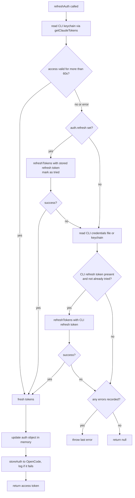

# 02 - Plugin startup and login

## What this chapter covers

This chapter explains everything that happens before the first real chat request leaves your machine: what an OpenCode plugin is, what the bridge's plugin function does when OpenCode loads it, how the bridge decides which credentials to use (`auth.loader`), the two ways a user can log in (browser OAuth and a pasted API key), how the OAuth login works under the hood (PKCE, a local callback server, and a curl-based token exchange), how the bridge reads the Claude Code command-line tool's saved login (`src/keychain.ts`), how a single-account setup refreshes expired tokens (`refreshAuth`), and how the bridge learns which version of the Claude Code CLI it should pretend to be (`src/constants.ts`). The per-request rewriting that happens afterwards is in [03-request-pipeline.md](03-request-pipeline.md).

Source files covered: `src/index.ts` (lines 1-900 and 1414-1572), `src/oauth.ts` (all), `src/keychain.ts` (all), `src/constants.ts` (all).

---

## 1. Background: what is an OpenCode plugin?

**OpenCode** is a terminal coding agent. It talks to many AI providers (Anthropic, OpenAI, and others). A **plugin** is a JavaScript/TypeScript module that OpenCode loads at startup so that third parties can change its behavior without editing OpenCode itself. The user turns a plugin on by listing it in `~/.config/opencode/opencode.json` (`README.md`, "Install"):

```json
{ "plugin": ["opencode-claude-bridge"] }
```

OpenCode downloads the package from npm and imports its default export. The default export must be an **async factory function**. OpenCode calls it once at startup, passing in a context object (the bridge only uses the `client` field), and the function returns an object of **hooks**: named entry points that OpenCode calls at the right moments.

In this repo the factory is `OpenCodeClaudeBridge` (`src/index.ts:725`) and it is the default export (`src/index.ts:1572`). The `client` it receives is an SDK handle back into OpenCode. The bridge describes the parts it uses in the `PluginClient` type (`src/index.ts:193-212`):

| Member | What it is for |
|---|---|
| `client.auth.set({ path: { id }, body })` | Saves a credential into OpenCode's own auth store (a file OpenCode owns), under a provider id such as `"anthropic"`. |
| `client.tui?.showToast(...)` | Shows a small pop-up message ("toast") in OpenCode's terminal UI. Optional: only present on hosts that expose the TUI control API (`src/index.ts:200`). |
| `client.tui?.clearPrompt` | Declared but not used in the files covered here. |

### What the factory returns

The object returned at `src/index.ts:823-1569` has exactly two top-level keys:

1. **`"experimental.chat.system.transform"`** (`src/index.ts:829`) - a hook OpenCode calls every time it assembles the system prompt (the standing instructions sent to the model before the conversation). See section 5.
2. **`auth`** (`src/index.ts:842`) - a description of how to authenticate with the `anthropic` provider. It contains:
   - `provider: "anthropic"` - this plugin takes over OpenCode's built-in Anthropic provider.
   - `loader(getAuth, provider)` - runs when OpenCode builds the provider; it decides which credentials to use and may return a custom `fetch` function (sections 6-7). The `fetch` it returns is the heart of the bridge and is the subject of [03-request-pipeline.md](03-request-pipeline.md).
   - `methods` - the login choices that appear in OpenCode's "connect a provider" menu (sections 7 and 9).

The comment above `"experimental.chat.system.transform"` (`src/index.ts:824-828`) says it "registers `/claude-pool`". That comment is stale: the hook shown below it only edits the system prompt and registers no command. Nothing in `src/index.ts` registers a slash command (the constants `POOL_COMMAND_NAME` and friends in `src/constants.ts:150-171` are defined but never imported by `src/index.ts`; the `claude-pool` command is covered in [07-enrollment-and-claude-pool-cli.md](07-enrollment-and-claude-pool-cli.md)).

---

## 2. Static data defined above the factory

Before the factory runs, the module defines some data at load time. Chapter 03 and chapter 04 explain how these are used per request; here is what each is.

### 2.1 Type declarations (`src/index.ts:49-80`)

| Type | Meaning |
|---|---|
| `AuthType` | Shape of what OpenCode's `getAuth()` returns: `{ type: "oauth" or "apikey" ..., access?, refresh?, expires? }`. `access` is the short-lived **access token** (a bearer credential sent with each request), `refresh` is the long-lived **refresh token** (used only to obtain new access tokens), `expires` is a millisecond timestamp. |
| `ProviderModel` | One entry in OpenCode's model catalog: display name, whether it supports attachments/reasoning/tool calls/temperature, context and output token limits, input/output modalities, and per-million-token cost. |
| `OAuthProfile` | The only part of the Anthropic profile response the bridge reads: `account.uuid`. |
| `ClaudeSystemPromptCache` | Shape of the optional captured-system-prompt file (see chapter 03). |

### 2.2 `ANTHROPIC_MODELS` - the fallback model catalog (`src/index.ts:125-191`)

OpenCode ships its own list of Anthropic models, but that list lags behind new releases. The bridge carries its own table of nine model ids and injects them (only if missing) when the loader runs. The comment says: "Fallback catalog, used only for ids the host's own model list lacks. Prices per million tokens, from platform.claude.com/docs/en/about-claude/pricing."

| Model id | Display name | Context / max output | Reasoning | `temperature` allowed | Cost in/out per M tokens |
|---|---|---|---|---|---|
| `claude-fable-5-1` | Claude Fable 5.1 | 1,000,000 / 128,000 | yes | false | 10 / 50 |
| `claude-opus-5-5` | Claude Opus 5.5 | 1,000,000 / 128,000 | yes | false | 4 / 20 |
| `claude-sonnet-5-5` | Claude Sonnet 5.5 | 1,000,000 / 128,000 | yes | false | 2 / 10 |
| `claude-sonnet-5` | Claude Sonnet 5 | 1,000,000 / 128,000 | yes | false | 2 / 10 |
| `claude-opus-4-6` | Claude Opus 4.6 | 200,000 / 32,000 | yes | false | 5 / 25 |
| `claude-opus-4-5` | Claude Opus 4.5 | 200,000 / 32,000 | yes | false | 5 / 25 |
| `claude-sonnet-4-6` | Claude Sonnet 4.6 | 200,000 / 64,000 | yes | false | 3 / 15 |
| `claude-sonnet-4-5` | Claude Sonnet 4.5 | 200,000 / 8,192 | yes | false | 3 / 15 |
| `claude-haiku-4-5-20251001` | Claude Haiku 4.5 | 200,000 / 64,000 | no | true | 1 / 5 |

Each entry also has `attachment: true`, `tool_call: true`, input modalities `text` and `image`, and `cache_read`/`cache_write` prices. Note that every model except Haiku has `temperature: false`; this tells OpenCode not to send a temperature setting for them. (Chapter 03 explains the separate rule the bridge applies if a temperature does get through.)

### 2.3 Tool name maps (`src/index.ts:82-123`)

`OUTBOUND_TOOL_NAME_MAP` and `INBOUND_TOOL_NAME_MAP` translate between OpenCode tool names (`bash`, `read`, `task`) and Claude Code tool names (`Bash`, `Read`, `Agent`). They are used per request; see [04-tools-and-translation.md](04-tools-and-translation.md).

### 2.4 Module-level constants (`src/index.ts:364-367`)

| Constant | Value | Purpose |
|---|---|---|
| `oauthProfileCache` | `Map<string, Promise<OAuthProfile or null>>` | Remembers the profile lookup per access token (chapter 03, section on `metadata.user_id`). |
| `SYSTEM_PROMPT_CACHE_PATH` | `$ANTHROPIC_SYSTEM_PROMPT_PATH`, else `$HOME/.cache/opencode-claude-bridge/claude-system-prompt.json` | Where a captured real Claude Code system prompt is looked up (chapter 03). On a machine with no `HOME`, the fallback becomes a relative path starting with `.cache/...`. |
| `POOL_RECHECK_MS` | `30_000` | How often the bridge re-checks whether the multi-account pool is active (section 3.9). |

### 2.5 Small response/persistence helpers

- **`buildAuthFailureResponse(detail)`** (`src/index.ts:369-388`) manufactures a fake HTTP 401 response with an Anthropic-style JSON error body (`type: "authentication_error"`) whose message reads "Claude OAuth credentials are no longer valid. <detail> Reconnect 'Claude Pro / Max (OAuth)' in OpenCode or run `claude login` again." The bridge returns this instead of throwing so OpenCode shows a readable, actionable error in the chat rather than a crash. It is used when token refresh fails completely.
- **`storeAuth(client, tokens)`** (`src/index.ts:391-404`) writes `{ type: "oauth", refresh, access, expires }` to OpenCode's auth store for provider `"anthropic"` via `client.auth.set`. This is how fresh tokens survive an OpenCode restart.
- **`openBrowser(url)`** (`src/index.ts:472-501`) - best-effort "open this URL in the user's browser". It runs asynchronously and swallows every error (`.catch(() => {})`), because failing to open a browser must never break login (the user can still copy the URL). Per platform it tries, in order:
  - macOS: `launchctl asuser <uid> /usr/bin/open <url>` (works even when the process is not in the user's GUI session), then `/usr/bin/open`, then `osascript -e 'open location "..."'`. The first one that does not throw wins (`break`).
  - Windows: `cmd /c start "" <url>`.
  - Other (Linux): `/usr/bin/xdg-open`, then `/usr/bin/open`.
  All use `execFileSync` with an argument array (no shell), so the URL cannot be misinterpreted as shell syntax. The `name` strings in the attempt tuples are unused.
- **`mergeHeaders`, `abortableSleep`, `recordPoolState`, `failureSignature`** belong to the request pipeline and are explained in chapter 03 and chapter 06.

---

## 3. Plugin initialization, step by step (`src/index.ts:725-821`)

When OpenCode imports the plugin, it awaits `OpenCodeClaudeBridge({ client })`. The following happens, in this order, before the hooks object is returned.

### 3.1 Remember the user's API key (`src/index.ts:726-728`)

```ts
const savedApiKey = process.env.ANTHROPIC_API_KEY;
```

The comment says "Save and clear ANTHROPIC_API_KEY so SDK doesn't bypass our fetch. Restored if OAuth isn't active". **What actually happens here is only the save.** The variable is not cleared at this point. The clear happens later, in `auth.loader`, where it is overwritten with the string `"oauth-placeholder"` (section 6.6), and restored from `savedApiKey` when OAuth is not active (`src/index.ts:885`). So the comment describes the combined behavior across the init and loader steps, not this line alone.

Why save it at all? The Anthropic SDK that OpenCode uses reads `ANTHROPIC_API_KEY` from the environment. If a real key is present, the SDK sends it as an `x-api-key` header and may bypass the bridge's custom `fetch`. The bridge needs to (a) override it while OAuth is in use, and (b) put it back if the user falls out of OAuth mode so plain API-key setups keep working. It is also reused by the "Claude API Key" login method (section 9).

### 3.2 Session id (`src/index.ts:729`)

```ts
const sessionId = SESSION_ID || randomUUID();
```

A **session id** is a random UUID that the real Claude Code CLI generates per run and sends with every request so Anthropic can group them. The bridge makes one per OpenCode process (or uses `ANTHROPIC_SESSION_ID` if you set it; `src/constants.ts:135-136`). It later appears in the `x-claude-code-session-id` header, in `metadata.user_id`, and as the seed of the billing `cch` value (chapter 03).

### 3.3 Device id (`src/index.ts:730`, `getStableDeviceId` at `src/index.ts:665-675`)

Claude Code also sends a **device id**: a stable per-machine identifier. The bridge builds one without storing anything on disk:

1. `who = "<username>@<hostname>"` using `os.userInfo().username` and `os.hostname()`.
2. If `userInfo()` throws (this can happen in some containers), fall back to `$USER` or `$USERNAME` or the literal `"unknown"`, still joined with `hostname()`.
3. If even that throws, `who` stays `"unknown"`.
4. Return `sha256(who)` as hex.

Why hash? The id is sent to Anthropic inside `metadata.user_id`. Hashing keeps the raw username and hostname off the wire while still being identical on every run on the same machine, which is what "stable" means here. It is stable only as long as the username and hostname do not change.

### 3.4 Toaster (`src/index.ts:732`)

`createToaster(client)` (`src/pool/notify.ts`) returns a function `toast(variant, message, dedupeKey?)`. It calls `client.tui.showToast` fire-and-forget (errors swallowed, so a missing or slow UI never delays a request), shows each distinct message at most once per 60 seconds (`TOAST_REPEAT_MS`) so concurrent requests do not stack identical pop-ups, and uses `POOL_TOAST_DURATION_MS` (10 s) as the on-screen duration. Variants are `info`, `success`, `warning`, `error`.

### 3.5 Create the pool (`src/index.ts:736-740`)

```ts
const pool: RotationManager = createPool(client, { onAccountDisabled: ... });
```

The **pool** is the opt-in multi-account feature: the user can enroll several Claude subscriptions and the bridge rotates among them when one hits a rate limit. `createPool` (`src/pool/bridge.ts`) builds a `RotationManager` from an account store (secrets kept in the OS keychain or a fallback), a rotation-state file with a cross-process lock, a refresh function (`refreshTokens` from `src/oauth.ts`) and a "mirror" function that copies the currently chosen account's tokens into OpenCode's auth store via `client.auth.set`. The `onAccountDisabled` callback shows an error toast: `"<label>" disabled (<reason truncated to 80 chars>); re-login, then claude-pool enroll`. The pool internals are in [05-account-pool-overview.md](05-account-pool-overview.md).

Creating the pool does not enable it. It merely builds objects.

### 3.6 Is the pool active? (`src/index.ts:741-743`)

```ts
let poolActive = false;
poolActive = await pool.isActive();
```

`pool.isActive()` (`src/pool/manager.ts:258-260`) is true only if at least one account is enrolled. The manager's comment: with none enrolled "we stay completely out of the way and the plugin's original single-account behaviour is preserved byte for byte." Every other piece of init is inside one `try` block (`src/index.ts:742-773`): if anything throws, the catch prints `[claude-pool] disabled (<message>)` to stderr and forces `poolActive = false`. So a broken keychain can never prevent the plugin from loading.

### 3.7 Auto-enroll (`src/index.ts:745-758`)

If the pool is already active **and** the environment variable `CLAUDE_POOL_AUTO_ENROLL` is not `"0"`, the bridge calls `autoEnrollIfNew({ accounts })`. This looks at whichever account the Claude CLI is currently logged into and, if the pool has not seen that account before, adds it. Matching is by refresh token, then by email, never by label (`src/pool/enroll.ts`, doc comment of `autoEnrollIfNew`). On `status === "enrolled"` the bridge logs `[claude-pool] auto-enrolled "<label>" (<email>) from the Claude CLI` and shows a success toast.

The guard `poolActive &&` is deliberate. The comment says: "Only once the pool is already in use, so installing the plugin never silently captures credentials from someone who has not opted in." In other words, the first enrollment is always an explicit user act (the `claude-pool enroll` command, chapter 07); only after that does the bridge keep the pool up to date automatically. See also [10-configuration-and-files-reference.md](10-configuration-and-files-reference.md) for the env var.

### 3.8 Sync and shared-login warning (`src/index.ts:760-767`)

Still only if the pool is active:

1. `await pool.sync()` (`src/pool/manager.ts:263-267`) registers every enrolled account in the rotation-state file (idempotent: `ensureAccount` for each label). The state file tracks cooldowns and which account is current.
2. `labelSharingClaudeCliLogin(accounts)` (`src/pool/enroll.ts:277-288`) compares the Claude CLI's current refresh token with every pooled account's refresh token and returns the label of a match, or `null`. If there is a match, the bridge logs and toasts `sharedLoginWarning(label)`:

   > "<label>" shares one login with Claude Code on this machine; whichever refreshes first logs the other out. Run `claude login` again (as this or another account) and do not re-enroll it.

   **Why this matters:** OAuth refresh tokens are single-use. Each time one is exchanged, the server returns a new refresh token and invalidates the old one. If the pool and the Claude CLI both hold the same refresh token, the first to refresh breaks the other. The warning tells the user to give the CLI its own login.

### 3.9 The `currentPoolActive` 30-second recheck (`src/index.ts:775-804`)

The init-time `poolActive` value would go stale: a user might run `claude-pool enroll` (or remove the last account) while OpenCode keeps running. The bridge wants such changes to apply without a restart, but, per the comment, "listing the keychain on every request is too slow." So it wraps the check:

```ts
let poolCheckedAt = Date.now();
let poolCheckFailing = false;
const currentPoolActive = async () => { ... }
```

Behavior of `currentPoolActive()`:

1. If fewer than `POOL_RECHECK_MS` (30 s) have passed since the last check, return the cached `poolActive`. Almost every request takes this fast path.
2. Otherwise stamp `poolCheckedAt = now` (before the slow work, so concurrent callers do not all re-check) and call `pool.isActive()`.
3. If the pool just became active (`active && !poolActive`), call `pool.sync()` so the new accounts get state entries.
4. Clear `poolCheckFailing`. If `active !== poolActive`, flip `poolActive` and announce it: log plus an `info` toast, either "Accounts enrolled - rotating across the pool" or "No accounts enrolled - using the single OpenCode login" (the source uses an em dash in these strings).
5. If the check throws (for example a locked keychain), keep the last known mode and log `could not re-check enrolled accounts; keeping pool on/off` **once** (`poolCheckFailing` suppresses repeats). The comment: "a locked keychain must not flip it back and forth."

Note that the recheck does not do the auto-enroll or shared-login steps; those run only at init.



### 3.10 Bootstrap auth at init (`src/index.ts:806-821`)

```ts
try {
  if (poolActive) { await pool.acquire(); }
  else {
    const tokens = getClaudeTokens();
    if (tokens) await storeAuth(client, tokens);
  }
} catch {}
```

"Bootstrap" means: put usable credentials into OpenCode's auth store before OpenCode builds its providers, so that the `auth.loader` sees an `oauth` entry on the very first start and the Claude models appear immediately "without requiring a restart" (the comment at `src/index.ts:806-809`).

- **Pool not active:** read the Claude CLI's login via `getClaudeTokens()` (section 10). If it exists and is still valid, copy it into OpenCode's store with `storeAuth`.
- **Pool active:** call `pool.acquire()`, which picks an account, refreshes its token if needed, and "mirrors" it into OpenCode's auth store (via the `mirrorFn` in `src/pool/bridge.ts`). The return value is ignored here.

**The anti-clobber reason.** With the pool active the bridge must not seed from the CLI keychain. The comment (`src/index.ts:810-813`): "that keychain holds whichever account `claude login` last used, so seeding from it would overwrite the active account on every startup and silently undo rotation." Concretely: suppose the pool has rotated to account B because A was rate-limited, but the Claude CLI is logged in as A. If startup copied the CLI's tokens over OpenCode's store, B would be silently replaced by A every restart. So in pool mode the pool is the single source of truth.

The whole block is wrapped in an empty `catch {}`: bootstrap is best effort, and failure just means the user will log in through the normal menu.

### 3.11 Startup sequence diagram



---

## 4. Why the plugin keeps two "modes"

Everything from here on branches on **pool mode** versus **single-account mode**:

| | Single-account mode | Pool mode |
|---|---|---|
| Who owns the tokens | OpenCode's auth store (plus the Claude CLI login as a fallback) | The pool's own account store; OpenCode's store is just a mirror |
| Refresh | `refreshAuth` (section 11) | `pool.acquire()` refreshes the chosen account |
| 429 handling | refresh token and retry | rotate to another account (chapter 06) |

Single-account mode is the default and what happens for anyone who never runs `claude-pool enroll`.

---

## 5. The `experimental.chat.system.transform` hook (`src/index.ts:829-840`)

OpenCode calls this hook with `input.model` and a mutable `output.system` (an array of system-prompt strings). The bridge's logic:

```ts
if (input.model?.providerID !== "anthropic") return;
if (output.system.some((s) => s.includes(CLAUDE_PREFIX))) return;
if (output.system.length > 0) output.system[0] = `${CLAUDE_PREFIX}\n\n${output.system[0]}`;
else output.system.push(CLAUDE_PREFIX);
```

Where `CLAUDE_PREFIX` is the sentence `You are a Claude agent, built on Anthropic's Claude Agent SDK.` (`src/index.ts:216-217`).

Line by line:

1. **Only for the `anthropic` provider.** Other providers (OpenAI etc.) must not receive Claude's identity sentence.
2. **Idempotent.** If any system string already contains the sentence, do nothing. The hook may be invoked more than once for the same prompt, and the prefix must appear once.
3. **Prepend or create.** If there is a first system string, glue the prefix and a blank line in front of it; otherwise add the prefix as the only string.

**Why does the prefix matter?** The real Claude Code CLI always begins its system prompt with this sentence. Anthropic's API, when authenticated with a subscription OAuth token, expects the request to look like Claude Code traffic. Having the sentence at the very start of the system prompt is part of that disguise. Later, in the request pipeline, the bridge also splits it into its own system block and de-duplicates accidental repeats (see `deduplicatePrefix` and `normalizeSystemBlocks` in chapter 03). Without this hook there would be nothing to split.

---

## 6. `auth.loader` overview

OpenCode calls `loader(getAuth, provider)` while building the Anthropic provider (and again when relevant state changes). `getAuth` is an async function returning the current `AuthType` from OpenCode's auth store; `provider` carries the model table (`provider.models`). The loader returns provider options. If it returns an object containing `fetch`, OpenCode uses that function for **every** HTTP call to Anthropic; that is how the bridge intercepts traffic. If it returns `{}`, OpenCode keeps its defaults.

### 6.1 Loader decision flow



### 6.2 Step 1: inject the model catalog (`src/index.ts:849-855`)

```ts
if (provider?.models !== undefined) {
  for (const [id, def] of Object.entries(ANTHROPIC_MODELS)) {
    if (!provider.models[id]) provider.models[id] = { ...def };
  }
}
```

The comment: "Always inject Claude models - runs before any auth check so models appear in the selector even on a fresh install with no auth configured." Two details: it only adds ids OpenCode does not already know (`if (!provider.models[id])`), so OpenCode's own, possibly newer, definition always wins; and it adds a **copy** (`{ ...def }`, a shallow copy) so OpenCode mutating the entry cannot alter the constant table.

### 6.3 Step 2: read current auth and auto-bootstrap (`src/index.ts:857-875`)

`let auth = await getAuth();`. If the stored auth is not of type `"oauth"` (for example nothing is stored yet, or it is an API key), the loader tries to bootstrap OAuth credentials silently:

- **Pool active (per `currentPoolActive()`):** `pool.acquire()`. If `acquired.kind === "ok"`, re-read `auth = await getAuth()` (the pool mirrored the chosen account into the store, so the store now has it). If the pool is exhausted, nothing changes.
- **Pool inactive:** `getClaudeTokens()`; if the CLI has valid tokens, `storeAuth` them and set the local variable `auth = { type: "oauth", ...tokens }` directly (no re-read needed).

All wrapped in `try {} catch {}`. The comment says "With the pool active this seeds from the pool, not the Claude CLI keychain, for the same anti-clobber reason as the init path above."

Note one behavior worth knowing: this bootstrap also runs when the stored type is `"apikey"`. If the user previously saved an API key through the "Claude API Key" method but has a valid Claude CLI login, the loader will overwrite the stored API key with the CLI's OAuth tokens. (This follows directly from the `auth.type !== "oauth"` condition; nothing in the code protects the API-key entry.) Treat this as a gotcha.

### 6.4 Step 3: API-key mode (`src/index.ts:877-881`)

```ts
if (auth.type === "apikey" && auth.access) {
  process.env.ANTHROPIC_API_KEY = auth.access;
  return {};
}
```

In API-key mode the bridge steps aside: it exports the key into the environment, which is where the Anthropic SDK looks, and returns no custom `fetch`. Requests then go straight to Anthropic with a normal `x-api-key` header, billed to the API account rather than the subscription.

### 6.5 Step 4: "not configured" (`src/index.ts:883-887`)

If the auth is neither API key nor OAuth, restore the user's original `ANTHROPIC_API_KEY` (if there was one) and return `{}`. This keeps a plain env-var setup working when the bridge has nothing to offer.

### 6.6 Step 5: OAuth mode and the placeholder trick (`src/index.ts:889-897`)

```ts
process.env.ANTHROPIC_API_KEY = "oauth-placeholder";
return { async fetch(input, init) { ... } };
```

**Why a placeholder?** The Anthropic SDK inside OpenCode refuses to start without credentials: it wants an API key. OAuth bearer tokens are not API keys. The bridge sets a dummy key so provider initialization succeeds, then in the custom `fetch` it overwrites the `authorization` header with the real OAuth bearer token and deletes the `x-api-key` header the SDK built from the dummy (`src/index.ts:947-948`, chapter 03).

The comment on `src/index.ts:894-896` adds the version-specific reason for not doing the more obvious thing (passing an `authToken` option): "OpenCode 1.4.0 now rejects Anthropic provider config when both an apiKey and authToken are present. Keep the placeholder apiKey for provider init, and let the fetch wrapper supply the real bearer token."

The body of the returned `fetch` starts at `src/index.ts:897` and is covered in chapter 03. Its first lines belong here because they connect to this chapter's token logic:

- `const auth = await getAuth();` re-reads auth **on every request** (not the loader-time value), so tokens refreshed by other code paths are seen immediately.
- `if (auth.type !== "oauth") return fetch(input, init);` if the user switched away from OAuth at runtime, fall through to a plain, unmodified fetch.
- `usePool = await currentPoolActive()` decides mode for this request.
- In pool mode, `pool.acquire()` returns either an account, an "exhausted" result (every account cooling down), or throws `LockTimeoutError` (another process holds the cross-process lock). The latter becomes a 503 "pool busy" response; exhaustion becomes a 429 response plus a toast. These are specified in [06-rotation-and-failure-handling.md](06-rotation-and-failure-handling.md).
- In single mode, if there is no access token, no expiry, or the token expires within 60 seconds, call `refreshAuth(auth, client)` (section 11). Refresh failure returns `buildAuthFailureResponse(detail)`. A null token also returns that response with the message "No usable OAuth access token is available."

---

## 7. Login method 1: "Claude Pro / Max (OAuth)" (`src/index.ts:1415-1533`)

`auth.methods` is the list OpenCode shows when the user picks "connect provider -> Anthropic". Each method has a `label`, a `type`, and an `authorize()` function. `authorize()` returns instructions for the user plus a `callback` OpenCode invokes when the user finishes (it passes whatever text the user typed). The callback returns `{ type: "success", access, refresh, expires }` or `{ type: "failed" }`. Both methods use `method: "code"`, meaning "the user will paste a code (or just press Enter)".

Both methods declare `type: "oauth"` (`src/index.ts:1417`, `1536`), even the API-key one; that is a trick to get OpenCode to show the text prompt. The credential that is actually stored for the API-key method has `type: "apikey"` (section 9).

### 7.1 Primer: OAuth with PKCE in plain English

**OAuth 2.0** is the standard way for an app to get permission to act on your behalf without learning your password. The "authorization code" flow works like this:

1. The app sends you to the provider's website (`claude.ai`) with a URL that says "this client wants these permissions".
2. You log in there and click Allow.
3. The website sends your browser back to the app (a "redirect") carrying a one-time **authorization code**.
4. The app trades that code, over a direct server-to-server call, for an **access token** and a **refresh token**.

**PKCE** ("Proof Key for Code Exchange", pronounced "pixie") protects step 3 from interception. The app invents a random secret called the **code verifier** and sends only its SHA-256 hash, the **code challenge**, in step 1. When trading the code in step 4 the app reveals the verifier. The server hashes it and compares. Someone who stole the code in transit cannot use it without the verifier.

The **state** parameter is a second random value the app sends in step 1 and expects echoed back in step 3. If the echo does not match, the redirect did not come from the login this app started (a forged or stale request), and the app ignores it. This prevents "cross-site request forgery" (CSRF: tricking the app into accepting somebody else's code).

**Redirect URI**: the address the provider sends the browser back to. It must be pre-registered for the client id, and the same value must be given again at the token exchange.

#### The pieces in this repo

| Item | Value (`src/constants.ts`) | Meaning |
|---|---|---|
| `CLIENT_ID` (63-64) | `9d1c250a-e61b-44d9-88ed-5944d1962f5e` (override `ANTHROPIC_CLIENT_ID`) | The public id of the Claude Code CLI's OAuth app. The bridge deliberately logs in *as* the Claude CLI. |
| `AUTHORIZE_URL` (75-77) | `https://claude.ai/oauth/authorize` | Where the browser goes. |
| `TOKEN_URL` (71-73) | `https://platform.claude.com/v1/oauth/token` | Where codes and refresh tokens are traded. |
| `MANUAL_REDIRECT_URL` (82-84) | `https://platform.claude.com/oauth/code/callback` | A redirect page that simply *displays* the code to the user so they can copy it. Matches the Claude CLI's production config. |
| `SCOPES` (88-90) | `org:create_api_key user:profile user:inference user:sessions:claude_code user:mcp_servers user:file_upload` | Permissions requested. The comment: "union of Console + Claude.ai scopes, matching Claude CLI's ALL_OAUTH_SCOPES. Includes org:create_api_key for Console -> Claude.ai redirect." |
| `PROFILE_URL` (67-69) | `https://api.anthropic.com/api/oauth/profile` | Used in chapter 03. Comment: "claude.ai serves this path behind a Cloudflare challenge that always 403s." |

Every one of these can be overridden by an environment variable of the same name (see [10-configuration-and-files-reference.md](10-configuration-and-files-reference.md)).

### 7.2 `authorize()` step 1: the keychain shortcut (`src/index.ts:1419-1428`)

```ts
const tokens = getClaudeTokens();
if (tokens) {
  await storeAuth(client, tokens);
  return { instructions: "Connected via Claude CLI - press Esc, then restart OpenCode if Anthropic models aren't visible",
           method: "code", callback: async () => ({ type: "success", ...tokens }) };
}
```

If the Claude CLI is already logged in with a still-valid token, no browser step is needed. The bridge saves those tokens and returns instructions telling the user to press Esc (dismiss the code prompt); the callback immediately reports success with the same tokens. Important consequence: OpenCode's store now holds the **same refresh token** as the Claude CLI. Because refresh tokens are single-use, whichever program refreshes first invalidates the other's copy. This is exactly why `refreshAuth` tries the CLI's valid access token first (section 11) and why the pool warns about shared logins (section 3.8). If the CLI's token is already expired, `getClaudeTokens()` returns null (section 10) and login falls through to the browser flow below.

### 7.3 `authorize()` step 2: the localhost callback server (`src/index.ts:1430-1503`)

If there is no usable CLI login, the bridge starts a tiny web server on the user's own machine to catch the browser redirect automatically. This matches how Claude Code does it (comment, `src/oauth.ts:231-232`).

`startOAuthCallbackServer()` (`src/oauth.ts:234-321`):

1. Creates a single promise (`codePromise`) with externally stored `resolve`/`reject` functions. It resolves with the authorization code when the redirect arrives.
2. Creates an HTTP server listening on **port 0** (`server.listen(0, "localhost", ...)`), which means "let the operating system pick any free port." The port is read back from `server.address()`. If the address is missing or a string, it rejects with "Failed to get server address". A server `error` event also rejects.
3. Immediately after the port is known, calls `buildAuthUrls(port)` (`src/oauth.ts:195-224`), which:
   - generates `verifier = base64url(randomBytes(64))` (a long random string; `base64url` is base64 with URL-safe characters and no `=` padding, `src/oauth.ts:36-38`),
   - `challenge = base64url(sha256(verifier))`,
   - `state = base64url(randomBytes(32))`,
   - builds two authorization URLs that share the same challenge and state but differ in `redirect_uri`:
     - **automatic**: `http://localhost:<port>/callback`
     - **manual**: `MANUAL_REDIRECT_URL`
     Query parameters in both: `code=true`, `client_id`, `response_type=code`, `redirect_uri`, `scope`, `code_challenge`, `code_challenge_method=S256`, `state`.
4. Stores `expectedState = state` and resolves with a handle: `{ url (automatic), manualUrl, verifier, state, port, waitForCode, close }`.
5. A 5-minute timer (`src/oauth.ts:286-289`) rejects the promise with "OAuth callback timed out after 5 minutes" and closes the server if no code arrives. `close()` clears that timer and closes the server.

**The request handler** (`src/oauth.ts:248-283`):

| Request | Response |
|---|---|
| Path is not `/callback` | 404 "Not found" |
| `/callback` but `state` query is missing or differs from `expectedState` (or `expectedState` is still null) | 400 "State mismatch". The comment: "Ignore (don't reject): a forged hit must not consume the one-shot promise." In other words, a stray or malicious request to the port cannot cancel the real login. |
| `error` query param present | 200 HTML "Authorization failed" with the error description **HTML-escaped** (`escapeHtml` replaces `& < > "`), and rejects the promise with `OAuth error: <desc>` |
| `code` present | 200 HTML "Authorization successful ... You can close this window", resolves with the code |
| neither | 400 "Missing authorization code" |

The server listens on the name `localhost`, not `0.0.0.0`, so only the local machine can reach it.

### 7.4 The race: callback vs. manual paste (`src/index.ts:1440-1503`)

If the server started, the bridge:

1. Computes `redirectUri = http://localhost:<port>/callback` (it must repeat this exact value in the token exchange for the automatic path).
2. Calls `openBrowser(url)`.
3. Registers a background listener: `callbackServer.waitForCode().then(code => { autoCode = code }).catch(() => {})`. If the code arrives automatically, it lands in the `autoCode` variable. Rejections (timeout, OAuth error) are swallowed here.
4. Returns instructions to OpenCode: "Opening browser for OAuth... If the browser redirected back successfully, just press Enter. Otherwise, open this URL and paste the code: <manualUrl>", with `url` set to the automatic URL.

Two things can now happen, and **whichever happens first wins**:

- **Automatic**: the user approves in the browser, the browser is redirected to `localhost:<port>/callback?code=...&state=...`, the server validates state and stores the code in `autoCode`. The user then presses Enter in OpenCode (empty input).
- **Manual**: the browser could not reach localhost (remote machine, container, SSH session, blocked port). The user opens the manual URL, approves, sees a code displayed by `platform.claude.com`, and pastes it into OpenCode.

OpenCode calls `callback(manualInput)` when the user submits. The logic (`src/index.ts:1463-1501`):

1. If there is no `autoCode` **and** the input is blank, sleep 500 ms. This is a grace period: the user may have pressed Enter a hair before the redirect finished arriving.
2. If `autoCode` is set: `exchangeCodeForTokens(autoCode, verifier, redirectUri)`, `storeAuth`, close the server, return success. (Even if the user also pasted something, the automatic code takes priority.)
3. Otherwise treat the input as manual:
   - `pastedState = parsePastedState(manualInput)` (section 8.4). If a state is present and **differs** from the expected `state`, log "Pasted code belongs to a different login attempt (state mismatch)", close the server and return failed. This catches a code copied from an older or different login attempt. If there is no state in the pasted text, the check is skipped (older manual pages may show the bare code).
   - `code = parseAuthCode(manualInput)` (section 8.4). Empty means "No authorization code received" and failure.
   - `exchangeCodeForTokens(code, verifier)` with no redirect argument, so it defaults to `MANUAL_REDIRECT_URL`. This must match the redirect_uri that was used in the **manual** URL.
   - `storeAuth`, close, success.
4. Any exception (token exchange failure, etc.) is logged as `Token exchange failed: <err>`, the server is closed, and the callback returns failed.

Both URLs use the **same verifier and state**; that is what lets either path complete with the same stored secrets. Only the `redirect_uri` differs, and it is chosen at exchange time to match.

If the user presses Enter with nothing pasted and the redirect never arrived, they get "No authorization code received" after the 500 ms pause.



### 7.5 `authorize()` step 3: fallback manual-only flow (`src/index.ts:1505-1531`)

If the callback server could not start (for example the sandbox forbids binding a port; the error is logged as `Failed to start callback server`), the bridge uses `createAuthorizationRequest()` (`src/oauth.ts:327-346`): same PKCE generation, but with only the manual redirect URL (the function takes an optional `redirectUri` argument that defaults to `MANUAL_REDIRECT_URL`; the doc comment calls it "Legacy ... for backward compatibility"). The returned URL is both opened in the browser and printed in the instructions ("After authorizing, you'll see a code - paste it below"). The callback:

1. `parsePastedState(code)`; mismatch with the expected state returns failed.
2. `exchangeCodeForTokens(parseAuthCode(code), verifier)`.
3. `storeAuth` and success, or log and failed.

There is no server to close and no automatic path, and unlike the race flow there is no explicit "empty code" check: an empty paste goes to the token endpoint as an empty `code`, which the server will reject, and the callback then returns failed through the catch.

---

## 8. `src/oauth.ts` in detail

### 8.1 Why curl? (`src/oauth.ts:89-92`, `44`, `72-73`, `82-84`)

The token endpoint is called by running the system `curl` program rather than using JavaScript's `fetch`. The code gives several reasons:

| Reason | Source comment | Plain English |
|---|---|---|
| Forbidden headers | "curl-based token exchange to avoid Bun/runtime fetch injecting forbidden headers (Origin, Referer, Sec-Fetch-*) that trigger 429s." (`oauth.ts:89-92`) | OpenCode runs on Bun. Bun's `fetch` adds browser-style headers (`Origin`, `Referer`, `Sec-Fetch-*`) that the token server treats as suspicious and answers with HTTP 429 (too many requests). curl sends only what we ask for. |
| Secrets in argv | "Payload (tokens, PKCE verifier) goes over stdin: argv is visible to `ps`." (`oauth.ts:44`) | Any user on the machine can list running programs and their command-line arguments with `ps`. The JSON body (refresh token, verifier) is therefore piped into curl's standard input (`--data-binary @-`) rather than given as an argument. |
| Don't block | "Async on purpose: a synchronous child process blocks the event loop, which stalls every stream in the long-lived opencode server for the whole refresh." (`oauth.ts:72-73`) | The **event loop** is the single thread that runs all JavaScript. A synchronous wait for curl would freeze every in-flight chat stream. `execFile` with a callback lets the loop keep running. |
| EPIPE | "curl can exit (DNS/TLS failure) before reading stdin; an unhandled EPIPE would crash the whole opencode process. The exit callback reports it." (`oauth.ts:82-84`) | **EPIPE** means "you wrote to a pipe nobody is reading". If curl dies early, writing the body would raise an unhandled error event and crash OpenCode. The code attaches an empty error handler to stdin and relies on the process exit callback to report the real failure. |

### 8.2 `buildTokenCurlArgs` (`src/oauth.ts:45-60`)

Exported (so tests can assert the secrets are not in argv). Returns the argument list:

| Arg | Meaning |
|---|---|
| `-sS` | Silent (no progress meter) but still show errors. |
| `-w "\n__HTTP_STATUS__%{http_code}"` | After the body, print a marker and the HTTP status code. This is how the status gets back to JS without a second call. |
| `-X POST <TOKEN_URL>` | POST to the token endpoint. |
| `-H "Content-Type: application/json"` | JSON body. |
| `-H "User-Agent: <getUserAgent()>"` | Claude-CLI-style user agent (section 12.3). |
| `--data-binary @-` | Read the request body from stdin, unchanged. |

### 8.3 `runCurl`, `describeCurlFailure`, `curlPost`

- **`runCurl(payload)`** (`src/oauth.ts:74-87`) wraps `execFile("curl", args, { timeout: 30000, encoding: "utf8", maxBuffer: 1 MiB })` in a promise, writes the payload to stdin and closes it. Errors are augmented with `stderr`.
- **`describeCurlFailure(err)`** (`src/oauth.ts:63-70`) turns a failure into a safe message. The comment: "execFileSync's error message embeds the command line; never rethrow it raw." The messages: `ENOENT` -> "curl is not installed or not on PATH"; killed/SIGTERM -> "request timed out"; numeric exit code -> `curl exited <n>: <stderr>`; otherwise the string code or "unknown curl failure". The payload is not in argv anyway, but this prevents leaking anything else.
- **`curlPost(body, retries = 3)`** (`src/oauth.ts:93-126`) is the retry loop:
  1. JSON-encode the body once.
  2. For each attempt: run curl; split the output on the last `"\n__HTTP_STATUS__"` marker; parse the number after it as `status` and rejoin everything before as the response body (so a body that itself contains the marker text is not truncated).
  3. If `status !== 429`, or it is the last attempt, return `{ status, body }`.
  4. On a 429 that is not the last attempt: log `Token endpoint 429 (attempt n/3), retrying...`, then sleep `1000 * 2^attempt + random(0..1000)` ms (about 1-2 s, then 2-3 s) and loop. This **exponential backoff with jitter** avoids hammering a server that asked us to slow down and avoids synchronized retries.
  5. If curl itself fails (not a 429): on the last attempt throw `Token endpoint unreachable: <described failure>`; otherwise the same sleep and retry.
  6. The trailing `return` (a synthetic 429 JSON body) is unreachable under normal control flow and exists to satisfy the type checker.

Note that non-429 HTTP errors (400, 401, 500) are **not** retried; they are returned for `parseTokenResponse` to judge.

### 8.4 Parsing helpers

- **`parseAuthCode(raw)`** (`src/oauth.ts:348-366`) normalizes what the user pasted into a bare code: trim; if it contains `#`, keep only the part before it (the manual page shows `code#state`); if it contains `?` it is probably a full callback URL, so parse it and take `searchParams.get("code")`, with a regex `[?&]code=([^&#]+)` fallback if URL parsing fails; trim again.
- **`parsePastedState(raw)`** (`src/oauth.ts:369-376`) returns the state from a pasted value, or `null` if there is none: first look for `state=` in a query string (percent-decoded), otherwise take whatever follows `#`. Used for the CSRF check in the callback.

### 8.5 Token exchange and refresh

- **`exchangeCodeForTokens(code, verifier, redirectUri?)`** (`src/oauth.ts:378-391`) POSTs `{ grant_type: "authorization_code", code, code_verifier, client_id, redirect_uri }`. `redirect_uri` defaults to `MANUAL_REDIRECT_URL`. Result goes through `parseTokenResponse(status, body, "Token exchange")`.
- **`refreshTokens(refreshToken)`** (`src/oauth.ts:393-400`) POSTs `{ grant_type: "refresh_token", refresh_token, client_id }` with label "Token refresh". It is also the function the pool uses to refresh enrolled accounts.

### 8.6 `parseTokenResponse` and `FALLBACK_TOKEN_LIFETIME_MS` (`src/oauth.ts:157-189`)

`parseTokenResponse(status, body, label)` converts the raw HTTP result into `{ access, refresh, expires }` (where `expires` is an absolute millisecond timestamp, `Date.now() + lifetime`) or throws a carefully worded error:

| Situation | Error text | Why worded this way |
|---|---|---|
| `status !== 200` and body is JSON | `<label> failed (<status>): <detail>` where detail comes from `extractOAuthErrorDetail` | The `"<label> failed (NNN)"` prefix is deliberately reserved to mean "the server rejected the credential", so other code can tell a real rejection from a network problem. |
| `status !== 200` and body is not JSON | `<label>: HTTP <status> with a non-JSON body ("<page title>"), likely blocked before reaching the token server` | The comment: "Deliberately not '<label> failed (NNN)': that prefix marks a rejected credential, and a page that never reached the token server is not one." For example a corporate proxy or Cloudflare HTML page. Only the HTML `<title>` (up to 80 chars) is quoted, never the body. |
| `status === 200` but JSON parse fails | `<label> returned a malformed response (HTTP 200, <n> bytes)` | "Errors here must not quote the body: a 200 body is where the tokens are." |
| 200, but missing or non-string/empty `access_token` or `refresh_token` | `<label> returned HTTP 200 without an access and refresh token` | |
| 200, tokens OK, `expires_in` not a positive finite number | Logs `... has no valid expires_in; treating the token as valid for 5 minutes` and uses `FALLBACK_TOKEN_LIFETIME_MS = 5 * 60_000` | The doc comment: "Used when a response carries valid tokens but no usable lifetime: refresh again soon rather than lose them." Better to keep a freshly issued (and single-use) refresh token and re-refresh in five minutes than to throw it away. |

`extractOAuthErrorDetail(body)` (`src/oauth.ts:128-150`) returns the server's own explanation or `null` for non-JSON. It checks, in order: `error` as a string; `error.message`; `error_description`; `message`; else `"unrecognised error body"`; truncated to 300 chars. Non-JSON bodies yield `null` and are never quoted (they may be proxy pages). `pageTitle` (`src/oauth.ts:152-155`) extracts the `<title>`.

**Exported vs internal.** `OAuthTokens`, `OAuthCallbackServer`, `buildTokenCurlArgs`, `extractOAuthErrorDetail`, `FALLBACK_TOKEN_LIFETIME_MS`, `parseTokenResponse`, `startOAuthCallbackServer`, `createAuthorizationRequest`, `parseAuthCode`, `parsePastedState`, `exchangeCodeForTokens`, `refreshTokens` are exported. `base64url`, `sleep`, `describeCurlFailure`, `runCurl`, `curlPost`, `pageTitle`, `buildAuthUrls` are private.

---

## 9. Login method 2: "Claude API Key" (`src/index.ts:1534-1566`)

A fallback for people without a subscription or who prefer metered billing.

1. **Environment shortcut:** `envKey = process.env.ANTHROPIC_API_KEY || savedApiKey`. Note the order: if the loader already replaced the env var with `"oauth-placeholder"`, `process.env.ANTHROPIC_API_KEY` is that truthy placeholder and would be picked first. This is why `savedApiKey` exists, but because it is only the **fallback** (`||`) it is used only when the env var is empty. In OAuth mode, therefore, this shortcut would store the literal `oauth-placeholder` as the "API key". (This follows from the code; it is flagged as a gotcha in the summary of findings.)
   If a key is found it is saved as `{ type: "apikey", access: key, expires: now + 365 days }` and the user is told "API key found in environment - press Esc, then restart OpenCode if Anthropic models aren't visible" (the source prefixes the message with a check mark).
2. **Otherwise** prompt "Paste your Anthropic API key (sk-ant-...):". The callback trims the pasted key; empty returns failed; otherwise save as above and return `{ type: "success", access: k, refresh: "", expires: ... }`.

The one-year expiry is arbitrary: API keys do not expire; the field is required by OpenCode's auth shape. On the next loader run the stored `apikey` type routes to section 6.4.

---

## 10. Reading the Claude CLI's saved login (`src/keychain.ts`)

The Claude Code CLI stores its OAuth login on disk. The bridge borrows it so most users never need a browser flow.

### 10.1 `claudeCredentialsPath()` (`src/keychain.ts:18-21`)

`join($CLAUDE_CONFIG_DIR or ~/.claude, ".credentials.json")`. The Claude CLI honors `CLAUDE_CONFIG_DIR` to relocate its config; the bridge follows. This is where Linux and Windows installs keep the login.

### 10.2 `readClaudeCredentials()` (`src/keychain.ts:27-49`)

1. **macOS only (`process.platform === "darwin"`):** run `security find-generic-password -s "Claude Code-credentials" -w 2>/dev/null` (with a 5-second timeout). `security` is the macOS command-line interface to the Keychain (the OS password store); `-s` selects the item whose "service" name is `Claude Code-credentials`, `-w` prints only the secret, and `2>/dev/null` hides errors. The output is JSON; parse and return it if non-empty. Any failure (no entry, user denies the keychain prompt, timeout) is swallowed.
2. **Fallback on every platform (including macOS when the keychain read failed):** read and JSON-parse the credentials file from 10.1. On any error return `null`.

The returned object has the shape `{ claudeAiOauth: { accessToken, refreshToken, expiresAt, scopes?, subscriptionType?, rateLimitTier? } }` (`KeychainCredentials`, lines 7-16). The only fields the bridge uses are the first three. Note that `execSync` runs through a shell here, but the command string is a constant, so there is no injection surface.

### 10.3 `getClaudeTokens()` (`src/keychain.ts:51-68`)

```ts
if (expiresAt > Date.now() + 60_000) return { access, refresh, expires };
return null;
```

It returns the CLI's tokens only if the access token is still valid with a **60-second buffer** (a token about to expire during the request would fail mid-stream), else `null`.

**Why it never refreshes the CLI's token.** The doc comment: "Never refreshes: that single-use token is Claude Code's." Refresh tokens rotate on use: refreshing would give the bridge a new refresh token and invalidate the one stored in the CLI's keychain entry. The CLI would then be logged out the next time it needed to refresh. The bridge only reads the CLI's current *access* token and leaves the CLI's refresh token alone. (Note that `getClaudeTokens` does return the CLI's `refresh` token in its result, and callers like the bootstrap path copy it into OpenCode's store, so OpenCode's store and the CLI end up sharing a refresh token; they simply avoid *using* it from here. Layer 3 of `refreshAuth` is the one place that does use it, as a last resort.)

---

## 11. Single-account `refreshAuth` (`src/index.ts:406-469`)

Called from the fetch wrapper when the token is missing/near expiry, and again after a 401 or 429. Signature: `refreshAuth(auth, client): Promise<string | null>`; returns a fresh access token, `null` if nothing worked and nothing errored, or throws the last error.

State inside: `errors: string[]`; `attemptedRefreshTokens: Set<string>`; and a helper `tryRefresh(token)` which returns `null` for empty or already-tried tokens, otherwise records the token as tried and calls `refreshTokens(token)`. The set guarantees **a given refresh token is never spent twice** in one call, which matters because a refresh token is single-use: a second attempt with an already-spent token would fail and could look like a revoked login.

### The three layers

| Layer | Source | Condition | Why |
|---|---|---|---|
| 1 | Claude CLI keychain (`getClaudeTokens()`) | Use only if its access token is still valid (more than 60 s left; checked again at `src/index.ts:427`) | Free: no network call, no spent refresh token. Comment: "Expired keychain refresh tokens are often stale after re-login, so do not try them before OpenCode's own stored OAuth refresh token." |
| 2 | OpenCode's stored refresh token (`auth.refresh`) | Only if layer 1 produced nothing and `auth.refresh` exists | This is the bridge's own login; its refresh token is the one most likely to still be valid. |
| 3 | The CLI's refresh token (`readClaudeCredentials()?.claudeAiOauth?.refreshToken`) | Only if still nothing, and only if it is different from tokens already tried (the `Set`) | Last resort: for when OpenCode's own refresh token was spent or revoked but the CLI has a good one. Risky because it rotates the CLI's token, but it only runs when everything else failed. |

Each layer is in its own `try`/`catch` that pushes `String(err)` to `errors` and carries on to the next layer.

### After success (`src/index.ts:449-462`)

```ts
auth.access = fresh.access; auth.refresh = fresh.refresh; auth.expires = fresh.expires;
try { await storeAuth(client, fresh); } catch (err) { console.error(...) }
return fresh.access;
```

**In-memory first, persist second.** The comment: "In memory first: the old refresh token is already spent, so if persisting fails these are the only valid credentials this process has." After a layer-2 or layer-3 refresh, the server has already invalidated the old refresh token. If `storeAuth` (a write to OpenCode's store) then fails, and the process had not updated the in-memory `auth` object first, the new tokens would be lost and the old ones are dead: the user would be logged out. By mutating the `auth` object first, the running process keeps working ("they stay valid in memory until restart", per the log message) even if the save fails. The save failure is logged with only the first line of the error, cut to 200 characters, to avoid dumping secrets or stack traces.

Note `auth` is the same object the fetch wrapper holds, so later code in the same request (for example the 429 loop) sees updated values.

### After failure (`src/index.ts:464-468`)

If `errors` is non-empty, throw the **last** error (`errors[errors.length - 1]`); otherwise return `null` (no layer had anything to try). Callers turn both outcomes into `buildAuthFailureResponse`.

README.md describes the layers as "re-read from Keychain, refresh via stored token, refresh via CLI's token", which matches the code.



---

## 12. Claude CLI version detection (`src/constants.ts:1-61`)

### 12.1 Why the version matters

The bridge pretends to be the Claude Code CLI, and the CLI reports its version in the `user-agent` header (`claude-cli/<version> (external, <entrypoint>)`) and in the billing header (`cc_version=<version>.<suffix>`). The code comments give the stakes: Claude Code "auto-updates under us and the API gates models on this" (`src/constants.ts:54`), and the fallback message says the old fallback version "newer models reject." In other words, Anthropic's server may refuse a newer model unless the client claims to be a recent enough CLI. Staying in sync with whatever CLI the user has installed keeps new models available.

### 12.2 Pieces

| Item | Lines | What it does |
|---|---|---|
| `CLAUDE_BINARIES` | 6-10 | Candidate commands to run: `claude` (via PATH), `~/.local/bin/claude`, `~/.claude/local/claude`. |
| `FALLBACK_CLI_VERSION` | 11 | `"2.1.98"`, used when nothing else works. |
| `VERSION_RECHECK_MS` | 12 | `10 * 60_000` (10 minutes). |
| `parseVersion(output)` | 14-16 | Regex `^(\d+\.\d+\.\d+)` on trimmed output; the function returns the leading `x.y.z` of the `claude --version` output, or `null`. |
| `detectClaudeVersion()` | 18-40 | Synchronous detection used once at module load (below). |
| `cliVersion`, `versionCheckedAt` | 42-43 | Module state. `cliVersion` starts as `$ANTHROPIC_CLI_VERSION` if set, else `detectClaudeVersion()`. |
| `recheckVersionInBackground(index)` | 45-52 | Asynchronous re-detection (below). |
| `getCliVersion()` | 55-61 | The public getter, which triggers rechecks. |

**`detectClaudeVersion()`** tries, in order:
1. Each binary in `CLAUDE_BINARIES`: `execFileSync(binary, ["--version"], { timeout: 3000, stdio: ["ignore","pipe","ignore"] })`; the first one that yields a parsable version wins. Failures (not installed) are swallowed.
2. If no binary worked: read `~/.claude/.credentials.json` and use its top-level `version` string if there is one. (This ignores `CLAUDE_CONFIG_DIR`, unlike `keychain.ts`. Whether the credentials file ever carries a `version` field is not established by the code.)
3. Otherwise print `[opencode-claude-bridge] Claude Code CLI not found; advertising version 2.1.98, which newer models reject. Set ANTHROPIC_CLI_VERSION to override.` and return the fallback.

Because it uses `execFileSync` (blocking, up to 3 s per candidate, so up to ~9 s worst case) this runs only once, when the module is first imported, before OpenCode is serving requests.

**`getCliVersion()`**:

```ts
if (!process.env.ANTHROPIC_CLI_VERSION && Date.now() - versionCheckedAt > VERSION_RECHECK_MS) {
  versionCheckedAt = Date.now();
  recheckVersionInBackground();
}
return cliVersion;
```

It always returns instantly. If the env override is not set and more than 10 minutes have elapsed since the last check, it stamps the time and starts a **non-blocking** recheck (`execFile` with a callback), then returns the *current* value. The recheck walks the binary list recursively: on success it updates `cliVersion`; on error or unparsable output it tries the next index; after the last binary it gives up silently and leaves the old value. So after the user upgrades Claude Code while OpenCode is running, the new version is picked up within roughly 10 minutes plus one request, without blocking any request and without a restart. The `ANTHROPIC_CLI_VERSION` override switches off all rechecks.

The recheck only runs binaries; it does not consult the credentials-file fallback or print the "not found" warning.

### 12.3 Other constants in this file (used by chapter 03)

| Constant | Lines | Value / meaning |
|---|---|---|
| `CLI_BUILD_ID` | 92-93 | `"835"` (env `ANTHROPIC_CLI_BUILD_ID`). Last-resort suffix in `cc_version`. |
| `ENTRYPOINT` | 95-98 | `ANTHROPIC_ENTRYPOINT`, else `CLAUDE_CODE_ENTRYPOINT`, else `"sdk-cli"`. Says how the CLI "was launched". |
| `getUserAgent()` | 100-103 | `$ANTHROPIC_USER_AGENT` or `claude-cli/<getCliVersion()> (external, <ENTRYPOINT>)`. A function (not a constant) so the version stays fresh. |
| `BETA_FLAGS` | 105-109 | Comma list of Anthropic "beta feature" flags, copied from Claude Code 2.1.178 via request interception (`interleaved-thinking-2025-05-14, thinking-token-count-2026-05-13, context-management-2025-06-27, prompt-caching-scope-2026-01-05, claude-code-20250219, advisor-tool-2026-03-01, effort-2025-11-24, extended-cache-ttl-2025-04-11`). Env `ANTHROPIC_BETA_FLAGS` overrides. |
| `OAUTH_BETA_FLAG` | 111 | `oauth-2025-04-20`, added separately and only for OAuth. |
| `ANTHROPIC_VERSION` | 114 | `"2023-06-01"`, the API version header. |
| `STAINLESS_HEADERS` | 117-124 | `x-stainless-*` headers: `lang: js`, `package-version: 0.94.0` (env `ANTHROPIC_SDK_VERSION`), `os` (`MacOS`/`Linux`/`Windows`), `arch`, `runtime: node`, `runtime-version: process.version`. "Stainless" is the company whose generator produced the Anthropic SDK; its SDKs add these telemetry headers. Because `process.version` is evaluated at load, under Bun it will be Bun's reported Node-compat version. |
| `DEFAULT_EFFORT` | 126-127 | `"medium"` (env `ANTHROPIC_DEFAULT_EFFORT`). |
| `CLEAR_THINKING_TYPE` | 129-130 | `"clear_thinking_20251015"` (env override). |
| `BILLING_CCH` | 132-133 | `""` unless env `ANTHROPIC_BILLING_CCH`. |
| `SESSION_ID` | 135-136 | `""` unless env `ANTHROPIC_SESSION_ID`. |
| `TOOL_PREFIX` | 138 | `"mcp_"`. Defined but not imported anywhere in `src/`; README says OpenCode's MCP tools get this prefix, but no code here applies it (the `mcp_` entries in the name map handle already-prefixed names only). |
| `POOL_TOAST_DURATION_MS` | 147 | 10 s; used by `src/pool/notify.ts`. |
| `POOL_COMMAND_NAME`, `POOL_COMMAND_TEMPLATE`, `POOL_COMMAND_MODEL` | 150-171 | `/claude-pool` command definition: the template runs `node $HOME/src/opencode-claude-bridge/scripts/claude-pool.mjs dashboard` (hard-coded home-relative path) and asks the model to echo it; the model is `opencode/big-pickle` ("free model ... so rendering status costs nothing"). Not used by `src/index.ts`. |
| `POOL_DASHBOARD_TOAST_DURATION_MS` | 179 | 30 s. Imported by `src/index.ts:28` but not used in the portions of that file read for this chapter. |

---

## 13. Putting it together: a first-run walkthrough

1. User adds the plugin to `opencode.json` and starts OpenCode. The module loads; `constants.ts` detects the Claude CLI version (blocking, once).
2. The factory runs (section 3). No pool is enrolled, so `poolActive = false`. The bridge reads the Claude CLI login; it is valid, so `storeAuth` copies it into OpenCode.
3. OpenCode builds the Anthropic provider and calls `auth.loader` (section 6). Models are injected, `getAuth()` returns the OAuth entry, the env var becomes `"oauth-placeholder"`, and a custom `fetch` is returned.
4. The user chats. The system-transform hook prepends the Claude identity sentence; the custom `fetch` runs (chapter 03).
5. Hours later the access token expires. The next request finds `auth.expires < now + 60 s`, `refreshAuth` runs, the CLI keychain probably has a newer valid token (layer 1) or the stored refresh token is used (layer 2), tokens are stored, and the request continues.
6. If the user had no Claude CLI login: the loader finds no OAuth, the user picks "Claude Pro / Max (OAuth)", the browser opens, the localhost server catches the code (or the user pastes it), PKCE completes, and tokens are stored.

---

## Key takeaways

- A plugin is an async factory returning hooks. This one returns a system-prompt transform and an `auth` block (loader + two login methods).
- At init the bridge saves the user's API key, makes a session id and a hashed device id, builds the (opt-in) multi-account pool, auto-enrolls the Claude CLI account only if the pool is already in use, and seeds OpenCode's auth store so models show up on first launch.
- With the pool active, bootstrap comes from the pool, not the CLI keychain, so a restart cannot undo rotation (the anti-clobber rule).
- `currentPoolActive()` caches the pool check for 30 seconds because keychain listing is slow; on errors it keeps the previous mode.
- The loader always injects its fallback model catalog, then chooses between API-key mode (bridge steps aside), "not configured" (restore env key), and OAuth mode (placeholder API key plus custom `fetch`).
- OAuth uses PKCE plus a `state` check. The local callback server and manual paste race; both share a verifier and state and differ only in redirect URI. Forged callbacks are ignored without cancelling the real login.
- Token calls use `curl` over stdin, asynchronously, for four reasons: runtime `fetch` adds headers that cause 429s, argv is visible to `ps`, sync would block the event loop, and EPIPE would crash the host. 429s are retried with exponential backoff; error messages never quote 200 bodies or non-JSON pages.
- `getClaudeTokens()` reads but never refreshes the Claude CLI's login, because refresh tokens are single-use and belong to the CLI.
- `refreshAuth` tries CLI access token, then stored refresh token, then CLI refresh token, deduplicating spent refresh tokens, and updates memory before persisting.
- The CLI version is detected at load and re-checked in the background every 10 minutes because the API gates newer models on the advertised version.

### Things in this chapter's code that look inconsistent or risky

- `src/index.ts:726`: comment says "save and clear" but init only saves.
- `src/index.ts:824-828`: stale comment about registering `/claude-pool`.
- `src/index.ts:862-875`: bootstrap also overwrites a stored API key when a valid Claude CLI login exists.
- `src/index.ts:1539`: env-key shortcut may capture `"oauth-placeholder"` when OAuth is active.
- `src/constants.ts:138`, `150-171`, `179` and `src/index.ts:28`: `TOOL_PREFIX`, `POOL_COMMAND_*`, `POOL_DASHBOARD_TOAST_DURATION_MS` unused in `src/index.ts`; README claims `mcp_` prefixing and an `x-claude-code-version` header that this code does not apply.
- `src/constants.ts:30`: version fallback reads `~/.claude/.credentials.json` ignoring `CLAUDE_CONFIG_DIR`.

## Related chapters

- Previous overview: [01-big-picture.md](01-big-picture.md)
- Next: [03-request-pipeline.md](03-request-pipeline.md) (the `fetch` this loader returns)
- Tool names and arguments: [04-tools-and-translation.md](04-tools-and-translation.md)
- Pool: [05-account-pool-overview.md](05-account-pool-overview.md), [06-rotation-and-failure-handling.md](06-rotation-and-failure-handling.md), [07-enrollment-and-claude-pool-cli.md](07-enrollment-and-claude-pool-cli.md)
- Env vars and paths: [10-configuration-and-files-reference.md](10-configuration-and-files-reference.md)
- Known issues: [11-known-issues-and-gotchas.md](11-known-issues-and-gotchas.md)
