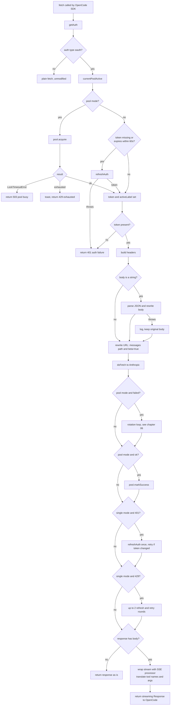
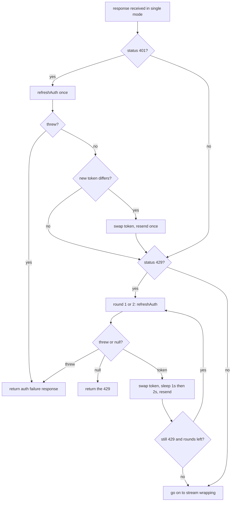
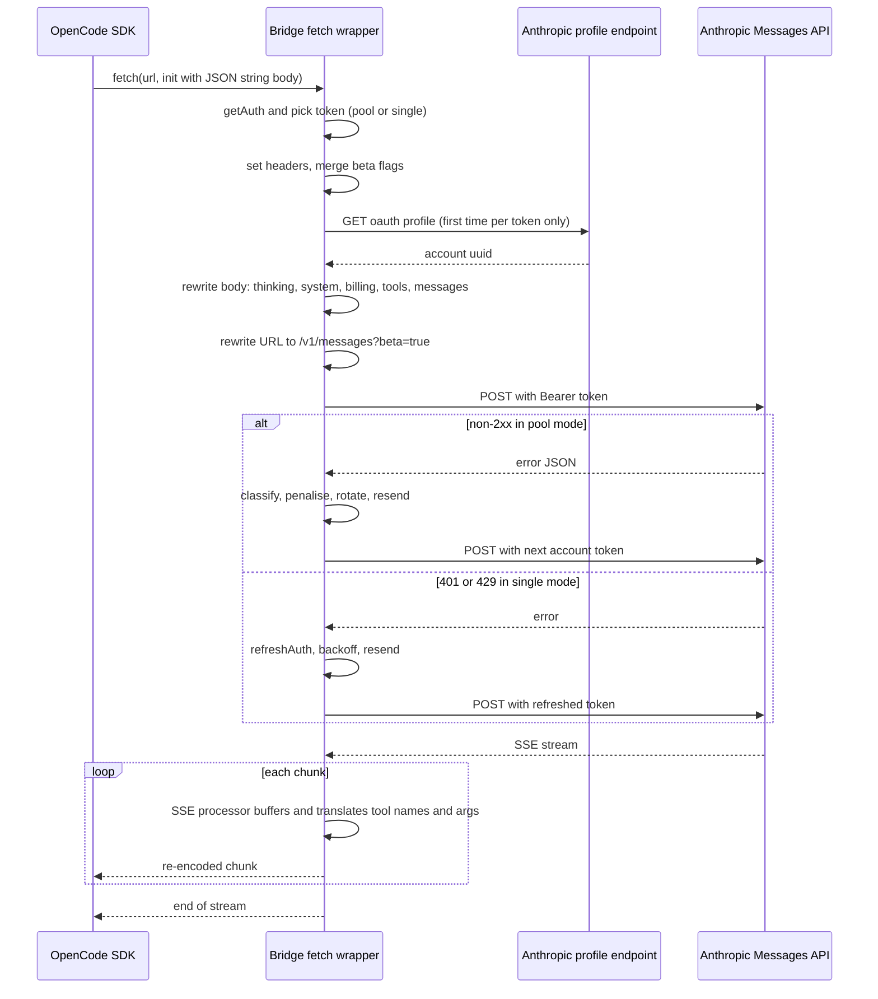

# 03 - The request pipeline

## What this chapter covers

Every time OpenCode wants to talk to Claude, it calls the custom `fetch` function that `auth.loader` returned (see [02-plugin-startup-and-login.md](02-plugin-startup-and-login.md)). This chapter walks through that function (`src/index.ts:897-1410`) one stage at a time: how it gets a token, which HTTP headers it sets and why, how it rewrites the JSON request body so the call looks like it came from the official Claude Code command-line tool, how it rewrites the URL, how it sends the request and reacts to failures, and how it wraps the streaming response on the way back. It also explains every helper that function relies on (`src/index.ts:216-722`). A "before and after" example, a flowchart of the whole wrapper and a sequence diagram are included. Tool-name translation and the streaming (SSE) processor are only summarized here; their details are in [04-tools-and-translation.md](04-tools-and-translation.md), and pool rotation is detailed in [06-rotation-and-failure-handling.md](06-rotation-and-failure-handling.md).

---

## 1. Vocabulary used in this chapter

| Term | Plain-English meaning |
|---|---|
| **Fetch wrapper** | A function with the same shape as the browser/Node `fetch(url, options)`. OpenCode's Anthropic SDK calls it instead of the built-in one, so the plugin sees every request first. |
| **Request body** | The JSON document sent to Anthropic's `/v1/messages` endpoint: model name, conversation, system prompt, tool list, and settings. |
| **System prompt** | Standing instructions placed before the conversation. In Anthropic's API it is the `system` field: either a string or an array of "text blocks". |
| **Beta flag** | A named opt-in sent in the `anthropic-beta` header that enables a not-yet-stable API feature (and allows request fields that feature gates). |
| **Billing header** | A pseudo system-prompt block starting `x-anthropic-billing-header:` that Claude Code puts first in its system prompt. Subscription (OAuth) requests are expected to carry it (`src/index.ts:1043`: "required for OAuth"). |
| **Fingerprint** | A 3-character hex value derived from the user's first message and the CLI version; it forms part of the billing header's `cc_version`. |
| **Thinking / adaptive thinking** | Anthropic's "extended thinking" feature, where the model reasons before answering. "Adaptive" lets the model decide how much to think. |
| **Prompt caching** | Anthropic stores the beginning of a request so a later request with the same beginning is cheaper/faster. "Explicit" caching uses `cache_control` markers; "implicit prefix caching" works on identical leading bytes. |
| **SSE** | Server-Sent Events: the streaming format Anthropic uses, a series of `event:`/`data:` text frames separated by blank lines. |
| **Pool** | Opt-in multi-account rotation ([05-account-pool-overview.md](05-account-pool-overview.md)). |

---

## 2. The whole wrapper at a glance



---

## 3. Helper functions and constants used by the wrapper

These are defined above the plugin factory. They are listed here in the order the wrapper uses them.

### 3.1 `mergeHeaders(target, source)` (`src/index.ts:503-516`)

OpenCode may supply headers in three shapes the web standard allows: a `Headers` object, an array of `[name, value]` pairs, or a plain object. `mergeHeaders` copies any of them onto a `Headers` object with `.set`, skipping `undefined` values and stringifying the rest. Using one normalized `Headers` object lets the wrapper treat names case-insensitively.

### 3.2 `buildBetaFlags(existing)` (`src/index.ts:553-562`)

```ts
const split = (s) => s.split(",").map(trim).filter(Boolean);
const merged = [...split(BETA_FLAGS), ...split(existing)];
const withoutSpecials = merged.filter(b => b !== "claude-code-20250219" && b !== OAUTH_BETA_FLAG);
return [...new Set(["claude-code-20250219", OAUTH_BETA_FLAG, ...withoutSpecials])].join(",");
```

Produces the `anthropic-beta` header value:

1. Start with the bridge's constant list `BETA_FLAGS` (`src/constants.ts:107-109`, taken from a real Claude Code 2.1.178 capture), then the flags OpenCode already set.
2. Remove `claude-code-20250219` and `oauth-2025-04-20` from the middle (so they do not appear twice).
3. Put `claude-code-20250219` **first**, `oauth-2025-04-20` **second**, then everything else, de-duplicated by `Set` (which keeps first-seen order).

Why merge instead of overwrite? The comment: "Dropping caller flags makes the API reject newer body fields they gate." If OpenCode (or its SDK) asked for a beta feature and the bridge dropped that flag, a body field depending on it would be rejected with a 400. Why `claude-code-20250219` first and the OAuth flag second? That matches the order the real CLI sends; the OAuth flag is required to authorize a subscription token at all (`src/constants.ts:111`, "added separately only for OAuth auth").

### 3.3 `deriveModelDisplayName(modelId)` (`src/index.ts:231-238`)

Converts a model id into the human name Claude Code prints in its system prompt. Regex `^claude-([a-z]+)-(\d+)(?:-(\d{1,2}))?(?:-\d{8})?$` (case-insensitive):

| Input | Output |
|---|---|
| `claude-opus-4-7` | `Opus 4.7` |
| `claude-haiku-4-5-20251001` | `Haiku 4.5` |
| `claude-sonnet-5` | `Sonnet 5` |
| `claude-sonnet-5-20260101` | `Sonnet 5` (minor limited to 1-2 digits so an 8-digit date is not read as a minor version) |
| anything non-matching | the raw id, unchanged |

The doc comment's reason for the fallback: "future naming changes are surfaced truthfully instead of silently wrong." The family word is capitalized, the rest lower-cased.

### 3.4 `rewriteSystemBlocksForModel(blocks, modelId)` (`src/index.ts:246-264`)

The captured Claude Code system prompt (sections 3.13 and 6.11) contains a sentence of the form "You are powered by the model named Sonnet 4.6. The exact model ID is claude-sonnet-4-6." The captured file reflects whichever model was in use when it was recorded. The comment explains the problem: "Without this, every request (regardless of selected model) gets a system prompt claiming 'You are powered by the model named Sonnet 4.6', which can bias behavior."

The function returns `blocks` unchanged if `modelId` is falsy. Otherwise it maps over text blocks (non-text blocks and blocks without a string `text` are returned as is) and replaces, globally, the regex `You are powered by the model named [^\n]+? The exact model ID is [a-z0-9.-]+\.` with the sentence filled in with the **current** display name and id. Only that one sentence is rewritten; other model references in the cached text are untouched. A new object is returned for each text block (`{ ...block, text }`) so the cached copy is never mutated.

### 3.5 `ADAPTIVE_THINKING_MODELS` and `supportsAdaptiveThinking` (`src/index.ts:266-279`)

```ts
const ADAPTIVE_THINKING_MODELS = ["claude-opus-4","claude-sonnet-4-6","claude-opus-5","claude-sonnet-5","claude-fable-5"];
supportsAdaptiveThinking(model) = typeof model === "string" && list.some(m => model.includes(m))
```

An explicit allowlist (substring match). The comment: "haiku and older sonnet variants (e.g. claude-sonnet-4-5) reject the field entirely. Opus 4.x and Sonnet 4.6 are confirmed; Fable 5.x, Opus 5.x and Sonnet 5 are documented as adaptive-thinking models." So "confirmed" for 4.x and "documented" for 5.x. Because of substring matching, `claude-opus-4` matches every Opus 4 variant, `claude-sonnet-5` also matches `claude-sonnet-5-5`, and a model id that merely contains one of these strings anywhere (for example an OpenRouter id like `anthropic/claude-opus-4-6`) also matches. It must be a string; anything else is false.

### 3.6 `EFFORTS_ABOVE_HIGH` and `normalizeThinkingForSonnet55(parsed)` (`src/index.ts:281-297`)

Sonnet 5.5 has quirks (comment): it "rejects `thinking:{type:"disabled"}` with a 400; `between_tools` is its lowest thinking setting, accepts no other thinking field, and 400s at xhigh/max effort." The function mutates the parsed body:

1. Return immediately unless `model` is a string starting with `claude-sonnet-5-5`.
2. If `thinking.type === "disabled"`, replace `thinking` with `{ type: "between_tools" }`.
3. If `thinking.type` is not `between_tools` after that, return (other thinking types are left alone).
4. Otherwise reset `thinking` to exactly `{ type: "between_tools" }` (dropping any extra fields such as a token budget), and if `output_config.effort` is `xhigh` or `max` (the `EFFORTS_ABOVE_HIGH` set), lower it to `"high"`.

Note that the function does nothing when `thinking` is absent. For Sonnet 5.5 the earlier adaptive step (section 6.2) will already have added `{ type: "adaptive" }`, which is not `disabled` or `between_tools`, so adaptive is left as is and the effort cap is not applied in that case. (This follows from the code order; whether the API accepts `adaptive` plus `xhigh` on Sonnet 5.5 is not something the code establishes.)

### 3.7 `stripAssistantPrefillForClaude(messages)` (`src/index.ts:590-599`)

An "assistant prefill" is a trailing assistant message the client pre-writes so the model continues from it. Newer Claude models reject conversations that end with an assistant message. The function removes the last message only if all of these hold: there is a last message; its role is `assistant`; its content is a plain string; and that string, trimmed, equals exactly `"Continue with your tasks."`. Anything else is returned untouched. This is a narrowly targeted fix for one specific placeholder OpenCode appends; it does not remove prefills in general. The code gives no comment naming the source of that string.

### 3.8 `stripSystemCacheControl(system)` (`src/index.ts:299-307`)

Returns the system blocks with any `cache_control` key removed. See section 6.12 for why.

### 3.9 `fetchOAuthProfile(accessToken)` and `oauthProfileCache` (`src/index.ts:364`, `695-721`)

Claude Code sends `metadata.user_id`, a JSON string containing the account's UUID. To learn the UUID the bridge calls `GET PROFILE_URL` (`https://api.anthropic.com/api/oauth/profile`) with the bearer token, content type, claude-cli user agent and the OAuth beta flag. Details:

- Uses `globalThis.fetch` (not the wrapper, which would loop).
- Results are cached **as promises** in a `Map` keyed by access token. Caching the promise (not the value) means concurrent requests that arrive while the first lookup is in flight share one network call. `cached` is returned if present.
- Failure (non-OK status, network error, JSON error) yields `null`. Right after the promise is stored, a `.then` removes the entry if the result was `null`, so failures are not cached permanently and the next request tries again; successful profiles stay cached for the life of the process (one per distinct token, so the map grows by one small entry per token rotation).
- The profile call has no timeout of its own, and the wrapper `await`s it, so a hanging profile endpoint would delay the chat request. (Observation from the code; no timeout or abort signal is passed.)

### 3.10 `getStableDeviceId()` and the session id

Covered in chapter 02 (sections 3.2-3.3). The wrapper receives both through closure (`sessionId`, `deviceId`).

### 3.11 `buildBillingHeader(sessionId, cache, dynamicFingerprint?)` (`src/index.ts:677-693`)

Returns one line of text:

```
x-anthropic-billing-header: cc_version=<version>.<suffix>; cc_entrypoint=<entrypoint>; cch=<cch>;
```

| Field | Value and precedence |
|---|---|
| `cch` | `BILLING_CCH` (env `ANTHROPIC_BILLING_CCH`) if non-empty; otherwise first 5 hex chars of `sha256(sessionId)`. The code treats `cch` as an opaque token; it does not claim to reproduce the real CLI's algorithm. |
| `suffix` | In this order: (1) `dynamicFingerprint` (computed per request from the first user message), (2) `cache.billing.ccVersionSuffix` from the captured prompt file, (3) `CLI_BUILD_ID` (`"835"`). The comment: "Prefer dynamic fingerprint (computed per-request from first user message) over static cached value, matching Claude Code's actual behavior." |
| `ccVersion` | `getCliVersion() + "." + suffix`. It **ignores** the captured `ccVersion` on purpose: "Deliberately ignores the capture: the API gates model access on this." (so a stale capture of an old version cannot lock out new models). |
| `cc_entrypoint` | `cache.billing.ccEntrypoint` if captured, else `ENTRYPOINT` (`sdk-cli` by default). |

### 3.12 `computeFingerprint` and `extractFirstUserMessageText` (`src/claude-tools.ts:38-67`)

(Imported from `claude-tools.ts`; mentioned here because the billing header depends on them.)

- `extractFirstUserMessageText(messages)` finds the first message whose role is `user`; returns its content if it is a string, or the `text` of the first `text` block if it is an array; otherwise `""`.
- `computeFingerprint(text, version = getCliVersion())` takes the characters at positions 4, 7 and 20 of the text (using `"0"` for any position past the end), builds `SALT + those three characters + version`, hashes with SHA-256 and keeps the first 3 hex characters. The salt is a fixed constant in the source.

### 3.13 `currentPromptCache()` and `readCachedClaudePromptCache()` (`src/index.ts:638-663`)

The optional captured Claude Code system prompt lives in a JSON file (`SYSTEM_PROMPT_CACHE_PATH`; produced by the validation scripts, see [08-scripts-validation-and-qa.md](08-scripts-validation-and-qa.md)). Its shape is `{ system: [{type, text, cache_control?}], billing?: { ccVersion?, ccVersionSuffix?, ccEntrypoint? } }`.

- `readCachedClaudePromptCache()` reads and parses the file; returns `null` if it is missing, malformed, or `system` is not a non-empty array.
- `currentPromptCache()` adds **mtime-based reloading**. It `stat`s the file on each call, and only re-reads when the modification time differs from the last seen value (`promptCacheMtime`, initially `-1`). If the file is missing, mtime is `0` and the cached value becomes `null`. The comment: "Re-read when the file changes, so a fresh capture applies without a restart." The cost per request is one cheap `stat` rather than a full read and parse.

### 3.14 System-block normalization helpers

- `deduplicatePrefix(text)` (`src/index.ts:565-571`): while the text contains the prefix sentence twice in a row (`PREFIX\n\nPREFIX`), collapse it to one. Needed because several layers may each prepend the sentence (the system.transform hook from chapter 02, OpenCode's own prompt, and a prior capture).
- `normalizeSystemBlocks(system)` (`src/index.ts:601-636`): used only when no captured prompt exists. See section 6.11.
- `maybeUnquoteText(text)` (`src/index.ts:578-588`): if a text block, trimmed, begins with a double quote, try `JSON.parse`; if the result is a string, return that string; any other result or parse failure returns the text unchanged. This undoes accidental double JSON-encoding of text blocks (the text arrives as `"\"hello\""`). Parse failures are expected and not logged.
- `mapOutboundToolName(name)` (`src/index.ts:573-576`): look up `OUTBOUND_TOOL_NAME_MAP`, defaulting to the name itself.

### 3.15 Tool helpers

- `shouldInjectClaudeTools({model, requestUrl, tools})` (`src/index.ts:309-318`): true only if `shouldUseClaudeToolSchemas` (in `claude-tools.ts:961-976`) approves the target **and** `tools` is a non-empty array. `shouldUseClaudeToolSchemas` returns true for any URL containing `api.anthropic.com`; for OpenRouter URLs only if the model starts with `anthropic/` or contains `claude`; otherwise if the model starts with `claude-` or `anthropic/` or contains `claude`.
- `getClaudeToolsForActiveOpenCodeTools(tools)` (`src/index.ts:327-362`): builds the replacement tool list. Detailed in chapter 04; the summary is in section 6.13.

### 3.16 Other small helpers

- `abortableSleep(ms, signal)` (`src/index.ts:518-531`): a `setTimeout` promise that rejects immediately if the caller's `AbortSignal` is already aborted or becomes aborted while waiting (clearing the timer), so a user pressing Esc in OpenCode cancels a backoff instead of waiting it out.
- `recordPoolState(what, action)` (`src/index.ts:535-541`): runs a pool bookkeeping action and logs-and-continues on any error. The comment: bookkeeping "waits on a cross-process lock that a slow token refresh elsewhere can hold past the 10s timeout; that must never fail a request."
- `failureSignature(status, bodyText)` (`src/index.ts:543-551`): a string identifying a failure: `status|error.type|error.message` when the body is Anthropic-style JSON, else `status|first 500 chars of the trimmed body`. Used by the pool loop to decide whether two accounts failed "identically" ([06](06-rotation-and-failure-handling.md)).

---

## 4. Stage 1: Getting an access token (`src/index.ts:897-940`)

Numbered workflow:

1. `const auth = await getAuth();` fresh read of OpenCode's auth store (every request).
2. If `auth.type !== "oauth"`, hand the request to the real `fetch(input, init)` unchanged. Nothing is rewritten.
3. `accessToken = auth.access || null`; `activeLabel = null` (will name the pool account serving this request so a later 429 is blamed on the right account).
4. `usePool = await currentPoolActive()` (fast path almost always; see chapter 02, section 3.9).
5. **Pool mode** (`src/index.ts:907-927`):
   1. `pool.acquire()`. On `LockTimeoutError`, log and return `buildPoolBusyResponse()`: a 503 `overloaded_error` with `retry-after: 5`, which clients retry automatically (another process is holding the cross-process lock while refreshing a token). Any other error is rethrown.
   2. If the result's `kind` is `"exhausted"`: build a message with `pool.describeExhaustion`, log it, show a deduplicated warning toast keyed `exhausted:<earliestReset>` (so a changing countdown does not defeat dedupe), and return `buildPoolExhaustedResponse(...)`, a 429 `rate_limit_error` with a `retry-after` computed from the earliest account reset. It is 429 rather than 401 so OpenCode does not prompt a re-login (comment in `src/pool/bridge.ts`).
   3. Otherwise record `activeLabel = acquired.label` and `accessToken = acquired.accessToken`.
6. **Single mode** (`src/index.ts:928-936`): if there is no token, or no expiry, or `auth.expires < now + 60_000` (a minute of safety margin), call `refreshAuth(auth, client)` (chapter 02, section 11). On throw, log `OAuth refresh failed: <detail>` and return `buildAuthFailureResponse(detail)`.
7. If after all that `accessToken` is still falsy, return `buildAuthFailureResponse("No usable OAuth access token is available.")`.

Note on single mode: a token that is fresh per its `expires` field is used as is, even if the server has since revoked it; that case is handled later by the 401 retry (section 8).

---

## 5. Stage 2: Headers (`src/index.ts:942-960`)

```ts
const headers = new Headers();
if (input instanceof Request) mergeHeaders(headers, input.headers);
if (init?.headers) mergeHeaders(headers, init.headers);
```

Headers are collected first from a `Request` object (if OpenCode passed one as `input`), then from `init.headers`, with later values overriding earlier ones. Then the bridge sets or removes the following. "Overwrite" means `headers.set`, replacing any existing value.

| # | Header | Action | Value | Why |
|---|---|---|---|---|
| 1 | `authorization` | set | `Bearer <accessToken>` | The real credential. OAuth subscription tokens are sent as bearer tokens. |
| 2 | `x-api-key` | **delete** | | The SDK built it from the `"oauth-placeholder"` environment key (chapter 02, section 6.6). Sending a bogus API key alongside would confuse or fail authentication. |
| 3 | `x-session-affinity` | **delete** | | An OpenCode-specific header, not part of Claude Code's traffic. (The code gives no comment; the purpose is inferred from the pattern of removing non-Claude-Code headers.) |
| 4 | `x-session-id` | **delete** | | Same: OpenCode's own session header; replaced by `x-claude-code-session-id` below. (Inferred, no code comment.) |
| 5 | `accept` | set only if absent | `application/json` | A default when the caller set none. |
| 6 | `user-agent` | overwrite | `getUserAgent()` = `claude-cli/<version> (external, <entrypoint>)` | Identify as the Claude CLI; version is kept fresh by the 10-minute background check (chapter 02, section 12). |
| 7 | `x-app` | overwrite | `cli` | Claude Code sends `x-app: cli`. |
| 8 | `x-claude-code-session-id` | overwrite | the plugin's `sessionId` UUID | Per-process session id Claude Code sends. |
| 9 | `anthropic-version` | overwrite | `2023-06-01` | Required API version. |
| 10 | `anthropic-dangerous-direct-browser-access` | overwrite | `true` | An Anthropic SDK header that explicitly allows direct use of credentials from non-server contexts; the Claude Code SDK sends it. |
| 11 | `x-stainless-lang`, `-package-version`, `-os`, `-arch`, `-runtime`, `-runtime-version` | overwrite (loop over `STAINLESS_HEADERS`) | `js`, `0.94.0`, `MacOS`/`Linux`/`Windows`, `arm64`/other, `node`, `process.version` | Telemetry headers the Stainless-generated Anthropic JS SDK embedded in Claude Code sends. Mirroring them completes the CLI imitation. |
| 12 | `x-stainless-retry-count` | set only if absent | `0` | Same SDK telemetry; leaves a value if the SDK already set one. |
| 13 | `x-stainless-timeout` | set only if absent | `600` | Same: the SDK's request timeout in seconds. |
| 14 | `anthropic-beta` | overwrite | `buildBetaFlags(existing)` | See section 3.2. |

README.md lists `x-claude-code-version` among the rewritten headers; no such header is set anywhere in `src/index.ts`. The version is communicated only through the user agent and the billing header.

Other headers OpenCode set (for example `content-type`) are passed through untouched.

---

## 6. Stage 3: Body rewrite (`src/index.ts:962-1124`)

### 6.0 Entry conditions and the `userIdFor` helper

`userIdFor(token)` (`src/index.ts:963-971`) builds the `metadata.user_id` string:

```ts
const profile = await fetchOAuthProfile(token);
if (!profile?.account?.uuid) return undefined;
return JSON.stringify({ device_id: deviceId, account_uuid: profile.account.uuid, session_id: sessionId });
```

So `metadata.user_id` is itself a JSON **string** containing three ids: the hashed device id, the account UUID from the profile, and the session id. If the profile lookup fails the function returns `undefined` and no `user_id` is set.

`ownsUserId` (`src/index.ts:972`) records whether the **bridge** (rather than the caller) supplied `metadata.user_id`. It matters for pool rotation: if the bridge generated it for account A, then after rotating to account B it must be regenerated for B (section 8.2).

The rewrite only runs if `init.body` exists and is a **string** (`src/index.ts:974-975`). A `Uint8Array`, `FormData`, or stream body is not rewritten. Also, the body comes only from `init.body`: if OpenCode passes a `Request` object with a body and no `init.body`, the body is not read and `doFetch` later sends `body: undefined` with `method: init?.method || "POST"` (`src/index.ts:1149-1154`). Presumably the SDK normally passes `(url, init)` with a string body, so this is a limitation rather than a common case.

The rewrite is inside `try { JSON.parse ... } catch`; see section 6.16 for the failure fallback.

### 6.1 Parse and compute `requestUrl` string (`src/index.ts:977-987`)

`parsed = JSON.parse(body)`. A local string `requestUrl` is derived from `input` (string, `URL`, or `Request.url`) via `new URL(...)`; failures leave it `""`. This copy is used only for the tool-schema decision (section 6.13). A second, separate `requestUrl` (a `URL` object) is built later for URL rewriting (section 7); the two do not interfere because the first lives inside the `try` block.

### 6.2 Adaptive thinking default (`src/index.ts:989-992`)

```ts
const supportsThinking = supportsAdaptiveThinking(parsed.model);
if (!parsed.thinking && supportsThinking) parsed.thinking = { type: "adaptive" };
```

If the model is on the allowlist (section 3.5) and the caller did not specify `thinking`, add `{ type: "adaptive" }`. This mimics Claude Code, which always asks these models to think adaptively. Models off the allowlist never get the field; "haiku and older sonnet variants ... reject the field entirely".

### 6.3 The temperature rule (`src/index.ts:994-1002`)

```ts
const thinkingType = parsed.thinking?.type;
if ((thinkingType === "enabled" || thinkingType === "adaptive") && parsed.temperature !== undefined && parsed.temperature !== 1) {
  parsed.temperature = 1;
}
```

The code comment: "Anthropic requires temperature=1 when thinking is enabled/adaptive." (**Temperature** is the randomness setting; with thinking on, the API only accepts 1.) The rule applies only when `temperature` was actually present and not already 1; an absent temperature is left absent. This covers both a caller-supplied `thinking` and the default added in 6.2.

### 6.4 System string to array (`src/index.ts:1004-1007`)

```ts
if (typeof parsed.system === "string") parsed.system = [{ type: "text", text: parsed.system }];
if (!parsed.system) parsed.system = [];
```

The rest of the pipeline operates on an array of blocks. A string becomes one text block, and a missing/falsy `system` becomes `[]`. (If `system` were something else truthy and non-array, later `.some`/`.unshift` calls would throw and the rewrite-failure fallback in 6.16 would trigger.)

### 6.5 Assistant prefill (`src/index.ts:1008-1010`)

If `messages` is an array, `parsed.messages = stripAssistantPrefillForClaude(parsed.messages)` (section 3.7).

### 6.6 `context_management` and `output_config` (`src/index.ts:1011-1023`)

```ts
if (supportsThinking) {
  if (!parsed.context_management) parsed.context_management = { edits: [{ type: CLEAR_THINKING_TYPE, keep: "all" }] };
  if (!parsed.output_config) parsed.output_config = { effort: DEFAULT_EFFORT };
}
```

For allowlisted models only, add (if absent):

- `context_management`: with one edit of type `clear_thinking_20251015` (`CLEAR_THINKING_TYPE`) and `keep: "all"`. This is Anthropic's "context editing" feature (enabled by the `context-management-2025-06-27` beta flag). Here it is configured to keep all thinking blocks, mirroring Claude Code's default request.
- `output_config.effort`: the default effort `medium` (`DEFAULT_EFFORT`), matching the `effort-2025-11-24` beta.

**Why only for thinking-capable models:** the comment: "context_management and output_config.effort are only supported by thinking-capable models. Sending them to haiku (used for title generation) produces a 400." OpenCode uses a small, cheap model (Haiku) to generate session titles; if the bridge added these fields to every request, title generation would break.

### 6.7 Sonnet 5.5 normalization (`src/index.ts:1024`)

`normalizeThinkingForSonnet55(parsed)` runs **after** the defaults above so that any `effort` value (caller's or default) is capped (section 3.6).

### 6.8 `metadata.user_id` (`src/index.ts:1026-1031`)

```ts
if (!parsed.metadata) parsed.metadata = {};
if (!parsed.metadata.user_id) {
  ownsUserId = true;
  const userId = await userIdFor(accessToken);
  if (userId) parsed.metadata.user_id = userId;
}
```

An empty `metadata` object is always ensured. If the caller did not provide `user_id`, the bridge claims ownership and fills it from the profile (section 3.9 explains the promise cache). If the profile call fails, `metadata` stays without a `user_id`, and `ownsUserId` stays true so that a later rotation tries again.

### 6.9 Dynamic fingerprint (`src/index.ts:1033-1041`)

If `messages` is an array, extract the first user message's text (section 3.12) and, if non-empty, compute `dynamicFingerprint = computeFingerprint(text)`. This is computed from the **already prefill-stripped** messages and before tool/text clean-up in 6.14. If there is no text, the fingerprint stays `undefined` and the billing header falls back to the cached suffix or the build id.

### 6.10 Billing header (`src/index.ts:1043-1058`)

```ts
const hasBilling = parsed.system.some(s => s.text?.startsWith("x-anthropic-billing-header:"));
const cachedClaudePromptCache = currentPromptCache();
const cachedClaudeSystem = cachedClaudePromptCache?.system || null;
let billingHeader = buildBillingHeader(sessionId, cachedClaudePromptCache, dynamicFingerprint);
if (!hasBilling) parsed.system.unshift({ type: "text", text: billingHeader });
else billingHeader = parsed.system[0]?.text || billingHeader;
```

1. Detect whether any system block already starts with the billing marker.
2. Load (or reuse) the captured prompt (section 3.13).
3. Build the billing line (section 3.11).
4. If no billing block exists, insert one as the **first** system block. The comment calls it "required for OAuth".
5. If one already exists (for example the request was already shaped by another layer), adopt `system[0].text` as the billing header, so the cached-prompt branch below reuses it. This assumes the existing billing block is at index 0; the check is `some` (anywhere) but the adoption reads index 0, so a billing block located elsewhere would make `billingHeader` hold unrelated text (an inconsistency noted in the summary).

### 6.11 Choose the system prompt: cached capture vs. normalization (`src/index.ts:1060-1073`)

**Branch A: a captured prompt exists.**

```ts
const rewritten = rewriteSystemBlocksForModel(cachedClaudeSystem, parsed.model-if-string);
parsed.system = [{ type: "text", text: billingHeader }, ...rewritten];
```

The entire system array is **replaced**: a billing block, followed by the captured real Claude Code system blocks with the model-identity sentence updated (section 3.4). Everything the caller (OpenCode, plus any plugin) had in `system` besides the billing marker is discarded. The README describes this: "The bridge injects this as the system prompt for all requests. OpenCode's default system prompt is sanitized out." One practical consequence (derived from the code, not stated in it): any OpenCode agent instructions or AGENTS.md content carried in the system prompt are not forwarded in this mode. Whether those reach the model by another route (for example as user-message content) is outside this file.

**Branch B: no captured prompt** (`parsed.system` is an array): `parsed.system = normalizeSystemBlocks(parsed.system)`:

1. For each block that is `type: "text"` with non-empty `text`: replace every `OpenCode` with `Claude Code` (case-sensitive), then every `opencode` (case-insensitive) with `Claude`, then `deduplicatePrefix`. So "OpenCode" becomes "Claude Code" first; remaining forms (`opencode`, `OPENCODE`, `Opencode`) become "Claude". Purpose: remove telltale references to the third-party client from prompt text that Anthropic can see. (The code states no comment about the motive; this is the evident intent.)
2. Check the first two blocks. If block 0 is a text block starting with `x-anthropic-billing-header:` **and** block 1 is a text block that starts with `CLAUDE_PREFIX` + a blank line, then split block 1 into two blocks: one containing only `CLAUDE_PREFIX`, and one containing the remainder of the text. Everything else is appended unchanged. Result order: billing, prefix-only block, rest-of-prompt block, then remaining blocks. This mirrors Claude Code's layout, where the identity sentence sits in its own block directly after the billing block.
3. If those conditions do not hold, return the normalized array without splitting.

### 6.12 Strip `cache_control` from system blocks (`src/index.ts:1074`)

`parsed.system = stripSystemCacheControl(parsed.system)` removes any `cache_control` field from every system block, in both branches. Why: the comment in `getClaudeToolsForActiveOpenCodeTools` (`src/index.ts:351-353`) explains that ordering is kept deterministic "to keep the serialized prefix byte-stable across turns: the bridge strips explicit cache_control and depends entirely on Anthropic's implicit prefix caching." In other words, the bridge does **not** want explicit cache markers on the system prompt; it relies on the API caching an identical request prefix. That is why every part of the beginning of the request (system blocks, sorted tools) must be byte-identical from turn to turn: any variation would reduce cache hits. (The code states the dependence on implicit caching but does not say why explicit markers were dropped.) Message content `cache_control` is removed separately in 6.15.

### 6.13 Tools and `tool_choice` (`src/index.ts:1076-1083`)

```ts
if (shouldInjectClaudeTools({ model: parsed.model, requestUrl, tools: parsed.tools })) {
  parsed.tools = getClaudeToolsForActiveOpenCodeTools(parsed.tools);
}
delete parsed.tool_choice;
```

- **Gate:** replace the tool list only when the target is Claude-compatible (section 3.15) and tools exist. The comment: "Keep OpenCode's default tool schemas for non-Claude targets. Claude wire schemas are only useful for Anthropic-native requests or Claude-family models on Anthropic-compatible routers such as OpenRouter."
- **Replacement:** each OpenCode tool is mapped through `OUTBOUND_TOOL_NAME_MAP` (for example `bash` to `Bash`, `task` to `Agent`). If the mapped name exists in Claude's captured catalog, that tool's exact Claude schema is used. Tools with no Claude counterpart (plugin/MCP tools such as a `compress` tool) are kept with their own schema, sorted by name, after the Claude ones. The doc comment: "tools without one ... keep their own schema rather than being dropped." Full mechanics: [04-tools-and-translation.md](04-tools-and-translation.md).
- **`tool_choice` is always deleted** (even for non-Claude targets). Claude Code does not send it; the code gives no more specific reason.

### 6.14 Message content clean-up (`src/index.ts:1085-1115`)

For every message whose `content` is an array, for every block:

- `text` blocks: `block.text = maybeUnquoteText(block.text)` (section 3.14) and `delete block.cache_control`. Removing message-level cache markers, like the system ones, leaves caching to the API's implicit prefix mechanism.
- `tool_use` blocks that have a `name`: rename via `mapOutboundToolName`, and if `input` is an object, translate its argument keys from OpenCode style to Claude style with `translateArgsOpencodeToClaude(name, input)` (for example `filePath` to `file_path`; plus special bridging for Agent, AskUserQuestion, Skill, WebFetch and TodoWrite; see chapter 04). This matters because earlier turns of the conversation, stored in OpenCode's format, are replayed to the API on every request; if the history still used OpenCode names, the model would see tools it was never offered.
- `tool_result` blocks need nothing: "tool_result blocks reference tool names via tool_use_id, no name translation needed here."

Note the translation uses the **renamed** `block.name` (Claude name) when calling `translateArgsOpencodeToClaude`.

### 6.15 Serialize (`src/index.ts:1117`)

`body = JSON.stringify(parsed)`.

### 6.16 Rewrite-failure fallback (`src/index.ts:1118-1123`)

Any exception inside the `try` (invalid JSON, a shape the code did not expect, a failure inside translation) is caught. The bridge sets `ownsUserId = false` (nothing it created will be sent), logs `request rewrite failed; sending the body unmodified: <message>`, and carries on. Because `body` is only assigned at the very end (`body = JSON.stringify(parsed)`), the original `init.body` is still in `body`, so the **original** request is sent. Note that the headers have already been rewritten, so such a request goes out with Claude-style headers but OpenCode's original body (no billing header and so on). Anthropic may reject it; the design chooses "try anyway" over "fail the chat".

---

## 7. Stage 4: URL rewrite (`src/index.ts:1126-1143`)

```ts
requestUrl = new URL(input as string | URL | Request.url);   // null if unparsable
if (pathname === "/messages") pathname = "/v1/messages";
if (pathname === "/v1/messages" && !searchParams.has("beta")) searchParams.set("beta", "true");
const finalUrl = requestUrl?.toString() ?? (input instanceof Request ? input.url : String(input));
```

1. Normalize the URL input into a `URL` object (or `null` if it is not a valid absolute URL).
2. If the path is exactly `/messages`, change it to `/v1/messages`. Some OpenCode configurations use a base URL without the `/v1` prefix.
3. For `/v1/messages`, add `?beta=true` unless a `beta` parameter is already present. Claude Code calls the "beta" version of the Messages endpoint (matching the beta headers). Note that only these exact paths are touched, so other endpoints (for example `/v1/messages/count_tokens`) are not modified.
4. `finalUrl` is the rewritten URL as a string, or, if URL parsing failed, the original value.

---

## 8. Stage 5: Sending the request and handling failures (`src/index.ts:1145-1357`)

### 8.1 Send

```ts
const outHeaders = {}; headers.forEach((v, k) => outHeaders[k] = v);
const doFetch = () => globalThis.fetch(finalUrl, { method: init?.method || "POST", body, headers: outHeaders, signal: init?.signal });
let response = await doFetch();
```

- The headers are flattened to a plain object (`outHeaders`). It is a mutable object so retry code can swap just the `authorization` header.
- `globalThis.fetch` is the runtime's real fetch (the wrapper's own name is not used, avoiding recursion).
- `signal: init?.signal` passes OpenCode's abort signal so cancelling a chat aborts the HTTP request.
- `doFetch` is a closure over `body`, `outHeaders` and `finalUrl`, so reassigning them before calling `doFetch()` again changes the retry.

### 8.2 Pool-mode failure handling (summary)

If `usePool && activeLabel && !response.ok` (`src/index.ts:1166`), the bridge enters a loop that reads the (small) error body, asks `pool.classifyResponse` what to do, and then returns the response unchanged (`PASS_THROUGH`), retries the same account after a backoff (`RETRY_SAME`), or penalizes/rotates to another account and re-sends (`ROTATE_COOLDOWN` / `ROTATE_DISABLE`). Key points to know here:

- It runs **before** the body is read as a stream, because rotation is only safe before any streaming has started: "a second stream's message ids and content-block indices cannot be spliced into the first."
- Only non-2xx bodies are consumed; they are re-created verbatim (minus `content-encoding` and `content-length`, which would no longer describe the decoded text) before being returned.
- 401/403 penalties are deferred until another account succeeds with the same request, and two accounts failing with an identical signature means "the request is at fault", so nobody is penalized.
- The number of rotations is capped by the number of enrolled accounts. On rotation the bridge swaps the `authorization` header and, if it supplied `metadata.user_id` itself (`ownsUserId`), regenerates it for the new account's profile.
- Exhaustion returns the 429 pool-exhausted response.

All of this is explained step by step in [06-rotation-and-failure-handling.md](06-rotation-and-failure-handling.md). After the loop (or if no failure), `if (usePool && activeLabel && response.ok)` calls `pool.markSuccess(label)` through `recordPoolState` (`src/index.ts:1310-1313`), so a failure to record never fails the request.

### 8.3 Single-account 401: refresh once (`src/index.ts:1315-1331`)

```ts
if (!usePool && response.status === 401) {
  freshToken = await refreshAuth(auth, client);        // on throw: cancel body, return 401 auth failure
  if (freshToken && freshToken !== accessToken) {
    await response.body?.cancel();
    outHeaders["authorization"] = `Bearer ${freshToken}`;
    response = await doFetch();
  }
}
```

A 401 means the server rejected the token (for example it was revoked or expired earlier than `expires` claimed). The bridge runs the three-layer refresh once. If refresh **throws**, it cancels the unread response body (freeing the connection) and returns the friendly `buildAuthFailureResponse`. If it returns a token that **differs** from the one that just failed, it cancels the first response, swaps in the new token and re-sends once. If the token is the same (for example the CLI keychain still holds the very token that was rejected), nothing is retried and the original 401 flows onward to the caller. Only one retry is made.

### 8.4 Single-account 429: refresh and retry, up to twice (`src/index.ts:1333-1357`)

The comment: "Legacy single-account path: refresh the token and retry, on the assumption that rate limits are per-access-token." For `retry = 0, 1`:

1. Log `429 rate limited (attempt n/2), refreshing token...`.
2. `refreshAuth`. On throw: return the auth-failure response. If it returns `null`: log "Token refresh failed, returning 429" and `break` (the original 429 is returned).
3. Put the new token in `outHeaders`.
4. `abortableSleep(1000 * (retry + 1))`: 1 s before the first retry, 2 s before the second, aborted early if the user cancels.
5. Cancel the old response body, `doFetch()` again. If the status is no longer 429, stop; otherwise loop.

After two rounds, whatever response is current (possibly still a 429) is returned. Observations from the code: if the CLI keychain still holds the same valid token, `refreshAuth` returns it again (layer 1) and the "retry" resends with the same token after a delay; if layer 2 or 3 runs, a refresh token is consumed on each attempt. Also the old response body is cancelled only after the sleep, so the 429 connection stays open during the backoff.



---

## 9. Stage 6: Wrapping the response stream (`src/index.ts:1359-1409`)

```ts
if (!response.body) return response;
const reader = response.body.getReader();
const processor = createSseProcessor({ inboundToolNameMap: INBOUND_TOOL_NAME_MAP, translateToolArgs: translateToolArgsJsonString, debug: ... });
return new Response(new ReadableStream({ start(controller) { ...read loop... }, cancel(reason) { return reader.cancel(reason); } }), { status, statusText, headers: response.headers });
```

1. A response with no body (such as some HEAD-like or empty replies) is returned directly.
2. Otherwise the bridge reads the byte stream, decodes it to text with a streaming `TextDecoder` (`{ stream: true }` so multi-byte characters split across chunks are handled), hands each text chunk to `processor.feedChunk(...)`, and enqueues whatever the processor returns (re-encoded to bytes). At the end of the stream it enqueues `processor.flush()` (any buffered tail) and closes. On a read error it errors the new stream.
3. `cancel(reason)` forwards cancellation to the original reader so that when OpenCode aborts, the HTTP connection is released.
4. The new `Response` carries the original `status`, `statusText` and `headers`.

What the processor does (summary only; see [04-tools-and-translation.md](04-tools-and-translation.md)): it splits the stream into SSE events on blank-line boundaries, buffers the fragmentary tool-argument JSON (`input_json_delta`) for each tool call, and when the tool call finishes, translates the tool name (`Bash` to `bash`) and argument keys (`file_path` to `filePath`) back into OpenCode's vocabulary. Buffering whole events avoids corruption when a key such as `file_` and `path` arrives split across two network chunks.

**Why `start()` with an async loop instead of `pull()`?** The code comment (`src/index.ts:1381-1385`): "Bun's ReadableStream doesn't reliably re-invoke pull() when the handler resolves without enqueuing (which happens while we're buffering input_json_delta fragments), so pull() can stall the stream." With `pull()`, the runtime calls the function whenever the consumer wants more data; if one call produces no output (because the processor is holding data back), Bun may not call it again and the stream hangs. A self-driven loop in `start()` does not depend on that re-invocation. The trade-off, not discussed in the code: the loop reads as fast as the network delivers and enqueues without waiting for consumer demand (no back-pressure).

Both successful and failed responses reach this point in single-account mode (for example a 400 JSON error body passes through the same processor; how the processor treats non-SSE text is a chapter 04 topic). The headers object is passed through as is, including any `content-encoding` the server sent; the pool error path, by contrast, strips `content-encoding` and `content-length` after decoding. Whether that matters downstream depends on the host runtime and is not established by the code.

---

## 10. Sequence diagram: one request end to end



---

## 11. Worked example: before and after

All secrets are placeholders. The "before" is what OpenCode's Anthropic SDK hands to the wrapper (representative, trimmed). The "after" is what the bridge sends to Anthropic. This example is constructed from the code paths above, not captured from a live run; the actual `<version>` and fingerprint depend on the installed Claude CLI.

### 11.1 Before (from OpenCode)

URL: `https://api.anthropic.com/v1/messages`

Headers:

```http
content-type: application/json
x-api-key: oauth-placeholder
x-session-id: ses_abc123
anthropic-version: 2023-06-01
anthropic-beta: fine-grained-tool-streaming-2025-05-14
user-agent: ai-sdk/anthropic
accept: application/json
```

Body (trimmed):

```json
{
  "model": "claude-opus-4-6",
  "max_tokens": 32000,
  "temperature": 0.7,
  "stream": true,
  "system": "You are a Claude agent, built on Anthropic's Claude Agent SDK.\n\nYou are OpenCode, an interactive CLI tool...",
  "tool_choice": { "type": "auto" },
  "tools": [
    { "name": "read", "description": "Read a file", "input_schema": { "type": "object", "properties": { "filePath": { "type": "string" } } } },
    { "name": "compress", "description": "plugin tool", "input_schema": { "type": "object" } }
  ],
  "messages": [
    { "role": "user", "content": [ { "type": "text", "text": "Please fix the bug in app.ts", "cache_control": { "type": "ephemeral" } } ] },
    { "role": "assistant", "content": [ { "type": "tool_use", "id": "toolu_01", "name": "read", "input": { "filePath": "/repo/app.ts" } } ] },
    { "role": "user", "content": [ { "type": "tool_result", "tool_use_id": "toolu_01", "content": "..." } ] }
  ]
}
```

### 11.2 After (to Anthropic)

URL: `https://api.anthropic.com/v1/messages?beta=true`

Headers (names lower-case, as `Headers` normalizes them):

```http
content-type: application/json
authorization: Bearer <access-token>                 # e.g. sk-ant-oat01-...
accept: application/json
user-agent: claude-cli/<version> (external, sdk-cli)
x-app: cli
x-claude-code-session-id: <random-uuid>
anthropic-version: 2023-06-01
anthropic-dangerous-direct-browser-access: true
x-stainless-lang: js
x-stainless-package-version: 0.94.0
x-stainless-os: MacOS
x-stainless-arch: arm64
x-stainless-runtime: node
x-stainless-runtime-version: v<node-version>
x-stainless-retry-count: 0
x-stainless-timeout: 600
anthropic-beta: claude-code-20250219,oauth-2025-04-20,interleaved-thinking-2025-05-14,thinking-token-count-2026-05-13,context-management-2025-06-27,prompt-caching-scope-2026-01-05,advisor-tool-2026-03-01,effort-2025-11-24,extended-cache-ttl-2025-04-11,fine-grained-tool-streaming-2025-05-14
```

(`x-api-key` and `x-session-id` are gone. `accept` stays as OpenCode set it.)

Body (trimmed), assuming a captured system prompt exists:

```json
{
  "model": "claude-opus-4-6",
  "max_tokens": 32000,
  "temperature": 1,
  "stream": true,
  "thinking": { "type": "adaptive" },
  "context_management": { "edits": [ { "type": "clear_thinking_20251015", "keep": "all" } ] },
  "output_config": { "effort": "medium" },
  "metadata": { "user_id": "{\"device_id\":\"<sha256-hex>\",\"account_uuid\":\"<account-uuid>\",\"session_id\":\"<random-uuid>\"}" },
  "system": [
    { "type": "text", "text": "x-anthropic-billing-header: cc_version=<version>.<3-hex-fingerprint>; cc_entrypoint=sdk-cli; cch=<5-hex>;" },
    { "type": "text", "text": "You are a Claude agent, built on Anthropic's Claude Agent SDK." },
    { "type": "text", "text": "...captured Claude Code instructions... You are powered by the model named Opus 4.6. The exact model ID is claude-opus-4-6. ..." }
  ],
  "tools": [
    { "name": "Read", "description": "<captured Claude Code description>", "input_schema": { "type": "object", "properties": { "file_path": { "type": "string" } }, "required": ["file_path"] } },
    { "name": "compress", "description": "plugin tool", "input_schema": { "type": "object" } }
  ],
  "messages": [
    { "role": "user", "content": [ { "type": "text", "text": "Please fix the bug in app.ts" } ] },
    { "role": "assistant", "content": [ { "type": "tool_use", "id": "toolu_01", "name": "Read", "input": { "file_path": "/repo/app.ts" } } ] },
    { "role": "user", "content": [ { "type": "tool_result", "tool_use_id": "toolu_01", "content": "..." } ] }
  ]
}
```

What changed and which rule did it: `temperature` 0.7 to 1 (6.3); `thinking`, `context_management`, `output_config` added because `claude-opus-4` is on the allowlist (6.2, 6.6); `metadata.user_id` added (6.8); the `system` string became an array with a billing block first, and (with a captured prompt) OpenCode's own text was replaced (6.10-6.11); `cache_control` removed from the user text block (6.14); `tool_choice` dropped (6.13); `read` replaced by Claude's `Read` schema, `compress` kept as a passthrough tool sorted after the Claude ones (6.13); history `tool_use` renamed and its `filePath` argument turned into `file_path` (6.14); `anthropic-beta` merged with OpenCode's own flag appended last (3.2); URL gained `?beta=true` (7).

### 11.3 What comes back (summary)

The SSE stream contains a `tool_use` block named `Read` with `file_path`; the processor presents it to OpenCode as `read` with `filePath`.

---

## 12. Order-of-operations cheat sheet

Order matters because later steps rely on earlier ones:

1. Token chosen (pool or single).
2. Headers set (beta flags merged with OpenCode's).
3. Parse body, then: thinking default, temperature fix, system normalized to array, prefill stripped, `context_management`/`output_config` (allowlisted models), Sonnet 5.5 normalization, `metadata.user_id`.
4. Fingerprint from first user text, billing header (needs fingerprint, session id, CLI version).
5. System replaced (captured prompt) or normalized, then `cache_control` stripped.
6. Tools replaced (gated), `tool_choice` removed.
7. Messages: unquote text, drop cache markers, rename and translate historical `tool_use`.
8. URL rewrite, send, failure handling, stream wrapping.

---

## Key takeaways

- The wrapper imitates Claude Code at every level the server can see: headers, beta flags, system prompt (billing block first, identity sentence next), tool schemas, `metadata.user_id`, thinking settings, and the `?beta=true` URL.
- Fields are added only where the target model supports them: Haiku (title generation) would 400 on `context_management` or `output_config`, so those and the default `thinking` are gated by an explicit model allowlist; Sonnet 5.5 gets special thinking/effort handling.
- `cc_version`'s suffix prefers a per-request fingerprint of the user's first message, then the capture, then a build id; the version part always comes from the live CLI version.
- With a captured Claude Code prompt on disk, the request's own system content is replaced wholesale; without it, text is rewritten (OpenCode becomes Claude Code) and the identity sentence is split into its own block.
- Explicit `cache_control` markers are stripped from system and message text; the design relies on Anthropic's implicit prefix caching, so the leading bytes (system, sorted tools) are kept deterministic.
- Any exception in the rewrite falls back to sending the original body, but with the new headers.
- Pool-mode failures are handled before streaming begins; single-account mode refreshes once on 401 and up to twice on 429.
- The response is re-streamed through an SSE processor that translates tool names and arguments back; it uses `start()` plus an async loop because Bun may not re-invoke `pull()`.

### Observations for the known-issues chapter

- `src/index.ts:1057`: billing adoption reads `system[0]` though the presence check is `some`.
- `src/index.ts:1060-1069`: captured prompt discards all other system content.
- `src/index.ts:1149-1154`: only `init.body` is used; a `Request` body would be dropped.
- `src/index.ts:695-721`: profile fetch has no timeout and is awaited on the request path.
- `src/index.ts:1352-1353`: 429 response body is left open during backoff.
- README lists an `x-claude-code-version` header that the code never sets.

## Related chapters

- [02-plugin-startup-and-login.md](02-plugin-startup-and-login.md) - how this function gets installed and how tokens are obtained
- [04-tools-and-translation.md](04-tools-and-translation.md) - tool schemas, argument translation, SSE processor
- [05-account-pool-overview.md](05-account-pool-overview.md) and [06-rotation-and-failure-handling.md](06-rotation-and-failure-handling.md) - pool mode
- [08-scripts-validation-and-qa.md](08-scripts-validation-and-qa.md) - how the captured system prompt file is produced
- [10-configuration-and-files-reference.md](10-configuration-and-files-reference.md) - env vars and file paths
- [11-known-issues-and-gotchas.md](11-known-issues-and-gotchas.md)
