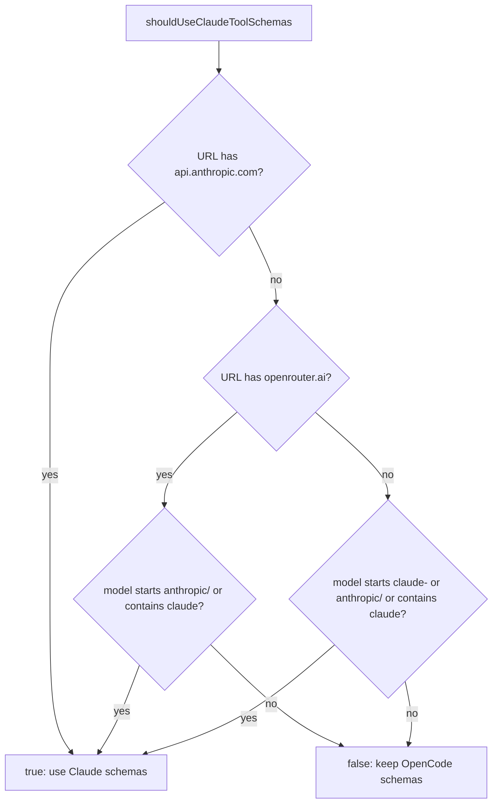
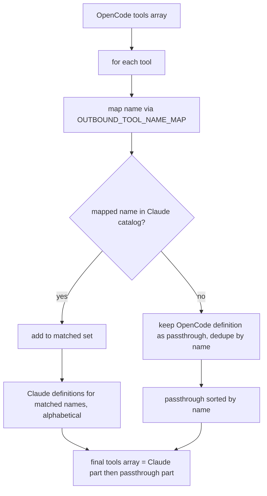
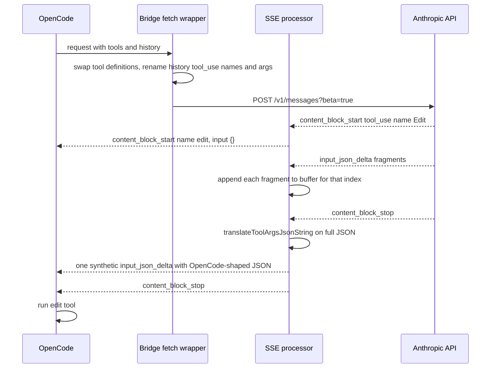
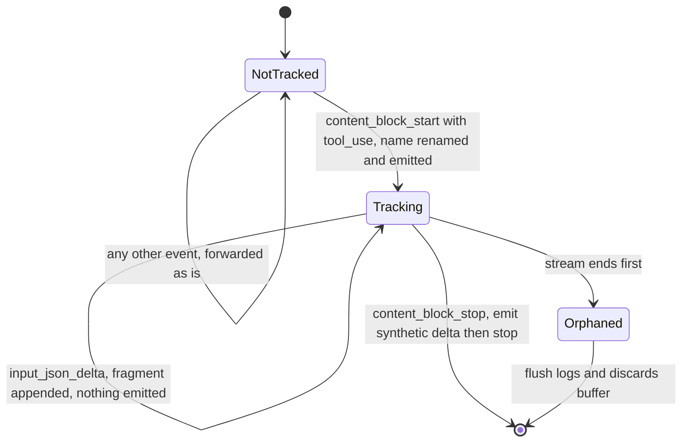

# Chapter 4: Tools and Translation

## What this chapter covers

The model can only "do" things (read a file, run a command, edit code) through **tools**. OpenCode and Claude Code both give the model tools, but they name them differently, describe them differently, and spell their arguments differently (`filePath` vs `file_path`). This chapter explains, line by line, how the bridge reconciles the two worlds:

1. Which tool definitions are sent to the API and why (`src/index.ts:309-362`, `src/claude-tools.ts:946-976`).
2. The wire-captured Claude Code tool catalog (`src/claude-tools.ts:352-944`).
3. How tool *names* are renamed in both directions (`src/index.ts:82-123`).
4. How tool *arguments* are renamed and reshaped in both directions (`src/claude-tools.ts:69-344`).
5. How the streaming response is parsed so arguments can be translated safely even when they arrive in tiny fragments (`src/stream.ts`).
6. The "fingerprint" helper that also lives in `claude-tools.ts` (`src/claude-tools.ts:30-67`).

Line numbers refer to the working tree at the time of writing.

---

## 1. Background: what a "tool" is on the wire

The Anthropic Messages API (the HTTP endpoint `POST /v1/messages` that every Claude client talks to) lets a request carry a `tools` array. Each entry is a **tool definition**:

```json
{
  "name": "Read",
  "description": "Reads a file from the local filesystem...",
  "input_schema": { "type": "object", "properties": { "file_path": { "type": "string" } }, "required": ["file_path"] }
}
```

- `name` is what the model will write when it wants to use the tool.
- `description` is prose instructions the model reads.
- `input_schema` is a JSON Schema (a standard way of describing the shape of a JSON object) that says which arguments exist.

When the model decides to use a tool, its reply contains a **`tool_use` block**: `{ "type": "tool_use", "id": "toolu_…", "name": "Read", "input": { "file_path": "/x" } }`. The client (OpenCode here) runs the tool and sends the result back in the next request as a **`tool_result` block** that references the same `id`. On the next turn, the whole conversation history, including old `tool_use` blocks, is sent again.

So tool names and argument names appear in three places, and the bridge must handle all three:

| Where | Direction | Handled by |
|---|---|---|
| The `tools` array (definitions) | outbound (OpenCode to API) | `getClaudeToolsForActiveOpenCodeTools` (`src/index.ts:327`) |
| Historical `tool_use` blocks inside `messages` | outbound | the loop at `src/index.ts:1089-1115` plus `translateArgsOpencodeToClaude` |
| New `tool_use` blocks streamed back by the model | inbound (API to OpenCode) | the SSE processor (`src/stream.ts`) plus `translateToolArgsJsonString` |

### Why the bridge bothers

The bridge's goal is to make OpenCode's requests look like Claude Code's requests. Claude Code sends its own tool definitions with specific names, descriptions and schemas. If OpenCode's differently-worded definitions were sent instead, the request would look noticeably different from a Claude Code request. So, where an OpenCode tool has a Claude Code equivalent, the bridge swaps in Claude Code's exact definition. The consequence is that the model now *calls* tools using Claude Code's names and argument spellings, so everything coming back has to be translated into what OpenCode's tool executor expects.

---

## 2. The wire-captured Claude Code tool catalog

`src/claude-tools.ts` holds tool definitions captured from real Claude Code traffic. The file header (`src/claude-tools.ts:1-12`) says they were captured from Claude Code 2.1.98 via mitmproxy (a man-in-the-middle HTTPS proxy) and that "only descriptions/schemas from the wire capture are used".

There are two arrays:

- `SHARED_TOOLS` (`src/claude-tools.ts:352`): 10 tools that OpenCode also has.
- `STUB_TOOLS` (`src/claude-tools.ts:676`): 16 tools that exist only in Claude Code.

`getClaudeTools()` (`src/claude-tools.ts:946-950`) returns both arrays merged and sorted alphabetically by name, 26 definitions in total.

### Shared tools (10)

| Claude Code name | Defined at | OpenCode name(s) that map to it | What it does (in short) |
|---|---|---|---|
| `Agent` | `:354` | `task`, `mcp_task` | Launch a sub-agent to do a task |
| `Bash` | `:392` | `bash`, `mcp_bash` | Run a shell command |
| `Edit` | `:424` | `edit`, `mcp_edit` | Exact string replacement in a file |
| `Glob` | `:453` | `glob`, `mcp_glob` | Find files by glob pattern |
| `Grep` | `:473` | `grep`, `mcp_grep` | Search file contents by regex |
| `Read` | `:542` | `read`, `mcp_read` | Read a file |
| `Skill` | `:574` | `skill`, `mcp_skill` | Invoke a named skill |
| `TodoWrite` | `:594` | `todowrite`, `mcp_todowrite` | Maintain a todo list |
| `WebFetch` | `:629` | `webfetch`, `mcp_webfetch` | Fetch a URL |
| `Write` | `:650` | `write`, `mcp_write` | Write a whole file |

### Claude-only tools (16)

`AskUserQuestion` (`:678`), `CronCreate` (`:723`), `CronDelete` (`:739`), `CronList` (`:752`), `EnterPlanMode` (`:762`), `EnterWorktree` (`:772`), `ExitPlanMode` (`:784`), `ExitWorktree` (`:808`), `Monitor` (`:822`), `NotebookEdit` (`:838`), `PushNotification` (`:855`), `RemoteTrigger` (`:869`), `ScheduleWakeup` (`:884`), `TaskOutput` (`:899`), `TaskStop` (`:914`), `WebSearch` (`:927`).

Three of these *do* have an OpenCode counterpart through the name map in `src/index.ts:82-107`:

| OpenCode name | Claude Code name |
|---|---|
| `question`, `mcp_question` | `AskUserQuestion` |
| `plan_enter` | `EnterPlanMode` |
| `plan_exit` | `ExitPlanMode` |

The other 13 have no OpenCode counterpart at all.

### Important: the stubs are NOT all sent

The README (`README.md:69-79`) says the bridge adds all 16 Claude-only "stub" tools and sends all 26 tools sorted alphabetically. **That is no longer what the code does.** Since commit `8256d63` ("stop dropping tools that have no Claude counterpart"), the outbound list contains only:

- Claude definitions for tools that OpenCode actually sent in this request (after name mapping), and
- OpenCode's own definitions for tools that have no Claude counterpart.

A Claude-only tool like `CronCreate` is therefore never sent, because no OpenCode tool maps to it. `AskUserQuestion` is only sent when OpenCode enabled its `question` tool. Tests lock this in: "does not advertise AskUserQuestion when OpenCode did not enable question" (`src/index.test.ts:347`) and "does not advertise WebSearch when only a custom websearch_cited tool is active" (`src/index.test.ts:288`). The 13 unmapped stub definitions are effectively unused data. `STUB_TOOL_NAMES` and `SHARED_TOOL_NAMES` (`src/claude-tools.ts:979-982`) are exported but only referenced by tests.

---

## 3. Deciding whether to swap tool definitions at all

Two functions decide this.

### `shouldUseClaudeToolSchemas({ model, requestUrl })` (`src/claude-tools.ts:961-976`)

Both inputs are lower-cased, then checked in order:

1. If the URL contains `api.anthropic.com`, return **true**. A native Anthropic request always gets Claude schemas.
2. Else, if the URL contains `openrouter.ai` (a third-party router that forwards to many model vendors), return true **only** if the model starts with `anthropic/` or contains `claude`.
3. Else (any other URL, or no URL), return true if the model starts with `claude-` or `anthropic/`, or contains `claude`.



### `shouldInjectClaudeTools({ model, requestUrl, tools })` (`src/index.ts:309-318`)

This wraps the previous function and adds one rule: the request must actually carry a non-empty `tools` array. Requests with no tools, such as OpenCode's title generation or conversation summary/compaction calls, are left alone (test: `src/index.test.ts:266`). Injecting tools there would change what those requests do.

Note: in practice this whole fetch wrapper is only installed for OpenCode's built-in `anthropic` provider (see [02-plugin-startup-and-login.md](02-plugin-startup-and-login.md)), so the OpenRouter branch only matters if such a request ever reaches it.

---

## 4. Building the outbound tool list

`getClaudeToolsForActiveOpenCodeTools(tools)` (`src/index.ts:327-362`) runs when `shouldInjectClaudeTools` says yes (`src/index.ts:1080-1082`).

Step by step:

1. If `tools` isn't an array, return `[]` (`:330`).
2. Load the 26-entry Claude catalog and a set of its names (`:332-333`).
3. For each tool OpenCode sent (`:338-349`):
   - Skip it if it's not an object or has no string `name`.
   - Translate the name with `OUTBOUND_TOOL_NAME_MAP` (for example `read` becomes `Read`). If the name isn't in the map, it stays as is.
   - If the translated name is in the Claude catalog, remember it as **matched**.
   - Otherwise keep OpenCode's original definition as **passthrough**, keyed by its name so duplicates collapse to the first one seen (test: `src/index.test.ts:338`).
4. Sort the passthrough tools by name (`:354-356`).
5. Return the matched Claude definitions in catalog order (alphabetical), followed by the sorted passthrough tools (`:358-361`).

The comment at `:351-353` explains why ordering matters. The bridge strips every explicit `cache_control` marker (see [03-request-pipeline.md](03-request-pipeline.md)), so it relies entirely on Anthropic's automatic prompt caching. That caching reuses work only if the start of the request is byte-for-byte identical to a previous one. A stable tool order keeps that prefix identical from turn to turn, regardless of the order OpenCode happened to list its tools in (test: `src/index.test.ts:328`).

Right after this, `src/index.ts:1083` deletes `tool_choice` from the body unconditionally. `tool_choice` is the API field that forces or forbids tool use. The code gives no comment explaining why, so the most we can say is that the bridge never forwards it.



**Example.** OpenCode sends `[bash, read, my_mcp_tool, edit]`. Output: `[Bash(Claude schema), Edit(Claude schema), Read(Claude schema), my_mcp_tool(OpenCode schema)]`.

---

## 5. Tool name maps

Both maps live in `src/index.ts`.

**Outbound** (`OUTBOUND_TOOL_NAME_MAP`, `:82-107`): `bash→Bash`, `read→Read`, `glob→Glob`, `grep→Grep`, `edit→Edit`, `write→Write`, `task→Agent`, `webfetch→WebFetch`, `todowrite→TodoWrite`, `skill→Skill`, each `mcp_<name>` variant to the same target, `question`/`mcp_question→AskUserQuestion`, `plan_enter→EnterPlanMode`, `plan_exit→ExitPlanMode`.

**Inbound** (`INBOUND_TOOL_NAME_MAP`, `:109-123`): the reverse of the non-`mcp_` entries, so `Agent→task`, `AskUserQuestion→question`, `EnterPlanMode→plan_enter`, and so on.

Where they are applied:
- Outbound definitions: in step 3 above.
- Outbound history: `mapOutboundToolName` (`src/index.ts:573-576`) renames every historical `tool_use.name` (`:1097-1098`).
- Inbound: the SSE processor renames `content_block.name` at `content_block_start` (`src/stream.ts:145-147`).

A name not in a map passes through unchanged. If the model ever called a Claude-only tool that OpenCode doesn't have, OpenCode would receive that Claude name, fail to find a tool with it, and return an error to the model. The README describes this fallback, but as section 2 shows, those tools are normally not advertised in the first place.

The README says MCP tools are "prefixed with `mcp_`". The code only *recognizes* `mcp_`-prefixed names in the outbound map. Nothing adds the prefix, and `TOOL_PREFIX` in `src/constants.ts:138` is unused.

---

## 6. Argument translation

Tool names are only half the problem. Argument names differ too. Two functions in `src/claude-tools.ts` handle this, and their doc comments say they "must stay in lockstep so round-trips preserve meaning" (`:276-277`).

### 6.1 Inbound: `translateToolArgsJsonString(json, toolName)` (`src/claude-tools.ts:192-270`)

This takes the complete argument JSON the model produced (as a string) and the **Claude** tool name. It returns a JSON string in OpenCode's shape.

1. **Parse** (`:193-203`). If the string isn't valid JSON, or is valid JSON but not a plain object (an array, a number), it is returned unchanged. The comment says this is so OpenCode surfaces the parse error itself rather than the bridge corrupting it.
   - The doc comment (`:187-190`) explains why it parses instead of using text find-and-replace: a key name can legitimately appear inside a value, for example a Bash command containing `file_path=...` or a todo item whose text says "activeForm". Tests at `src/index.test.ts:408` and `:422` lock this in.
2. **Rename top-level keys** using `PARAM_SNAKE_TO_CAMEL[toolName]` (`:206-215`).
3. **Delete Claude-only fields** listed in `INBOUND_FIELDS_TO_STRIP[toolName]` (`:217-221`). The comment at `:166-172` explains: OpenCode validates arguments with Zod (a TypeScript schema library). In non-strict mode Zod would silently drop unknown fields anyway, but deleting them explicitly makes behavior independent of OpenCode's validation mode.
4. **Tool-specific reshaping** (`:223-267`), described in the tables below.
5. **Re-serialize** with `JSON.stringify` (`:269`). Even a tool with no rules has its JSON re-serialized, which can change whitespace but not meaning.

**Key renames** (`PARAM_SNAKE_TO_CAMEL`, `:82-122`):

| Claude tool | Claude key | OpenCode key |
|---|---|---|
| Edit | `file_path` | `filePath` |
| Edit | `old_string` | `oldString` |
| Edit | `new_string` | `newString` |
| Edit | `replace_all` | `replaceAll` |
| Read | `file_path` | `filePath` |
| Write | `file_path` | `filePath` |
| Write | `content` | `content` (identity; "for completeness", `:94`) |
| Grep | `glob` | `include` |
| Skill | `skill` | `name` |

`Agent`, `WebFetch` and `TodoWrite` have empty entries. Their differences are handled by the special rules below, and an empty map means "no renames" (`:210`).

**Fields stripped inbound** (`INBOUND_FIELDS_TO_STRIP`, `:173-180`):

| Claude tool | Fields deleted |
|---|---|
| Agent | `model`, `run_in_background`, `isolation` |
| Bash | `run_in_background`, `dangerouslyDisableSandbox` |
| Read | `pages` |
| Grep | `output_mode`, `-B`, `-A`, `-C`, `context`, `-n`, `-i`, `type`, `head_limit`, `offset`, `multiline` |
| Skill | `args` |
| WebFetch | `prompt` |

The model may well use these (for example Grep's `-i` for case-insensitive search). They are silently discarded, so OpenCode runs the tool without that option.

**Special rules inbound:**

| Tool | Rule | Lines |
|---|---|---|
| TodoWrite | For each item in `todos`, move `activeForm` into `priority` and delete `activeForm`. Claude's item is `{content, status, activeForm}` and OpenCode's is `{content, status, priority}`. OpenCode types `priority` as a free string, so the activeForm sentence fits. | `:224-233` |
| Agent | Map `subagent_type` with `AGENT_TYPE_CLAUDE_TO_OPENCODE`. Unknown values are left alone (test `src/index.test.ts:436`). | `:234-237` |
| AskUserQuestion | If `questions` arrived as a JSON string, try to parse it into an array. An invalid string is left as is so OpenCode reports a schema error. | `:238-245` |
| AskUserQuestion | For each question, move `multiSelect` into `multiple`. | `:246-254` |
| WebFetch | If there's no string `format`, set `format: "markdown"`. Claude's WebFetch has no such field and OpenCode's requires one. | `:255-262` |
| Agent | If `subagent_type` is still missing, set it to `"general"`, because OpenCode's task tool requires it. | `:263-267` |

**Agent type map, inbound** (`:152-157`): `general-purpose→general`, `statusline-setup→build`, `Explore→explore`, `Plan→plan`.

### 6.2 Outbound: `translateArgsOpencodeToClaude(toolName, args)` (`src/claude-tools.ts:279-344`)

This is applied to every historical `tool_use` block in the conversation (`src/index.ts:1104-1109`) *after* its name has been mapped to the Claude name. It takes and returns an object, not a string. The block came from OpenCode already parsed.

1. **Rename keys** with `PARAM_CAMEL_TO_SNAKE` (`:124-143`): Edit `filePath/oldString/newString/replaceAll` to snake_case, Read and Write `filePath→file_path`, Grep `include→glob`, Skill `name→skill`.
2. **Agent** (`:295-302`): map `subagent_type` with `AGENT_TYPE_OPENCODE_TO_CLAUDE` (`build→general-purpose`, `general→general-purpose`, `explore→Explore`, `plan→Plan`), then delete the OpenCode-only fields `task_id` and `command`. The maps are written out separately, not derived from each other, because they aren't exact inverses: both `build` and `general` become `general-purpose` (`:145-151`).
3. **TodoWrite** (`:306-316`): for each item, if it has `priority` and no `activeForm`, move `priority` into `activeForm`. If `status` is `cancelled`, change it to `completed`, since Claude Code has only `pending`, `in_progress` and `completed`.
4. **AskUserQuestion** (`:319-326`): for each question, if `multiple` is a boolean and `multiSelect` is undefined, move it into `multiSelect`.
5. **WebFetch** (`:330-341`): if `format` is a string and `prompt` is undefined, make up a `prompt` and delete `format`:
   - `text`: "Fetch this URL and return the content as plain text."
   - `html`: "Fetch this URL and return the raw HTML."
   - anything else: "Fetch this URL and return the content as markdown."

   Always delete `timeout`, which is OpenCode-only.

Fields stripped *inbound* (like Grep's `-i`) can't be restored outbound, because OpenCode never had them. A round trip therefore preserves meaning only for the fields both sides understand. Test `src/index.test.ts:686` checks that the Edit round trip is exactly invertible.

### 6.3 Worked round trip

**Turn N, the model calls Edit.** The model streams (simplified):

```json
{"name": "Edit", "input": {"file_path": "src/app.ts", "old_string": "log()", "new_string": "warn()", "replace_all": false}}
```

The SSE processor renames `Edit→edit` at block start, buffers the arguments, and at block end emits:

```json
{"filePath": "src/app.ts", "oldString": "log()", "newString": "warn()", "replaceAll": false}
```

OpenCode runs its `edit` tool with those arguments.

**Turn N+1, the history is sent back.** OpenCode's history holds `{"name": "edit", "input": {"filePath": …, "oldString": …, …}}`. The outbound loop renames `edit→Edit` and the keys back to snake_case, so the API sees exactly what the model originally produced.



---

## 7. The streaming (SSE) processor: `src/stream.ts`

### 7.1 What SSE is

Responses from `/v1/messages` are streamed as **Server-Sent Events (SSE)**: a plain-text format where the server keeps the HTTP response open and writes a series of events. Each event is a few lines such as `event: <name>` and `data: <json>`, and events are separated by a blank line (`\n\n`).

The Anthropic stream for one reply looks like:

```
event: message_start         -> metadata for the whole message
event: content_block_start   -> a new block (text, thinking, or tool_use) at index N
event: content_block_delta   -> a piece of that block (text_delta, input_json_delta, ...)
event: content_block_stop    -> block N is finished
event: message_delta         -> stop reason, usage
event: message_stop
event: ping                  -> keep-alive, may appear anywhere
```

For a `tool_use` block, the arguments arrive as a series of `input_json_delta` events. Each carries a `partial_json` string fragment, and only the concatenation of all fragments is valid JSON.

### 7.2 The problem it solves

The network delivers the response in arbitrary chunks, unrelated to event boundaries, and the model's JSON fragments are themselves tiny. A key such as `file_path` can be split as `"file_` in one fragment and `path"` in the next. An earlier approach (per the file header, `src/stream.ts:4-8`) did text substitution on each chunk as it arrived, and silently failed at these splits. The processor fixes this by working on whole events and whole argument payloads.

### 7.3 How it works

`createSseProcessor(deps)` (`src/stream.ts:95-233`) returns `{ feedChunk, flush }`. Its dependencies are injected (`:59-81`) so it can be unit-tested without the rest of the plugin:

- `inboundToolNameMap`: the `INBOUND_TOOL_NAME_MAP` from `index.ts`.
- `translateToolArgs`: `translateToolArgsJsonString`.
- `debug`: optional logger. Its messages deliberately never include stream content, because model output may contain file contents or secrets (`:74-79`).

Internal state:
- `sseBuffer`: text received but not yet forming a complete event.
- `toolBlocks`: a `Map` from content-block index to `{ toolName, partialJson }` for each open `tool_use` block. Keying by index means two tool calls streaming at once can't mix up their fragments (`:11-13`).

**`feedChunk(text)`** (`:201-212`): appends the chunk to `sseBuffer`, then repeatedly cuts off everything up to and including the next `\n\n` and runs it through `processEvent`. Whatever is left (an incomplete event) stays buffered. It returns the concatenated output text.

**`processEvent(block)`** (`:109-199`):

1. `parseSseEvent` (`:23-37`) collects the `event:` name and all `data:` lines (multiple data lines are joined with `\n`, per the SSE spec). A block with no `data:` line (a comment or keep-alive) is returned unchanged (`:111`).
2. **Cheap type sniff** (`:117-120`). `peekType` (`:50-57`) uses a regex to read `"type"` only if it is the first key of the JSON. If it finds a type that isn't one of `content_block_start`, `content_block_delta` or `content_block_stop`, the original bytes are forwarded untouched. This skips a parse and re-serialize for `message_start`, `ping`, `message_delta` and so on. If the regex can't tell, it returns `null`, and the code falls through to a full parse to be safe.
3. Full `JSON.parse` (`:122-129`). On failure the frame is forwarded unchanged and a debug message records only its size and event name. The comment notes that V8's parse error would quote the input, which could leak content.
4. **`content_block_start` with a `tool_use` block** (`:138-151`): rename `content_block.name` via the inbound map, set `input` to `{}` if missing, register `toolBlocks[index] = { toolName: <Claude name>, partialJson: "" }`, and emit the re-serialized event. The **Claude** name is stored because the argument translator is keyed by Claude names.
5. **`content_block_delta` with `input_json_delta`** (`:154-167`): if this index is a registered tool block, append `partial_json` to its buffer and **emit nothing** (`return ""`). If it isn't registered (shouldn't normally happen), forward unchanged.
6. **`content_block_stop`** (`:171-194`): if this index is a registered tool block, remove it, run `translateToolArgs` on the full buffered JSON (on an exception, log and fall back to the untranslated JSON), then emit two events: one **synthetic** `content_block_delta` whose `input_json_delta.partial_json` is the entire translated argument string, followed by the original stop event. Non-tool blocks' stop events pass through unchanged.
7. Anything else, for example text deltas or a non-tool `content_block_start`, passes through unchanged (`:196-198`).

**`flush()`** (`:214-231`): called when the upstream response ends. It returns any leftover bytes in `sseBuffer` so nothing is dropped. If any tool blocks are still open (the connection ended before their `content_block_stop`), it logs one debug line naming each orphaned block's index, tool and buffered byte count, then clears them. Those blocks' arguments are never emitted, so OpenCode sees the start of a tool call with no arguments.

### 7.4 Per-block state



### 7.5 Chunk boundaries, illustrated

```
Network chunk 1:  ...data: {"type":"content_block_delta","index":1,"delta":{"type":"input_json_delta","partial_json":"{\"file_"}}\n\nevent: content_blo
Network chunk 2:  ck_delta\ndata: {"type":"content_block_delta","index":1,"delta":{"type":"input_json_delta","partial_json":"path\":\"a.ts\"}"}}\n\n

feedChunk(chunk 1):
  complete event  -> buffer[1] = {"file_            (emits nothing)
  leftover        -> "event: content_blo" stays in sseBuffer
feedChunk(chunk 2):
  leftover + chunk 2 now forms a complete event
                  -> buffer[1] = {"file_path":"a.ts"}   (emits nothing)
later, content_block_stop index 1:
  translate       -> {"filePath":"a.ts"}
  emit            -> synthetic delta {"filePath":"a.ts"}, then the stop event
```

There are two layers of buffering. `sseBuffer` deals with network chunks cutting through events. `toolBlocks` deals with the model's own JSON fragments cutting through keys.

### 7.6 Trade-off: tool arguments are no longer incremental

Because fragments are held back until the block ends, OpenCode receives each tool call's arguments in one burst rather than progressively. Text and thinking deltas still stream normally. This is the price of correct translation.

### 7.7 How `index.ts` drives the processor

`src/index.ts:1359-1409` wraps the upstream body in a new `ReadableStream`. A `TextDecoder` in streaming mode turns bytes into text, so a multi-byte UTF-8 character split across chunks is handled correctly. Each decoded chunk is passed to `feedChunk`, any output is re-encoded and enqueued, and at the end `flush()` runs and the stream is closed. Errors are forwarded with `controller.error`, and cancelling the new stream cancels the upstream reader. The original status and headers are kept.

The comment at `:1381-1385` explains why this uses a `start()` loop instead of the more common `pull()` callback. Under Bun (the JavaScript runtime OpenCode runs on), `pull()` isn't reliably called again when the previous call finished without enqueuing anything, and that happens every time the processor is buffering argument fragments. With `pull()` the stream could stall.

If the response has no body, it is returned untouched (`:1360`).

---

## 8. The fingerprint helpers (`src/claude-tools.ts:30-67`)

These don't concern tools, but they live in this file.

**`extractFirstUserMessageText(messages)`** (`:52-67`): find the first message with `role === "user"`. If its `content` is a string, return it. If it's an array of blocks, return the `text` of the first `type: "text"` block. Otherwise return `""`.

**`computeFingerprint(text, version = getCliVersion())`** (`:38-46`):

1. Take the characters at positions 4, 7 and 20 of the text (counting from 0). Any position past the end becomes the character `"0"`.
2. Build the string `"59cf53e54c78" + those 3 characters + version`. The salt is `FINGERPRINT_SALT`, `:32`.
3. SHA-256 hash it and keep the first 3 hex characters.

The result becomes the suffix of `cc_version` in the billing header (see [03-request-pipeline.md](03-request-pipeline.md)), for example `cc_version=2.1.98.930`. The README says this mirrors Claude Code's own algorithm. The code itself doesn't say what Anthropic does with the value.

**Worked examples** (computed with Node.js crypto, version `2.1.98`):

| First user message | Chars at 4, 7, 20 | Fingerprint |
|---|---|---|
| `I want to refactor the database schema for users.` | `n`, `t`, `h` | `930` |
| `hello` (5 characters) | `o`, `0`, `0` | `e54` |

Counting the first one: `I`(0) ` `(1) `w`(2) `a`(3) `n`(4) `t`(5) ` `(6) `t`(7) … `t`(19) `h`(20).

Because only the *first* user message is used, the fingerprint stays the same for the whole conversation, and differs between conversations whose first messages differ at those positions.

---

## 9. What the tests lock in

`src/index.test.ts` has these relevant groups:

| Test group | Line | Covers |
|---|---|---|
| `tool schema selection` | `:229` | URL/model rules, no injection without tools, filtering to active tools, passthrough of plugin and MCP tools, deterministic order, dedupe, no `AskUserQuestion`/`WebSearch` unless enabled |
| `translateToolArgsJsonString` | `:358` | Every rename and strip rule, values containing key names left alone, malformed or non-object JSON passthrough, unknown tools passthrough, Agent default, stringified questions |
| `translateArgsOpencodeToClaude` | `:570` | Reverse renames, agent types, `task_id`/`command` stripped, multiSelect, WebFetch prompt synthesis for all three formats, `timeout` stripped, cancelled to completed, plan tools, Edit round-trip inverse |
| `Agent type maps` | `:698` | Both maps cover the expected values |
| `SSE processor: tool name mapping` | `:819` | Each Claude to OpenCode name, unknown names untouched |
| `SSE processor: argument translation` | `:833` | End-to-end translation through the processor |
| `SSE processor: chunk boundary handling` | `:913` | Arguments split across many fragments, several events in one chunk |

---

## Key takeaways

- The bridge swaps OpenCode's tool definitions for Claude Code's wire-captured ones **only for tools OpenCode actually enabled** and only for Claude targets. Everything else (MCP and plugin tools) keeps its own definition and is appended in sorted order.
- Despite the README, the 13 Claude-only tools without an OpenCode counterpart are never sent. Only `AskUserQuestion`, `EnterPlanMode` and `ExitPlanMode` can appear, and only when their OpenCode equivalents are enabled.
- Tool names are mapped by two small tables in `index.ts`. Argument shapes are mapped by two mirror-image functions in `claude-tools.ts` that parse JSON rather than doing text substitution.
- Some Claude-only arguments (Grep flags, Bash `run_in_background`, Read `pages`, …) are silently dropped inbound.
- The SSE processor buffers each tool call's argument fragments and emits them translated, in one piece, when the block closes. Text still streams live.
- The fingerprint is a 3-hex-character hash of a fixed salt, 3 characters of the first user message, and the CLI version.

## Related chapters

- [01-big-picture.md](01-big-picture.md): where translation fits in the overall flow.
- [03-request-pipeline.md](03-request-pipeline.md): the full request rewrite, including where the tool steps run.
- [06-rotation-and-failure-handling.md](06-rotation-and-failure-handling.md): why account rotation must finish before the stream processor starts.
- [11-known-issues-and-gotchas.md](11-known-issues-and-gotchas.md): the README discrepancies noted here.
