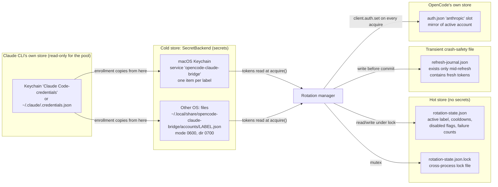
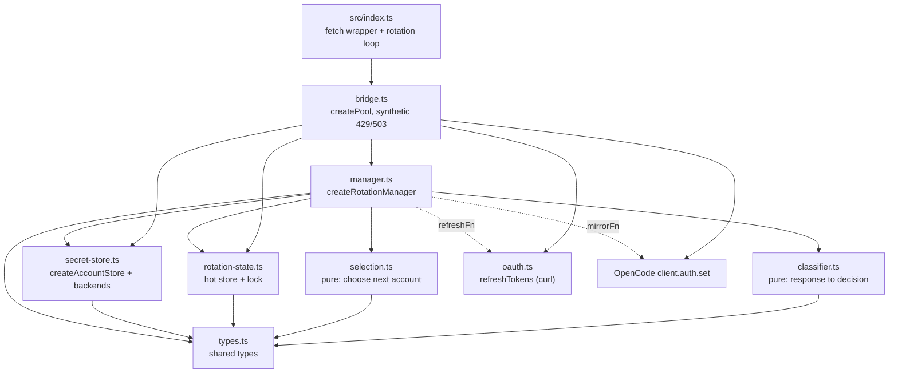
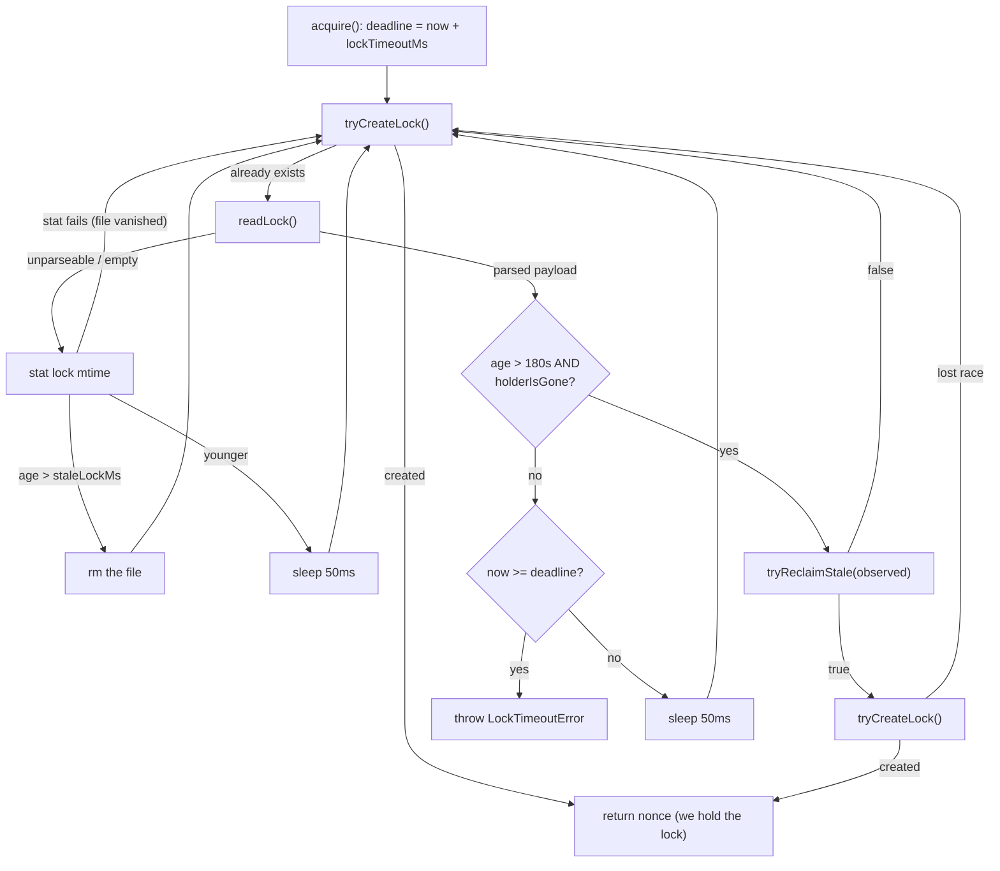
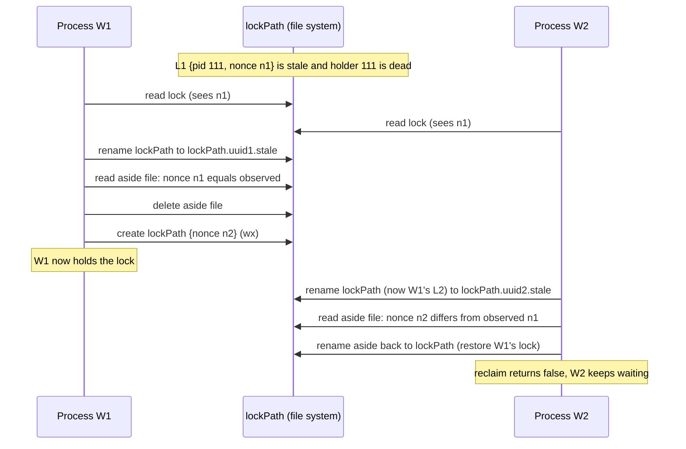
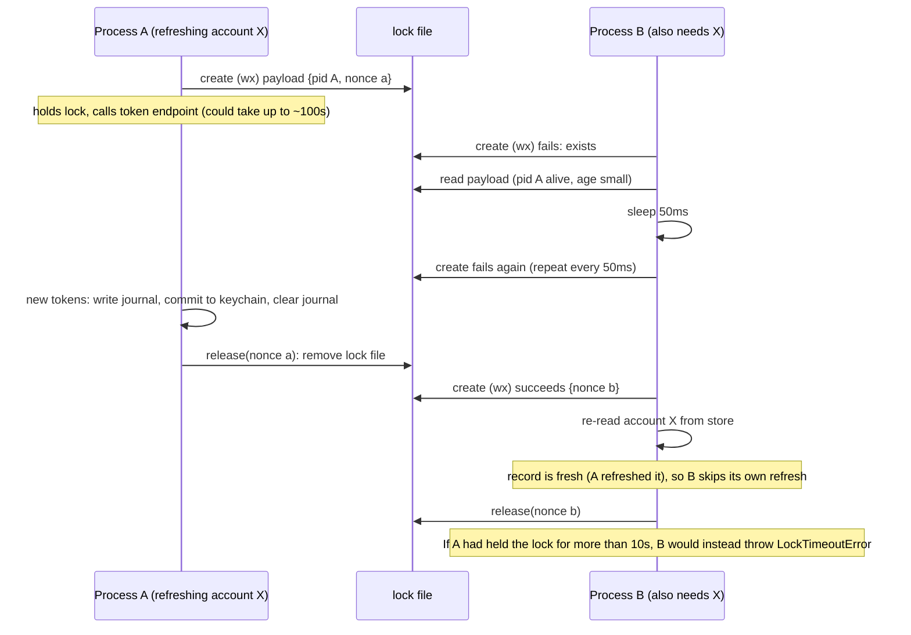
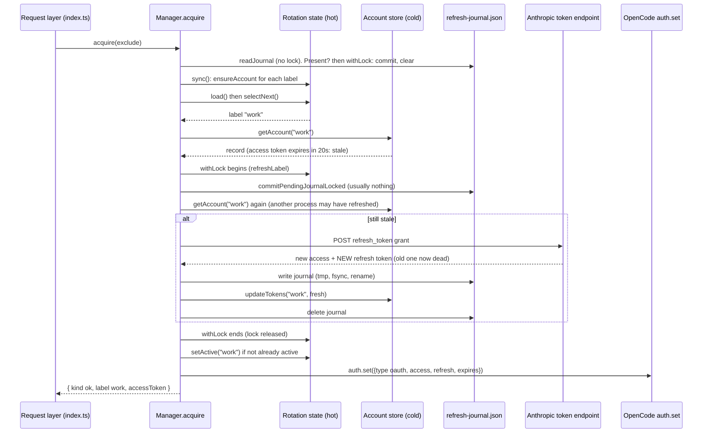
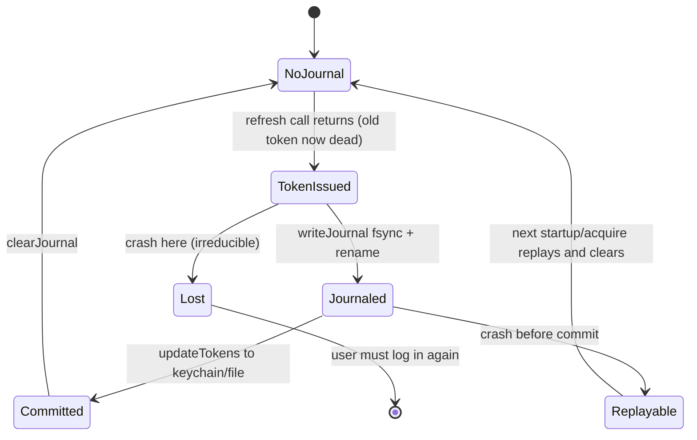
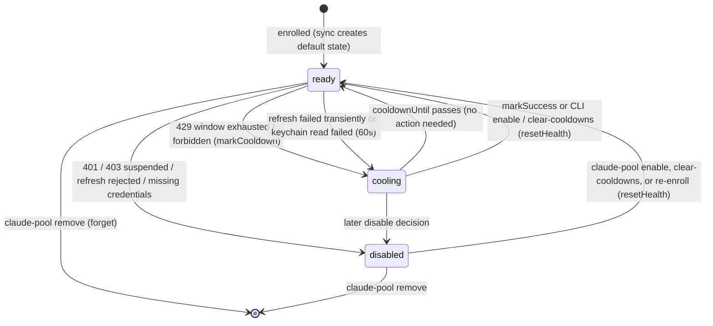

# 05 - The Account Pool: Storage, Locking and the Manager

## What this chapter covers

This chapter explains the **account pool**: the opt-in feature that lets the
bridge hold several Claude subscriptions at once and move between them. It
covers *what is stored and where*, *how it is kept safe when several programs
touch it at once*, and *how the manager object hands out a usable access token*.

It does **not** cover how a failed response is judged or how the request loop
reacts to it; that is [chapter 06](06-rotation-and-failure-handling.md). It
also does not cover how accounts get *into* the pool (the `claude-pool` command,
auto-enrollment, the dashboard); that is
[chapter 07](07-enrollment-and-claude-pool-cli.md).

Files covered (all under `src/pool/`):

| File | Role | Lines |
| --- | --- | --- |
| `types.ts` | Shared type definitions and two constants | 202 |
| `secret-store.ts` | Where account credentials physically live (keychain or files) | 372 |
| `rotation-state.ts` | The hot JSON file, atomic writes, the cross-process lock | 434 |
| `selection.ts` | Pure "which account next?" policy (summarised here, detailed in ch. 06) | 68 |
| `manager.ts` | The orchestrator: token acquisition, refresh journal, mirroring | 554 |
| `bridge.ts` | Wires the real pieces together; builds the two synthetic error responses | 84 |

### Words used in this chapter

* **Claude subscription** - a paid Claude Pro or Max plan. It is not billed per
  token; instead it has *usage windows*.
* **Usage window** - Anthropic limits a subscription with two independent
  rolling quotas: one over the last **5 hours** and one over the last **7 days**.
  When either is used up, every request fails with HTTP 429 ("Too Many
  Requests") until it resets.
* **OAuth** - the login protocol Claude Code uses. After you log in, the bridge
  holds three things per account: a short-lived **access token** (the bearer
  credential attached to each API request), a long-lived **refresh token** (used
  to obtain a new access token when the old one expires), and the access
  token's **expiry time**.
* **Refresh token rotation** - every time you use a refresh token, Anthropic
  returns a *brand new* refresh token and invalidates the old one immediately.
  If the new one is lost, the account is locked out until you log in again.
  This single fact drives most of the design in this chapter.
* **Keychain** - macOS's built-in encrypted credential store, accessed here
  through the `/usr/bin/security` command-line tool.
* **Lock file / mutex** - a file whose existence means "somebody is busy; wait".
  Used so two OpenCode processes do not edit the same data at the same time.
* **Atomic write** - writing a file such that a reader (or a crash) sees either
  the complete old content or the complete new content, never a half-written mix.

---

## 1. Why a pool exists

One Claude subscription can be exhausted. With heavy agent use the 5-hour window
fills in a couple of hours, and then OpenCode simply fails until the window
rolls over. If you own several subscriptions, the sensible reaction is "use the
next one". The pool automates that.

Complications that shape the design:

1. **OpenCode and Claude CLI each hold only one credential.** OpenCode's
   `auth.json` has a single `anthropic` slot, and the Claude CLI's keychain
   entry holds one login. Logging in as a second account *overwrites* the first.
   So the bridge needs its own storage for many accounts
   (`src/pool/types.ts:4-9`).
2. **Refresh tokens are single-use.** Refreshing the same account twice at the
   same time (two OpenCode windows, or many parallel agents in one window) would
   burn the token twice and brick the account (`src/pool/types.ts:12-14`,
   `src/pool/rotation-state.ts:12-17`).
3. **Many processes, many concurrent requests.** Several OpenCode instances and
   several parallel agent sessions in each may all want to read and change the
   pool at the same moment.
4. **It must be invisible when unused.** With no accounts enrolled, the plugin
   behaves exactly as before ("byte for byte", `src/pool/manager.ts:253-257`).

The pool is **opt-in** because `isActive()` is simply "is at least one account
enrolled?" (`src/pool/manager.ts:258-260`). Installing the plugin never
captures credentials by itself.

### Pool is the source of truth, auth.json is a cache

OpenCode reads its Anthropic credentials from one slot in its own `auth.json`.
The pool treats that slot as a **derived cache**: whichever account is currently
"active" is copied (mirrored) into it, using OpenCode's own `client.auth.set`
API (`src/pool/bridge.ts:29-39`). The authoritative copy of every account is in
the pool store. If the two disagree, the pool wins
(`src/pool/types.ts:4-7`, `src/pool/manager.ts:26-30`).

---

## 2. Cold secrets versus hot state

The pool deliberately splits its data into two stores with different change
rates (`src/pool/types.ts:8-11`).

| | Cold store ("account records") | Hot store (`rotation-state.json`) |
| --- | --- | --- |
| Contents | Access token, refresh token, expiry, email, plan type, enrolment time | Which account is active; per-account cooldown, disabled flag, failure count, last reason, quota reset times |
| Contains secrets? | Yes | No - "contains NO secret material" (`src/pool/rotation-state.ts:3-4`) |
| Where | macOS Keychain, or `0600` files elsewhere | Plain JSON file, mode `0600` |
| Changes when | A token is refreshed (about hourly per account), or an account is enrolled/removed | On every 429, every success, every switch |
| Write cost | Slow (keychain subprocess) and risky | Cheap, atomic file replace |

**Why split them?** Because the two change at very different rates and have very
different failure costs:

* A rate-limit hit happens often. If each one rewrote the account record (which
  contains the refresh token), every write would be another chance for a crash
  or error to lose a refresh token. Keeping secrets in a store that changes only
  on real token rotation "avoids multiplying the window in which a rotating
  refresh token can be lost" (`src/pool/types.ts:9-11`).
* Secrets belong in the OS-encrypted keychain, where possible. Cooldown
  timestamps are not sensitive, and keeping them in a plain JSON file means the
  CLI, dashboard and tests can read them freely, and a human can `cat` the file
  to debug (`SETUP.md` section 6 suggests exactly that).

The two stores are tied together only by the **account label** (a short name
like `work` or an email-derived name).

### Data at rest



All the files in the "hot", "transient" and (non-macOS) "cold" boxes live in
`~/.local/share/opencode-claude-bridge/` (derived from `os.homedir()`). The
whole directory is what `SETUP.md` section 9 removes with `rm -rf` when
uninstalling; note that on Linux this directory also contains the `accounts/`
folder, so that command deletes the stored credentials too.

| Path | What | Mode | Source |
| --- | --- | --- | --- |
| Keychain service `opencode-claude-bridge`, account = label | Account record JSON (macOS) | OS-protected | `src/pool/types.ts:18` |
| `~/.local/share/opencode-claude-bridge/accounts/<encoded-label>.json` | Account record JSON (non-macOS) | file `0600`, dir `0700` | `src/pool/secret-store.ts:498-504` |
| `~/.local/share/opencode-claude-bridge/rotation-state.json` (or `$CLAUDE_POOL_STATE_PATH`) | Hot state | `0600` | `src/pool/rotation-state.ts:62-71` |
| `~/.local/share/opencode-claude-bridge/rotation-state.json.lock` | The lock; **always** here, even if the state path is overridden | `0600` | `src/pool/rotation-state.ts:58-60` |
| `~/.local/share/opencode-claude-bridge/refresh-journal.json` | Pending-refresh journal | `0600` | `src/pool/manager.ts:115-123` |
| `~/.local/share/opencode/auth.json` | OpenCode's mirror (written through OpenCode's API, not by the pool directly) | owned by OpenCode | `src/pool/bridge.ts:29-39` |

---

## 3. Component diagram



The manager is built with **dependency injection**: it never imports the keychain
or the network directly. It is handed `accounts`, `state`, `refreshFn`,
`mirrorFn`, an optional `clock`, an optional `journalPath`, `expiryBufferMs`
and an `onAccountDisabled` callback (`src/pool/manager.ts:66-77`). That is why
the tests can drive it with in-memory fakes and a fake clock.

---

## 4. Every type in `types.ts`

`src/pool/types.ts` is only types and two constants. Here each one in plain
English.

### Constants

| Name | Value | Meaning |
| --- | --- | --- |
| `POOL_KEYCHAIN_SERVICE` | `"opencode-claude-bridge"` | The service name under which each account is a keychain item (`types.ts:18`). |
| `ROTATION_STATE_VERSION` | `1` | Schema version stamped into `rotation-state.json`. A file with another version is thrown away (treated as empty) (`types.ts:21`, `rotation-state.ts:129-138`). |

### Credentials (cold)

* **`PoolOAuthTokens`** (`types.ts:30-34`) - `{ access, refresh, expires }`.
  `expires` is in **epoch milliseconds** (ms since 1970-01-01), matching
  OpenCode's `auth.json` and the Claude CLI's `expiresAt`.
* **`AccountRecord`** (`types.ts:40-53`) - one enrolled account, stored as JSON.
  * `label` - stable user-chosen name; also the keychain "account" attribute.
  * `oauth` - the `PoolOAuthTokens`.
  * `subscriptionType` (e.g. `"max"`), `rateLimitTier` (e.g.
    `"default_claude_max_20x"`), `scopes` - copied from the Claude CLI
    credentials; informational only.
  * `email` - looked up from Anthropic's `/api/oauth/profile` endpoint at
    enrollment time. Used by the dashboard and by auto-enroll matching.
  * `enrolledAt` - epoch ms when the account entered the pool.
* **`ClaudeCliCredentials`** (`types.ts:60-69`) - the Claude CLI's *own* shape
  (`claudeAiOauth.{accessToken, refreshToken, expiresAt, ...}`) that enrollment
  reads. It is "deliberately not interchangeable" with `AccountRecord`
  (different field names), so a conversion step is required. On macOS it comes
  from the keychain service `Claude Code-credentials`; on Linux from
  `$CLAUDE_CONFIG_DIR` or `~/.claude/.credentials.json` (`src/keychain.ts:19`).

### Rotation state (hot)

* **`AccountState`** (`types.ts:74-98`) - mutable scheduling info per account:
  * `cooldownUntil` - epoch ms before which the account must not be used;
    `null` means available.
  * `disabled` - permanently excluded until an operator re-enables it.
  * `failureCount` - consecutive failures; reset on success. Used as a
    tie-breaker by selection (fewer failures preferred).
  * `lastReason` - human text explaining the last cooldown/disable.
  * `updatedAt` - epoch ms of the last change; also a selection tie-breaker.
  * `fiveHourReset`, `sevenDayReset` - last observed reset times of the two
    quota windows, so the UI can show quota rather than only "cooling until X".
    `undefined` = never seen; `null` = explicitly unknown.
  * `bindingWindow` - which window Anthropic named as the limiting one on the
    last 429: `"five_hour"`, `"seven_day"` or `null`.
* **`RotationState`** (`types.ts:100-105`) - `{ version, activeLabel,
  accounts }` where `accounts` maps label to `AccountState`.

### Classifier-related (used by chapter 06)

* **`RotationAction`** (`types.ts:117-125`) - what to do with a failed response:
  `RETRY_SAME` (back off, same account), `ROTATE_COOLDOWN` (park the account
  until a time, switch), `ROTATE_DISABLE` (exclude permanently, switch),
  `PASS_THROUGH` (not our business, give the response to the caller untouched).
* **`DecisionSource`** (`types.ts:133-139`) - which "rung of the fallback
  ladder" produced the decision: `retry-after`, `unified-reset`, `token-reset`,
  `body-hint`, `default`, or `status`. Kept for logs and tests because Anthropic
  does not publicly document the subscription rate-limit headers, so we must
  tell a real signal from a guessed default.
* **`RotationDecision`** (`types.ts:141-159`) - `{ action, backoffMs?, until?,
  reason, source, windows? }`. `backoffMs` is used with `RETRY_SAME`; `until`
  with `ROTATE_COOLDOWN`; `windows` carries both observed quota resets.
* **`ClassifyInput`** (`types.ts:162-171`) - `{ status, headers, bodyText?, now,
  attempt? }`. Header names **must be lowercased by the caller**. `now` is
  injected so tests are deterministic. `attempt` counts consecutive same-account
  retries already made.
* **`SelectionResult`** (`types.ts:175-185`) - either `{ kind: "selected",
  label }` or `{ kind: "exhausted", earliestReset, cooling[], disabled[] }`.

### Infrastructure

* **`SecretBackend`** (`types.ts:194-199`) - the four-method interface a
  credential store must offer: `get(label)`, `set(label, value)`,
  `remove(label)`, `list()`. Values are opaque strings (JSON-encoded records).
  Tiny on purpose so tests can fake it with a `Map`.
* **`Clock`** (`types.ts:202`) - `() => number` returning epoch ms.

---

## 5. Secret store backends (`secret-store.ts`)

`createSecretBackend()` picks the backend by platform
(`secret-store.ts:496-505`):

* `process.platform === "darwin"` - the **keychain backend**.
* anything else - the **file backend** in
  `~/.local/share/opencode-claude-bridge/accounts`.

On top of either backend sits `createAccountStore(backend)`, which adds JSON
(de)serialisation and validation (section 5.3).

### 5.1 macOS Keychain backend

Implemented by `createKeychainBackend(service)` (`secret-store.ts:325-383`),
which shells out to Apple's `/usr/bin/security` binary found on `PATH`.

Constants: `SECURITY_TIMEOUT_MS = 10_000` (every call is killed after 10 s) and
`SECURITY_MAX_LINE = 4000` (`secret-store.ts:217,240`).

| Method | Command | Notes |
| --- | --- | --- |
| `get(label)` | `security find-generic-password -s <service> -a <label> -w` | `-w` prints just the secret. Trailing newline stripped. "Could not be found" in stderr means missing -> `null`. Any *other* failure (locked keychain, timeout) **throws** rather than returning `null`, because "missing" gets an account disabled and a locked keychain must not (`secret-store.ts:329-345`). |
| `set(label, value)` | `security -i` with `add-generic-password -U -s ... -a ... -l "service:label" -D "Claude account pool entry" -X <hex>` **sent on stdin** | `-U` updates if the item exists. The value is hex-encoded (`-X`). Error text never includes the value (`secret-store.ts:347-357`). |
| `remove(label)` | `security delete-generic-password -s <service> -a <label>` | Missing item is not an error (`secret-store.ts:359-373`). |
| `list()` | `security dump-keychain`, parsed in-process | Returns sorted labels whose service attribute equals ours (`secret-store.ts:375-381`). |

**Why stdin for `set`?** Anything on a command line is visible to every user on
the machine via `ps`. `security -i` reads commands from stdin, so the secret
(hex-encoded) never appears in argv (`runSecurityCommand`,
`secret-store.ts:249-264`). `get` still puts the *label and service* in argv,
which are not secret; the secret comes back over stdout.

**Why a 4000-character line cap?** A comment explains that `security -i` writes
a *truncated* secret for lines over 4095 characters and then fails
(`secret-store.ts:239`). Storing a truncated refresh token would be silent data
loss, so oversized commands are rejected up front with "keychain command exceeds
the safe line length" (`secret-store.ts:250-253`). Hex doubles the size, so a
record JSON of about 1900 bytes is the practical limit. Test
`secret-store.test.ts:258` ("refuses an oversized value rather than storing a
truncated secret") pins this.

**Quoting.** `quoteForSecurity` wraps names in double quotes and rejects any
label or service containing `"`, `\`, CR or LF, since they would corrupt the
command line (`secret-store.ts:242-247`).

**Decoding `dump-keychain` output** (`secret-store.ts:266-323`). To list
accounts, the backend runs `dump-keychain` (which prints attributes but not
secrets) and splits the output into blocks, one per item, starting at each line
beginning `keychain:`. Within a block it reads the `"svce"` (service) and
`"acct"` (account) attributes. Each attribute can appear in two forms:

1. **Quoted form**: `"acct"<blob>="work"` - decoded with `JSON.parse`
   (`decodeDumpValue`).
2. **Hex form**: `"acct"<blob>=0x796100  "ya\000"` - printed when the value
   contains bytes that are not plain printable ASCII. `decodeDumpHex` converts
   the hex to UTF-8 and **rejects** the result if it contains the Unicode
   replacement character (invalid UTF-8), because "a wrong label is worse than
   none" (`secret-store.ts:274-292`). The trailing escaped rendering after the
   hex is ignored.

A comment records the bug the hex form fixed: before it, such items were
invisible to `list()`, so the account was silently dropped from the pool, then
"disabled as credentials missing" (`secret-store.ts:277-279`).

If `dump-keychain` fails entirely, `list()` throws
`Failed to list keychain service "..."`.

> Practical consequence: a first write (and sometimes reads) can trigger a macOS
> password prompt. `SETUP.md` section 7 advises choosing "Always Allow" in
> Keychain Access, otherwise each rotation prompts.

### 5.2 File backend (Linux and other non-macOS)

`createFileBackend(dir)` (`secret-store.ts:424-494`). Default `dir`:
`~/.local/share/opencode-claude-bridge/accounts` (`secret-store.ts:498-504`).

* **One file per account**, named `encodeURIComponent(label) + ".json"`
  (`fileNameForLabel`, `secret-store.ts:398-401`). URL-encoding means unusual
  characters in a label become safe filename characters.
* **Label validation** (`validateLabel`, `secret-store.ts:385-396`): empty
  string, `"."`, `".."`, or anything containing `/`, `\` or a NUL byte throws
  `Invalid account label`. This blocks path traversal; tested at
  `secret-store.test.ts:179`.
* **Directory permissions**: `ensureDir()` makes the directory with mode `0700`
  and then `chmod 0700` **on every write** (`secret-store.ts:427-430`). (The
  rotation-state store is more careful and only chmods a directory it just
  created; see section 6.)
* **Lazy creation**: the directory is created at first `set`, *not* when the
  backend is constructed, because construction happens while the plugin loads
  and an unwritable home must leave the pool inactive rather than crash the load
  (`secret-store.ts:425-426`). Reading a never-written store returns "empty"
  without creating anything (`list()` maps `ENOENT` to `[]`).
* **Atomic write** (`set`, `secret-store.ts:443-466`):
  1. Open a temp file `.<encoded-label>.<pid>.<counter>.tmp` in the same
     directory with flags `O_WRONLY | O_CREAT | O_EXCL` and mode `0600`
     (`O_EXCL` = fail if it already exists).
  2. Write the value, `fsync` the file (force it to disk), close.
  3. `rename` over the target (atomic on POSIX).
  4. `fsync` the directory so the rename itself survives power loss
     (`syncDirectory`, `secret-store.ts:415-422`).
  5. In `finally`, close any open handle and unlink the temp file if it is still
     there.
  Errors are rethrown as the generic `Failed to store account "<label>"` so the
  secret cannot leak through an error message.
* **`get`** reads the file; `ENOENT` -> `null`; any other error ->
  `Failed to read account`.
* **`remove`** unlinks and fsyncs the directory; missing file is fine.
* **`list`** reads the directory, maps each name through `labelFromFileName`
  (strips `.json`, URL-decodes, re-validates; anything that fails is skipped, so
  the dotted `*.tmp` leftovers are ignored) and sorts.

### 5.3 The account store layer (`createAccountStore`)

`createAccountStore(backend)` (`secret-store.ts:525-574`) returns:

| Method | Behaviour |
| --- | --- |
| `getAccount(label)` | `backend.get`, `JSON.parse`, then `isAccountRecord` validation. Missing -> `null`. Corrupt/invalid -> logs `Failed to parse account record "<label>"` (label only; "JSON parse errors can include secret input") and returns `null`. |
| `putAccount(record)` | Stores `JSON.stringify(record)` under `record.label`. |
| `updateTokens(label, tokens)` | Reads the existing record, throws `Account "<label>" does not exist` if absent, writes back with **only** `oauth` replaced (all metadata preserved), returns the updated record. This is the one function the refresh protocol calls. |
| `removeAccount(label)` | `backend.remove`. |
| `listAccounts()` | For each label from `backend.list()`, `getAccount`; accounts that fail are skipped with a log line instead of failing the whole list. |

`isAccountRecord` (`secret-store.ts:507-523`) requires string `label`, numeric
`enrolledAt`, an `oauth` object with string `access`, string `refresh`, numeric
`expires`, and optional-but-correctly-typed `subscriptionType`, `rateLimitTier`
and `scopes`. It does **not** check `email`, so a wrongly typed `email` would
pass validation (minor; the type declares it a string).

Locked-in behaviour (tests in `secret-store.test.ts`): round-trip of every
field (line 50); unknown label gives `null` (58); malformed JSON gives `null`
and a log naming only the label (64); `updateTokens` preserves metadata (83) and
throws on a missing account (107); corrupt entries are skipped in listings
(125); file backend permissions `0700`/`0600` (162); path traversal rejected
(179); a never-written store is empty without being created (194); atomic
replacement leaves no temp files (222).

---

## 6. `rotation-state.json` and the cross-process lock

### 6.1 Schema

Example with fake data (two accounts: `work` is healthy and active, `personal`
is cooling after hitting its 5-hour limit; `legacy` was disabled):

```json
{
  "version": 1,
  "activeLabel": "work",
  "accounts": {
    "work": {
      "cooldownUntil": null,
      "disabled": false,
      "failureCount": 0,
      "lastReason": null,
      "updatedAt": 1787170000000,
      "fiveHourReset": 1787172000000,
      "sevenDayReset": 1787486400000,
      "bindingWindow": "five_hour"
    },
    "personal": {
      "cooldownUntil": 1787172000000,
      "disabled": false,
      "failureCount": 1,
      "lastReason": "Account usage window rejected by Anthropic; resets in 3600 seconds",
      "updatedAt": 1787168400000,
      "fiveHourReset": 1787172000000,
      "sevenDayReset": 1787486400000,
      "bindingWindow": "five_hour"
    },
    "legacy": {
      "cooldownUntil": null,
      "disabled": true,
      "failureCount": 0,
      "lastReason": "refresh rejected: Token refresh failed (400): invalid_grant",
      "updatedAt": 1787160000000
    }
  }
}
```

The three window fields are optional (see `legacy`). All times are epoch
milliseconds. The file is pretty-printed with two-space indent
(`rotation-state.ts:154`).

### 6.2 Loading (`load`, `rotation-state.ts:110-146`)

`load()` is synchronous and **never throws and takes no lock**:

* File missing or unreadable -> default empty state
  `{version:1, activeLabel:null, accounts:{}}` (a fresh pool, not an error).
* Malformed JSON -> log `[claude-pool] rotation state at <path> is malformed
  JSON; falling back to defaults` and use defaults.
* Not an object, or `version !== 1` -> log "unsupported version" and use
  defaults.
* Otherwise fields are normalised (`activeLabel ?? null`, `accounts ?? {}`).

Caveat worth knowing: falling back to defaults means a corrupted state file
silently **forgets all cooldowns and disabled flags**. Accounts that were
disabled become eligible again (and will be re-disabled by the next failure).
This is a safe-direction failure, not data loss of secrets.

Lock-free reads are safe because writes are atomic renames (next section).

### 6.3 Atomic write (`save`, `rotation-state.ts:148-171`)

1. `ensureDir()` - create the parent directory with mode `0700` if absent.
2. Choose a unique temp name `<statePath>.<random-uuid>.tmp`.
3. `openSync(tmp, "wx", 0o600)` - create exclusively with owner-only mode.
4. Write the JSON, **`fsync`** it (without this, "the contents may not have
   reached disk yet" even though rename is atomic), close.
5. `renameSync(tmp, statePath)` - atomically swap the directory entry.
6. `chmodSync(statePath, 0o600)`.
7. If anything throws: close the fd if still open, remove the temp file, rethrow.
   The previous state file stays intact. (Test `rotation-state.test.ts:95`.)

`ensureDir` (`rotation-state.ts:103-108`) only `chmod`s a directory *it just
created* (`mkdirSync(..., {recursive:true})` returns the first directory it
created, or `undefined`). A comment explains: an unconditional chmod "would
silently repair permissions an operator deliberately set, masking a real
failure".

### 6.4 The lock: why it exists

The lock does two jobs (`rotation-state.ts:12-17`):

1. Protects read-modify-write cycles on `rotation-state.json` shared by many
   processes.
2. **Guards the token-refresh critical section** in the manager. Because two
   concurrent refreshes of one account could permanently brick it, the manager
   takes this same lock around every refresh. This is why the lock path
   deliberately ignores `CLAUDE_POOL_STATE_PATH`: "processes sharing accounts
   must share it" (`rotation-state.ts:56-60`). Test `rotation-state.test.ts:277`
   verifies two stores with different state files still serialise on one lock.

### 6.5 Lock options and defaults

| Option | Default | Meaning | Source |
| --- | --- | --- | --- |
| `staleLockMs` | `180_000` (3 min) | Age after which a lock *may* be presumed abandoned | `rotation-state.ts:94` |
| `lockPollMs` | `50` | Sleep between attempts while waiting | `rotation-state.ts:95` |
| `lockTimeoutMs` | `10_000` (10 s) | Give up waiting after this long | `rotation-state.ts:96` |
| `lockPath` | `<statePath>.lock` | In practice `bridge.ts` passes `defaultLockPath()` | `rotation-state.ts:89`, `bridge.ts:22` |
| `clock` | `Date.now` | Injectable for tests | `rotation-state.ts:90` |

Why 180 s for staleness? A comment explains: a refresh runs up to 3 curl
attempts at 30 s each plus backoff (about 100 s), so a 30 s threshold would
declare a healthy refreshing process "stale" (`rotation-state.ts:91-94`).

### 6.6 Lock payload and acquisition

The lock file contains JSON `{ pid, hostname, acquiredAt, nonce }`
(`LockPayload`, `rotation-state.ts:44-50`). `nonce` is a random UUID that
uniquely identifies *this* acquisition so it can be told apart from a successor.

**`tryCreateLock()`** (`rotation-state.ts:182-204`): `openSync(lockPath, "wx",
0o600)`. The `"wx"` flag fails if the file already exists, and that check is
atomic on POSIX, so it is a dependency-free mutex. On success it writes the
payload, `fsync`s, closes and returns the nonce. On failure returns `null`.

**`acquire()`** (`rotation-state.ts:260-307`) loops until it holds the lock:



Details of each branch:

1. **Unparseable lock file** (`rotation-state.ts:275-288`). Usually a torn write,
   which must not wedge the pool forever. But it is also what a lock looks like
   in the instant between being created and being written, so deleting it on
   sight would evict a holder mid-acquisition. So it is only removed once its
   file *modification time* is older than `staleLockMs`; otherwise wait 50 ms
   and retry. If `stat` itself fails the file vanished, so retry at once.
2. **Parseable lock, stale by age *and* holder gone** (`rotation-state.ts:290`):
   `clock() - acquiredAt > staleLockMs && holderIsGone(existing)`. Both are
   required; see next subsection.
3. **Otherwise, wait** - but first check the deadline; past it, throw
   `LockTimeoutError` with a message naming the lock path and the holder's pid
   and hostname (`rotation-state.ts:298-303`).

### 6.7 Stale-lock detection (`holderIsGone`)

(`rotation-state.ts:216-233`.) Age alone is not proof of a crash: it is only a
timeout, and a legitimate refresh could outlast it. Reclaiming a *live*
holder's lock lets two processes refresh one account concurrently, which
"rotates its refresh token twice and permanently bricks it". So the code
requires proof the holder process is gone:

| Situation | Result |
| --- | --- |
| Lock's hostname differs from this machine's | `true` (gone): another host's pid cannot be checked, so the age heuristic is all we have. (Relevant only if the state dir is on a shared filesystem.) |
| Same host: `process.kill(pid, 0)` succeeds | `false` - process exists, so the lock is live regardless of age. (Signal `0` sends nothing; it only checks existence.) |
| Same host: error `ESRCH` (no such process) | `true` - holder is dead |
| Same host: error `EPERM` (process exists, owned by another user) | `false` - treated as alive. Test: `rotation-state.test.ts:181`, `security-fixes.test.ts:92-155` |

Limitation (my reading, not documented in code): if a crashed holder's pid has
since been reused by an unrelated process, `kill(pid,0)` succeeds forever, so the
lock would never be reclaimed and every caller would hit `LockTimeoutError`
until someone deletes the lock file by hand.

### 6.8 Rename-aside plus nonce reclaim: the race it prevents

(`tryReclaimStale`, `rotation-state.ts:235-258`, comment at lines 206-215.)

The naive approach is "if the lock looks stale, delete it". That is racy:

1. Waiters W1 and W2 both read the same stale lock **L1** (nonce `n1`).
2. W1 deletes L1 and creates a fresh lock **L2** (nonce `n2`) and starts work.
3. W2, still acting on its old observation, deletes the file at `lockPath`. That
   is now W1's *fresh* L2. W2 creates its own lock. Now **two processes believe
   they hold the lock**.

The fix: instead of deleting, **rename** the lock file aside to
`<lockPath>.<uuid>.stale` (rename is atomic and only one renamer can succeed for
a given source file). Then **read the moved file's nonce and compare it with the
nonce originally observed**:

* Same nonce: we really did move the stale lock. Delete the aside file and
  return `true`; the caller then tries to create the lock.
* Different nonce: we accidentally moved somebody's fresh lock. Rename it back
  and return `false` (keep waiting).
* Rename failed: someone else got there first; return `false`.
* Moved file unreadable (`moved === null`): falls through and is treated as
  ours, since it cannot be shown to be a replacement.



Honest caveat (my reading): between W2's rename-aside and its restore there is a
brief moment when `lockPath` does not exist, and a third process could create a
lock in that gap, only to have W2's restore overwrite it. The window is tiny and
needs a stale lock *plus* three contenders, but the protocol shrinks the race
rather than eliminating it.

### 6.9 Release

`release(nonce)` (`rotation-state.ts:309-315`) re-reads the lock; **if it exists
and its nonce is not ours, do nothing** (our lock was reclaimed; deleting would
evict the legitimate current holder). Otherwise remove the file. It also removes
the file if the lock cannot be read at all.

### 6.10 `withLock` and the mutators

`withLock(fn)` (`rotation-state.ts:322-338`):

1. `acquire()` the lock.
2. `load()` the state **inside** the lock (so it is current).
3. Remember `JSON.stringify(state)`; run `fn(state)` (may be async; it can mutate
   the state in place).
4. **Only if the JSON changed**, `save(state)`. Several callers take the lock
   purely for mutual exclusion (token refresh) and never touch state; rewriting
   the file for them would waste an fsync per request.
5. `finally` release the lock. If `fn` throws, nothing is saved but the lock is
   still released (test `rotation-state.test.ts:202`).

Exposed store API (`rotation-state.ts:351-431`):

| Method | What it does |
| --- | --- |
| `load()` | Lock-free read described above. |
| `save(state)` | Atomic write (does *not* take the lock itself). |
| `withLock(fn)` | As above. |
| `setActive(label \| null)` | Sets `activeLabel` under lock. |
| `ensureAccount(label)` | Creates a default `AccountState` if missing. **Fast path**: if `load()` already shows the account, return without locking (this ran for every account on every `acquire()` and locking cost "~10ms each"); re-checked under the lock otherwise. |
| `markCooldown(label, until, reason, windows?)` | Sets `cooldownUntil`, `failureCount += 1`, `lastReason`, `updatedAt`. Updates `fiveHourReset`/`sevenDayReset` only if the new value is non-null (a 429 revealing one window must not erase the other), and `bindingWindow` if provided (even `null`). |
| `markDisabled(label, reason)` | Sets `disabled = true`, `lastReason`, `updatedAt`. |
| `resetHealth(label)` | Clears `disabled`, `cooldownUntil`, `failureCount`, `lastReason`. Leaves observed quota windows alone ("clearing local health does not give the account its server-side quota back"). Creates the entry if missing. Used by enrolment and the TUI "enable" actions. |
| `forget(label)` | Deletes the account's entry and clears `activeLabel` if it pointed there. |
| `markSuccess(label)` | Sets `cooldownUntil = null`, `failureCount = 0`, `updatedAt = now`. |

(`mutateAccount` is the private helper behind the mark/reset methods: lock, create
default entry if absent, apply the mutation.)

### 6.11 `LockTimeoutError`

`export class LockTimeoutError extends Error {}` (`rotation-state.ts:29`).
Its doc comment is the key: *another process held the lock too long; says
nothing about any account's health*. Everything that catches it avoids blaming
an account:

* Manager `acquire()` handles it around `refreshLabel` and around `setActive`
  (section 7.3).
* `src/index.ts:909-915` turns an `acquire()` lock timeout into the 503 "pool is
  busy" response (section 9).
* `src/index.ts:1263-1267` passes the current error through when a *rotation's*
  `acquire` times out.
* `recordPoolState` (`src/index.ts:535`) swallows *any* error from bookkeeping
  so a busy lock never fails a request that already has a response.

### 6.12 Two processes contending for the lock



The "re-read inside the lock" step is what turns contention into correctness:
the loser of the race does not refresh again, it just uses the winner's tokens
(`manager.ts:288-291`).

---

## 7. The rotation manager (`manager.ts`)

`createRotationManager(opts)` (`manager.ts:163-527`) returns an object with the
methods below. Internal helper functions are listed afterwards.

### 7.1 Exported helpers and constants (module level)

| Name | Behaviour | Source |
| --- | --- | --- |
| `TRANSIENT_REFRESH_COOLDOWN_MS` | `60_000`. Cooldown applied when a refresh fails for a reason that may fix itself, and when a keychain read fails. | `manager.ts:96` |
| `isCredentialRejected(detail)` | Decides if a refresh error text means "this credential is dead" (true) or "endpoint unreachable/blocked" (false). True if the text contains an OAuth error code word `invalid_grant`, `invalid_client`, `unauthorized_client` or `access_denied` (anywhere, case-insensitive), **or** it *begins with* `Token refresh failed (400)`, `(401)` or `(403)`. A bare status elsewhere in the text does not count. | `manager.ts:103-113` |
| `defaultJournalPath()` | `~/.local/share/opencode-claude-bridge/refresh-journal.json` | `manager.ts:115-123` |
| `describeExhaustion(info, now)` | One-line fail-fast message (below). | `manager.ts:134-153` |
| `formatWait(ms)` | `"Nm"` under 60 minutes (rounded **up**, minimum 0), `"Hh Mm"`/`"Hh"` under 24 hours, `"Dd Hh"`/`"Dd"` beyond. | `manager.ts:155-161` |
| Types `RefreshFn`, `MirrorFn`, `ManagerOptions`, `ExhaustionInfo`, `AcquireResult`, `PoolSnapshot`, `PoolSnapshotRow`, `RotationManager`, `AccountStore` | Public contracts. `AcquireResult` is `{kind:"ok", label, accessToken}` or `{kind:"exhausted", info}`. | `manager.ts:51-93,529-554` |

Why `isCredentialRejected` is so strict: `refreshTokens` throws errors of the
form `Token refresh failed (<status>): <detail>` (`src/oauth.ts:170`). Matching
a status anywhere in the text once let a gateway page containing "(403)", or a
network error mentioning "(401) retries", *permanently disable a healthy
account*, and undoing a disable needs manual action (`manager.ts:108-112`).
Related: `parseTokenResponse` deliberately words a non-JSON firewall/CDN page as
`Token refresh: HTTP 403 with a non-JSON body...` so that it does **not** carry
the "failed (NNN)" prefix and is therefore classified transient
(`src/oauth.ts:163-169`; test `manager.test.ts:208`).

**`describeExhaustion` message variants** (`manager.ts:134-153`):

| Situation | Message |
| --- | --- |
| Some account is cooling | `Claude pool exhausted — next account free in <formatWait> (<label of soonest>)` plus `; N disabled` if any are disabled |
| Nothing cooling, none disabled | `Claude pool exhausted — every account failed this request` (happens when this request already tried every account) |
| Exactly one disabled | `Claude pool exhausted — "<label>" disabled; re-login, then claude-pool enroll` |
| Several disabled | `Claude pool exhausted — N accounts disabled; re-login and re-enroll each` |

It is intentionally terse because OpenCode shows session errors as a 5-second
toast with hard-coded duration, so a longer message cannot be read in time
(`manager.ts:125-133`).

### 7.2 Manager methods

| Method | Purpose and behaviour | Source |
| --- | --- | --- |
| `isActive()` | `true` iff at least one account is enrolled (`listLabels().length > 0`). Gate for the whole feature. | `manager.ts:258` |
| `listLabels()` | Labels of all enrolled accounts from the cold store. | `manager.ts:249` |
| `sync()` | For every enrolled label, `state.ensureAccount(label)` so the hot store knows about it. Idempotent. | `manager.ts:263` |
| `acquire(exclude?)` | The main entry point; section 7.3. | `manager.ts:324` |
| `refreshLabel(label)` | Public (the TUI calls it directly): refresh one account safely; section 8. | `manager.ts:279` |
| `replayJournal()` | Commit a leftover journal; section 8.3. | `manager.ts:232` |
| `pendingRefreshLabel()` | The label named in a present journal, or `null`; for visibility of the recovery path. | `manager.ts:487` |
| `applyDecision(label, decision)` | Apply a classifier verdict to the pool state; section 10.2. | `manager.ts:412` |
| `classifyResponse(input)` | Thin wrapper around `classify()`; does not mutate anything. | `manager.ts:503` |
| `markSuccess(label)` | Delegates to `state.markSuccess`. | `manager.ts:507` |
| `exhaustionInfo()` | Runs `selectNext` with no exclusions: returns an empty info object if some account is selectable, else the cooling/disabled breakdown. | `manager.ts:511-521` |
| `describeExhaustion(info)` | Wraps the module function with the manager's clock. | `manager.ts:523` |
| `snapshot()` | Read-only per-account view for the dashboard (section 10.1). | `manager.ts:445` |

Internal (not exported): `disable(label, reason)` (marks disabled, then calls
`onAccountDisabled` inside try/catch so a throwing listener cannot undo the
disable; `manager.ts:169-176`), `isFresh`, `writeJournal`, `clearJournal`,
`readJournal`, `commitPendingJournalLocked`, `mirror`, and the `inFlight` map.

### 7.3 `acquire(exclude?)` step by step

`acquire` answers "give me a usable access token, from the best account". The
optional `exclude` set lists labels to skip (the request loop passes the
accounts it has already tried; chapter 06).

1. **`replayJournal()`** - recover any crashed refresh first (cheap if no journal:
   one file read, no lock).
2. **`sync()`** - make sure every enrolled account has a state entry.
3. **`selectNext(state.load(), now, exclude)`** - pure policy. If result is
   `exhausted`, return `{kind:"exhausted", info}` immediately. (Selection rules:
   [chapter 06 section 4](06-rotation-and-failure-handling.md).)
4. **Load the chosen account's record** from the cold store.
   * If the read **throws** (locked keychain, I/O error): cool the account for
     60 s with the error message as reason, then `acquire(exclude)` again.
     It is *not* disabled: "a locked keychain or timeout is not missing".
   * If the record is **missing** (state knows it, keychain does not): **disable**
     it with reason `credentials missing from keychain` and re-acquire. Disabling
     rather than ignoring prevents selection picking it forever.
5. **Freshness check**: `isFresh(tokens, now)` = non-empty access token and
   `expires > now + expiryBufferMs` (default buffer 60 s, so tokens within a
   minute of expiry are refreshed early). If stale, call `refreshLabel(label)`
   (section 8). Outcomes:
   * **Success** - use the fresh tokens.
   * **`LockTimeoutError`** - the lock holder is probably refreshing this very
     account. Re-read the record: if it is now fresh, use it. Otherwise try an
     alternative account via `acquire(exclude + label)`; if that yields `ok`
     return it, otherwise throw the original `LockTimeoutError` (the request
     layer then answers 503; account not blamed).
   * **Any other error** - classify with `isCredentialRejected(detail)`:
     * rejected -> **disable** with reason `refresh rejected: <detail>`;
     * otherwise -> **cooldown 60 s** with reason `refresh failed: <detail>`
       (network blip or 5xx from the token endpoint must not disable accounts,
       or one outage would disable every account in turn "and wedge the pool with
       no automatic recovery").
     In both cases move on with `acquire(exclude)`.
6. **Stickiness**: if `state.activeLabel !== label`, `setActive(label)`. A
   `LockTimeoutError` here is swallowed ("stickiness only; a busy lock must not
   fail a request that has a valid token"); other errors propagate.
7. **Mirror**: `mirror(record)` calls `mirrorFn(record.oauth)`, which in
   production is `client.auth.set(...)` (section 9.1). Note this happens on
   **every** `acquire`, i.e. every request, not only when the active account
   changes (`manager.ts:399`).
8. Return `{ kind: "ok", label, accessToken }`.

Recursion note: the "disable/cool and retry" steps call `acquire` again. Each
such step removes one account from consideration, so recursion is bounded by the
number of accounts.



### 7.4 In-flight refresh deduplication

`inFlight: Map<label, Promise<tokens>>` (`manager.ts:179`). When
`refreshLabel` is called and a refresh for that label is already running **in
this process**, the caller receives the *same promise* instead of starting
another (`manager.ts:279-282`). Ten parallel agent requests that all notice an
expired token therefore cause one token-endpoint call. The map entry is removed
in `finally`. (Cross-**process** duplicates are handled by the lock plus the
re-read; test `manager.test.ts:169` pins the in-process collapse.)

---

## 8. The refresh-token journal protocol

### 8.1 The danger

Anthropic's refresh invalidates the old refresh token the moment it issues the
new one. Between "server issued new tokens" and "we saved them" there is a window
in which a crash (or power loss, or an exception) leaves the account with a dead
stored token and the live token lost forever. The user then has to log in again
(`manager.ts:7-13`).

### 8.2 Journal then commit

Inside `refreshLabel`, while holding the cross-process lock (`manager.ts:283-302`):

1. **Replay** any existing journal first (`commitPendingJournalLocked`) - the
   TUI calls `refreshLabel` directly, bypassing `acquire`'s replay.
2. **Re-read** the account from the store. If another process refreshed while we
   waited for the lock and the tokens are now fresh, return them and stop.
3. Call `refreshFn(current.oauth.refresh)` (production: `refreshTokens`, a `curl`
   POST to the token URL with up to 3 attempts; `src/oauth.ts:93-120,393-400`).
4. **`writeJournal({label, tokens, writtenAt})`**: make the directory (mode
   `0700` if newly created), write `refresh-journal.json.<uuid>.tmp` with mode
   `0600`, `fsync`, rename over `refresh-journal.json`
   (`manager.ts:183-197`). From this moment the new tokens are crash-safe.
5. **`accounts.updateTokens(label, fresh)`** - commit to the authoritative store.
6. **`clearJournal()`** - delete the journal (best-effort).

The commented sequence in the file header also lists "mirror to opencode's
single anthropic slot" as step 6; in the code the mirror happens later, in
`acquire`, after the lock is released.

What remains unprotected: a crash between the server issuing the tokens (step 3)
and the journal reaching disk (step 4). The file calls this "microseconds wide"
and "irreducible" (`manager.ts:23-24`).



### 8.3 Replay at startup

`replayJournal()` (`manager.ts:232-245`) runs at the start of every `acquire()`
(so it is effectively "at startup" as soon as the first request arrives):

1. Cheap pre-check `readJournal()`: if there is no valid journal return `false`
   with **no lock taken**.
2. Otherwise `state.withLock(commitPendingJournalLocked)`.
3. `commitPendingJournalLocked` (`manager.ts:221-230`) re-reads the journal,
   calls `accounts.updateTokens(entry.label, entry.tokens)`, deletes the
   journal, and logs `[claude-pool] replayed pending refresh for "<label>" from
   journal`. **The caller must hold the lock** - otherwise another process might
   spend the dead keychain token while the journal waits.
4. Any failure (including lock timeout) is logged as `failed to replay refresh
   journal: ...` and returns `false`; the journal stays for the next attempt.

`readJournal` returns `null` (ignored) for unreadable/invalid JSON or an entry
without `label` and `tokens.refresh` (`manager.ts:203-213`).

Tests locking this in: journal written *before* the commit (`manager.test.ts:191`),
cleared after commit (183), replay from a crashed process (326), no replay when
none exists (350), lock held until replay finished (355), and `refreshLabel`
using the journal rather than spending the dead keychain token (379).

Security note: while a journal exists, fresh tokens are in a plain `0600` JSON
file on disk even on macOS, where everything else is keychain-held. The window is
normally a few milliseconds.

### 8.4 Failure handling summary

| Failure | Treated as | Effect |
| --- | --- | --- |
| Token endpoint returns OAuth error (`invalid_grant` etc.) or `Token refresh failed (400/401/403)` | Permanent | Account **disabled**, `onAccountDisabled` callback fires (a toast in `index.ts:736-739`) |
| Network error, 5xx, HTML firewall page, malformed 200 | Transient | 60 s cooldown, request moves to another account |
| `LockTimeoutError` | Not the account's fault | Use holder's result, else alternative account, else throw (503) |
| Keychain read throws | Transient | 60 s cooldown |
| Account in state but absent from store | Permanent | Disabled: `credentials missing from keychain` |

---

## 9. `bridge.ts`: wiring and the synthetic responses

### 9.1 `createPool(client, hooks)` (`bridge.ts:17-41`)

Builds the production manager:

* `accounts = createAccountStore(createSecretBackend())` - keychain on macOS,
  files elsewhere.
* `state = createRotationStateStore({ path: defaultStatePath(), lockPath:
  defaultLockPath() })`.
* `refreshFn = (t) => refreshTokens(t)` from `src/oauth.ts`.
* `mirrorFn`: `client.auth.set({ path: { id: "anthropic" }, body: { type:
  "oauth", refresh, access, expires } })` - i.e. OpenCode's own API writes its
  `auth.json`, so the pool never edits that file directly.
* `onAccountDisabled` is passed from the caller (`index.ts` shows a toast).
* No `journalPath`/`clock`/`expiryBufferMs` overrides: defaults apply.

`PoolClient` (`bridge.ts:8-15`) is the minimal client shape: just `auth.set`.

How the plugin uses it (details in [chapter 02](02-plugin-startup-and-login.md)):
`src/index.ts:736` creates the pool; `poolActive = await pool.isActive()`; if
active, optional auto-enroll then `pool.sync()` (`index.ts:741-770`). Afterwards
`currentPoolActive()` (`index.ts:778`) re-checks `isActive()` at most every
`POOL_RECHECK_MS = 30_000` ms (`index.ts:367`) so enrolling the first account or
removing the last takes effect without restarting OpenCode. A failing re-check
keeps the last known mode, so a locked keychain does not flip modes back and
forth.

### 9.2 `buildPoolBusyResponse()` (`bridge.ts:51-63`)

Returned when `acquire()` throws `LockTimeoutError` at the **start** of a request
(`index.ts:909-915`). Status **503** with header `retry-after: 5`:

```json
{
  "type": "error",
  "error": {
    "type": "overloaded_error",
    "message": "Claude pool is busy: another process is refreshing a token. Retrying shortly."
  }
}
```

Headers: `content-type: application/json`, `retry-after: 5`. 503 plus
`overloaded_error` is chosen because HTTP clients (including OpenCode's SDK
layer) treat it as retryable and honour `retry-after`.

### 9.3 `buildPoolExhaustedResponse(message, earliestReset, now)` (`bridge.ts:65-84`)

Returned when *every* account is cooling/disabled/already-tried. Status **429**:

```json
{
  "type": "error",
  "error": {
    "type": "rate_limit_error",
    "message": "Claude pool exhausted — next account free in 2h 5m (personal)"
  }
}
```

Headers: `content-type: application/json`, and, **only if `earliestReset` is not
null**, `retry-after: <seconds>` where seconds = `max(1, ceil((earliestReset -
now) / 1000))`. When every account is disabled `earliestReset` is `null`, so no
`retry-after` header is sent.

Why **429 and not 401** (doc comment, `bridge.ts:43-50`): a 401 would make
OpenCode prompt the user to re-authenticate, but nothing is wrong with the
credentials; every account is simply mid-cooldown. `retry-after` lets upstream
retry logic wait for a real recovery instead of hot-looping.

Note a stray doc comment: the long "Build the fail-fast response..." block at
`bridge.ts:43-50` sits above `buildPoolBusyResponse`'s own one-line comment, so
the exhausted-response documentation is attached to the wrong function
(cosmetic).

---

## 10. Account lifecycle state diagram

An account is in exactly one of three states, as reported by `snapshot()`
(`status: "disabled" | "cooling" | "ready"`, `manager.ts:460`). "Cooling" is
derived: `cooldownUntil` in the future.



Key points:

* **Cooling heals itself.** `isAvailable` is simply `!disabled && (cooldownUntil
  === null || cooldownUntil <= now)` (`selection.ts:3-8`). No timer fires; the
  account is just eligible once the clock passes the timestamp. A successful
  request also clears the cooldown (`markSuccess`).
* **Disabled never heals itself.** It needs `resetHealth`, which is what
  `claude-pool enable`, `clear-cooldowns`, the TUI, and re-enrollment call
  (`src/pool/tui.ts:579,633`, `scripts/claude-pool.mjs:139,157,268`). The
  `onAccountDisabled` hook shows an error toast so the operator knows.
* **`resetHealth` is local only.** If the real quota window is still spent, the
  next request will 429 and cool it again - "the honest outcome" (comment in
  `tui.ts:575-577`).

### 10.1 `snapshot()` (`manager.ts:445-480`)

Returns `{ activeLabel, now, accounts: PoolSnapshotRow[] }` after calling
`sync()`. Each row has: `label`, `email`, `tier` (the `subscriptionType`),
`status`, `cooldownUntil` (only while cooling), `reason`, `failureCount`,
`tokenExpires` (the **expiry only**, never the token), `active`,
`fiveHourReset`, `sevenDayReset`, `bindingWindow`, `scopes`, `rateLimitTier`,
`enrolledAt`, `updatedAt`. Rows are sorted ready, then cooling, then disabled,
then by label. Deliberately contains no secrets so it can be printed or logged.

### 10.2 `applyDecision(label, decision)` (`manager.ts:412-439`)

| `decision.action` | Effect |
| --- | --- |
| `ROTATE_COOLDOWN` | `markCooldown(label, decision.until ?? now, decision.reason, decision.windows)`, then `releaseIfActive` |
| `ROTATE_DISABLE` | `disable(label, reason)` (fires the callback), then `releaseIfActive` |
| `RETRY_SAME`, `PASS_THROUGH` | Nothing |

`releaseIfActive` clears `activeLabel` **only if it still equals this label**.
Why the guard: penalties for 401/403 are *deferred* until another account has
succeeded (chapter 06), by which time the pool has already switched to a new
active account; unconditionally clearing `activeLabel` would wrongly discard the
new, healthy pick (`manager.ts:416`; test `manager.test.ts:411`).

---

## 11. Stickiness and how accounts are chosen (short version)

* **Sticky**: while the active account is available, `selectNext` returns it
  every time, so a session keeps using one account until it fails
  (`selection.ts:21-27`). This keeps prompt caches warm on one account and avoids
  bouncing between subscriptions.
* **Otherwise** pick the available account with the lowest `failureCount`, then
  the oldest `updatedAt` (least recently touched), then alphabetical label.
* A recovered account does **not** reclaim the active slot; the pool stays on
  whichever account it last switched to until that one fails.

Full rules and the exhausted result are in
[chapter 06](06-rotation-and-failure-handling.md).

---

## 12. Behaviour locked in by tests

| Test file | Guarantees |
| --- | --- |
| `secret-store.test.ts` | Record round-trip; corrupt entries skipped; file perms; path traversal; atomic replace; keychain refuses oversize values (macOS only) |
| `rotation-state.test.ts` | Exact state round-trip; defaults on missing/malformed/version mismatch; failed save leaves old file and no temp; `0600`/`0700`; lock serialises concurrent writers; stale lock reclaimed; live holder under another user never reclaimed; lock released on throw; mutators; shared lock across relocated state files |
| `manager.test.ts` | Inactive until enrolled; fresh token reused; refresh persists and mirrors; concurrent refresh collapsed; journal-before-commit; HTML 403 from the token endpoint cools rather than disables; lock-contention fallbacks; keychain read failure cools; journal replay; deferred penalty keeps new active account; exhaustion messages; `formatWait`; `onAccountDisabled` semantics |
| `security-fixes.test.ts` | Bounded short-reset retries (audit M1); credential-rejection classification (H2); re-enrolment clears disabled state; stale reclaim requires a dead holder (H1); strict `Token refresh failed (NNN)` prefix match |
| `rotation-loop.test.ts` | End-to-end request-loop behaviour (chapter 06) |

---

## Key takeaways

* The pool exists because one subscription's 5-hour / 7-day windows run out and
  because OpenCode and Claude CLI each store only one login.
* **Secrets and scheduling are stored separately**: account records in the
  keychain (or `0600` files), cooldown/active/disabled state in plain
  `rotation-state.json`. This keeps secret rewrites rare.
* On macOS secrets are passed to `security -i` over **stdin**, hex-encoded, with a
  4000-character guard because the tool silently truncates longer lines.
* `rotation-state.json` is written atomically (temp file, fsync, rename) and read
  without a lock; all writes go through a cross-process lock file with a nonce,
  3-minute stale threshold plus a "holder process is dead" check, and a 10 s
  timeout that raises `LockTimeoutError` (which never blames an account).
* Refreshing a token is a *journal-then-commit* operation inside that lock, with
  replay of any leftover journal at the next `acquire()`, plus in-process
  de-duplication.
* Transient refresh failures cool an account for 60 s; only genuine credential
  rejections disable it.
* The pool is authoritative; OpenCode's `auth.json` is a mirror refreshed on
  every `acquire()`.
* When nothing is usable the bridge answers a synthetic **429** (never 401), or a
  **503 + retry-after: 5** if only the lock is busy.

## Quirks worth knowing (candidates for the known-issues chapter)

* `acquire()` mirrors to `auth.json` on every request, not only on switches
  (`manager.ts:399`).
* An unparseable *fresh* lock file makes `acquire()` loop without ever checking
  the 10 s deadline, so it can wait up to `staleLockMs` (3 min) rather than time
  out (`rotation-state.ts:275-288`).
* pid reuse can make a dead holder look alive indefinitely (`rotation-state.ts:227`).
* A corrupt `rotation-state.json` silently resets all cooldowns/disabled flags
  (`rotation-state.ts:121-127`).
* The file-backend directory is chmod-ed on every write whereas the state store
  chmods only on creation (`secret-store.ts:427-430` vs `rotation-state.ts:103-108`).
* The refresh journal holds plaintext tokens briefly, even on macOS.

## Related chapters

* [06 - Rotation and failure handling](06-rotation-and-failure-handling.md): the
  classifier, selection, and the request loop that calls `acquire`/`applyDecision`.
* [07 - Enrollment and the claude-pool CLI](07-enrollment-and-claude-pool-cli.md):
  how accounts get into the pool and how operators re-enable them.
* [02 - Plugin startup and login](02-plugin-startup-and-login.md): where the pool
  is constructed and the single-account OAuth path.
* [10 - Configuration and files reference](10-configuration-and-files-reference.md):
  every path and environment variable in one place.
* [11 - Known issues and gotchas](11-known-issues-and-gotchas.md).
