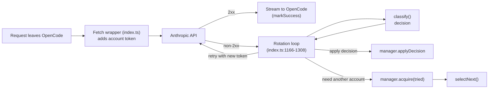
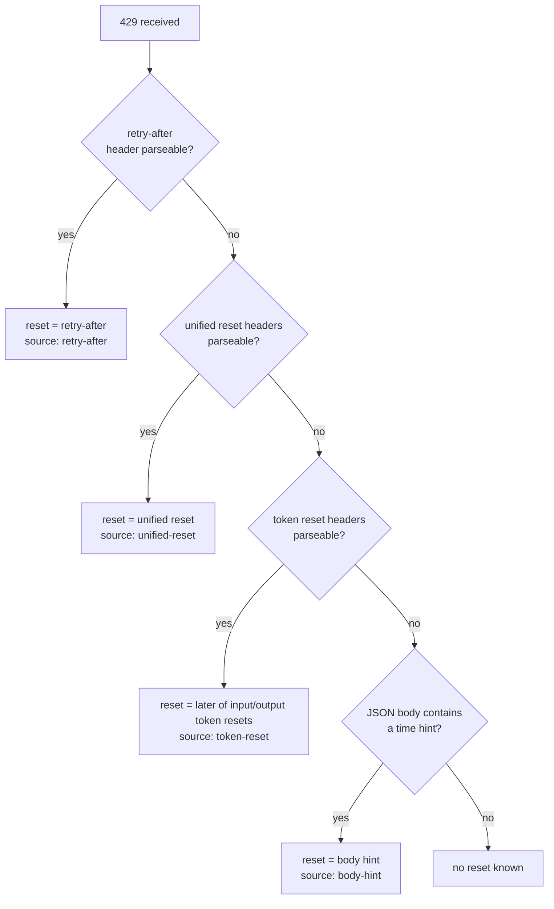
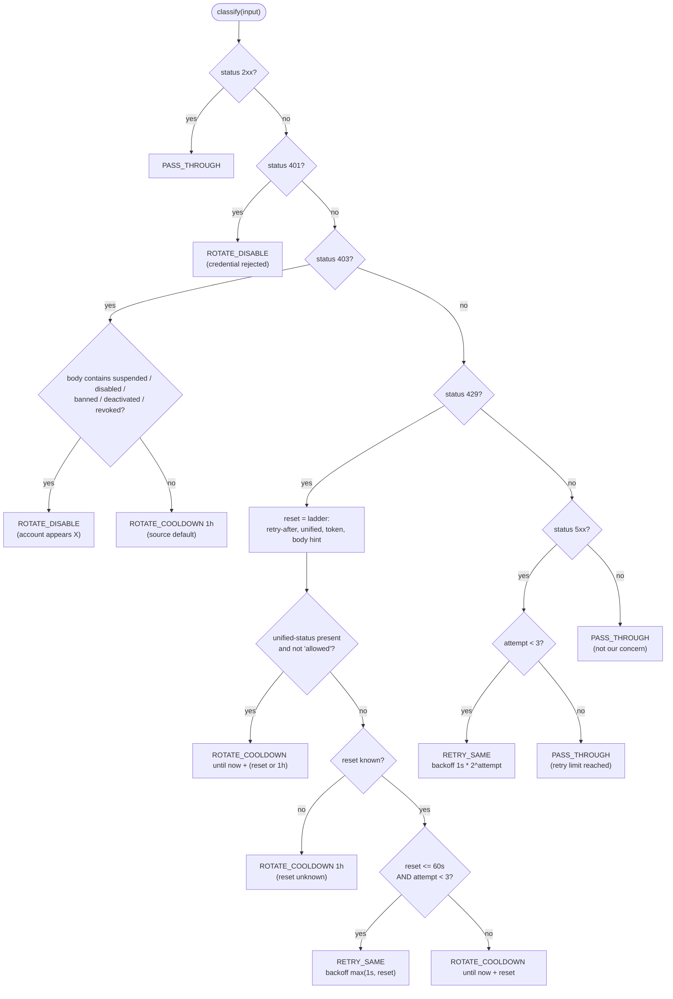
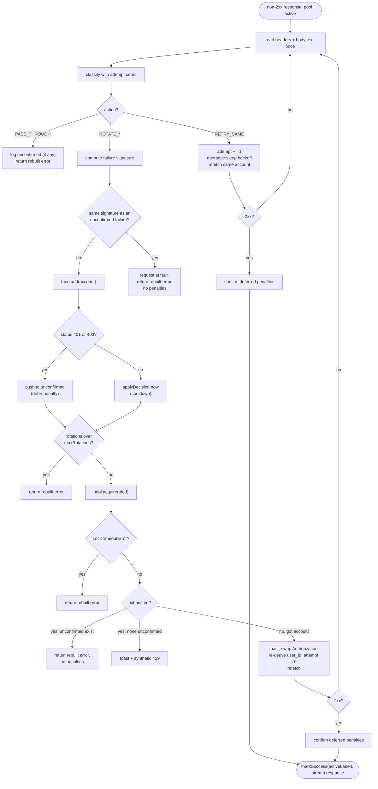
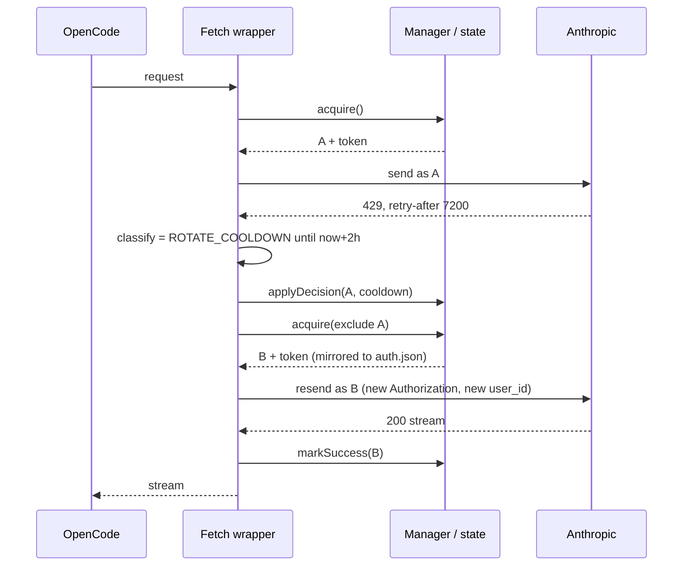
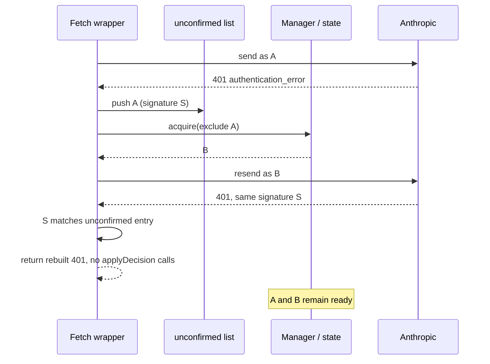
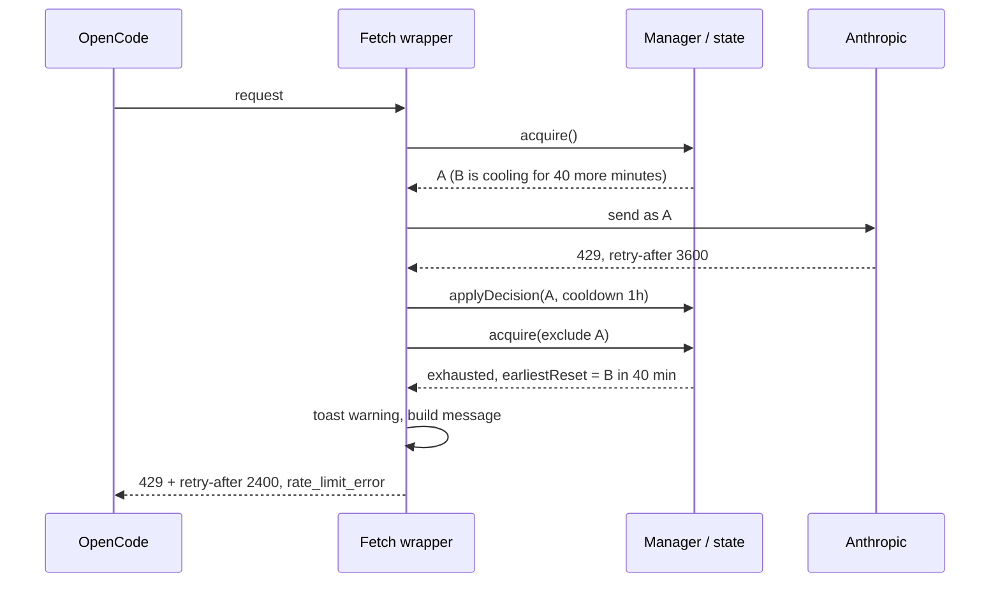
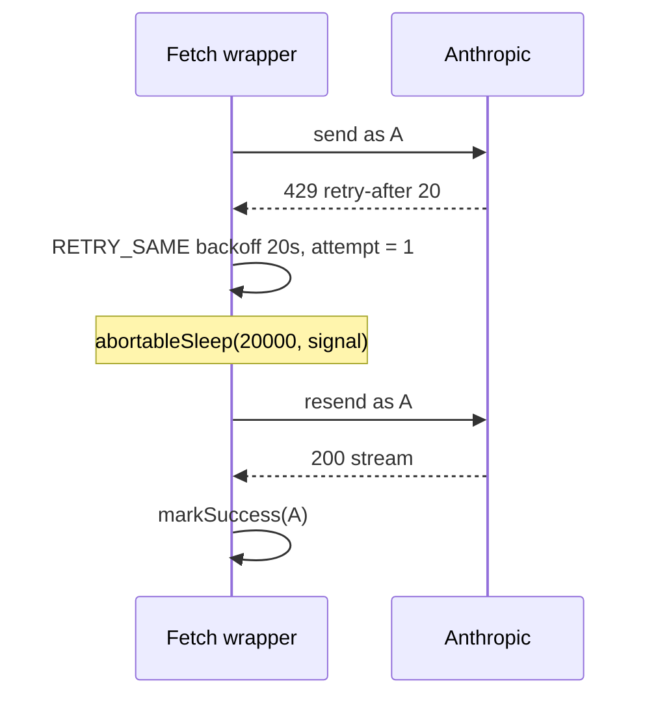

# 06 - Rotation and Failure Handling

## What this chapter covers

When Anthropic's API rejects a request, the bridge has to decide: *wait and try
the same account again? Park this account and switch to another? Mark it dead?
Or do nothing and let the caller see the error?* This chapter explains how that
decision is made and acted on:

1. **The classifier** (`src/pool/classifier.ts`) - a pure function that looks at
   an HTTP response (status, headers, body) and returns a *decision*.
2. **Selection** (`src/pool/selection.ts`) - a pure function that picks the next
   account.
3. **The rotation loop** (`src/index.ts:1145-1357`) - the code inside the fetch
   wrapper that gets a failed response, asks the classifier, applies the
   decision to the pool, swaps credentials and retries.
4. **The legacy single-account paths** for 401 and 429 when the pool is not in use
   (`src/index.ts:1315-1357`).

The storage and manager side (how accounts and cooldowns are persisted, how
`acquire()` and `applyDecision()` work) is in
[chapter 05](05-account-pool-overview.md).

### Vocabulary

* **HTTP status code** - a three-digit number on every response. `2xx` = success,
  `4xx` = the request or credentials were refused, `5xx` = the server failed.
* **429 "Too Many Requests"** - you exceeded a rate limit. For Claude
  subscriptions this means a quota window (5-hour or 7-day) is spent.
* **401 "Unauthorized"** - the credential was not accepted.
* **403 "Forbidden"** - the credential was understood but not allowed.
* **5xx / 529** - server-side failure; `529` is Anthropic's "overloaded".
* **Response header** - metadata lines on a response (`retry-after: 30`).
  Header names are case-insensitive; the bridge lowercases them.
* **`retry-after`** - a standard header saying how long to wait. It may be a
  number of seconds (`30`) or a date (`Wed, 21 Oct 2026 07:28:00 GMT`).
* **Cooldown** - the pool's bookkeeping for "do not use this account until time
  T".
* **SSE (Server-Sent Events)** - the streaming format of successful responses:
  the reply arrives as a long-lived sequence of small events. This matters in
  section 8.1.
* **Epoch seconds / epoch milliseconds** - a time expressed as the number of
  seconds (or ms) since 1970-01-01 UTC. `1787172000` is epoch seconds.

---

## 1. The big picture

The classifier and selector are deliberately **pure**: no I/O, no clock reads
(time is passed in), no state. That makes them easy to test and impossible to
break by timing. All side effects live in the manager and the loop.

---

## 2. The classifier

`classify(input: ClassifyInput): RotationDecision` is the single public entry
point (`classifier.ts:403-410`). `input` is `{ status, headers, bodyText?, now,
attempt? }` (`types.ts:162-171`). `headers` must already be lowercased.

The whole thing is wrapped in a `try/catch`: if anything unexpected throws, or
the input is not an object, the answer is `PASS_THROUGH` ("Classifier could not
safely inspect the response" / "Invalid classifier input"). The principle is
that a bug in classification must never turn into a rotation or a disable; the
worst case is the caller sees the original error.

### 2.1 Constants

| Constant | Value | Meaning | Source |
| --- | --- | --- | --- |
| `RETRY_SAME_MAX_RESET_SECONDS` | `60` | A 429 whose reset is at most this many seconds away is "short": wait and retry the same account | `classifier.ts:3` |
| `DEFAULT_UNKNOWN_COOLDOWN_MS` | `3_600_000` (1 hour) | Cooldown used when we cannot tell when an account will recover, and for a non-suspension 403 | `classifier.ts:4` |
| `MAX_TRANSIENT_ATTEMPTS` | `3` | Cap on consecutive same-account retries (both short-429 and 5xx) | `classifier.ts:5` |
| `UNIFIED_RESET_HEADERS` | `anthropic-ratelimit-unified-reset`, `...-5h-reset`, `...-7d-reset` (in that order) | Candidate "when does my limit reset" headers | `classifier.ts:11-15` |
| `UNIFIED_STATUS_HEADER` | `anthropic-ratelimit-unified-status` | Account-level verdict | `classifier.ts:17` |
| `UNIFIED_CLAIM_HEADER` | `anthropic-ratelimit-unified-representative-claim` | Names which window is the binding one | `classifier.ts:18` |
| `CLAIM_RESET_HEADERS` | `five_hour` -> `...-5h-reset`; `seven_day` -> `...-7d-reset` | Maps a claim name to its reset header | `classifier.ts:20-23` |
| `TOKEN_RESET_HEADERS` | `anthropic-ratelimit-input-tokens-reset`, `...-output-tokens-reset` | The documented per-token-bucket resets of the pay-as-you-go API | `classifier.ts:25-28` |
| `ACCOUNT_DISABLED_MARKERS` | `suspended`, `disabled`, `banned`, `deactivated`, `revoked` | Words that, in a 403 body, mean "permanently dead account" | `classifier.ts:30-36` |

The code comment at `classifier.ts:7-10` states that the `unified` header names
and value formats were "verified against live Anthropic OAuth subscription
traffic" and are epoch *seconds*, not RFC 3339 dates. Anthropic does not
publicly document these headers, which is why the source of each decision is
recorded (`DecisionSource`, chapter 05 section 4). The live fixtures are pinned
in `classifier-live.test.ts` (captured 2026-08-19).

### 2.2 Input headers the classifier reads

| Header | Read by | Used for |
| --- | --- | --- |
| `retry-after` | `resolveRetryAfter` | First-choice reset hint (seconds, epoch, or HTTP-date) |
| `anthropic-ratelimit-unified-status` | `unifiedStatusRejects` | If present and not `allowed` (case-insensitive, trimmed): the account's window is exhausted |
| `anthropic-ratelimit-unified-representative-claim` | `resolveUnifiedReset`, `resolveWindows` | Which window is binding: `five_hour` or `seven_day` |
| `anthropic-ratelimit-unified-5h-reset` | `resolveUnifiedReset`, `resolveWindows` | When the 5-hour window frees up |
| `anthropic-ratelimit-unified-7d-reset` | `resolveUnifiedReset`, `resolveWindows` | When the 7-day window frees up |
| `anthropic-ratelimit-unified-reset` | `resolveUnifiedReset` | Generic reset (the live fixture shows it equals the binding window's reset) |
| `anthropic-ratelimit-input-tokens-reset`, `anthropic-ratelimit-output-tokens-reset` | `resolveTokenReset` | Per-bucket reset; the **later** of the two is used |

Headers that appear in real traffic but are **not** read: `...-5h-status`,
`...-7d-status`, `...-5h-utilization`, `...-7d-utilization`,
`...-overage-status`, `...-fallback` (see `classifier-live.test.ts:13-24`).
`readHeader` uses `Reflect.get` inside a `try`, so an odd headers object cannot
make the classifier throw (`classifier.ts:51-58`).

### 2.3 How a reset value is read (`normalizeResetValue`)

Every reset-like value, whatever header it came from, goes through one
normalizer (`classifier.ts:60-92`) which answers: **"how many seconds from
`now` until this happens?"** (`undefined` if it cannot tell).

| Value looks like | Interpreted as | Result |
| --- | --- | --- |
| Not a string or number, or empty/whitespace | no information | `undefined` |
| Integer (optional sign) `>= 1_000_000_000_000` | epoch **milliseconds** | `(value - now) / 1000` |
| Integer `>= 1_000_000_000` (and `< 1e12`) | epoch **seconds** (e.g. `1787172000`) | `value - now/1000` |
| Integer below `1_000_000_000` (e.g. `30`, `3600`) | already a delta in **seconds** | `value` |
| Anything else non-numeric (e.g. `2026-10-21T07:28:00Z`, `Wed, 21 Oct 2026 07:28:00 GMT`) | a date, parsed with `Date.parse` | `(timestamp - now) / 1000`; unparseable -> `undefined` |

The result is clamped at 0 (`Math.max(0, ...)`) so a reset time already in the
past becomes "now", never a negative number. A comment in the live test explains
the stakes: misreading epoch *seconds* as *milliseconds* would put the reset ~56
years in the past and "permanently strand the account".

Caveat from my reading: the integer rule requires digits only, so a *decimal*
such as `"30.5"` falls through to `Date.parse`, which returns `NaN` in V8 (the
reset is ignored and the next rung is tried), and `"1.5"` parses as a date in
the year 2001 (result clamps to 0 seconds). Real `retry-after` values are
integers or HTTP-dates, so this is theoretical.

### 2.4 The reset fallback ladder (for 429)

For a 429 the classifier tries four sources **in order** and takes the first
that yields a value (`classifier.ts:349-353`):

**Rung 1 - `retry-after`** (`resolveRetryAfter`, `classifier.ts:94-101`): the
normalizer applied to the header.

**Rung 2 - unified reset** (`resolveUnifiedReset`, `classifier.ts:117-136`):

1. If `representative-claim` is `five_hour` or `seven_day` (trimmed,
   case-insensitive), read the matching `5h-reset`/`7d-reset` header. If it
   parses, use it. "Prefer the window the server says is actually binding."
2. Otherwise try `unified-reset`, then `5h-reset`, then `7d-reset`, and use the
   first that parses.

**Rung 3 - token resets** (`resolveTokenReset`, `classifier.ts:138-150`): parse
both token-bucket reset headers, keep the ones that parsed, and take the
**maximum** (the account is not usable until *both* buckets are back).

**Rung 4 - body hint** (`resolveBodyHint`, `classifier.ts:219-243`). The body
must be valid JSON. Three sub-attempts, in order:

1. `durationFromMessage` on `error.message` (`classifier.ts:152-177`): regex
   `(?:in|after)?\s*(<number>)\s*(<unit>)\b` finds the first "number + unit" such
   as `45 seconds`, `2 minutes`, `1.5h`, `300ms`. Unit table: `ms`/milliseconds
   x0.001; `s`/`sec`/seconds x1; `m`/`min`/minutes x60; `h`/`hr`/hours x3600;
   `d`/days x86400. Because "in/after" is optional, any "number unit" pair in
   the message matches (e.g. "per 1 minute" would read as 60 s). It is a
   heuristic.
2. `timestampFromMessage` (`classifier.ts:179-193`): an ISO-8601 timestamp in the
   message (`2026-10-21T07:28:00Z` or with offset), else a 10-13 digit number
   treated as epoch seconds/ms via the normalizer.
3. `findResetField` (`classifier.ts:195-217`): breadth-first search through the
   whole JSON for a key named `resetsAt` or `reset_at`, visiting at most 10,000
   nodes, normalizing the first usable value.

If nothing yields a value, there is **no reset** and the account gets the
conservative 1-hour cooldown (section 3).

### 2.5 The account-level verdict: `unifiedStatusRejects`

(`classifier.ts:103-115`.) If `anthropic-ratelimit-unified-status` is present as
a string and, trimmed and lowercased, is **anything other than `allowed`**, the
function returns true. The doc comment: "Anything other than 'allowed' means
this account is out for the current window, which no amount of retrying or
token refreshing can clear - only using a different account will."

Observation (my reading): any non-`allowed` value counts, including a value such
as `allowed_warning` if Anthropic sends one. That is only consulted on a 429, so
the practical risk is small.

### 2.6 Recording both quota windows (`resolveWindows`)

(`classifier.ts:282-310`.) Independently of which window is binding, the
classifier extracts both subscription windows into `decision.windows`:

* `five` = normalized `5h-reset` header; `seven` = normalized `7d-reset`.
* `claim` = lowercased `representative-claim`; `binding` is `undefined` if the
  header is absent, `"five_hour"`/`"seven_day"` if recognised, and `null` for any
  other value.
* If neither window parsed **and** `binding` is `null`/`undefined`, return
  `undefined` (nothing to record).
* Otherwise return `{ fiveHourReset, sevenDayReset, binding }` where each reset is
  converted back to an **absolute** epoch-ms time (`now + seconds * 1000`) or
  `null` if not disclosed.

How it lands in `rotation-state.json`: `applyDecision` passes `decision.windows`
to `markCooldown`, which only overwrites a window that is non-null (so learning
the 5-hour reset does not erase a known 7-day reset) and sets `bindingWindow`
unless it is `undefined` (chapter 05 section 6.10). Rotation itself ignores the
windows; they exist so the dashboard can show "5h resets at X / 7d resets at Y".

Where windows are and are not captured:

| Decision | `windows` attached? |
| --- | --- |
| 429 with `unified-status` rejecting | Yes |
| 429 with a known reset (short or long) | Yes (but a short `RETRY_SAME` decision is never written to state) |
| 429 with no reset known (1 h default) | No |
| 403, 401, 5xx, pass-through | No |
| 2xx responses | Not classified at all, so the headers on healthy responses are not recorded |

---

## 3. Decision table: every outcome of `classifyInternal`

Evaluated top to bottom (`classifier.ts:312-401`). `now` is injected;
`attempt` = how many same-account retries this request has already made.

| # | Condition | Action | When / value | `source` | Source line |
| --- | --- | --- | --- | --- | --- |
| 1 | status 200-299 | `PASS_THROUGH` | reason "Successful response" | `status` | 316 |
| 2 | status 401 | `ROTATE_DISABLE` | "Anthropic rejected this account's credential; re-login required" | `status` | 322-328 |
| 3 | status 403 and lowercased body contains a marker (checked in order `suspended`, `disabled`, `banned`, `deactivated`, `revoked`) | `ROTATE_DISABLE` | reason `Account appears <marker>` | `body-hint` | 330-339 |
| 4 | status 403, no marker (or no body) | `ROTATE_COOLDOWN` | `until = now + 3_600_000` (1 h) | `default` | 340-345 |
| 5 | status 429, `unified-status` present and != `allowed` | `ROTATE_COOLDOWN` | `until = now + reset` if a reset was found by the ladder, **else** `now + 1 h`; carries `windows` | ladder source, or `default` | 360-371 |
| 6 | status 429, a reset known, `reset <= 60 s` **and** `attempt < 3` | `RETRY_SAME` | `backoffMs = max(1000, reset*1000)`; carries `windows` | ladder source | 265-273, 373-375 |
| 7 | status 429, a reset known, `reset > 60 s` **or** `attempt >= 3` | `ROTATE_COOLDOWN` | `until = now + reset`; carries `windows` | ladder source | 274-279, 373-375 |
| 8 | status 429, no reset known anywhere | `ROTATE_COOLDOWN` | `until = now + 1 h`, reason "Rate limit reset is unknown; conservatively cooling the account" | `default` | 376-381 |
| 9 | status 500-599 and `attempt < 3` | `RETRY_SAME` | `backoffMs = 1000 * 2^attempt` -> 1 s, 2 s, 4 s | `status` | 384-395 |
| 10 | status 500-599 and `attempt >= 3` | `PASS_THROUGH` | "Transient retry limit reached" | `status` | 397 |
| 11 | any other status (1xx, 3xx, 400, 404, 408, 413, 422, ...) | `PASS_THROUGH` | "Response status does not trigger rotation" | `status` | 400 |
| 12 | classifier threw / input not an object | `PASS_THROUGH` | "Classifier could not safely inspect the response" | `status` | 405-408 |

Notes on the table:

* **Rows 5 vs 6/7 - "status outranks retry-after".** The account-level verdict
  is checked *before* the reset is used to choose between retry and rotate.
  Without it "a short retry-after would keep us retrying an account whose 5-hour
  or 7-day quota is already spent" (`classifier.ts:355-357`; test
  `classifier-live.test.ts:49`).
* **Which reset is used in row 5.** `reset` comes from the ladder, so a
  `retry-after` header (rung 1) beats the binding-window reset (rung 2). Combined
  with a rejecting status, the cooldown is then only as long as `retry-after`
  says, which could be shorter than the real window. The tests only assert the
  *action* in that combination (`classifier-live.test.ts:49-64`), not the
  `until`. When `retry-after` is absent, the binding window's reset is used
  (tests at lines 78-103). README says "preferring whichever window
  `representative-claim` reports" without mentioning this precedence.
* **Row 7 with `attempt >= 3`** turns a short reset into a cooldown of that
  short duration (e.g. 20 s). This is the escape hatch from infinite retry:
  "an account that keeps returning a short window would otherwise be retried
  forever, hanging the request" (`classifier.ts:261-264`; audit M1 tests,
  `security-fixes.test.ts:26-49`).
* **Row 9** uses its own sanitised attempt counter (non-finite or negative becomes
  0, fractions floored; `classifier.ts:385-388`). Row 6 uses `input.attempt ?? 0`
  directly.
* **Rows 3 and 4 inspect the body as a substring.** The marker search is
  `body.toLowerCase().includes(marker)` anywhere in the 403 body, so a message
  such as "this feature is disabled for your organization" matches `disabled`.
  The loop's two-account confirmation (section 6.4) is what limits the damage
  of such a false positive.
* **Row 2 (401) says "disable"**, but in the loop the penalty is deferred until
  another account succeeds (section 6.4). The classifier only states what *would*
  be done.
* The 529 "overloaded" status is a 5xx so it follows rows 9-10.

### 3.1 Classifier flowchart

---

## 4. Selection (`selection.ts`)

`selectNext(state, now, exclude = new Set()): SelectionResult`
(`selection.ts:16-68`). Used by `manager.acquire()` and `manager.exhaustionInfo()`.

### 4.1 `isAvailable(account, now)` (`selection.ts:3-8`)

An account is usable iff **not disabled** and (`cooldownUntil` is `null` **or**
`cooldownUntil <= now`). A cooldown whose timestamp equals or precedes `now` has
expired. Nothing needs to "wake up" an account: time passing is enough (test
`selection.test.ts:119`).

### 4.2 Ordering rules

1. **Sticky active account.** If `activeLabel` is set, is not in `exclude`, has
   an entry in `state.accounts`, and is available, return it
   (`selection.ts:21-27`). So one account keeps serving all requests until it
   fails. A stale `activeLabel` naming a missing account falls through
   (test line 137).
2. **Otherwise the best available other account.** Candidates are accounts not in
   `exclude` and available. Sort by, in order (`selection.ts:30-38`):
   1. lowest `failureCount`,
   2. lowest (oldest) `updatedAt` - the least recently touched, which acts like
      "longest idle first",
   3. label in plain string order (UTF-16 code-unit comparison, not locale), a
      stable final tie-break.
   Return the first. (Tests: lines 43, 105, 147.)
3. **Otherwise exhausted** (`selection.ts:44-67`). The result is
   `{ kind: "exhausted", earliestReset, cooling, disabled }` where:
   * `cooling` = accounts that are **not disabled** with `cooldownUntil > now`,
     as `{label, until}` sorted by `until` ascending;
   * `disabled` = labels with `disabled === true`, sorted alphabetically;
   * `earliestReset` = `cooling[0]?.until`, or `null` if nothing is cooling
     (all disabled, or the pool is empty).

`exclude` removes accounts from steps 1 and 2 only. Excluded accounts that are
*cooling* still show up in `cooling` and *disabled* ones in `disabled`, because
those lists are computed from every account. An excluded account that is merely
"failed but not yet penalised" (a deferred 401/403) appears in neither list -
which is how `describeExhaustion` can end up saying "every account failed this
request" (chapter 05 section 7.1).

An empty pool is `exhausted` with `earliestReset: null` and empty lists (test
line 128).

Consequence: a recovered account does not reclaim the active slot. After
account A's 2-hour cooldown ends, the pool stays on B until B fails.

---

## 5. Where the loop sits in the fetch wrapper

The rotation loop is one block inside the plugin's custom `fetch` (chapter 03
covers the whole request pipeline). The relevant lifecycle for a request:

1. **Start** (`src/index.ts:904-927`): `usePool = await currentPoolActive()`. If
   true, `pool.acquire()`:
   * throws `LockTimeoutError` -> return **503** `buildPoolBusyResponse()`;
   * returns `exhausted` -> log, `toast("warning", ...)`, return **429**
     `buildPoolExhaustedResponse(...)` *without calling Anthropic at all*;
   * returns `ok` -> `activeLabel = label`, `accessToken = token`.
2. Headers and body are rewritten (chapters 03/04). Whether the bridge itself
   injected `metadata.user_id` is remembered in `ownsUserId`
   (`index.ts:972,1028`), set back to `false` if the rewrite failed
   (`index.ts:1119`).
3. `doFetch()` sends the request (`index.ts:1149-1154`); it closes over
   `outHeaders` and `body`, so later changes to those apply to retries.
4. `let response = await doFetch()` (`index.ts:1156`).
5. **If `usePool && activeLabel && !response.ok`** -> the rotation loop below.
6. If the response is OK, `markSuccess` (section 6.9).
7. Otherwise legacy paths (section 9) run only when `!usePool`.
8. Tool-name mapping and streaming conversion of the response proceed
   (chapter 04).

---

## 6. The rotation loop in detail

### 6.1 Why it only runs before the body is read

The comment at `index.ts:1160-1165` states the rule: this block "runs BEFORE
response.body is read below, which is the only point where rotation is safe:
once SSE streaming has begun, a second stream's message ids and content-block
indices cannot be spliced into the first."

In plain terms: a successful reply is a *stream*. Suppose account A starts
streaming "Hello, wor..." and then fails mid-way. If we switched to account B and
began a new stream, the new stream carries its own message id and numbers its
content blocks from zero, so it cannot be stitched onto the half-delivered first
stream; the consumer would see a corrupt conversation. So the bridge only
rotates when the **status line is already an error and no body has been
consumed**. The loop only consumes **non-2xx** bodies, which are short JSON error
envelopes, never live streams. Errors that arrive *inside* an already-started
stream are passed through untouched (README, `types.ts:109-116`).

### 6.2 Setup variables (`index.ts:1167-1180`)

| Variable | Meaning |
| --- | --- |
| `maxRotations` | Number of enrolled accounts, from `pool.listLabels()` (a keychain list call on macOS). Safety cap on switches. |
| `rotations` | How many switches have happened this request. |
| `attempt` | Consecutive same-account retries made; passed to the classifier; reset to 0 on each switch. |
| `tried` | `Set<string>` of labels already used and failed this request; passed to `acquire()` as the exclusion set. |
| `unconfirmed` | List of `{label, decision, signature}` for 401/403 failures whose penalties are **deferred** (section 6.4). |
| `confirmPenalties()` | Applies every deferred penalty (via `applyDecision`) and empties the list. |
| `unconfirmedLabels()` | `"A", "B"` string for log lines. |

`recordPoolState(what, action)` (`index.ts:535-541`) wraps every state write the
loop does: it catches *any* error and logs `could not record <what>;
continuing: ...`. Reason (comment above it): bookkeeping waits on a cross-process
lock that "a slow token refresh elsewhere can hold past the 10s timeout; that
must never fail a request."

### 6.3 Numbered workflow

Each pass of `for (;;)` handles one failed response.

1. **Capture headers.** Copy every response header into a plain object with
   lowercased keys (`index.ts:1183-1186`). (Note: this inner `headers` shadows
   the outer request `Headers` object, only inside the loop.)
2. **Read the body once**: `const bodyText = await response.text()`
   (`index.ts:1187`). A `Response` body can be read only once, so everything
   after must use `bodyText`.
3. **Define `rebuild()`** (`index.ts:1188-1200`): constructs a fresh `Response`
   from `bodyText` with the original status, statusText and headers **minus
   `content-encoding` and `content-length`**. Why: `fetch` transparently
   decompresses (gzip/br), so after `text()` the bytes are already decoded.
   Passing the original `content-encoding: gzip` would tell the consumer to
   decompress plain text, and the original `content-length` would describe bytes
   that no longer exist. Either "corrupt[s] the error downstream" (the code
   comment). Every path that gives the failure back to the caller uses
   `rebuild()`.
4. **Classify**: `pool.classifyResponse({status, headers, bodyText, now:
   Date.now(), attempt})` (`index.ts:1202-1208`).
5. **`PASS_THROUGH`** (`index.ts:1210-1217`): if there are unconfirmed penalties,
   log "no other account succeeded, so ... not penalised"; **return
   `rebuild()`**. The error goes to the caller; nothing was penalised.
6. **`RETRY_SAME`** (`index.ts:1219-1232`):
   1. `attempt += 1`;
   2. log `<label>: <reason>; retrying in <ms>ms`;
   3. `await abortableSleep(backoffMs ?? 1000, init?.signal)` - sleeps, but
      rejects immediately if the user cancelled the request (the caller's
      `AbortSignal`); `abortableSleep` (`index.ts:518-529`) clears its timer and
      rejects with `signal.reason`, and bails at once if already aborted;
   4. `response = await doFetch()` - same account, same token;
   5. if `response.ok`: `confirmPenalties()` then `break` out of the loop
      (success); otherwise `continue` to step 1 with the new response.
7. **Otherwise it is a rotation decision** (`ROTATE_COOLDOWN` or
   `ROTATE_DISABLE`). Compute `signature = failureSignature(status, bodyText)`
   (section 6.5).
8. **Identical-failure check** (`index.ts:1235-1241`): if any entry already in
   `unconfirmed` has the same signature, the *request* is at fault, not the
   accounts. Log it and **return `rebuild()`** - neither account penalised.
9. `tried.add(activeLabel)`.
10. **Penalise now or defer** (`index.ts:1244-1255`):
    * status **401 or 403**: log "checking another account before penalising"
      and push `{label, decision, signature}` onto `unconfirmed`. No state change
      yet.
    * any other status (429, i.e. a cooldown from a rate limit): log "rotating
      account" and apply the decision immediately with
      `recordPoolState(... pool.applyDecision(...))` (cooldown written, active
      label cleared if it was this one).
11. **Cap**: `rotations += 1`; `if (rotations > maxRotations) return rebuild()`
    (`index.ts:1257-1258`). Because `tried` grows each pass and `acquire` fails to
    find new accounts once all are tried, this is a safety net rather than the
    normal exit.
12. **Get the next account**: `pool.acquire(tried)` (`index.ts:1260-1267`).
    `LockTimeoutError` -> log and **return `rebuild()`** (pass the current error
    through; nobody is blamed). Other errors propagate.
13. **No account left** (`next.kind === "exhausted"`):
    * if `unconfirmed` is non-empty (`index.ts:1268-1274`): log "no other account
      available to confirm ... at fault; passing the error through without
      penalising" and **return `rebuild()`**. Reason (comment): "Unconfirmed
      disables need manual repair; surface the real error."
    * else (`index.ts:1275-1284`): build the message via
      `pool.describeExhaustion(info)`, log it, show a `warning` toast (dedupe key
      `exhausted:<earliestReset>` so a counting-down message does not stack), and
      **return the synthetic 429** `buildPoolExhaustedResponse(message,
      earliestReset, Date.now())` (chapter 05 section 9.3).
14. **Switch**:
    1. Toast `info`: `Switched from "A" to "B" (<why>)` where `why` is `HTTP
       <status>, checking another account` when this failure was just deferred,
       else the decision's reason truncated to 60 characters
       (`index.ts:1286-1289`).
    2. `activeLabel = next.label`.
    3. `outHeaders["authorization"] = "Bearer <new access token>"`
       (`index.ts:1291`) - swapping the credential; every other header is kept.
    4. **Re-derive `metadata.user_id`** if `ownsUserId && typeof body ===
       "string"` (`index.ts:1292-1299`): parse `body`, call `userIdFor(token)`
       (which looks up the account's profile - cached per token - and builds the
       JSON string `{device_id, account_uuid, session_id}`), set
       `metadata.user_id` to it, or **delete** `metadata.user_id` if the profile
       could not be fetched, then re-stringify. Why: `user_id` embeds the
       *account's own uuid*; sending account B's token with account A's uuid
       would be an inconsistent identity (my inference, consistent with the code
       and with the fact the bridge only does this when it created the field
       itself, i.e. the caller had not supplied one). `ownsUserId` guards
       against overwriting a user_id that OpenCode or the user set.
    5. `attempt = 0` (fresh retry budget for the new account); log `now using
       account "B"`.
    6. `response = await doFetch()`.
    7. If `response.ok`: `confirmPenalties()` and `break`. Otherwise loop again
       (step 1) with the new account's failure.
15. **After the loop** (`index.ts:1310-1313`): if `usePool && activeLabel &&
    response.ok`, `markSuccess(activeLabel)`. This runs for *every* successful
    request, including ones that never entered the loop, and attributes the
    success to the account that finally served it (`activeLabel` was updated
    during switches).

### 6.4 The "unconfirmed penalties" mechanism

**The problem.** A 401 or 403 might mean "this account is dead" - or "this
*request* is malformed". The live test fixture shows exactly such a case: the API
answered `401 authentication_error: OAuth authentication is currently not
supported.` (`rotation-loop.test.ts:42-45`), a refusal of how the request looks,
not of the account. If the loop disabled an account every time it saw a 401,
one bad request shape would disable every account in turn, and a disabled account
needs manual repair.

**The rule** (comment at `index.ts:1171-1173`): a 401/403 penalty "waits until
another account SUCCEEDS with the same request: an identical failure blames the
request, and a 429 or 5xx from the next account says nothing about the first
one."

How the pieces implement it:

| Event | What the loop does |
| --- | --- |
| A fails 401/403 | Remember `{A, decision, signature}` in `unconfirmed`; switch to B. **No state change yet.** |
| B succeeds (2xx) | `confirmPenalties()` runs: A's decision is applied (disabled, or 1-hour cooldown for a non-marker 403). A really was the problem. |
| B fails with the **identical signature** | The request is the problem. Pass B's error through; A and B both unpenalised. |
| B fails differently with 401/403 | B is also deferred; try C. Both are applied only if some later account succeeds. |
| B gets 429 (or another cooldown) | B is cooled **immediately** (B's own limit is real information about B). A stays unconfirmed; if C later succeeds, A's penalty is confirmed too. |
| B gets a non-rotating error (e.g. 400, or 5xx retries exhausted) | `PASS_THROUGH`: pass through, A unpenalised (`rotation-loop.test.ts:113`). |
| No account left to try (exhausted) | Pass the error through; A unpenalised. |
| `LockTimeoutError` while acquiring | Pass the error through; A unpenalised. |

Deferred penalties land *after* the pool has switched to B. That is why
`applyDecision` clears `activeLabel` only if it still equals the penalised label
(chapter 05 section 10.2); otherwise confirming A's penalty would wipe out the
healthy pick of B.

### 6.5 `failureSignature(status, bodyText)` (`index.ts:543-551`)

A string identifying "what kind of failure this was", used to compare two
responses:

* If the body is JSON with an `error` object: `"<status>|<error.type>|<error.message>"`
  (missing parts become empty strings).
* Otherwise: `"<status>|<first 500 chars of trimmed body>"`.

It deliberately excludes things that differ between otherwise identical failures,
such as the request id (the test helper adds a random `request_id` to every body,
`rotation-loop.test.ts:34-35`, and the signature must still match). Signatures
are only compared against `unconfirmed` (401/403) entries, never against 429s.

### 6.6 What `maxRotations` and `tried` do together

`tried` guarantees no account is visited twice in one request. With N accounts,
at most N accounts can fail, after which `acquire(tried)` is `exhausted`. The
`rotations > maxRotations` check can only fire if the enrolled set changed
mid-request.

### 6.7 `LockTimeoutError` handling summary

| Where | Effect |
| --- | --- |
| Initial `acquire()` (`index.ts:909-915`) | 503 busy response, `retry-after: 5` |
| `acquire(tried)` during rotation (`index.ts:1263-1267`) | pass the current error through |
| Any `recordPoolState` write | swallowed, logged, request continues |
| Inside the manager (chapter 05 section 7.3) | uses holder's result or another account |

### 6.8 Exhaustion response and toast

When every account is cooling/disabled/tried and nothing is awaiting
confirmation:

* **Message** from `describeExhaustion` (chapter 05 section 7.1), e.g. `Claude
  pool exhausted — next account free in 1h 59m (personal)`.
* **Toast**: variant `warning`, titled "Claude pool", shown for 10 s
  (`POOL_TOAST_DURATION_MS`), and suppressed if an identical toast was shown in
  the last 60 s (`TOAST_REPEAT_MS`, `src/pool/notify.ts`); the dedupe key
  `exhausted:<earliestReset>` keeps the message stable even as the countdown text
  changes.
* **HTTP**: synthetic 429 with `retry-after` = seconds until the earliest reset
  (minimum 1), JSON `{"type":"error","error":{"type":"rate_limit_error","message":...}}`.
  It is a 429 and not a 401 so OpenCode will not prompt for re-login.

### 6.9 `markSuccess`

`pool.markSuccess(label)` -> `state.markSuccess` -> `cooldownUntil = null`,
`failureCount = 0`, `updatedAt = now`. Called inside `recordPoolState` so a busy
lock never fails the request. Side effect worth knowing: it rewrites
`rotation-state.json` (with an fsync) on essentially every successful request,
because `updatedAt` changes each time (chapter 05, `withLock` persists on any
change). It also runs when the response *headers* say 2xx, before the stream
finishes, so a mid-stream failure is still counted as a success.

---

## 7. Worked scenarios

Assume two enrolled accounts, `A` (active) and `B`, both healthy, `maxRotations
= 2`. Times are illustrative.

### Scenario 1 - A is rate-limited for 2 hours, B succeeds

Anthropic replies `429` with `retry-after: 7200` (or the unified headers saying
the 5-hour window resets in 2 h).

1. `acquire()` returns A (sticky). Request sent with A's token.
2. 429 arrives. Loop: body read; classify -> row 7 (reset 7200 s > 60): `ROTATE_COOLDOWN`,
   `until = now + 7_200_000`.
3. Signature `429|rate_limit_error|...`; no unconfirmed entries; `tried = {A}`.
4. Status is 429 (not 401/403), so `applyDecision(A)` runs immediately: A gets
   `cooldownUntil`, `failureCount = 1`, window times recorded; `activeLabel`
   cleared.
5. `rotations = 1`. `acquire({A})`: selection skips A, picks B; B's token is
   refreshed if near expiry; `setActive(B)`; mirrored to `auth.json`.
6. Toast "Switched from "A" to "B" (Account rate limit resets in 7200 seconds)".
7. `Authorization` swapped; if the bridge owns `metadata.user_id` it is rebuilt
   for B; `attempt = 0`.
8. Request re-sent; B returns 200. `confirmPenalties()` (nothing pending); break.
9. `markSuccess(B)`. Later requests keep using B (sticky) even after A's
   cooldown expires.

### Scenario 2 - A gets 401, B gets the identical 401: nobody penalised

Both replies: `401 {"type":"error","error":{"type":"authentication_error","message":"OAuth authentication is currently not supported."}}`.

1. Request as A -> 401. classify -> row 2 `ROTATE_DISABLE`.
2. Signature `401|authentication_error|OAuth authentication is currently not
   supported.`; `unconfirmed` is empty so no match; `tried = {A}`.
3. Status 401 -> **defer**: push `{A, ...}` to `unconfirmed`; log "checking
   another account before penalising". No state written.
4. `acquire({A})` -> B; toast "Switched ... (HTTP 401, checking another
   account)"; resend as B.
5. B -> 401 with the same body. classify -> `ROTATE_DISABLE` again; signature
   identical to A's -> **repeated** found.
6. Log: `"A" and "B" failed identically (HTTP 401); the request is at fault, not
   the accounts - passing the error through without penalising either`.
7. Return `rebuild()` (the 401). `unconfirmed` is dropped; neither account is
   disabled (`rotation-loop.test.ts:121`). OpenCode sees one 401.

Variant (same code path, different end): if B had **succeeded**, step 5 would be
`confirmPenalties()` which disables A (`rotation-loop.test.ts:94`); if B had
been rate-limited, B gets cooled and A stays untouched when the 429 is finally
returned (`rotation-loop.test.ts:102`).

### Scenario 3 - everything is cooling: fail-fast 429

`B` is already cooling until 40 minutes from now (from an earlier request). A
now returns 429 with `retry-after: 3600`.

1. A -> 429; classify -> `ROTATE_COOLDOWN` 1 h. `applyDecision(A)` immediately.
2. `acquire({A})`: A excluded and now cooling; B cooling; nothing available.
   `selectNext` returns exhausted with `cooling = [B (40m), A (60m)]`,
   `earliestReset` = B's time.
3. `unconfirmed` is empty, so the exhausted branch builds the message `Claude
   pool exhausted — next account free in 40m (B)`, logs it, toasts a warning.
4. Return a synthetic **429** with `retry-after: 2400` (seconds).

Had the very *first* `acquire()` (before sending anything) found both accounts
cooling, the same synthetic 429 would be returned without any call to Anthropic
(`index.ts:917-925`).

### Scenario 4 - 429 with a 20 s reset: same-account retry

`retry-after: 20`, status header `allowed` (or absent).

1. A -> 429. classify: reset 20 s <= 60 and `attempt = 0 < 3` -> `RETRY_SAME`,
   `backoffMs = 20000`.
2. Log `A: Rate limit resets in 20 seconds; retrying in 20000ms`. `attempt = 1`.
   `abortableSleep(20000, signal)` - the user can cancel during the wait.
3. Re-send as A (same token). If 200: `confirmPenalties()` (none), break,
   `markSuccess(A)`. Nothing was recorded in `rotation-state.json` apart from the
   success.
4. If it 429s again, steps repeat with `attempt = 2`, then `3`. At `attempt >= 3`
   the classifier switches to row 7: `ROTATE_COOLDOWN` until `now + 20 s` and the
   loop rotates to B. So the worst case spends about 3 x 20 s = 60 s waiting on A
   before moving on, and A is only parked for those 20 s.
5. If `retry-after` had been `5`, the wait is `max(1000, 5000)` = 5 s; if `0` or a
   past date, the wait is the 1-second minimum.

Short table for 5xx (same mechanism, no `retry-after`): 503 -> wait 1 s, retry;
503 again -> wait 2 s; again -> 4 s; a fourth 503 -> pass through the error.
Total of up to four requests to the same account. (Test:
`classifier.test.ts:130` for 529.)

---

## 8. Other classifier-to-loop interactions worth knowing

* **Mixed failures.** A 429 (cooled at once) followed by a 401 on B (deferred),
  then nothing left: exhausted with unconfirmed -> B's 401 passed through; A
  remains cooled, B untouched.
* **403 without a marker** is a 1-hour cooldown but is *deferred* like a 401
  (the loop test is on `status === 401 || 403`, `index.ts:1244`), so it is only
  applied if another account then succeeds.
* **Disabled-by-decision vs disabled-by-refresh**: a `ROTATE_DISABLE` applied
  through `applyDecision` triggers the same `onAccountDisabled` toast as a
  rejected refresh: `"<label>" disabled (<reason>); re-login, then claude-pool
  enroll` (`index.ts:736-739`).
* **Rotation only before the body** also means a mid-stream overload error is
  passed to OpenCode as it arrives; the failed account is *not* penalised by the
  loop because the response was `2xx` and `markSuccess` already ran.

---

## 9. The legacy single-account paths

When the pool is not active (`!usePool`: no accounts enrolled) the bridge uses
the original behaviour. These blocks run **after** the pool block and only if
`!usePool`.

### 9.1 Legacy 401 (`index.ts:1315-1333`)

1. On a 401, log `401 from Anthropic; refreshing token and retrying once`.
2. `refreshAuth(auth, client)` (`index.ts:407-460`) tries three layers in order:
   (1) the Claude CLI's own keychain/credentials file, but only if its access
   token is valid for more than 60 s; (2) OpenCode's stored refresh token;
   (3) the Claude CLI's refresh token, only if different from those already
   tried. A successful refresh is stored in memory first, then saved through
   `client.auth.set` (`storeAuth`); a save failure is logged but the new token
   stays usable in memory.
3. If refreshing **throws**: log, cancel the response body, return
   `buildAuthFailureResponse(detail)` - a synthetic **401**
   `{"type":"error","error":{"type":"authentication_error","message":"Claude OAuth credentials are no longer valid. <detail> Reconnect 'Claude Pro / Max (OAuth)' in OpenCode or run `claude login` again."}}`
   (`index.ts:369-387`).
4. If it returns a token **different from the one just used**: cancel the old
   body, set `Authorization`, and `doFetch()` once more.
5. If it returns `null` or the same token: fall through and the original 401 is
   returned to the caller (after tool mapping).

### 9.2 Legacy 429 (`index.ts:1335-1357`)

Comment: "refresh the token and retry, on the assumption that rate limits are
per-access-token." Up to two attempts (`retry = 0, 1`):

1. Log `429 rate limited (attempt N/2), refreshing token...`.
2. `refreshAuth`. If it throws: log and return `buildAuthFailureResponse` (a 401
   `authentication_error` for what was a 429, which may mislead).
3. If it returns `null`: log "Token refresh failed, returning 429" and `break`
   (caller receives the 429).
4. Set `Authorization` to the new token, `abortableSleep(1000 * (retry + 1))` -
   **1 s then 2 s** - cancel the old body, `doFetch()`.
5. Stop looping when the status is no longer 429.

This block is evaluated after the 401 block, so a retried-after-401 request that
then returns 429 enters it. There is **no 403 or 5xx handling** in the legacy
path, and no cooldown memory: each request starts from scratch.

Caveats from my reading (for the known-issues chapter):

* The legacy 429 logic assumes a refreshed token escapes the limit. Subscription
  limits are per-**account** windows (the very premise of the pool), so for a
  genuinely exhausted account this loop only burns a refresh and up to 3 s.
  Moreover `refreshAuth` Layer 1 can return the Claude CLI's existing valid access
  token, i.e. the same token again.
* A *refresh failure* during a 429 is reported to the user as an authentication
  error, not a rate limit.

---

## 10. Behaviour locked in by tests

| Test file | What it pins |
| --- | --- |
| `classifier.test.ts` | 30 s retry-after -> `RETRY_SAME` 30 000 ms (line 19); 3600 -> rotate with `until = NOW + 3.6e6` (27); boundary: 60 retries, 61 rotates (35, 42); RFC 3339 unified reset (49); later of two token resets (61); no hint -> 1 h cooldown (76); HTTP-date `retry-after` (84); suspension 403 disables (94); generic 403 cools (101); 401 disables (109); 2xx not inspected (123); 529 retried up to the limit (130); malformed headers/JSON never throw (141); `retry-after` outranks later rungs (154); duration in the message body (171); binding window absent/recorded (183, 193) |
| `classifier-live.test.ts` | Real captured headers: epoch-seconds interpretation (34); rejected status outranks short `retry-after` (49); allowed status honours short `retry-after` (66); `seven_day` / `five_hour` binding claim picks the matching reset (79, 95); healthy 200 untouched (107) |
| `security-fixes.test.ts` (M1) | Short-reset retries are capped; after the cap the account is rotated (26-49) |
| `selection.test.ts` | Active sticky; others by failureCount then updatedAt then label; cooling list ordered; disabled excluded and reported; past cooldown available; empty pool exhausted; `exclude` skips even the active account |
| `rotation-loop.test.ts` | Drives the real plugin with two file-backed accounts: 401 then success disables the first (94); 401 then 429 does not disable the first but cools the second (102); 401 then 400 penalises nobody (113); identical 401s blame the request (121) |

Not covered by an automated test that I found: the `RETRY_SAME` sleep path
inside the loop, the toast contents, the `user_id` re-derivation, and the
`LockTimeoutError` pass-through inside the loop.

---

## Key takeaways

* The **classifier is pure**: status + headers + body + clock -> one of four
  actions (`RETRY_SAME`, `ROTATE_COOLDOWN`, `ROTATE_DISABLE`, `PASS_THROUGH`),
  with the `source` of the evidence recorded.
* For 429 the reset time comes from a ladder: `retry-after`, then the
  `anthropic-ratelimit-unified-*` headers (preferring the `representative-claim`
  window), then token-bucket resets, then hints in the JSON body, else a 1-hour
  default. A rejecting `unified-status` always forces a cooldown.
* **60 seconds** is the line between "wait and retry the same account" and
  "switch accounts", and at most **3** same-account retries are allowed per
  account per request. 5xx errors back off 1 s, 2 s, 4 s, then pass through.
* 401 and 403 are **never penalised on one account's word alone**: the loop waits
  until another account succeeds with the same request, and identical failures on
  two accounts blame the request. Rate limits (429) are penalised immediately.
* Rotation happens only **before** the response body is read, because a second
  SSE stream cannot be spliced into a first. Error bodies are read once and
  re-emitted without `content-encoding`/`content-length`.
* After a switch the loop swaps the `Authorization` header, rebuilds
  `metadata.user_id` if the bridge owns it, resets the retry budget, and records
  `markSuccess` for whichever account finally served the request.
* When nothing is usable, the answer is a synthetic **429** with `retry-after`
  and a toast; if only the lock is busy, a **503**.
* Selection is **sticky**, then prefers fewest failures, then least recently
  updated, then label order.

## Quirks worth knowing (candidates for the known-issues chapter)

* README's "When rotation happens" table says a 401 disables the account and
  switches; actually the disable is deferred and may never be applied
  (`index.ts:1244-1249`). README also omits the 403-without-marker 1-hour
  cooldown and the 5xx retry ladder.
* With a rejecting `unified-status` **and** a `retry-after` header, the cooldown
  length follows `retry-after`, not the binding window (`classifier.ts:349-371`),
  so an exhausted account might return to rotation early and be re-cooled by its
  next 429.
* 403 suspension markers are plain substring matches (`classifier.ts:331-332`).
* `markSuccess` causes a locked state-file write on each successful request
  (`index.ts:1310-1313`, `rotation-state.ts:424-430`).
* The legacy 429 path retries on the unproven assumption that a new access token
  lifts a rate limit (`index.ts:1335-1337`) and reports refresh failure as a 401.
* The loop re-sends `body` as it stands in memory; this works because the bridge
  rewrites string bodies. A non-string (streamed) request body could not be
  replayed on retry (not verified against OpenCode's actual usage).

## Related chapters

* [05 - Account pool overview](05-account-pool-overview.md): storage, lock,
  `acquire`, `applyDecision`, refresh journal, synthetic response builders.
* [03 - Request pipeline](03-request-pipeline.md): everything the fetch wrapper
  does around this loop.
* [04 - Tools and translation](04-tools-and-translation.md): what happens to the
  successful response afterwards.
* [07 - Enrollment and the claude-pool CLI](07-enrollment-and-claude-pool-cli.md):
  re-enabling disabled or cooling accounts.
* [11 - Known issues and gotchas](11-known-issues-and-gotchas.md).
