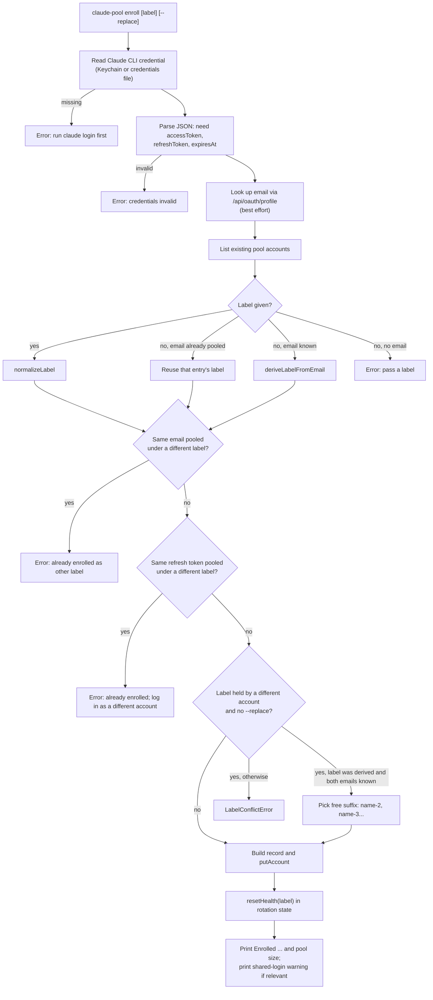
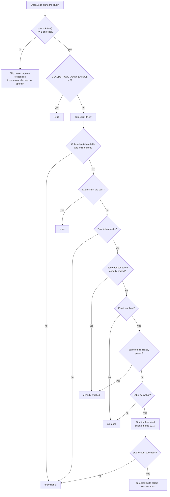
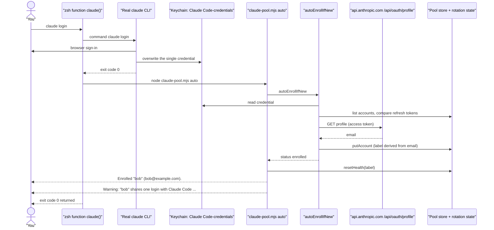

# 07 - Enrollment and the `claude-pool` CLI

## What this chapter covers

This chapter explains how accounts get into the multi-account "pool", and how you manage the pool afterwards.

- Why enrollment exists at all (one login slot, `claude login` overwrites it).
- How the bridge reads the Claude CLI's saved login, looks up the account's email, chooses a label, and decides whether it is a duplicate.
- Automatic enrollment (at OpenCode startup and via a shell hook), every outcome it can produce, and the guards around it.
- The "shared login" warning and why single-use refresh tokens make it matter.
- Every `claude-pool` subcommand: arguments, what it reads and writes, example output, exit codes.
- The full-screen terminal UI (`claude-pool dashboard`): screens, keys, rendering, how usage is fetched, and what happens when you quit mid-refresh.
- Supporting modules: `dashboard.ts` (plain-text status), `usage.ts` (the usage meter), `notify.ts` (toast pop-ups).
- Why the old `/claude-pool` slash command was archived.
- A step-by-step setup for two accounts and a troubleshooting table.

Plain-English glossary used throughout:

| Term | Meaning |
| --- | --- |
| **OAuth** | The "log in with your Claude account" mechanism. Instead of an API key, the app holds short-lived tokens issued after you log in in a browser. |
| **Access token** | A short-lived secret (hours) sent with every request to prove who you are. |
| **Refresh token** | A longer-lived secret used only to obtain a new access token. In this system it is **single-use**: using it invalidates it and returns a new one. |
| **Pool** | The set of enrolled Claude accounts the bridge can rotate between. Stored in the macOS Keychain (or files on other systems). See chapter 05. |
| **Label** | A short nickname for a pooled account, e.g. `alice`. |
| **Enroll** | Copy the account the Claude CLI is currently logged into into the pool. |
| **Keychain** | macOS's encrypted credential store, accessed with the `security` command. |
| **TTY** | An interactive terminal. When output is piped to a file or CI log, there is no TTY. |

---

## 1. Why enrollment is needed

Two separate programs each store exactly one Claude login:

1. The **Claude CLI** (`claude`), in the macOS Keychain under the service name `Claude Code-credentials` (or a JSON file on other systems).
2. **OpenCode**, in its own `auth.json`, in a single `anthropic` slot.

Running `claude login` for a second account overwrites the first account's credentials in the CLI's store (`src/pool/enroll.ts:199-206`, `scripts/claude-pool.mjs:5-14`, `SETUP.md:100-108`). Once overwritten, the first account's refresh token is gone, and the only way back is a fresh login.

Enrollment solves this by *copying* the CLI's current login into the pool's own storage before you log in as someone else. The pool then holds as many accounts as you enroll, and the bridge mirrors whichever one is active into OpenCode's single slot (README "Where credentials live").

The required order is therefore:

```
claude login          (account #1)
claude-pool enroll    (copy #1 into the pool)
claude login          (account #2; #1 is already safe)
claude-pool enroll    (copy #2 into the pool)
```

The pool is **opt-in**: with zero enrolled accounts the plugin behaves exactly like the single-account version.

---

## 2. Manual enrollment, step by step (`enrollFromClaudeCli`)

The core function is `enrollFromClaudeCli(opts)` at `src/pool/enroll.ts:207-270`. It is used by `claude-pool enroll` and by the TUI's `e` key.

### 2.1 Reading the Claude CLI credential

`readClaudeCliCredentialsRaw()` (`src/pool/enroll.ts:126-148`) returns the raw JSON text:

| Platform | Where it looks | Failure message |
| --- | --- | --- |
| macOS (`darwin`) | Runs `security find-generic-password -s "Claude Code-credentials" -w` (10 second timeout). `-w` prints only the secret value. | `No Claude CLI credentials found in the keychain (service "Claude Code-credentials"). Run \`claude login\` first.` |
| anything else | Reads the file at `claudeCredentialsPath()`: `$CLAUDE_CONFIG_DIR/.credentials.json` if that variable is set, otherwise `~/.claude/.credentials.json` (`src/keychain.ts:19-21`). | `No Claude CLI credentials found at <path>. Run \`claude login\` first.` |

`parseClaudeCredentials(raw)` (`src/pool/enroll.ts:79-100`) then validates it:

- Not valid JSON: `Claude CLI credentials are not valid JSON`.
- Must contain a `claudeAiOauth` object with string `accessToken`, string `refreshToken` and numeric `expiresAt` (a millisecond timestamp). Otherwise: `Claude CLI credentials are missing claudeAiOauth.{accessToken,refreshToken,expiresAt}`.
- Optional fields `subscriptionType` (e.g. `max`), `rateLimitTier` and `scopes` are carried along if present.

### 2.2 Looking up the email

`lookupEmail(accessToken)` (`src/pool/enroll.ts:154-172`) calls `GET https://api.anthropic.com/api/oauth/profile` (the `PROFILE_URL` constant, overridable with `ANTHROPIC_PROFILE_URL`, `src/constants.ts:66-68`) with headers `authorization: Bearer <token>`, `content-type: application/json`, and `anthropic-beta: oauth-2025-04-20`. It has a 15 second timeout. It returns `account.email_address`, falling back to `account.email`.

It is **best effort**: any failure (offline, non-2xx, timeout, bad JSON) returns `undefined` rather than throwing, because enrollment should still work offline or with an expired token (comment at `:150-153`). The consequence is that an account can be enrolled with no email; the TUI then shows an em dash for it and some duplicate detection (by email) is not possible for it.

Passing `resolveEmail: false` skips the lookup entirely; passing a function substitutes it (used by tests). The CLI's `enroll` command uses the default; the TUI passes `resolveEmail: true` (`scripts/claude-pool.mjs:313`), which is equivalent to the default.

### 2.3 Choosing and normalizing the label

Label choice (`src/pool/enroll.ts:223-234`), in priority order:

1. An explicit label from the user (`claude-pool enroll work`), passed through `normalizeLabel`.
2. If the same email is already enrolled: reuse *that* entry's label (so re-enrolling refreshes it).
3. Otherwise derive one from the email with `deriveLabelFromEmail`.
4. If there is no email and no explicit label: error `Could not determine an account label. Pass one explicitly: claude-pool enroll <label>`.

**`normalizeLabel`** (`src/pool/enroll.ts:40-66`) is strict because labels are used verbatim as the Keychain account name and, on non-macOS systems, as a file name. Rules applied in this order:

| Step | Rule | Error text (abridged) |
| --- | --- | --- |
| 1 | Trim whitespace and lowercase. | - |
| 2 | Must not be empty. | `Account label cannot be empty` |
| 3 | At most 64 characters (`MAX_LABEL_LENGTH`). | `Account label is too long (max 64 characters)` |
| 4 | Must not start with `-`; otherwise `security` would read it as one of its own command-line options. | `...cannot start with "-" (it would be read as a command option)` |
| 5 | Only `a-z 0-9 . _ -` allowed. | `...may only contain letters, digits, dot, underscore and hyphen` |
| 6 | Not `.`, `..`, and must not contain `..` anywhere (path-escape protection). | `...is not a safe filename` |

**`deriveLabelFromEmail`** (`src/pool/enroll.ts:69-77`): take the part before `@`, drop everything after the first `+` (plus-addressing), lowercase, delete any character outside `a-z 0-9 . _ -`, then run `normalizeLabel`. Examples (computed from the code): `Work.Account+tag@corp.io` becomes `work.account`; `alice@example.com` becomes `alice`. If nothing survives the cleaning, it throws `Cannot derive an account label from "<email>"`.

### 2.4 Matching: same account, same person, or just the same label?

An existing pool entry can "match" the incoming credential in three different ways, and each is handled differently (`src/pool/enroll.ts:220-265`):

| Match type | How detected | Why it exists | What happens |
| --- | --- | --- | --- |
| **Same email** | `findByEmail`, case-insensitive (`:175-179`) | After either the pool or the CLI refreshes, the two copies' refresh tokens differ, so token comparison alone cannot tell they are the same person (`:174`). | If the (explicit or derived) label equals the existing entry's label, the entry is refreshed in place. If you passed a *different* label, error: `<email> is already enrolled as "<label>". Enroll without a label to refresh its credentials.` |
| **Same refresh token** | Exact string match (`:242-244`) | The CLI's credential is literally the same login as a pooled one. | If the target label equals that entry's label, it is simply rewritten. Otherwise error: `That account is already enrolled as "<label>". Run \`claude login\` as a different account before enrolling again.` |
| **Same label, different account** | Label equal, not the same-email entry, refresh token differs (`:251-255`) | Two different people can derive the same label (`alice@work.com` and `alice@home.com` both give `alice`). | See below (conflicts). |

### 2.5 Label conflicts and `--replace`

When a different account already owns the label and `replace` is not set (`:256-265`):

- If the label was **derived** (not typed by the user) *and* both accounts have known emails, the code picks a free variant with `firstFreeLabel` (`alice`, then `alice-2`, `alice-3`, ...; `:181-187`). Rationale in the code comment: both people belong in the pool.
- Otherwise it throws `LabelConflictError` (`:19-30`):
  - existing account has a known email: `Label "x" already belongs to a different account (<email>). Choose another label or pass --replace.`
  - existing account has no email: `Label "x" belongs to an account whose email was never resolved; it may be this one. Pass --replace to overwrite it, or choose another label.`

With `--replace` (`opts.replace === true`) the conflict check is skipped and the old entry under that label is overwritten. Note that `--replace` does **not** bypass the two earlier checks (same email under another label, or same refresh token under another label); those still error.

After all checks, `toAccountRecord(label, creds, now, email)` (`:102-124`) builds the stored record: `label`, `oauth {access, refresh, expires}`, `enrolledAt`, plus optional `subscriptionType`, `rateLimitTier`, `scopes`, `email`. Optional keys are only assigned when present, because `undefined` keys vanish in JSON and would make a stored record differ structurally from the one just built (comment `:115-117`). The record is saved with `accounts.putAccount(record)`.

### 2.6 Resetting health on enroll

`enrollFromClaudeCli` itself only writes the credential. The **callers** then call `state.resetHealth(label)` (`scripts/claude-pool.mjs:139`, `:317`). That clears `disabled`, `cooldownUntil`, `failureCount` and `lastReason` for the account (`src/pool/rotation-state.ts:405-415`), while deliberately keeping observed quota-window info. Why: a revoked account that you log back into and re-enroll would otherwise report "Enrolled" while rotation kept skipping it as disabled (comment `scripts/claude-pool.mjs:136-138`). This is the recovery path in the SETUP troubleshooting table ("claude login, then claude-pool enroll clears the disabled flag").

### 2.7 Manual enrollment flowchart



---

## 3. Automatic enrollment

### 3.1 `autoEnrollIfNew` (`src/pool/enroll.ts:326-383`)

This function "adopts whatever account the Claude CLI is currently logged into, if the pool has not seen it before". Crucially it **never throws** (`:323-325`): it runs while the plugin is starting, and a failure to adopt a new account must not stop the existing pool from serving requests. Every error path becomes a status value.

It differs from manual enrollment in that it never asks questions, never accepts a label, and never overwrites anything.

Steps and outcomes, in order:

| # | Check | Outcome status | Meaning |
| --- | --- | --- | --- |
| 1 | Read + parse the CLI credential. | `unavailable` on any failure | Logged out, unreadable, or malformed. |
| 2 | `expiresAt <= now`. | `stale` | Expired access token. Rationale (`:342-343`): it would enter the pool only to fail its first request and get disabled, so leave it for an explicit `claude-pool enroll`. |
| 3 | List pool accounts. | `unavailable` if listing throws | Storage problem. |
| 4 | Any pooled account has the same refresh token. | `already-enrolled` (with `label`) | Same login. |
| 5 | Look up email (exceptions swallowed). No email. | `no-label` | There is no basis for a label. Auto-enroll will not invent one. |
| 6 | Any pooled account has the same email (case-insensitive). | `already-enrolled` (with `label`, `email`) | Same person with a diverged token. |
| 7 | `deriveLabelFromEmail` throws. | `no-label` | Email has no usable characters. |
| 8 | Pick `firstFreeLabel(label, existing)` (always suffixes on collision, never errors). | - | - |
| 9 | `putAccount` throws. | `unavailable` | Could not save. |
| 10 | Saved. | `enrolled` (with `label`, `email`) | New account in the pool. |

Matching is "by refresh token, then by email; never by label, since two different accounts may derive the same one" (`:319-322`).

### 3.2 Where it is called, and the guards

**(a) OpenCode startup** (`src/index.ts:734-773`):

```ts
poolActive = await pool.isActive();                       // :743
if (poolActive && process.env.CLAUDE_POOL_AUTO_ENROLL !== "0") {   // :748
  const adopted = await autoEnrollIfNew({ accounts: createAccountStore(createSecretBackend()) });
  if (adopted.status === "enrolled") {
    console.error(`[claude-pool] auto-enrolled "${adopted.label}" (${adopted.email}) from the Claude CLI`);
    toast("success", `Added "${adopted.label}" (${adopted.email}) to the pool`);
  }
}
```

Guards:

1. **Pool must already be non-empty** (`pool.isActive()` is "at least one label exists", `src/pool/manager.ts:258-260`). Installing the plugin must never silently capture credentials from someone who has not opted in (comment `src/index.ts:745-747`, SETUP table `SETUP.md:171-178`).
2. **`CLAUDE_POOL_AUTO_ENROLL=0`** disables the startup check. Any other value (including unset) leaves it on.
3. Only the `enrolled` status produces output (a stderr line and a success toast). `already-enrolled`, `stale`, `unavailable` and `no-label` are silent at startup.
4. The startup path does **not** call `resetHealth` after adopting (the CLI `auto` does). The next line, `pool.sync()` (`:761`), registers the new label in the rotation state, so a brand-new account starts healthy anyway.

If anything in this block throws, the catch at `:768-773` logs `[claude-pool] disabled (...)` and turns the pool off for this session. `autoEnrollIfNew` itself cannot trigger that, but `pool.isActive()` and `pool.sync()` can.

**(b) The `claude-pool auto` subcommand** (`scripts/claude-pool.mjs:153-173`). Important difference from startup: this path does **not** check whether the pool is empty (the guard lives only in `index.ts`). Running `claude-pool auto` against an empty pool will enroll the current login. See Key takeaways and chapter 11. Output per status:

| Status | Printed | Side effects |
| --- | --- | --- |
| `enrolled` | `Enrolled "<label>" (<email>).` then a shared-login warning if applicable | `state.resetHealth(label)` |
| `already-enrolled` | `Already pooled as "<label>".` | none |
| `stale` | `Claude CLI credential is expired; run \`claude login\` first.` | none |
| `no-label` | `Could not resolve the account email; use \`claude-pool enroll <label>\`.` | none |
| `unavailable` (default branch) | `No Claude CLI credential found.` | none |

The exit code is 0 in all five cases.

### 3.3 Auto-enroll decision flowchart



### 3.4 The shared-login warning

`labelSharingClaudeCliLogin(accounts, readCredentials)` (`src/pool/enroll.ts:277-288`) returns the label of the pooled account whose **refresh token is identical** to the one the Claude CLI currently holds, or `null` (also `null` if the CLI credential cannot be read). It only compares; the doc comment promises it never returns or logs a token.

`sharedLoginWarning(label)` (`:290-293`) produces:

```
"alice" shares one login with Claude Code on this machine; whichever refreshes first logs the other out. Run `claude login` again (as this or another account) and do not re-enroll it.
```

**Why it matters.** Refresh tokens are single-use. Right after enrollment, the pool and the Claude CLI hold *copies of the same* refresh token. Whichever one refreshes first receives a new refresh token and the old one dies, so the other copy becomes invalid and that side is silently logged out (README "Refresh tokens rotate"; SETUP "OAuth access token has been revoked"). If the CLI refreshes first, the pool's copy dies and the account gets disabled; if the pool refreshes first, `claude` itself stops working. The fix is to run `claude login` again, which gives the CLI its own, independent refresh token, and **not** to re-enroll (re-enrolling would put the CLI's token back into the pool, recreating the sharing).

Where it is shown:

- `claude-pool enroll`, `list`, `status` and (after enrolling) `auto`: prints `\nWarning: <text>` (`scripts/claude-pool.mjs:68-71`).
- Plugin startup: after `pool.sync()`, logs `[claude-pool] <text>` to stderr and shows a `warning` toast (`src/index.ts:762-766`).

Because the warning appears right after every enroll, and the standard enroll flow *always* leaves the CLI and the pool sharing a token until the next `claude login`, you will normally see it after enrolling the last account. That is expected: the next `claude login` (as another account) clears it. If you are enrolling your last account and will keep using `claude`, run `claude login` once more.

---

## 4. The shell hook (`install-hook`)

`claude-pool install-hook` (`scripts/claude-pool.mjs:175-193`) only **prints** text; it does not edit any file. You append it to your shell startup file yourself:

```bash
node ~/src/opencode-claude-bridge/scripts/claude-pool.mjs install-hook >> ~/.zshrc
source ~/.zshrc
```

Exact text printed (`<path>` is `new URL(import.meta.url).pathname`, i.e. the absolute path of `claude-pool.mjs`):

```sh
# --- opencode-claude-bridge account pool ---
# Add to ~/.zshrc, then: source ~/.zshrc
# A function, not an alias: aliases are expanded at parse time and are not
# enabled in non-interactive shells, so they fail inside scripts.
claude-pool() { node <path> "$@"; }

# Wraps the Claude CLI so every successful login is pooled automatically.
claude() {
  command claude "$@"
  # Not "status": zsh reserves it as a read-only alias for $?.
  local claude_rc=$?
  if [ "$1" = "login" ] && [ "$claude_rc" -eq 0 ]; then
    node <path> auto
  fi
  return "$claude_rc"
}
```

What each piece does:

- **`claude-pool()` function**: makes `claude-pool` a command anywhere without a global npm install. It is a function rather than an alias because aliases are expanded when the line is parsed and are off in non-interactive shells, so they break inside scripts.
- **`claude()` function**: shadows the real `claude` command.
  - `command claude "$@"` runs the real binary, bypassing the function itself (otherwise it would recurse forever).
  - It saves the exit code immediately in `claude_rc`. The variable is deliberately **not** called `status`, because in zsh `status` is a read-only special parameter equal to `$?`; assigning to it errors. This is the zsh-compatibility point (comment at line 185 of the printed text, `scripts/claude-pool.mjs:186`).
  - `local` scopes the variable to the function in zsh and bash.
  - It runs `node <path> auto` only when the first argument is exactly `login` **and** the exit code was 0. Anything else (`claude`, `claude --help`, a failed login) passes straight through.
  - `return "$claude_rc"` preserves the real command's exit status.

Observations (not verified by running a shell; from reading the text):

- Only the exact form `claude login` triggers `auto`. Other spellings of logging in (for example a login subcommand nested under another word) would not.
- `<path>` is inserted unquoted and comes from a URL's `.pathname`, which percent-encodes characters such as spaces. If the repo lives in a directory with a space in its name, the printed functions would likely be broken. Not tested.
- The hook calls `auto`, which (unlike OpenCode startup) does not require a non-empty pool, so installing the hook means the very first `claude login` after install enrolls that account. SETUP.md describes the opposite for the "pool is empty" row (see chapter 11).

### 4.1 Sequence: `claude login` with the hook installed



---

## 5. The `claude-pool` CLI

Source: `scripts/claude-pool.mjs` (362 lines). `package.json` registers it as the `claude-pool` binary (`"bin"`, `package.json:34-36`), but the README and SETUP run it as `node scripts/claude-pool.mjs <command>` or through the shell function above.

### 5.1 Start-up behavior common to every command

1. **Argument parsing** (`:40-42`): the first argument is the command. Remaining arguments starting with `--` are *flags*; the first remaining argument that does not start with `--` is *the argument* (label). Unknown flags are silently ignored; only `--replace` is ever read, and only by `enroll`.
2. **Help** (`:44-47`): `help`, `--help`, `-h` as the command, or `--help`/`-h` anywhere in the remaining arguments, prints the usage text to stdout and exits **0**. This happens even if the project is not built.
3. **No command** (`:48-51`): usage text to stderr, exit **1**.
4. **Build check** (`:53-59`): if `dist/pool/rotation-state.js` does not exist, prints `claude-pool: the plugin is not built yet. Run \`npm run build\` in <repo root> first.` to stderr and exits **1**. The check exists because the script imports compiled output from `dist/`, and a missing file would otherwise show a raw `ERR_MODULE_NOT_FOUND` stack trace that says nothing about the real fix (`:53-54`). Note the order: this check runs *before* the unknown-command check, so an unknown command on an unbuilt tree reports "not built".
5. **Wiring** (`:61-75`): dynamically imports the compiled modules, then creates the account store (`createAccountStore(createSecretBackend())`, Keychain or file backend; chapter 05) and the rotation-state store (path and lock path from `defaultStatePath()` / `defaultLockPath()`).
6. **Error handling** (`:343-362`): everything runs in a `try`. An `EnrollmentError` (including `LabelConflictError`) prints just its message; any other error prints its stack. Both exit **1**. An unknown command prints `claude-pool: unknown command "<x>"` plus usage to stderr and exits **1**.

Helper `syncEnrolled()` (`:77-87`): registers every enrolled label in the rotation state. The state file is *derived*, not authoritative: deleting it must not make accounts look exhausted. The plugin does this on `acquire()`; the CLI does the same so its view matches what a real request would do. Helper `when(ts)` (`:89-93`) formats a timestamp as an ISO date plus `(in ~Nm)` or `(now)`, using `Math.ceil` on minutes.

### 5.2 Usage text

```
usage: claude-pool <command>

  enroll [label] [--replace]  add the account Claude CLI is logged into
                              (label defaults to the account's email name)
  auto                        enroll the logged-in account if the pool has not seen it
  install-hook                print a shell function that runs `auto` after `claude login`
  whoami                      show which account Claude CLI is logged into
  list                        show every enrolled account and its status
  status                      show active account and what rotation picks next
  dashboard                   interactive manager (prints the status when not in a terminal)
  enable <label>              re-enable one account (clears its cooldown or disabled flag)
  remove <label>              drop an account from the pool
  clear-cooldowns             re-enable every account (clears all cooldowns and disabled flags)
  help                        show this help

Adding accounts (repeat for as many as you like):
  claude login   # as the account you want to add
  claude-pool enroll
```

### 5.3 Subcommand reference

| Command | Args / flags | Reads | Writes | Exit codes |
| --- | --- | --- | --- | --- |
| `enroll` | optional `[label]`, `--replace` | CLI credential, profile API, pool | pool entry; rotation state (`resetHealth`) | 0 ok; 1 on any error |
| `auto` | none | CLI credential, profile API, pool | pool entry and `resetHealth` only when `enrolled` | 0 for all outcomes (including "nothing found"); 1 only on unexpected exception |
| `install-hook` | none | nothing | stdout only | 0 |
| `whoami` | none | CLI credential, profile API, pool | nothing | 0; 1 on unreadable credential |
| `list` | none | pool, rotation state | rotation state (`ensureAccount` per label) | 0 |
| `status` | none | pool, rotation state | rotation state (`ensureAccount` per label) | 0 |
| `dashboard` | none | pool, state, CLI credential, usage API | via TUI actions (see section 6) | 0 normally; 130/143 on SIGINT/SIGTERM-SIGHUP |
| `enable` | `<label>` required | pool | rotation state (`resetHealth`) | 0; 1 if no label or unknown label |
| `remove` | `<label>` required | pool, state | deletes pool entry and state entry | 0; 1 if unknown label (or an `Error` for missing label) |
| `clear-cooldowns` | none | rotation state | rotation state (under lock) | 0 |
| `help` | - | - | - | 0 |

### 5.4 `enroll` (`:130-151`)

Calls `enrollFromClaudeCli({accounts, label, replace})`, then `state.resetHealth(record.label)`, prints, and finally the shared-login warning check.

Illustrative output (derived from code, not captured from a real run):

```
$ claude-pool enroll
Enrolled "alice" (alice@example.com), tier max.
Pool now holds 1 account.
Add another so rotation has somewhere to go:
  claude login          # as the next account
  claude-pool enroll    # label is derived from its email

Warning: "alice" shares one login with Claude Code on this machine; whichever refreshes first logs the other out. Run `claude login` again (as this or another account) and do not re-enroll it.
```

If the email could not be looked up it prints `Enrolled "work" (email unresolved), tier ?.`. The "add another" hint appears only when the pool holds fewer than 2 accounts.

Error examples:

```
$ claude-pool enroll work
Label "work" already belongs to a different account (carol@example.com). Choose another label or pass --replace.
$ echo $?
1
```

### 5.5 `whoami` (`:195-224`)

Reads the CLI credential, looks up its email, and checks the pool:

1. If a pooled account has the **same refresh token**: prints `Claude CLI is logged in as: <email or enrolled email or "(unresolved)">` and `Already enrolled in the pool as "<label>".`
2. Else if the email lookup failed: prints three lines saying the CLI's stored credential is "expired or superseded", that it may already be in the pool under a newer token (check `claude-pool list`), and how to enroll fresh. Rationale (`:208-210`): the pool rotates refresh tokens, which supersedes the CLI's own copy, so a stale CLI credential proves nothing about whether the underlying account is enrolled. This matches SETUP.md's "whoami says the credential is superseded" entry.
3. Else prints `Claude CLI is logged in as: <email>` followed by either `That account is in the pool as "<label>" (its token has since been rotated).` or `Not yet in the pool. Run \`claude-pool enroll\` to add it.`

Small inconsistency: the email comparison in step 3 is exact (`a.email === email`, `:218`), whereas every other email comparison in `enroll.ts` is case-insensitive.

If the CLI credential is missing, `readClaudeCliCredentialsRaw` throws an `EnrollmentError` and the command exits 1 with that message.

### 5.6 `list` (`:95-128`)

Illustrative output (columns computed from code: label width is the longest label (min 9) plus 2; email width is the longest email (min 5) plus 2):

```
 LABEL     EMAIL              TIER      STATUS      TOKEN EXPIRES
*alice     alice@example.com  max       ready       2026-08-20T02:23:10.552Z
 bob       bob@example.com    max       COOLING     2026-08-20T03:54:35.726Z
           cooling until 2026-08-20T05:00:00.000Z (in ~42m) - rate limited (5h window)
 carol     carol@example.com  pro       DISABLED    2026-08-19T22:10:00.000Z
           disabled - 401 after refresh

* = active account (mirrored into opencode's anthropic slot)
```

(The code prints an em dash between the time and reason; replaced here with a hyphen.) Details:

- Empty pool: `No accounts enrolled. Run: claude-pool enroll <label>`.
- Rows are sorted alphabetically by label (unlike the TUI, which sorts by status).
- Status: `DISABLED` if the account's `disabled` flag is set, else `COOLING` if `cooldownUntil` is in the future, else `ready`.
- `*` in the first column marks the active account.
- Missing email or tier shows `?`.
- Ends with the shared-login warning check.

### 5.7 `status` (`:226-242`)

Runs the **same selection function** the request path uses (`selectNext(state, Date.now())`, chapter 06) so you see what the next request would do.

```
enrolled: 3
active:   alice
next:     alice
state:    /Users/you/.local/share/opencode-claude-bridge/rotation-state.json
```

When nothing is usable:

```
enrolled: 2
active:   (none)
next:     NONE — pool exhausted
  cooling alice until 2026-08-20T05:00:00.000Z (in ~42m)
  disabled bob
state:    /Users/you/.local/share/opencode-claude-bridge/rotation-state.json
```

### 5.8 `enable <label>` (`:258-270`)

Requires the label to exist in the pool store, otherwise prints `No enrolled account named "x". Enrolled: a, b` (or `none`) to stderr and exits 1. With no label: `usage: claude-pool enable <label>`, exit 1. Otherwise `resetHealth(label)` and prints `Re-enabled "x". This clears local state only; a spent quota window will cool it again.` That caveat is important: the command cannot give back server-side quota; if Anthropic still says the window is spent, the next request will cool it again.

### 5.9 `remove <label>` (`:244-256`)

With no label it throws a plain `Error("usage: claude-pool remove <label>")`, which the outer handler prints as a stack trace (exit 1), unlike `enable` which prints a clean message. If the label is in neither the credential store nor the rotation state, prints `No account named "x". Enrolled: ...` and exits 1. (Checking *both* lets you clean up an orphan state entry whose credential is already gone.) Otherwise it deletes the credential (`accounts.removeAccount`), then the state entry (`state.forget`, which also clears `activeLabel` if it pointed at this account, `rotation-state.ts:417-422`), and prints `Removed "x".` Removing from the pool does not log you out of Claude itself (SETUP section 9).

### 5.10 `clear-cooldowns` (`:272-281`)

Inside the state lock, for every account **already present in the state file**: `cooldownUntil = null`, `disabled = false`, `failureCount = 0`. Prints `Cleared all cooldowns and re-enabled every account.` Differences from `enable`/`resetHealth`: it does not clear `lastReason` or touch `updatedAt`, and it does not call `syncEnrolled` first (accounts never registered in the state are already "ready" anyway). It is the "everything is cooling down and I believe it is wrong" lever from SETUP.

### 5.11 `dashboard` (`:287-341`)

Builds a `createPoolTui` with dependencies and calls `tui.start()`. The function's doc comment ("Print the formatted dashboard... the slash command and the CLI can never drift apart", `:283-286`) is stale: it predates the TUI. What the wiring actually does:

- `pool = createPool({ auth: { set: async () => {} } })`: a pool whose "write to OpenCode's auth slot" is a no-op. The comment (`:302-303`) explains that mirroring is the plugin's job, and doing it from here would fight a running OpenCode session.
- `enroll(label, options)`: calls `enrollFromClaudeCli` with `resolveEmail: true`, then `state.resetHealth`, returning the label.
- `whoami()`: parses the CLI credential and looks up the email (used for the header hint "claude cli: ...").
- `fetchUsage(label, allowRefresh)` (`:320-334`): loads the record. If the access token expires within 60 seconds: when `allowRefresh` is false it throws `access token expired`; when true it calls `pool.refreshLabel(label)` (which **rotates the refresh token**, so it only happens on an explicit user action) and re-reads the record. Then calls `fetchUsage(record.oauth.access)` from `usage.ts`.

Note that the `dashboard` function shadows the outer `accounts` and `state` by creating second instances; harmless.

When stdin or stdout is not a TTY, the TUI prints the plain-text dashboard (section 7) and returns, so `claude-pool dashboard | cat` works.

---

## 6. The interactive TUI (`src/pool/tui.ts`)

A TUI is a "text user interface": a full-screen program in the terminal. This one is built only on Node built-ins (raw keyboard input plus ANSI escape codes, the invisible control sequences that move the cursor and set colours). The header comment (`:4-7`) explains why: the package has no runtime dependencies, and a credential manager should not pull a widget toolkit into its trust boundary.

### 6.1 What you see

Mock screenshot (illustrative; the real one uses colour: green/yellow/red status dots, the selected row inverted). Here `bob` is selected and its detail pane is expanded:

```
 claude-pool  4 enrolled · 2 ready · 1 cooling · 1 disabled
 claude cli: carol@example.com — press e to enroll

   LABEL        EMAIL                TIER  DETAIL
▸● alice        alice@example.com    max   token in 5h
 ●  bob         bob@example.com      max   token in 3h40m
     5h ████████░░░░░░░░░░░░  40% resets in 2h12m
     7d ██▍░░░░░░░░░░░░░░░░░  12% resets in 98h
     tier default_claude_max_5x   failures 0   enrolled 3h ago
     scopes user:inference user:profile
 ◐⧉ bob-2       bob@example.com      max   back in 42m
 ○  dave        dave@example.com     pro   401 after refresh

 ↑/↓ move  ⏎ details  g/G top/bottom
 e enroll  u re-enable  f token  s usage  a activate  x remove  c clear-all  p prune  r reload  q quit
```

(`relative()` in the TUI only formats minutes and hours, so a multi-day reset prints as hours, e.g. `in 98h`.)

Legend:

| Symbol | Meaning |
| --- | --- |
| `▸` (cyan) | The active account (`account.label === activeLabel`, `:300`) |
| `●` green | ready |
| `◐` yellow | cooling (rate-limited until a time) |
| `○` red | disabled |
| `⧉` yellow | Redundant duplicate (same email as a healthier entry) |
| inverted row | The cursor |

Rows come from `pool.snapshot()` (chapter 05), sorted ready, then cooling, then disabled, then by label (`src/pool/manager.ts:476-479`). Because status changes re-sort rows, `reload()` re-finds the selected row by label so the cursor "follows the account, not the index" (`:226-235`; tested by "keeps the selection on the same account when a reload re-sorts the rows").

Detail column per row (`:302-309`): cooling shows `back in <time>`; disabled shows the stored reason (or `needs re-login`); ready shows `token <relative expiry>`.

The header's "claude cli:" line (`:275-282`) appears when `whoami` returned an email: `(already enrolled)` if some pooled account has that email, otherwise `- press e to enroll`. A yellow warning line appears when `pool.pendingRefreshLabel()` reports a leftover refresh journal: `pending refresh journal for "x" - a refresh died mid-flight; it replays on next use` (journal mechanics: chapter 05).

### 6.2 Key bindings

| Key | Action | Notes (source) |
| --- | --- | --- |
| `Up` / `k` | cursor up | `:512-516` |
| `Down` / `j` | cursor down | `:517-521` |
| `PgUp` / Ctrl-B | up by (rows - 8) | `:522-526` |
| `PgDn` / Ctrl-F | down by (rows - 8) | `:527-534` |
| `g` / Home | top | `:535-539` |
| `G` / End | bottom | `:540-544` |
| `q` / Ctrl-C | quit | works even while busy (checked before the busy gate) `:511` |
| `Enter` | toggle detail pane for selected row; loads usage if opened | `:549-557` |
| `r` | reload snapshot | `:548` |
| `s` | refresh usage for selected account; **may refresh the OAuth token** | `:558-568` |
| `e` | enroll the Claude CLI's current login | `:611-627` |
| `u` | re-enable selected (clear local cooldown/disabled) | skipped with a message if already ready `:569-582` |
| `f` | force an OAuth token refresh for the selected account | `:583-590` |
| `a` | make selected the active account | `:640-647` |
| `x` | remove selected account (asks `[y/N]`) | `:648-662` |
| `c` | clear cooldowns of every non-ready account | `:628-639` |
| `p` | prune redundant duplicates (asks `[y/N]`) | `:591-610` |

Notes:

- Movement keys work even while an action is running; everything from `r` onward is ignored while `busy` (`:545-547`). This prevents a second action from replacing a pending confirmation prompt with one for a different account.
- Confirmation (`:499-508`): while a `[y/N]` prompt is showing, the next key decides. `y`/`Y` runs the action; any other key cancels with "cancelled". Only `x` and `p` (and the enroll-replace prompt) are gated, because they delete credentials; `c`, `u`, `f`, `a` run immediately.
- Several code comments refer to the usage key as capital `U` (`tui.ts:437-438`, `scripts/claude-pool.mjs:325`), but the real key is lowercase `s`; the comment at `tui.ts:559-560` says it was renamed to avoid a mis-hit next to `u`. The on-screen hint ("press s") is correct.
- `c` in the TUI only clears accounts whose status is not ready, and uses `resetHealth` (so it clears `lastReason` too), whereas the CLI `clear-cooldowns` does not.

### 6.3 The `e` (enroll) flow with conflict handling

`e` calls `deps.enroll()` with no label. If it throws a `LabelConflictError` whose `existingEmail` is **null** (the old owner's email was never resolved, so it might be the same account), the TUI turns it into a confirm prompt: `"<label>" belongs to an account with no known email. Replace it with the Claude CLI login?`. `y` re-runs enroll with `{replace: true}`. If the conflict names a *known different* email, the error is shown as a failure, and the user must enroll by CLI with an explicit label (tests: "offers to replace a label held by an account with no known email", "never offers to replace an account that belongs to a known other email").

### 6.4 How usage is loaded and refreshed

State: a map `usage: label -> AccountUsage | null | "expired"`. Absent means "not fetched yet" (`:208-212`).

`loadUsage(label, force=false)` (`:433-452`):

1. Do nothing without a label or without a `fetchUsage` dependency.
2. Unless `force`, if the label is already cached, stop. (The cache never expires by itself; only `s` replaces it.)
3. Unless `force`, if the row's access token expires within 60 seconds, store `"expired"` and render. It does **not** call the network: refreshing rotates the refresh token, and moving the cursor over a row must not have that side effect.
4. Otherwise call `deps.fetchUsage(label, force)`; success is cached; any exception is cached as `null` ("usage unavailable"). Failures are cached so a dead token does not trigger a request on every keystroke.
5. Render if still running.

Triggers: opening the detail pane (`Enter`), moving the cursor while the pane is open (`afterMove`, `:459-462`; this was a bug fix: the pane used to show "loading usage..." forever for the newly selected row), and `s`. `s` first deletes the cache entry then calls `loadUsage(label, true)` inside `act`, so `allowRefresh` is true. The detail pane renders:

| Usage state | Pane shows |
| --- | --- |
| data | `5h`, `7d`, and (if present) `7d opus` bars, colour green under 70%, yellow 70-89%, red 90%+, with the percent and `resets in ...` |
| `"expired"` | `token expired - press s to refresh and load usage` |
| `null` | `usage unavailable` |
| absent, with `fetchUsage` wired | `loading usage...` |
| absent, no `fetchUsage` | Falls back to header-derived reset times: `5h resets in ...  7d resets in ...  (binding: five_hour)` |

Followed by `tier <rateLimitTier>  failures N  enrolled <relative>`, optional `scopes ...` and `last: <reason>` lines (clipped to the terminal width).

A 30-second timer reloads the snapshot (not usage) so cooldown countdowns tick without input (`:732-735`); it skips ticks while busy or while a confirm prompt is showing.

### 6.5 Rendering strategy

- One frame is built as a string and written with a single `stdout.write` (`:8-11`, `:410`), because incremental cursor updates flicker over SSH.
- `render()` returns immediately if not `running` (`:240`).
- Geometry: `dims()` clamps to at least 60 columns and 10 rows (`:219-224`). Chrome (title, cli line, journal line, blank, header, blank, footer) is 7 rows, plus 4 when a detail pane is open; the remaining rows are the list capacity, with scrolling that keeps the cursor visible (`:246-252`). A `showing 1-5 of 12` indicator appears when the list does not fit.
- Column widths scale with the terminal: label 12-24, email 14-32, detail takes the rest (`:255-257`).
- The first frame (and any resize) uses clear-screen; later frames use cursor-home and every line carries erase-to-end-of-line (`needsFullClear`, `HOME`, `EOL`).
- `clipFrame(frame, width, height)` (`:142-187`) is the single choke point: it clips each line to `cols - 1` *visible* characters (ignoring escape codes, using a regex), guarantees each line ends with an erase code, and pads or truncates to exactly `rows - 1` lines. Reason: a line exactly as wide as the terminal wraps, which made the frame drift and produced duplicated footers and stale text; constant-height frames make leftovers impossible (comments `:125-132`, `:167-186`, `:395-410`).
- Colour is decided once at import time from `NO_COLOR` and `TERM=dumb` (`:35-42`); with those set, all style codes are empty strings.
- Key decoding (`decodeKeys`, `:475-496`) splits a chunk into discrete keys, since one read can contain several keypresses or half an escape sequence.

### 6.6 Starting, quitting, and the quit-during-refresh fix

`start()` (`:679-742`):

1. **Non-TTY fallback**: if stdin or stdout is not a TTY, load the snapshot, print `formatDashboard(snapshot)` plus newline, and return (`:682-686`).
2. Otherwise set `running = true`, load the snapshot, try `whoami` (failure ignored), enter the alternate screen and hide the cursor, render, switch stdin to raw mode, and attach the key handler.
3. Install: a resize handler; `SIGINT`/`SIGTERM`/`SIGHUP` handlers that call `stop()` then `process.exit(130 or 143)`; the 30 second timer; an `exit` hook calling `stop`.
4. Await a promise that `stop()` resolves.

`stop()` (`:665-677`): sets `running = false`, resolves the wait, clears the timer, leaves raw mode, pauses stdin, shows the cursor and leaves the alternate screen. If an action is still in flight it prints `claude-pool: finishing the current action before exiting...`. It does **not** force-exit: "the action may be a token refresh, and killing it mid-request can lose the only valid refresh token" (`:674-675`).

**The recent fix**: pressing `q` while a usage refresh (`s`) or other action is in flight used to let that action finish later and call `render()`, painting the dashboard over the restored shell. Two guards now prevent it: `render()` returns early if `!running` (`:238-240`), and `loadUsage` checks `if (running) render()` (`:442`, `:451`). The test "quitting while an action is in flight does not redraw over the restored shell" (`tui.test.ts:184`) records any writes after the alternate-screen-off code and asserts there are none. Because the fetch is not cancelled, the process keeps running until it settles (the network call has a 10 second timeout, `usage.ts:16`).

Caveat from reading the code: the signal handlers (`:725-730`) do call `process.exit(...)` immediately, so SIGINT/SIGTERM/SIGHUP *do* force-exit mid-action, unlike `q`. In raw mode Ctrl-C arrives as a key (`\u0003`), not as SIGINT, so it takes the graceful path; an external `kill` takes the forced path.

Another caveat (reading only, not run): `decodeKeys` holds a lone `ESC` that is not part of a recognised `ESC [ ...` sequence in `pendingEscape` and prepends it to the next chunk. Because the next chunk then also fails to match, a bare Escape key press (or an `ESC O x` sequence from terminals in application-cursor mode) appears to stall all later input, including `q`/Ctrl-C; only an external signal would exit. Worth confirming before relying on it; logged for chapter 11.

Dead code noted while reading: the local `line()` helper and the `lines`/`lastFrameLines` counters (`:262-269`, `:403`) are not used for output; frame height is enforced by `clipFrame`.

---

## 7. `dashboard.ts`: the plain-text status

`src/pool/dashboard.ts` is "pure formatting over `PoolSnapshot`, with no I/O" and never renders token material, only expiry timestamps (`:1-6`). `formatDashboard(snapshot)` is now only used by the TUI's non-TTY fallback (`tui.ts:684`); the other export, `truncate(text, max)`, is also imported by `src/index.ts:42` for toast text.

Output rules (`:31-93`):

- No accounts: four lines explaining the pool is inactive and how to enroll (`claude login && claude-pool enroll`).
- Header: `Claude pool - N enrolled - R ready - C cooling - D disabled`.
- One line per account: marker `▸` if active, status icon (`●` `◐` `○`), label (truncated to 22, padded), email-or-label (truncated to 30, padded), then a detail: cooling shows `back in 42m`; disabled shows `needs re-login`; ready shows `token expires in 5h`. A non-ready account with a stored reason gets an extra indented line `↳ <reason>` (truncated to 88 characters); healthy accounts do not show the reason because it is stale history.
- Footer: if any ready, `Active: <label>` (or `(none - will be chosen on next request)`); else if some cooling, `No account is usable right now. Earliest recovery: <label> in 12m.`; else `Every account is disabled. Re-login and re-enroll to recover.`
- `relative(target, now)` rounds to minutes and prints `in 5m`, `3m ago`, `in 2h`, `1h30m ago`; there is no day unit.

Illustrative piped output:

```
Claude pool — 3 enrolled · 1 ready · 1 cooling · 1 disabled

▸ ● alice                  alice@example.com              token expires in 5h
  ◐ bob                    bob@example.com                back in 42m
    ↳ 429 from upstream, 5h window exhausted
  ○ carol                  carol@example.com              needs re-login
    ↳ 401 after refresh

Active: alice
```

---

## 8. `usage.ts`: the usage meter

Source of per-account subscription utilization, equivalent to Claude Code's `/usage` screen (`src/pool/usage.ts:1-11`).

- **Endpoint**: `GET https://api.anthropic.com/api/oauth/usage` (`USAGE_URL`, overridable via the `ANTHROPIC_USAGE_URL` environment variable, which is not in the README's environment table). Headers: `authorization: Bearer <access token>` and `anthropic-beta: oauth-2025-04-20`. 10 second timeout via `AbortController`.
- **Why it exists**: it is the only way to get *how much* of a window is spent. Rate-limit headers disclose reset times but not utilization, and only appear once you are already throttled (`:8-10`).
- **Errors**: any non-2xx throws `usage request failed (<status>)`, so callers can tell "expired token" from "no data".
- **Parsing** (`parseUsage`, `:61-72`): reads `five_hour`, `seven_day`, `seven_day_opus` from the JSON body, each through `parseWindow`:
  - `utilization` must be a number, else the whole window is `null`.
  - `resets_at` string parsed with `Date.parse`; invalid gives `null`.
  - `locked_reason` string or `null`.
  - utilization is clamped to 0-100 (a bar is fixed width).
  - Missing or non-object body gives all-`null` windows plus `fetchedAt`.
- **Result type** `AccountUsage { fiveHour, sevenDay, sevenDayOpus, fetchedAt }`. The opus window is "only present on some plans".
- **`renderBar(utilization, width, ascii=false)`** (`:111-129`): fixed-width meter. In unicode mode: `exact = pct/100 * width`; `full` whole blocks `█`; the remainder picks one of seven eighth-blocks (`▏▎▍▌▋▊▉`) so even a 20-cell bar shows 1% steps; padded with `░`. In ASCII mode: `#` filled and `-` empty, rounded. Width is at least 1. Examples (computed): `renderBar(50, 10)` is `█████░░░░░`; `renderBar(50, 10, true)` is `#####-----`; `renderBar(12, 20)` is `██▍░░░░░░░░░░░░░░░░░`. The TUI never passes `ascii`.

The TUI picks bar width as `clamp(cols/5, 10, 24)` (`tui.ts:328`).

---

## 9. `notify.ts`: toast de-duplication

A **toast** is a small pop-up message in OpenCode's interface. `createToaster(client, clock)` (`src/pool/notify.ts:20-41`) returns `toast(variant, message, dedupeKey?)`.

- Variants: `info`, `success`, `warning`, `error`.
- **Dedupe window**: `TOAST_REPEAT_MS = 60_000`. The key is `"<variant>:<dedupeKey>"`, defaulting `dedupeKey` to the message. A toast with a key seen in the last 60 seconds is dropped, so several concurrent requests hitting the same condition do not stack identical pop-ups. Entries older than 60s are purged on each call.
- `dedupeKey` exists for messages whose text changes over time (for example a countdown). Callers use `exhausted:<earliestReset>` (`src/index.ts:919`, `:1278`).
- Because the variant is part of the key, a different severity with the same text is never suppressed (test "never hides a different severity").
- **Fire-and-forget**: the call runs `client.tui?.showToast?.(...)` inside a swallowed promise (`:32-39`). A slow or missing TUI never delays or fails a request. Title is fixed as `Claude pool`, with `duration: POOL_TOAST_DURATION_MS` (10 s, `src/constants.ts:147`).
- Callers in the enrollment area: success on auto-enroll (`index.ts:756`), warning for shared login (`:765`), error when an account gets disabled (`:738`: `"<label>" disabled (<reason, 80 chars>); re-login, then claude-pool enroll`).

---

## 10. Why the `/claude-pool` slash command was archived

`docs/archived/slash-command.md` records that a chat command `/claude-pool` once showed the dashboard inside OpenCode. It was removed in favour of `claude-pool dashboard`, because of two limits in OpenCode itself (the doc says both were verified against the shipped binary):

1. **A command always costs a model turn.** After the `command.execute.before` hook, OpenCode unconditionally sends the prompt to the model. A plugin cannot cancel it; emptying the parts just sent an empty message and the model improvised. A `noReply` flag exists in the prompt API but is not exposed to plugins.
2. **A plugin cannot open a popup.** `tui.publish` accepts only three event types (prompt-append, command-execute, toast-show). There is no dialog event, so the dashboard could only be a toast, which is the wrong shape for a table.

The archive keeps the old `config` hook code and one useful trick: OpenCode expands `` !`shell command` `` in command templates by running the shell and substituting its output before the prompt is built. It also notes that `dashboard.ts` and `manager.snapshot()` were kept and are display-ready, so if OpenCode ever adds a dialog event only the transport needs rewriting. That is why `formatDashboard` still exists and is reused for the non-TTY fallback.

---

## 11. Step-by-step: set up two accounts

(Condensed from `SETUP.md` sections 2 to 5. macOS assumed.)

1. **Prerequisites**: macOS, Node 20+, OpenCode, Claude CLI, and two Claude Pro/Max accounts (one account works but has nowhere to rotate to).
2. **Build**:
   ```bash
   git clone <repo> ~/src/opencode-claude-bridge && cd ~/src/opencode-claude-bridge
   npm ci && npm run build      # re-run after every source change, then restart OpenCode
   ```
3. **Register the plugin via a wrapper** (do not point OpenCode at `dist/index.js` directly: its loader calls every named export as a plugin factory, and the helper exports make it crash with `modelId.match is not a function`; see chapter 02):
   ```bash
   cat > ~/.config/opencode/claude-bridge-wrapper.mjs <<'EOF'
   export { default } from "/Users/YOU/src/opencode-claude-bridge/dist/index.js";
   EOF
   ```
   Then in `~/.config/opencode/opencode.json`, `"plugin": ["file:///Users/YOU/.config/opencode/claude-bridge-wrapper.mjs"]`. Absolute path and `file://` are both required; do not add an `anthropic` provider block.
4. **Install the shell hook** (also defines the `claude-pool` function):
   ```bash
   node ~/src/opencode-claude-bridge/scripts/claude-pool.mjs install-hook >> ~/.zshrc
   source ~/.zshrc
   ```
5. **Enroll account #1**: `claude login` (as alice), then `claude-pool enroll`. (With the hook the login already auto-enrolls via `auto`; running `enroll` again is harmless: same refresh token, same label, it rewrites the entry.)
6. **Enroll account #2**: `claude login` (as bob), then `claude-pool enroll`. Safe because alice is already captured.
7. **Check**: `claude-pool list` should show both (illustrative):
   ```
   LABEL     EMAIL                      TIER   STATUS   TOKEN EXPIRES
    alice    alice@example.com          max    ready    2026-08-20T02:23:10.552Z
   *bob      bob@example.com            max    ready    2026-08-20T03:54:35.726Z
   ```
   The first Keychain write may prompt for your login password; choose **Always Allow** to avoid a prompt on every rotation.
8. **Restart OpenCode**, then test: `opencode run -m anthropic/claude-haiku-4-5-20251001 "Reply with exactly: OK"` and run `claude-pool status` to see which account served it.
9. Optionally run `node scripts/qa-rotation.mjs` (chapter 08).

To pick a label yourself: `claude-pool enroll work`. Later logins are adopted automatically at OpenCode startup (pool non-empty) and, with the hook, right after `claude login`.

---

## 12. Troubleshooting (from SETUP.md section 7, plus enrollment-specific errors)

| Symptom | Cause | Fix |
| --- | --- | --- |
| `modelId.match is not a function` on startup | Config points at `dist/index.js`, not the wrapper | Use the wrapper (SETUP 3.1) |
| Claude models missing from OpenCode | Plugin failed to load: stale build or wrong wrapper path | `npm run build`; `grep -i "failed to load plugin" ~/.local/share/opencode/log/opencode.log \| tail -5` |
| `OAuth access token has been revoked` | That account's single-use refresh token was consumed elsewhere (another tool, or a script calling the refresh endpoint and discarding the replacement). No grace window. Pool disables the account and rotates | `claude login` as that account, then `claude-pool enroll` (clears disabled flag). Never call the token endpoint by hand |
| `whoami` says credential is expired or superseded | Expected after a rotation: the pool refreshed, so the CLI's copy is stale | Use `claude-pool list` as the authority |
| Everything is cooling down | All accounts hit their quota windows | `claude-pool status` shows earliest reset; `claude-pool clear-cooldowns` if you think the cooldown is wrong |
| Rotation never happens | Fewer than two usable accounts, or accounts are `DISABLED` | `claude-pool list`; re-enroll disabled accounts |
| Keychain prompts on every rotation | Access Control not set to always allow | Keychain Access: item `opencode-claude-bridge`, allow `security` |
| `claude-pool: the plugin is not built yet` | `dist/` missing | `npm run build` in the repo root |
| `No Claude CLI credentials found ...` | Not logged in, or wrong `CLAUDE_CONFIG_DIR` on Linux | `claude login` |
| `That account is already enrolled as "x"` | Same refresh token already pooled | `claude login` as a different account |
| `<email> is already enrolled as "x"` | You passed a label for an email already pooled | Enroll without a label to refresh |
| `Label "x" already belongs to a different account` | Label collision | Choose another label or `--replace` |
| Warning: `"x" shares one login with Claude Code` | CLI and pool hold the same refresh token | `claude login` again; do not re-enroll |
| Auto-enroll "does nothing" | Pool empty (startup only), expired CLI token, no email, `CLAUDE_POOL_AUTO_ENROLL=0` | Enroll by hand once; see section 3 |
| TUI keyboard unresponsive after pressing Esc | Possibly the key decoder issue in 6.6 | Kill the terminal tab; report |

---

## Key takeaways

- Enrollment exists because the Claude CLI and OpenCode each hold exactly one login and `claude login` overwrites it. Always enroll *before* logging in as the next account.
- Matching order: exact refresh token, then email (case-insensitive), never label alone. Explicit labels are strictly normalized; derived labels strip `+tags` and unsafe characters and get `-2`, `-3` suffixes when two different people collide.
- `--replace` only resolves label conflicts; it cannot override the same-email or same-refresh-token refusals.
- Callers, not `enrollFromClaudeCli`, reset the account's health; startup auto-enroll skips that because a new account starts healthy.
- `autoEnrollIfNew` never throws and returns one of five statuses; startup auto-enroll is gated by a non-empty pool and `CLAUDE_POOL_AUTO_ENROLL`, and only `enrolled` is visible to the user. The `claude-pool auto` command and the shell hook do not apply the non-empty-pool gate.
- Single-use refresh tokens make a CLI/pool shared login fragile; the warning tells you to `claude login` again rather than re-enroll.
- The hook is a function, uses `command claude`, and avoids the zsh-reserved name `status`.
- The TUI is dependency-free, fixes frame height to avoid wrap artifacts, never refreshes tokens as a side effect of browsing, and (since the fix) does not paint over the shell if you quit mid-action.
- Items for chapter 11: `claude-pool auto` / hook on an empty pool vs SETUP.md:171-173; stale `U` comments and the stale `dashboard()` doc comment; unquoted/percent-encoded path in the hook; `remove` with no label prints a stack trace; possible Esc-key input stall; signal handlers force-exit mid-refresh; `ANTHROPIC_USAGE_URL` undocumented; `whoami` case-sensitive email comparison.

## Related chapters

- [02 - Plugin startup and login](02-plugin-startup-and-login.md): where startup auto-enroll runs.
- [05 - Account pool overview](05-account-pool-overview.md): secret store, rotation state, lock, refresh journal, manager (`snapshot`, `refreshLabel`).
- [06 - Rotation and failure handling](06-rotation-and-failure-handling.md): what `selectNext`, cooldowns and "disabled" mean.
- [08 - Scripts, validation and QA](08-scripts-validation-and-qa.md): `qa-rotation.mjs`.
- [10 - Configuration and files reference](10-configuration-and-files-reference.md): environment variables and paths.
- [11 - Known issues and gotchas](11-known-issues-and-gotchas.md).
