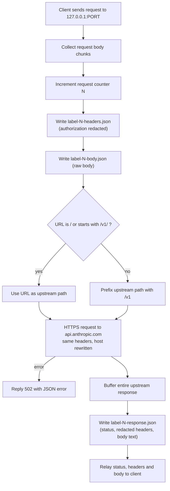
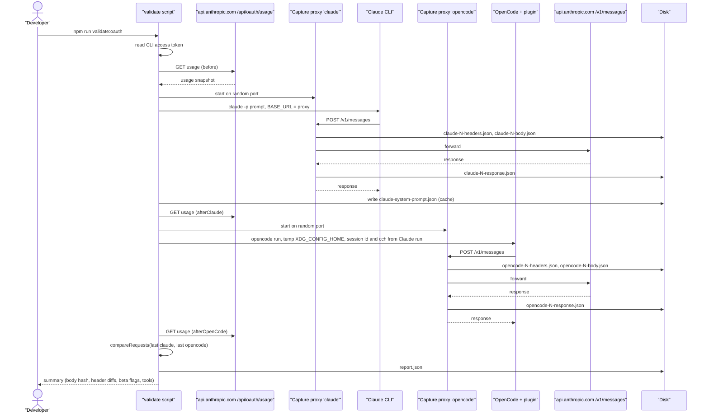
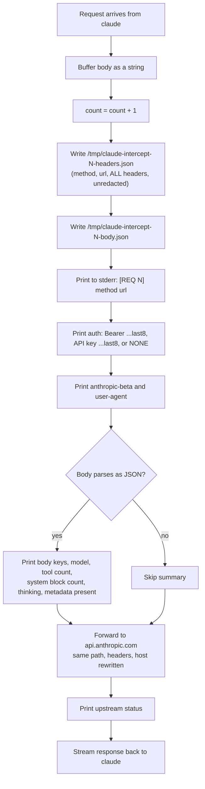
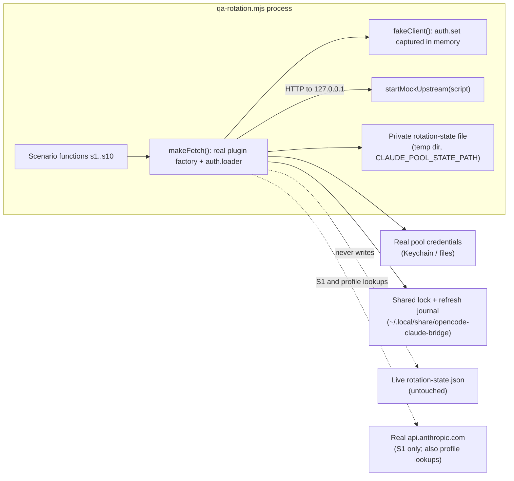
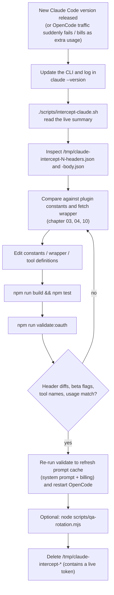

# 08 - Scripts, validation and QA

## What this chapter covers

The `scripts/` folder holds three developer tools. None of them is part of the plugin that OpenCode loads; they exist to help the maintainer keep the plugin working.

| Script | Purpose in one line | Touches real accounts or network? |
| --- | --- | --- |
| `scripts/validate-opencode-oauth.js` | Run the official Claude Code CLI and OpenCode (with this plugin) through a recording proxy, then diff the two requests and compare subscription usage. Also caches Claude Code's system prompt for the plugin to reuse. | Yes: real API calls and your real login |
| `scripts/intercept-claude.sh` | Record exactly what the latest Claude CLI sends, so you can update the plugin's constants. | Yes: one real API call with your CLI login |
| `scripts/qa-rotation.mjs` | End-to-end test of multi-account rotation using the real plugin code against a fake upstream server. | Scenario 1 hits the real API; the others use a local fake, but the plugin still uses your enrolled accounts' credentials |

This chapter explains each script step by step, what it writes and where, how the proxies work, how reports are diffed, and finishes with a detailed workflow for updating the bridge when Claude Code ships a new version.

Plain-English glossary:

| Term | Meaning |
| --- | --- |
| **Proxy** | A small server that sits between a client and the real server. The client is told "your server is at 127.0.0.1:PORT" (127.0.0.1 means "this computer"); the proxy writes down what arrives, then forwards it to the real server and relays the answer. |
| **`ANTHROPIC_BASE_URL`** | An environment variable that the Anthropic SDKs and Claude CLI honour to talk to a different server address instead of `api.anthropic.com`. This is how the scripts redirect traffic to their proxy. |
| **System prompt** | The block of instructions the client sends to the model along with your message. Claude Code's is long and recognisable. |
| **Fingerprint / wire matching** | Making the plugin's requests look, byte for byte, like the official CLI's, so Anthropic treats the traffic as ordinary Claude Code subscription use. Chapter 03 covers this. |
| **Usage buckets** | The rolling quota meters (5-hour, 7-day, etc.) returned by the usage endpoint. |
| **Fake / mock upstream** | A local server that pretends to be Anthropic and returns scripted answers (e.g. a rate-limit error). |

---

## 1. `scripts/validate-opencode-oauth.js`

### 1.1 Purpose

The README (section "Local validation") says it validates "how local OpenCode traffic is being classified and how closely it matches Claude Code on the wire". In practice it answers two questions:

1. **Do the requests look the same?** It captures one request from the real Claude Code CLI and one from OpenCode running this plugin, then reports every difference in headers, beta flags, body fields and tool names.
2. **Is Anthropic billing them the same way?** It reads the subscription usage meters before and after each run. If OpenCode were being treated as a separate "OAuth app / extra usage" client, the meters would diverge or OpenCode's call would fail with an extra-usage style error (README).

A side effect with real importance: it writes Claude Code's captured system prompt into a cache file that the plugin reads afterwards. The README says: "This is currently the key step that makes OpenCode traffic behave like standard Claude Code usage."

### 1.2 Running it

```bash
npm run validate:oauth -- --model claude-sonnet-4-6 --prompt "Reply with exactly VALIDATE."
```

`npm run validate:oauth` first runs `npm run build` (so `dist/index.js` is current) and then the script (`package.json:16`). Run directly instead with `node scripts/validate-opencode-oauth.js`, but then you must build yourself.

### 1.3 Options (`parseArgs`, `:18-49`)

| Option | Default | Effect |
| --- | --- | --- |
| `--model <id>` | `claude-sonnet-4-6` | Model for both clients. OpenCode gets it as `anthropic/<id>`. |
| `--prompt <text>` | `Reply with exactly VALIDATE.` | The user message sent by both clients. |
| `--out-dir <dir>` | `<repo>/tmp/validate-<epoch-ms>` | Where artifacts are written. |
| `--skip-claude` | off | Skip the official Claude Code capture (then there is nothing to compare, and the prompt cache is not refreshed). |
| `--skip-opencode` | off | Skip the OpenCode capture. |
| `--help`, `-h` | - | Print usage, exit 0. |

Unknown arguments are silently ignored. `--model` and similar options take the next argument without checking that it exists.

### 1.4 Building blocks

| Function | Lines | What it does |
| --- | --- | --- |
| `sha256` | `:51-53` | Hex SHA-256 of a string; used to compare bodies without printing them. |
| `readClaudeCredentials` | `:55-72` | On macOS, `security find-generic-password -s "Claude Code-credentials" -w` (5 s timeout) and parse JSON; otherwise (or if that fails) read `~/.claude/.credentials.json`. Unlike the pool code, it ignores `CLAUDE_CONFIG_DIR`. Returns `null` when nothing works. |
| `getOAuthAccessToken` | `:74-79` | Returns `claudeAiOauth.accessToken` or throws `No Claude Code OAuth access token found. Run \`claude login\` first.` It uses the *Claude CLI's* login, never the pool. |
| `fetchJson` | `:81-87` | `fetch` that throws `Request failed (<status>): <body>` on non-2xx. |
| `fetchUsage` | `:89-96` | `GET https://api.anthropic.com/api/oauth/usage` with `authorization: Bearer ...`, a hard-coded `user-agent: claude-cli/2.1.98 (external, sdk-cli)`, `anthropic-beta: oauth-2025-04-20` and `anthropic-dangerous-direct-browser-access: true`. (The plugin's own `src/pool/usage.ts` does the same call without the user-agent; see chapter 07.) |
| `safeFetchUsage` | `:98-106` | Never throws: on failure returns `{ _error: "<message>" }` so a broken usage call does not abort the run. |
| `redactHeaders` | `:108-114` | Replaces `authorization` with `Bearer ...<last 8 chars>`. Only `authorization` is redacted; other headers (such as `x-api-key`, if present) are written as-is. |
| `splitHeaderList` / `sortedDifference` | `:116-124` | Comma-list parsing and "items in A not in B, sorted". |
| `startCaptureProxy` | `:126-208` | The recording proxy, described in 1.6. |
| `runCommand` | `:210-224` | Spawns a child process (stdin ignored, stdout/stderr collected), working directory defaults to the repo root, environment = current environment plus overrides. Resolves `{code, stdout, stderr}` when the child closes; never rejects. |
| `captureClaudeCode` | `:226-239` | Starts a proxy labelled `claude`, runs `claude -p <prompt> --model <model>` with `ANTHROPIC_API_KEY=""` (forces OAuth instead of an API key) and `ANTHROPIC_BASE_URL=http://127.0.0.1:<port>`. Always closes the proxy. |
| `captureOpenCode` | `:241-272` | See 1.5. |
| `extractSessionReplay` | `:274-292` | Pulls the Claude Code session id and billing hash out of the captured request, see 1.7. |
| `firstMessageCapture` | `:294-300` | Despite the name, returns the **last** captured `POST` to `/v1/messages` or `/messages` (`.at(-1)`). |
| `compareRequests` | `:302-412` | The diff engine, see 1.8. |
| `printUsage`, `printCommandResult` | `:414-433` | Console output helpers. `printUsage` shows `five_hour`, `seven_day`, `seven_day_sonnet`, `seven_day_oauth_apps`, `extra_usage`. |
| `writePromptCache` | `:435-460` | Writes the system-prompt cache, see 1.9. |
| `summarizeRun` | `:462-472` | `{result, captureCount, messageRequestCount}`. |

### 1.5 How it launches OpenCode

`captureOpenCode` (`:241-272`) is careful not to disturb your real OpenCode config:

1. Creates a temp directory (`mkdtemp` under the OS temp dir, prefix `opencode-bridge-`), with an `opencode/` subfolder.
2. Writes `opencode/opencode.json` containing `{"$schema": "...", "plugin": ["<repo>/dist/index.js"]}`. Note this points straight at `dist/index.js`, not the wrapper SETUP.md demands for normal use (SETUP says the loader calls every named export; whether a bare path hits the same problem is not tested here; see chapter 11).
3. Starts a proxy labelled `opencode`.
4. Runs `opencode run --model anthropic/<model> --format json "<prompt>"` with environment:
   - `XDG_CONFIG_HOME=<temp dir>`: makes OpenCode read *this* temporary config instead of `~/.config/opencode`.
   - `ANTHROPIC_BASE_URL=http://127.0.0.1:<port>`: points the plugin's transport at the proxy.
   - If a Claude Code capture exists: `ANTHROPIC_SESSION_ID` and `ANTHROPIC_BILLING_CCH` set to the values Claude Code used (see 1.7).
5. In a `finally`, closes the proxy and deletes the temp directory.

OpenCode's *credentials* are not isolated: only the config home is redirected. OpenCode's auth file lives under the data directory (`XDG_DATA_HOME`), which is untouched, and the plugin falls back to the Claude CLI's login, so real credentials (and, if a pool is enrolled, possibly the pool) are used.

### 1.6 How the capture proxy works (`startCaptureProxy`)



Key details:

- It listens on `127.0.0.1` with port `0`, meaning the OS picks a free port, so parallel runs do not collide (`:197`). It throws `Failed to bind proxy port` if the address is not usable.
- Each request is buffered whole (no streaming). The proxy writes the **request body in full, including your prompt**, to disk. The proxy stores the unredacted body.
- The `/v1` prefixing exists because `ANTHROPIC_BASE_URL` has no path in this setup, and the clients may call `/messages` rather than `/v1/messages`; normalising makes both reach the real API. Query strings are preserved because `req.url` includes them.
- The headers forwarded upstream include the real `authorization`, with `host` replaced. `accept-encoding` is forwarded too, so a compressed response would be stored as garbled text in `*-response.json`'s `body` (it is decoded as UTF-8); this is the author's trade-off, not documented.
- `upstream.write(bodyBuffer)` then `upstream.end()` sends the request. Upstream errors become `502`; in that case no `-response.json` is written (consistent with some `tmp/validate-*` folders where a request number has headers and body but no response file).
- Counting: the counter increments per request, so one Claude CLI run typically yields several numbered captures (the Claude CLI makes more than one request per prompt). Only message POSTs are used for comparison.

### 1.7 Replaying the session id and billing hash

`extractSessionReplay(claudeCaptures)` (`:274-292`) looks at the last `/messages` request Claude Code sent and extracts:

- `sessionID` from the request header `x-claude-code-session-id`;
- `billingCch` from `system[0].text` via the regex `cch=([^;]+);`. The first system block is the billing header text (fields `cc_version`, `cc_entrypoint`, `cch`, see chapter 03).

It returns `null` if neither is found. When present, those become `ANTHROPIC_SESSION_ID` and `ANTHROPIC_BILLING_CCH` in OpenCode's environment (both are overrides listed in the README's environment table). Purpose: make the two requests as identical as possible so the diff highlights real structural differences rather than per-run randomness.

### 1.8 How the report diff is computed (`compareRequests`)

Inputs are the last message request of each client. If either is missing, the result is `{available: false}` and no details are printed.

1. **Header diff**: for the sorted union of header names, skipping `authorization`, `content-length`, `host`, `connection`, `accept-encoding`, any header whose values differ is recorded as `{claude: <value or null>, opencode: <value or null>}`. Comparison is strict string equality, so header order is irrelevant but a missing header shows as `null`.
2. **Same method / same URL**: booleans.
3. **Body hash**: SHA-256 of each raw body string plus `equal`. Because bodies contain session ids, timestamps and (for a different model of system prompt) other text, equality is rare; use it as a quick signal, then read `bodyShape`.
4. **Beta flags**: the comma-separated `anthropic-beta` header split into arrays for each client, plus `missingFromOpenCode` (in Claude's but not OpenCode's) and `extraInOpenCode` (the reverse), each sorted.
5. **Body shape** (only if both bodies parse as JSON): top-level keys (sorted), `model`, `thinking`, `output_config`, `context_management`, number of `system` blocks, the text of `system[0]` (billing header), whether `metadata.user_id` is present, and tools: counts, names in order, whether the ordered name lists are equal (`toolNamesEqual`), and `missingFromOpenCode` / `extraInOpenCode`.

### 1.9 The system-prompt cache (`writePromptCache`)

After a successful Claude Code capture, `writePromptCache` (`:435-460`):

1. Takes the last message request body and parses it.
2. Requires `system` to be an array of at least 2 entries; otherwise returns `false` and writes nothing.
3. Parses `system[0].text` with `cc_version=([^;]+);\s*cc_entrypoint=([^;]+);` for the billing metadata.
4. Creates `~/.cache/opencode-claude-bridge/` if needed and writes `claude-system-prompt.json`:

```json
{
  "source": "claude-code-capture",
  "updated_at": "<ISO timestamp>",
  "billing": { "ccVersion": "...", "ccVersionSuffix": "<last dot-part of version>", "ccEntrypoint": "sdk-cli" },
  "system": [ "...every system block except the first (billing) block..." ]
}
```

`billing` is omitted if the regex fails. The location can be overridden for the plugin by `ANTHROPIC_SYSTEM_PROMPT_PATH` (README), but this script always writes the default path (`:16`). The result is stored as `report.claude.promptCacheWritten` (true/false). How the plugin consumes the file is chapter 03.

### 1.10 Step-by-step run order (`main`, `:474-539`)

1. Parse args; create the output directory (recursive).
2. `readFileSync(dist/index.js)`. Intended as a "build exists" check, but a missing file throws a raw `ENOENT`; the friendly message `Missing built plugin ... Run \`npm run build\` first.` is only reached for an empty file (`:478-480`).
3. Read the CLI access token (throws if none).
4. Initialise the `report` object.
5. **Usage before**: `safeFetchUsage` -> `report.usage.before`; print.
6. Unless `--skip-claude`: run Claude Code via proxy; `report.claude = summarizeRun(...)`; print exit code, stdout, stderr; write prompt cache; **usage afterClaude**; print.
7. Unless `--skip-opencode`: run OpenCode via proxy (with replay values from step 6 if available); `report.opencode`; print; **usage afterOpenCode**; print.
8. `report.comparison = compareRequests(...)`.
9. Write `report.json`; print summary lines.
10. On any exception: print stack and exit 1.

Both usage snapshots reuse the one access token read at the start, so a token that expires mid-run would make later snapshots `_error`.

### 1.11 Sequence of a full run



### 1.12 What gets written where

| Path | Contents |
| --- | --- |
| `<repo>/tmp/validate-<ms>/` (or `--out-dir`) | All artifacts below |
| `.../claude-<N>-headers.json`, `opencode-<N>-headers.json` | `{method, url, headers}` with `authorization` redacted to the last 8 characters |
| `.../claude-<N>-body.json`, `opencode-<N>-body.json` | The raw request body text (contains your prompt and system prompt) |
| `.../claude-<N>-response.json`, `opencode-<N>-response.json` | `{status, headers, body}` of the upstream reply (absent on proxy errors) |
| `.../report.json` | See below |
| `~/.cache/opencode-claude-bridge/claude-system-prompt.json` | The system-prompt cache (1.9) |
| `<os tmp>/opencode-bridge-XXXX/` | Temporary OpenCode config; deleted at the end |

`report.json` fields (confirmed against an existing run in `tmp/`):

| Field | Meaning |
| --- | --- |
| `model`, `prompt`, `outDir` | The options used |
| `usage.before`, `usage.afterClaude`, `usage.afterOpenCode` | Usage endpoint JSON, or `{_error}` (the `after*` keys exist only if that run executed) |
| `claude`, `opencode` | `{result: {code, stdout, stderr}, captureCount, messageRequestCount}`; `claude` also has `promptCacheWritten`. `null` if skipped |
| `comparison` | `{available:false}` or `{available, sameMethod, sameUrl, bodyHash{claude,opencode,equal}, headerDiff, betaFlags{claude,opencode,missingFromOpenCode,extraInOpenCode}, bodyShape}` (1.8) |

The `tmp/` folder is working output; not checked in as part of the plugin.

### 1.13 Reading the results

Illustrative console summary:

```
Artifacts saved to /path/to/repo/tmp/validate-1700000000000
Body hash equal: false
Header differences: 2
Missing beta flags: 0
Extra beta flags: 0
Tool names equal: true
Claude tool count: 24
OpenCode tool count: 24
Missing tools: 0
Extra tools: 0
```

Good signs: no missing/extra beta flags, `toolNamesEqual: true`, only expected header differences (e.g. session ids), and usage deltas that match between the Claude and OpenCode runs. Bad signs (README): an extra-usage style API error in OpenCode's stderr, or usage buckets diverging.

Caveats: it costs real (small) subscription usage; the proxy writes your prompt and tokens' last 8 characters to `tmp/`; compare only works if both clients made a message request.

---

## 2. `scripts/intercept-claude.sh`

### 2.1 Purpose

A lighter-weight tool for the "update for a new Claude CLI version" workflow. It runs only the official CLI through a recording proxy and prints a human-readable summary of what the CLI sent. You then compare against the plugin's constants.

### 2.2 Usage

```bash
./scripts/intercept-claude.sh [model]      # default model: claude-sonnet-4-6
```

Fixed proxy port: `18899` (`:9`). If something else is on that port, the proxy fails to start (the script does not check; the CLI run would then fail or hit whatever else is listening).

### 2.3 Step by step

1. Print a banner (model, port).
2. Launch an inline Node program in the background (`&`, `PROXY_PID=$!`) that starts an HTTP server on the port, with an automatic self-destruct after **60 seconds** (`setTimeout(...exit(0), 60000)`, `:74`).
3. `sleep 1` to let it bind.
4. Run `ANTHROPIC_API_KEY= ANTHROPIC_BASE_URL=http://localhost:18899 claude -p "say hi" --model "$MODEL" 2>/dev/null` (stderr of the CLI hidden; empty API key forces OAuth).
5. Kill the proxy and wait for it.
6. Print where files were saved and example inspect commands.

Not set: `set -e`; failures of Claude or the proxy do not stop the script, and its exit code is that of the last `echo`.

### 2.4 What the proxy does per request



Differences from the validator's proxy:

| Aspect | `intercept-claude.sh` | `validate-opencode-oauth.js` |
| --- | --- | --- |
| Port | Fixed 18899 | Random free port |
| Redaction in files | **None**: `headers.json` contains the full `authorization` header | `authorization` redacted |
| Path rewriting | None; uses `req.url` as is | Adds `/v1` if missing |
| Response handling | Streams (`pipe`) | Buffers and saves |
| Response saved | No | Yes |
| Output | Live summary on stderr | JSON report |
| Lifetime | 60 s timer | Closed after each run |

Important safety note: `/tmp/claude-intercept-*-headers.json` contains the live OAuth bearer token. Delete the files after use, and do not share them. Files are overwritten on the next run (`count` restarts at 1 each time).

Also: the body is accumulated as a string by `body += c`, which is fine for JSON text. The `$PORT` shell variable is interpolated into the Node source (double-quoted heredoc-style string), which is why `$` signs in the JS must be avoided.

### 2.5 Illustrative output

```
=== Claude Code Network Interceptor ===
Model: claude-sonnet-4-6
Proxy: localhost:18899

Proxy ready on 18899

Running: claude -p 'say hi' --model claude-sonnet-4-6

[REQ 1] POST /v1/messages?beta=true
  auth: Bearer ...a1b2c3d4
  beta: claude-code-20250219,oauth-2025-04-20,...
  ua:   claude-cli/2.1.xxx (external, sdk-cli)
  body keys: max_tokens, messages, metadata, model, system, thinking, tools
  model: claude-sonnet-4-6
  tools: 24
  system blocks: 3
  thinking: {"type":"adaptive"}
  metadata: present
  -> 200
Hi!

=== Saved to /tmp/claude-intercept-*-{headers,body}.json ===
```

(Values are placeholders to show the shape; they were not captured from a real run.)

---

## 3. `scripts/qa-rotation.mjs`

### 3.1 Purpose

An end-to-end test of rotation. Unlike unit tests, it drives the **real plugin factory** (`OpenCodeClaudeBridge` from `dist/index.js`) and its real `auth.loader` fetch wrapper (`:1-8`). Failure behaviour is provoked with a local fake server, because "deliberately exhausting a live Max subscription to observe a real 429 is not a reasonable test cost".

Requirements: built `dist/`, and at least two accounts enrolled (the rotation scenarios need somewhere to rotate to; chapter 07). Usage:

```bash
node scripts/qa-rotation.mjs          # all scenarios
node scripts/qa-rotation.mjs s4       # one scenario: s1 ... s10
```

An unknown scenario name prints `Unknown scenario "x". Choose one of: s1, ..., s10` and exits **2**. Otherwise exit **0** if every scenario passed, **1** if any failed. The last line is `===== N/M scenarios passed =====`.

### 3.2 Architecture



### 3.3 State isolation: why a private state file but a shared lock and journal

At import time (`:18-29`), unless the caller already set `CLAUDE_POOL_STATE_PATH`, the harness:

1. creates a temp directory `qa-rotation-XXXX` under the OS temp dir;
2. sets `CLAUDE_POOL_STATE_PATH` to `<tmp>/rotation-state.json` (honoured by `defaultStatePath()`, `src/pool/rotation-state.ts:62-63`);
3. registers an `exit` hook that removes the temp directory.

Reason (comment `:18-22`): previously the harness deleted and rewrote the **live** state file while a running OpenCode wrote the same file under its lock. They raced, and the penalties (cooldowns, disables) that scenarios caused leaked into the live pool. Now each scenario's cooldowns land in a throwaway file. The `resetState()` helper deletes that private file between scenarios.

**The lock and the refresh journal deliberately remain shared** (`:22-23`; `defaultLockPath()` ignores `CLAUDE_POOL_STATE_PATH`, `rotation-state.ts:56-60`). Why: they guard the *real credentials*. Refresh tokens are single-use, so if the harness and a live OpenCode both refreshed the same account at once, one would spend the token and the other would lose it. A private lock would let two processes do exactly that. Sharing the lock and the journal means the harness queues behind live OpenCode and a crash mid-refresh still leaves a recoverable journal (chapter 05).

(Consequence: the harness still uses your real enrolled accounts' tokens, and may refresh them if they are near expiry; this is real, valuable activity, which is why it must respect the shared lock. This is inferred from the design comments; I did not trace the refresh path in detail.)

### 3.4 Harness helpers

| Helper | Lines | Role |
| --- | --- | --- |
| `resetState` | `:31-33` | Delete the private state file so each scenario starts with no cooldowns. |
| `fakeClient` | `:35-46` | A stand-in for OpenCode's client object. Its `auth.set({body})` stores the credential the plugin would "mirror into OpenCode's auth slot" in memory instead of the real `auth.json`. |
| `makeFetch(client)` | `:48-55` | Runs `OpenCodeClaudeBridge({client})`, then calls `hooks.auth.loader(getAuth, provider)` and returns the resulting `fetch`. `getAuth` returns whatever was last stored by `auth.set`, or an empty OAuth stub. This is the same wrapper OpenCode would use for every Anthropic request. |
| `messagesBody` | `:57-63` | A tiny request: model `claude-haiku-4-5`, `max_tokens: 16`, one user message "Reply with the single word: pong". |
| `startMockUpstream(script)` | `:66-101` | HTTP server on a random port. For the i-th request it replies with `script[min(i, last)]`: status, optional headers, JSON body (default is a `rate_limit_error` JSON). It records, per request, the `authorization` header, URL, and `account_uuid` parsed from `metadata.user_id` (which is itself a JSON string). Returns `{url, seen, calls(), close()}`. The URL it gives is `http://127.0.0.1:<port>/v1/messages`. Note the last scripted step repeats forever. |
| `tokenId` | `:103-108` | SHA-256 of the header, first 10 hex characters. Comment: "comparing tokens must not print live credential material, even a suffix, to the QA log." (This is stricter than the validator's last-8 redaction.) |
| `record` | `:110-114` | Collects `{name, pass, detail}` and prints `PASS`/`FAIL` plus detail. |
| `scenarioAccounts` | `:279-285` | State entries whose `lastReason` does NOT start with `refresh rejected`, `refresh failed` or `credentials missing`. Reason (comment `:279-280`): accounts whose real refresh token is already dead get disabled during `acquire()`, which is not what S7/S8/S9 are testing. |
| `penalised` | `:287-291` | Of those, accounts that are disabled or cooling now. |
| `identicalFailureScenario` | `:293-313` | Shared body for S7 and S8. |

Each scenario also runs inside `try/catch`: an exception records `FAIL <name>` with `threw: <stack>` (`:396-403`). That `record` name is just `s7` rather than the descriptive title in that case.

### 3.5 Scenarios and what they assert

| ID | Mock upstream script | Assertions (all must hold) | What it proves |
| --- | --- | --- | --- |
| **S1** (`:117-133`) | None: **real** Anthropic API, `https://api.anthropic.com/v1/messages` | HTTP status is 200 | The pooled, rewritten request works end to end. Prints the active label and the first 120 characters of the body. The only scenario that spends real quota and depends on the network. |
| **S2** (`:136-163`) | 429 with `retry-after: 21600` (6 h), then 200 | Final status 200; the two upstream calls used **different** `authorization` values; exactly 1 account has a cooldown | A long reset window cools the account and rotates to the other. |
| **S3** (`:166-190`) | 429 with `retry-after: 1`, then 200 | Final 200; both calls used the **same** token; 0 accounts cooled | A short reset (under 60 s per README) retries the same account without rotation. |
| **S4** (`:193-218`) | 429 `retry-after: 21600` repeated forever | Final status 429; the error message names at least one known account label; the message is one line (no `\n`); response `retry-after` header is a positive number | When every account is exhausted the request fails fast with a one-line message (shown as an OpenCode toast; the per-account breakdown lives in the dashboard) and a retry-after. |
| **S5** (`:221-244`) | 403 `"account suspended"`, then 200 | Final 200; exactly 1 scenario account is disabled | A suspension permanently disables the account and rotates. |
| **S6** (`:250-277`) | 401 `"OAuth access token has been revoked."`, then 200 | Final 200; exactly 1 disabled; the two calls used different tokens | Reproduces a real incident: a revoked credential used to pass straight through to the user; now it disables that account and rotates. |
| **S7** (`:318-323`) | The same 401 (`"OAuth authentication is currently not supported."`) twice, then 200 | Final status equals the failure (401); no account penalised; exactly 2 upstream calls on 2 different tokens | A failure caused by the request (not the account), seen identically on two accounts, passes through without disabling anyone. Previously it walked the whole pool. |
| **S8** (`:325-330`) | Same shape with a 403 `permission_error` ("Your account does not have access to this model.") | Same as S7 with status 403 | Same for 403. |
| **S9** (`:333-359`) | 403 `"no access to model"`, then 401 `"revoked"`, then 200 | Final 200; exactly 1 account cooled (not disabled) and 1 disabled; 3 distinct tokens seen | Different failures from different accounts are each charged to their own account. (The 403 produced a cooldown, the 401 a disable; this requires at least 3 accounts with live-looking credentials, otherwise `distinct === 3` cannot hold.) |
| **S10** (`:362-388`) | 429 `retry-after: 21600`, then 200 | Final 200; the two tokens differ; the second request has a `user_id` with an `account_uuid`; that uuid differs from the first request's | After rotation, `metadata.user_id` is re-stamped with the account that actually serves the request (index.ts re-binding, `src/index.ts:1292-1297`). |

How scenarios exercise the plugin: each `doFetch(up.url, ...)` sends a POST to the mock URL rather than `api.anthropic.com`; the plugin's wrapper still rewrites headers/body (chapter 03) and runs its rotation loop (chapter 06) on the mock's replies. The plugin also calls the real profile endpoint to fill in `account_uuid` (`src/index.ts:695-714`, `:962-970`), so S2-S10 are not fully offline.

Number-of-accounts assumptions are implicit: S2, S5, S6, S10 need >= 2 usable accounts; S9 needs >= 3; S7/S8 need >= 2 (they assert exactly two upstream calls on distinct tokens). With too few accounts, the corresponding scenario fails rather than being skipped (the harness has no skip logic).

### 3.6 Illustrative output

```
PASS  S2 long reset window rotates account
      HTTP 200 | token1=...3f9a1c0d22 token2=...b81e45a7c9 rotated=true | cooled=[["alice","2026-08-20T08:00:00.000Z"]]

PASS  S3 short reset retries same account
      HTTP 200 | sameToken=true | accountsCooled=0 (expect 0) | upstreamCalls=2

===== 10/10 scenarios passed =====
```

(Placeholders, not real output.)

### 3.7 Inconsistency to note

`SETUP.md:215-216` says the expected result is `6/6 scenarios passed`, but the script defines ten scenarios (`:391`) and prints `N/10`. SETUP.md was evidently written when only S1-S6 existed. (README does not mention the count.) Also, SETUP calls the first scenario "the first hits the real API; the rest use a local upstream", which matches the code for requests to `/v1/messages`, but the plugin's profile lookups do reach the real API in the rest.

---

## 4. How to update the bridge when Claude Code releases a new version

The plugin's strategy is to make OpenCode's requests indistinguishable from the official CLI's. When the CLI changes what it sends, the plugin must follow. The README's list of things that have changed across versions: `anthropic-beta` flags, body fields (`thinking`, `metadata`, `context_management`), `user-agent` version, `x-stainless-package-version`, `x-claude-code-session-id`, billing header shape (`cc_version`, `cc_entrypoint`, `cch`), tool definitions and schemas.

### 4.1 Workflow



### 4.2 Detailed steps

1. **Update the Claude CLI** and confirm it still works (`claude --version`; `claude login` if needed). The plugin auto-detects the installed CLI version from `claude --version`, falling back to `2.1.98` (README environment table, `ANTHROPIC_CLI_VERSION`), so the user-agent often updates itself; everything else must be checked.
2. **Capture the new reality**: `./scripts/intercept-claude.sh claude-sonnet-4-6`. Read the stderr summary: beta flags, user-agent, body keys, tool count, system block count, thinking, metadata.
3. **Inspect the raw files** in `/tmp/claude-intercept-1-*` (the CLI may make several requests; look for the `/v1/messages` POST, which may not be number 1). Use the printed hint commands:
   ```bash
   cat /tmp/claude-intercept-1-headers.json | python3 -m json.tool
   python3 -c "import json; d=json.load(open('/tmp/claude-intercept-1-body.json')); print(sorted(d.keys()))"
   ```
4. **Compare with the plugin**: beta flags (`ANTHROPIC_BETA_FLAGS` default and constants), `user-agent`, `x-stainless-*` headers and SDK version, billing header (`cc_version`, `cc_entrypoint`, `cch`), body fields (`thinking`, `metadata`, `context_management`, `output_config`), tool names and schemas. Where each lives is covered in chapters 03, 04 and 10. Environment overrides in the README can be used to experiment without editing code.
5. **Make the changes** in `src/`, then `npm run build` and `npm test`.
6. **Validate**: `npm run validate:oauth -- --model claude-sonnet-4-6`. Read `report.json` (or the console summary):
   - `betaFlags.missingFromOpenCode` / `extraInOpenCode` should be empty;
   - `headerDiff` should contain only expected per-run differences;
   - `bodyShape.toolNamesEqual` true, missing/extra tools empty, `thinking` / `output_config` / `context_management` equal;
   - `usage.afterClaude` vs `usage.afterOpenCode`: the buckets should move the same way. Divergence, or an extra-usage style error in the OpenCode stderr, means OpenCode is still being classified differently.
7. **Refresh the system-prompt cache**: a successful validate run with the Claude capture rewrites `~/.cache/opencode-claude-bridge/claude-system-prompt.json`, which the plugin automatically reuses. Do this after every Claude Code update because the cached prompt and billing version come from that CLI build. Then restart OpenCode.
8. **Optionally run** `node scripts/qa-rotation.mjs` if you touched the request/rotation path.
9. **Clean up**: delete `/tmp/claude-intercept-*` (live bearer token) and any `tmp/validate-*` you do not need (request bodies and 8-character token suffixes).

### 4.3 Cost and safety checklist

| Item | Detail |
| --- | --- |
| Spends real quota | Yes, a tiny amount per client per run (usage is deliberately measured). |
| Writes secrets to disk | `intercept-claude.sh` writes full headers including the bearer token to `/tmp`; the validator writes redacted headers but raw bodies. |
| Overwrites a shared cache | The validator overwrites `claude-system-prompt.json` for all OpenCode sessions on the machine. |
| Needs `claude` on PATH and a valid login | Both capture tools do. The validator uses the CLI login, not the pool. |

---

## Key takeaways

- The validator proves equivalence two ways: a structural diff of the last message request from each client, and usage-meter snapshots before/after each run. It also refreshes the system-prompt cache that the plugin needs.
- Both capture proxies are plain HTTP-to-HTTPS forwarders pointed at via `ANTHROPIC_BASE_URL`. The validator's is safer (random port, redaction, `/v1` normalisation, buffered and saved responses); the shell script's is faster to read but stores unredacted headers in `/tmp`.
- `firstMessageCapture` returns the **last** message request, not the first.
- The QA harness runs the real plugin against a fake upstream. It uses a private state file so scenarios cannot pollute the live pool, but shares the lock and refresh journal because those protect single-use refresh tokens.
- There are ten scenarios (S1 live; S2-S10 mocked); SETUP.md still says six.
- When Claude Code updates: intercept, diff against constants, fix, build, test, validate, refresh the prompt cache, restart OpenCode, clean up temp files.
- Items for chapter 11: SETUP.md:215-216 `6/6` vs ten scenarios; the unreachable "Missing built plugin" message (`validate-opencode-oauth.js:478-480`); the misnamed `firstMessageCapture`; validator ignores `CLAUDE_CONFIG_DIR` (`:68`) and hard-codes user-agent `2.1.98` (`:92`); validator points OpenCode at `dist/index.js` directly (`:247`); `intercept-claude.sh` stores unredacted bearer tokens and uses a fixed port; qa-rotation scenarios silently depend on the number of enrolled accounts; "mock" scenarios still make real profile requests.

## Related chapters

- [03 - Request pipeline](03-request-pipeline.md): the headers, body and billing fingerprint these scripts compare, and how the prompt cache is consumed.
- [04 - Tools and translation](04-tools-and-translation.md): the tool definitions compared in `bodyShape`.
- [05 - Account pool overview](05-account-pool-overview.md): state file, lock and journal that qa-rotation isolates and shares.
- [06 - Rotation and failure handling](06-rotation-and-failure-handling.md): the classifier and loop that S2-S10 assert on.
- [07 - Enrollment and the claude-pool CLI](07-enrollment-and-claude-pool-cli.md): enrolling the accounts qa-rotation needs.
- [09 - Build, test, CI, release](09-build-test-ci-release.md): `npm run build`, `npm test`.
- [10 - Configuration and files reference](10-configuration-and-files-reference.md): environment variables and file locations.
- [11 - Known issues and gotchas](11-known-issues-and-gotchas.md).
