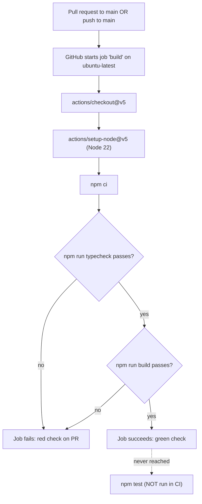
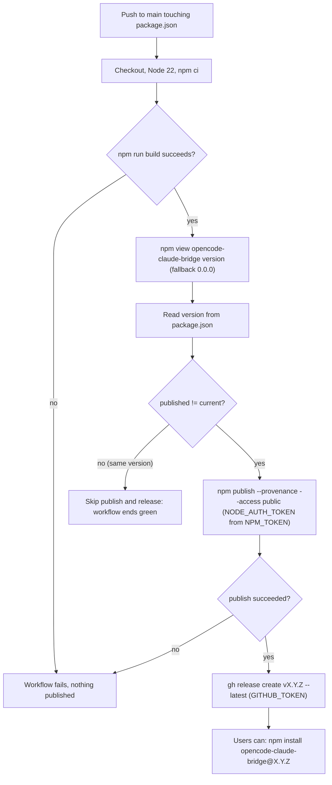
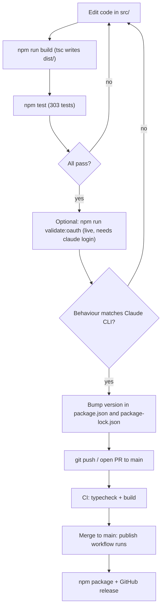

# 09 - Build, Test, CI and Release

## What this chapter covers

This chapter explains everything that happens between "I edited a TypeScript file" and "users get a new version from npm":

- The layout of the repository, file by file.
- What `package.json` and `tsconfig.json` say, option by option.
- What `dist/` is, and exactly which files end up in the package that users download.
- How OpenCode (the host application) installs the plugin, from npm or from a local source checkout.
- How the tests are built and run, and what every test file covers.
- The two GitHub Actions workflows (CI and publish), step by step.
- A practical "how to cut a release" checklist.

You do not need to know anything about npm publishing in advance. New terms are defined where they first appear.

Facts below were checked against the repository on **Mon Oct 5 2026** (output of `date` on the machine where this chapter was written). Citations look like `path:LINE`.

Related chapters: [README](README.md), [01-big-picture](01-big-picture.md), [08-scripts-validation-and-qa](08-scripts-validation-and-qa.md), [10-configuration-and-files-reference](10-configuration-and-files-reference.md), [11-known-issues-and-gotchas](11-known-issues-and-gotchas.md).

---

## 1. Repository layout

`git ls-files` lists 46 tracked files. Untracked-but-generated folders (`dist/`, `node_modules/`, `tmp/`, `.serena/`) are listed in `.gitignore` and shown at the bottom.

```text
opencode-claude-bridge/
|-- .github/workflows/
|   |-- ci.yml                  CI: typecheck + build on PRs and pushes to main
|   `-- publish.yml             Publish: npm publish + GitHub release when version changes
|-- .gitignore                  Keeps node_modules, dist, tmp, .serena out of git
|-- .npmignore                  Excludes src/, tsconfig.json, .gitignore from the npm package (redundant, see section 5)
|-- README.md                   User-facing readme (install, how the bridge works, env vars); also shipped to npm
|-- SETUP.md                    macOS end-to-end setup guide for the multi-account pool
|-- docs/archived/
|   `-- slash-command.md        Notes on a removed /claude-pool slash command and why it was dropped
|-- package.json                Package manifest: name, version, scripts, bin, files
|-- package-lock.json           Exact dependency versions (only TypeScript and @types/node, both dev-only)
|-- tsconfig.json               TypeScript compiler settings
|-- scripts/
|   |-- claude-pool.mjs         The `claude-pool` command-line tool (enroll, list, dashboard...); the package's `bin`
|   |-- intercept-claude.sh     Dev tool: proxy that records what the real Claude CLI sends (writes /tmp/claude-intercept-*)
|   |-- qa-rotation.mjs         Dev tool: drives the real plugin against a fake upstream to exercise rotation
|   `-- validate-opencode-oauth.js   Dev tool: runs Claude CLI and OpenCode side by side and diffs their requests
`-- src/
    |-- index.ts                The plugin itself: auth loader, fetch wrapper, request rewriting, login flows
    |-- index.test.ts           Tests for pure helpers in index/claude-tools/stream/oauth (130 tests)
    |-- oauth.ts                PKCE login, localhost callback server, token exchange and refresh (via curl)
    |-- oauth.test.ts           Tests for token parsing, secret handling, state checking (11 tests)
    |-- keychain.ts             Reads the Claude CLI's saved login (macOS keychain or credentials file)
    |-- constants.ts            Client id, URLs, scopes, beta flags, header values, env-var overrides
    |-- claude-tools.ts         Claude Code's wire-captured tool schemas and argument translation maps
    |-- stream.ts               Server-sent-events (SSE) processor that renames tools/arguments in responses
    |-- rotation-loop.test.ts   End-to-end test of the plugin's fetch wrapper through pool failure handling (4 tests)
    `-- pool/
        |-- types.ts              Shared types: AccountRecord, RotationState, keychain service name
        |-- secret-store.ts       Where account tokens are stored: macOS keychain or 0600 files
        |-- secret-store.test.ts  Tests for the account store, file backend, keychain backend (15 tests)
        |-- rotation-state.ts     Cooldown/disabled state file plus the cross-process lock
        |-- rotation-state.test.ts   Tests for persistence, locking, mutators (15 tests)
        |-- selection.ts          Pure function: pick which account to use next
        |-- selection.test.ts     Tests for selection (15 tests)
        |-- classifier.ts         Pure function: turn an HTTP failure into retry/rotate/disable
        |-- classifier.test.ts    Tests for the classifier (18 tests)
        |-- classifier-live.test.ts  Classifier fixtures captured from real Anthropic headers (6 tests, offline)
        |-- manager.ts            The rotation manager: token refresh, journal, acquire/penalize
        |-- manager.test.ts       Tests for the manager (32 tests)
        |-- enroll.ts             Enrollment: copy the Claude CLI login into the pool; labels; auto-enroll
        |-- enroll.test.ts        Tests for enrollment (32 tests)
        |-- bridge.ts             Wires the manager to OpenCode's client; builds the "pool busy/exhausted" responses
        |-- bridge.test.ts        Test for the "pool busy" 503 response (1 test)
        |-- notify.ts             Toast (pop-up message) helper with de-duplication
        |-- notify.test.ts        Tests for toasts (3 tests)
        |-- usage.ts              Fetches per-account 5-hour / 7-day usage from Anthropic
        |-- dashboard.ts          Pure text formatting of the pool dashboard
        |-- tui.ts                Interactive terminal UI behind `claude-pool dashboard`
        |-- tui.test.ts           Tests for the TUI (7 tests)
        `-- security-fixes.test.ts  Regression tests from security audits and a bug sweep (14 tests)

Generated / ignored (not tracked):
    dist/            Compiled JavaScript + .d.ts files (output of `tsc`)
    node_modules/    Installed dev dependencies
    tmp/             Scratch folder
    .serena/         Local agent-tooling state
```

Sources: `.gitignore:1-6`, `git ls-files`, file headers.

Counts: 303 tests in total (see section 6); per-file counts above come from running each compiled test file on its own.

---

## 2. `package.json`, field by field

The full file is 37 lines (`package.json:1-37`).

| Field | Value | What it means |
| --- | --- | --- |
| `name` | `opencode-claude-bridge` (`package.json:2`) | The name on the npm registry (the public package index at npmjs.com). Also the name users put in OpenCode's config. |
| `version` | `1.10.12` (`package.json:3`) | The current release number. The publish workflow compares this to what npm already has (section 8). `package-lock.json:3` and `:9` carry the same number and must be kept in step. |
| `description` | "OpenCode <-> Claude bridge - keychain sync + PKCE OAuth + request transformation" (`package.json:4`) | Shown on npm. The arrow and dash are stored as unicode escapes in the file. |
| `type` | `module` (`package.json:5`) | Tells Node that `.js` files are ES modules (they use `import`/`export`, not `require`). Without it, Node would treat the compiled `dist/*.js` files as old-style CommonJS and fail on `import`. |
| `main` | `dist/index.js` (`package.json:6`) | The file loaded when someone does `import "opencode-claude-bridge"`. This is the compiled plugin. |
| `types` | `dist/index.d.ts` (`package.json:7`) | The TypeScript declaration file for editors. Produced because `declaration: true` in tsconfig. |
| `files` | `["dist"]` (`package.json:8-10`) | An allow-list of what goes into the published package (section 5). `package.json`, `README.md`, and the `bin` target are always added by npm. |
| `scripts` | five entries (below) | Named commands run with `npm run <name>`. |
| `keywords` | opencode, anthropic, oauth, claude (`package.json:18-23`) | Search tags on npm. |
| `repository` | git URL `https://github.com/dotCipher/opencode-claude-bridge` (`package.json:24-27`) | Links the npm page to GitHub. Provenance (section 8) also cross-checks the repository. |
| `author` / `license` | `dotCipher` / `MIT` (`package.json:28-29`) | Metadata. |
| `devDependencies` | `@types/node ^25.5.0`, `typescript ^5.9.3` (`package.json:30-33`) | Tools needed only to build. There are **no runtime dependencies**: the shipped plugin uses only Node's built-in modules. Locked at TypeScript 5.9.3, @types/node 25.5.0, undici-types 7.18.2 (`package-lock.json:21-48`). |
| `bin` | `{"claude-pool": "./scripts/claude-pool.mjs"}` (`package.json:34-36`) | Makes npm create a `claude-pool` command when the package is installed globally (`npm i -g`) or linked. It points at a plain `.mjs` script that has a `#!/usr/bin/env node` first line (`scripts/claude-pool.mjs:1`) and imports from `dist/`. |

Notably absent: there is no `engines` field (no declared minimum Node version), no `lint` script, no `prepare` script, and no `dependencies`. `SETUP.md:15` says "Node 20+", and CI uses Node 22 (`.github/workflows/ci.yml:16`); nothing enforces either.

### The scripts

| Script | Exact command (`package.json:11-16`) | What it does |
| --- | --- | --- |
| `build` | `tsc` | Runs the TypeScript compiler using `tsconfig.json`. Reads `src/**/*.ts`, writes `dist/**/*.js` and `.d.ts`. |
| `prepublishOnly` | `npm run build` | An npm "lifecycle hook": npm runs it automatically right before `npm publish`, so a publish always ships a fresh build even if you forgot to build. |
| `typecheck` | `tsc --noEmit` | Same compiler checks, but writes nothing. Fast way to find type errors. |
| `test` | `npm run build && node --test $(find dist -name '*.test.js' \| sort)` | Builds first, then runs Node's built-in test runner (`node --test`) over every compiled test file, found with `find` and sorted for a stable order. See section 6. |
| `validate:oauth` | `npm run build && node scripts/validate-opencode-oauth.js` | Builds, then runs the live validator that compares the real Claude CLI with OpenCode+plugin. It touches the network and real credentials; see [08-scripts-validation-and-qa](08-scripts-validation-and-qa.md). Not part of `npm test`. |

Two things to know:

1. `npm test` does **not** run `typecheck` separately, but `tsc` (inside `build`) type-checks as part of compiling, and exits non-zero on type errors, which stops `&&` and so stops the tests.
2. The `$(find ...)` part is POSIX shell syntax. It works on macOS and Linux (CI is Linux). It would not work in Windows `cmd.exe`. This is an inference from the syntax, not something tested here.

---

## 3. `tsconfig.json`, option by option

`tsconfig.json:1-19`. TypeScript (a typed superset of JavaScript) must be compiled to plain JavaScript before Node can run it. These options control how.

| Option | Value | Plain-English meaning |
| --- | --- | --- |
| `target` | `ES2022` (`:3`) | Emit JavaScript that uses 2022-era language features as-is (top-level `await`, class fields, `??`). Node 18+ understands it. |
| `module` | `ES2022` (`:4`) | Emit ES-module syntax (`import`/`export`), matching `"type": "module"`. |
| `moduleResolution` | `bundler` (`:5`) | How TypeScript finds imported files. `bundler` mode lets source say `import ... from "./oauth.js"` and resolves it to `oauth.ts`. That is why every import in `src/` ends in `.js` even though the files are `.ts`. |
| `declaration` | `true` (`:6`) | Also write `.d.ts` type-description files next to the JavaScript. |
| `outDir` | `dist` (`:7`) | Put output in `dist/`. |
| `rootDir` | `src` (`:8`) | Treat `src/` as the root, so `src/pool/manager.ts` becomes `dist/pool/manager.js` (no extra `src` folder level). |
| `strict` | `true` (`:9`) | Turn on all strict type checks (no implicit `any`, null checks, etc.). |
| `esModuleInterop` | `true` (`:10`) | Smooths importing older CommonJS modules. |
| `skipLibCheck` | `true` (`:11`) | Do not type-check third-party `.d.ts` files; speeds the build and avoids unrelated errors. |
| `forceConsistentCasingInFileNames` | `true` (`:12`) | Error if an import's letter case differs from the real filename (catches bugs that only appear on case-sensitive Linux). |
| `resolveJsonModule` | `true` (`:13`) | Allow `import data from "./x.json"`. |
| `lib` | `["ES2022", "DOM"]` (`:14`) | Which built-in type libraries to load. `DOM` is included for browser-style globals such as `fetch`, `Request`, `Response`, `Headers`, `URL`, which the plugin uses. |
| `types` | `["node"]` (`:15`) | Load only `@types/node` global types. |
| `include` | `["src"]` (`:16`) | Compile everything under `src/`, **including test files**. Hence tests land in `dist/`. |
| `exclude` | `["node_modules", "dist"]` (`:17`) | Never compile these. |

Not set: `noEmitOnError`. So by default `tsc` still writes `dist/` even when there are type errors, but it exits with a failure code. CI and `npm test` rely on that exit code.

---

## 4. What `dist/` is

`dist/` ("distribution") is the output folder of `tsc`. It contains one `.js` file and one `.d.ts` file per source file, mirroring `src/`, including compiled tests (for example `dist/index.test.js`).

- It is **gitignored** (`.gitignore:2`), so it is never committed. Anyone who clones the repo must run `npm run build` before using it.
- It **is** what gets shipped to npm and what OpenCode actually loads (`main: dist/index.js`).
- `tsc` never deletes old output. If you rename or delete a source file or a test, the stale compiled file remains in `dist/` and `npm test` (which globs `dist/`) will keep running it. If tests behave strangely, `rm -rf dist && npm run build`. (General `tsc` behaviour; not specific to this repo.)

---

## 5. What actually ships to npm: `.npmignore` vs `files`

Two mechanisms can control the contents of an npm package:

- **`files`** in `package.json` is an *allow-list*: only listed paths are included.
- **`.npmignore`** is a *deny-list* (same syntax as `.gitignore`).

This repo has both. `files` is `["dist"]` (`package.json:8-10`) and `.npmignore` lists `src/`, `tsconfig.json`, `.gitignore` (`.npmignore:1-3`). When `files` is present, the allow-list decides what is included, so `.npmignore` has no extra effect here; it is redundant (harmless, but misleading).

npm always adds `package.json`, the README, the license file if present, and any file referenced by `main`/`bin`. Verified with `npm pack --dry-run` on this checkout:

| Included | Notes |
| --- | --- |
| `package.json`, `README.md` | Always included. |
| `dist/**/*.js` and `dist/**/*.d.ts` | From `files`. |
| `scripts/claude-pool.mjs` | Included **only** because `bin` points at it. The other three scripts are not shipped. |
| `dist/**/*.test.js` | **Compiled tests ship to users**, because they sit inside `dist/`. Includes `dist/pool/classifier-live.test.js`. They are not harmful but add size. |

Result of the dry run: **67 files, 137.1 kB packed (compressed), 528.8 kB unpacked**, version 1.10.12. `SETUP.md`, `docs/`, `src/`, `.github/` are not shipped.

Consequence: `claude-pool.mjs` imports `../dist/...` modules (it prints a "not built" message otherwise, per commit `48d7a19`), which is why `dist` must be in the package.

---

## 6. How OpenCode installs the plugin

OpenCode is a terminal AI coding assistant. It loads **plugins**: JavaScript modules listed in its config file. This plugin's job is to make OpenCode's Anthropic provider use a Claude subscription.

### From npm

1. The user adds `"plugin": ["opencode-claude-bridge"]` to `~/.config/opencode/opencode.json` (`README.md:8-12`).
2. On next launch OpenCode auto-installs it from npm (`README.md:14`). OpenCode keeps its installed plugin packages under `~/.cache/opencode`, which is why the upgrade instruction is `cd ~/.cache/opencode && npm install opencode-claude-bridge@latest` (`README.md:21-25`).
3. OpenCode "pins" the installed version (`README.md:21`): it does not update itself on every launch, so users must upgrade manually and restart.
4. OpenCode loads `main` (`dist/index.js`) and calls the plugin's default export.

### From source

1. `git clone`, then `npm install && npm run build` (`README.md:33-35`). The build is mandatory because `dist/` is not in git.
2. Point the config at the compiled entry file by absolute path: `"plugin": ["/Users/YOU/opencode-claude-bridge/dist/index.js"]` (`README.md:41`).
3. `SETUP.md:85-90` shows a variant that uses a `file://` URL to a wrapper `.mjs` file; it states that the `file://` prefix and an absolute path are both required.

After editing source you must rebuild and restart OpenCode for changes to take effect (the plugin is loaded once at startup).

A related detail: `src/constants.ts:162-165` hard-codes a `$HOME/src/opencode-claude-bridge/scripts/claude-pool.mjs` path for the (now unused) slash command; see [10-configuration-and-files-reference](10-configuration-and-files-reference.md) and [11-known-issues-and-gotchas](11-known-issues-and-gotchas.md).

---

## 7. The test setup

### How tests are run

- Test framework: **`node:test`**, the test runner built into Node.js. No Jest, Mocha, or other dependency. Tests use `describe` and `it` from `node:test` and `node:assert/strict` (for example `src/index.test.ts:11-12`).
- Tests are TypeScript in `src/`, compiled by `tsc` into `dist/` alongside the code (`tsconfig.json:16`).
- `npm test` = build, then `node --test $(find dist -name '*.test.js' | sort)` (`package.json:14`). Each file is a separate test file for Node's runner; the runner executes files in parallel processes and prints a combined summary.
- Tests import the compiled production modules (for example `./index.js`), not copies. `src/index.test.ts:2-6` says so explicitly.
- No test needs a network, a keychain, or real credentials (details below). Tests that touch the filesystem use temporary directories and a throwaway `HOME`.

### Real results

Run on **Mon Oct 5 2026, about 16:38 IST**, in this checkout (version 1.10.12):

| Command | Result |
| --- | --- |
| `npm run typecheck` | Passed, no errors. |
| `npm test` | **303 tests, 71 suites, 303 pass, 0 fail, 0 cancelled, 0 skipped, 0 todo.** Node's reported `duration_ms` was about **4269 ms (4.3 s)**; wall-clock for the whole command including the `tsc` build was about **5.6 s**. |

Per-file counts (each compiled file run separately): index 130, oauth 11, rotation-loop 4, bridge 1, classifier-live 6, classifier 18, enroll 32, manager 32, notify 3, rotation-state 15, secret-store 15, security-fixes 14, selection 15, tui 7 = 303. All pass.

On macOS the "keychain backend" suite in `secret-store.test.ts` runs; on other platforms it is skipped (`src/pool/secret-store.test.ts:240`). On this machine nothing was skipped. One test is skipped when running as root (`src/pool/secret-store.test.ts:208`).

Noise in the output: lines beginning `[claude-pool]` are the plugin's own `console.error` logging during the rotation tests, not failures.

### Environment tricks used by tests

| Technique | Where | Why |
| --- | --- | --- |
| `process.env.ANTHROPIC_TOKEN_URL = "http://127.0.0.1:1/..."` set before dynamic `await import` | `src/oauth.test.ts:9-10` | `TOKEN_URL` is read once at import time (`src/constants.ts:71-73`); port 1 refuses connections so the "endpoint unreachable" paths are tested with no network. |
| `process.env.CLAUDE_POOL_AUTO_ENROLL = "0"` | `src/rotation-loop.test.ts:13` | Stops the plugin from adopting the developer's real Claude CLI login. |
| `Object.defineProperty(process, "platform", { value: "linux" })` | `src/rotation-loop.test.ts:14` | Forces the file-based secret store instead of the macOS keychain. |
| Throwaway `HOME` in a temp directory | `src/rotation-loop.test.ts:23-33` | The pool store is under `~/.local/share/...`; tests must not touch the real one. |
| Stubbed `fetch` | `src/rotation-loop.test.ts:1-5` | The "Anthropic API" is a fake; no traffic leaves the machine. |

### Test file table

| File | Tests | What it covers |
| --- | --- | --- |
| `src/index.test.ts` | 130 | The biggest file; pure-function tests. Groups: **thinking injection** (adaptive thinking added only for models that support it - sonnet-4-6, opus-4-5/4-6 and newer; not for sonnet-4-5, haiku-4-5, unknown models; existing block never overwritten); **Sonnet 5.5 thinking normalization** (`disabled` rewritten to `between_tools`, effort `xhigh`/`max` clamped to `high`, extra fields stripped, other models untouched); **temperature coercion** (forced to 1 when thinking is on); **OAuth error parsing** (nested message extraction, non-JSON returns null); **assistant prefill stripping** (the synthetic "Continue with your tasks." message removed so the request ends with a user message); **system cache control** (`cache_control` stripped); **tool schema selection** (Claude schemas for native Anthropic and Claude models on OpenRouter, defaults for non-Claude, only when tools are active, filtered to active tools, plugin/MCP tools pass through, deterministic order, de-duplication, no WebSearch/AskUserQuestion unless enabled); **`translateToolArgsJsonString`** (Claude to OpenCode argument renames for Read, Edit, Grep, Skill, TodoWrite, Agent, WebFetch, Bash, AskUserQuestion; Claude-only fields stripped; string values and malformed JSON left alone); **`translateArgsOpencodeToClaude`** (the reverse direction, round trip, plan_enter/plan_exit, WebFetch prompt synthesis); **Agent type maps**; **SSE processor** (tool-name mapping, argument translation, chunk-boundary handling, interleaved tool blocks, error/debug callbacks, flush, byte-exact pass-through of uninteresting events); **`parseSseEvent`/`buildSseEvent`** round trip; **`deriveModelDisplayName`** (`claude-opus-4-7` becomes "Opus 4.7", date suffixes ignored); **`rewriteSystemBlocksForModel`** (identity line rewritten per model); **`failureSignature`** (same error from different requests compares equal). See [04-tools-and-translation](04-tools-and-translation.md) and [03-request-pipeline](03-request-pipeline.md). |
| `src/oauth.test.ts` | 11 | **Token response validation** (a 200 without both tokens is rejected; malformed body is never quoted because it may hold token fragments; missing lifetime gets a short fallback expiry; such an error does not cause account disablement); **token endpoint secret handling** (payload never in `curl`'s argv; refresh token not leaked when the endpoint is unreachable); **OAuth state verification** (state read from each pasted form; a forged callback is ignored while the real one still works); **error bodies** (a firewall HTML page is not treated as a rejected credential; `invalid_grant` is). |
| `src/rotation-loop.test.ts` | 4 | Drives the real plugin fetch wrapper with two fake accounts "alice" and "bob": a 401/403 only disables the first account if another account then succeeds; no penalty when the next account is merely rate-limited or rejects the request; both failing identically blames the request, not the accounts. See [06-rotation-and-failure-handling](06-rotation-and-failure-handling.md). |
| `src/pool/bridge.test.ts` | 1 | The "pool busy" response is a retryable 503 that reveals no lock path, pid, or host name. |
| `src/pool/classifier.test.ts` | 18 | `classify()` decisions: retry the same account for `retry-after` of 30 s but rotate for one hour; 60 s boundary; RFC 3339 and HTTP-date parsing; later of input/output token resets; conservative rotation on a 429 with no hint; 403 suspension disables, generic 403 cools down; revoked credential disables and rotates; 2xx passes without reading the body; 529 retried up to a limit; malformed headers/JSON never throw; `retry-after` takes precedence; duration hint from JSON message; usage-window hints (binding window from the claim header). |
| `src/pool/classifier-live.test.ts` | 6 | Same classifier checked against header values captured from a real Anthropic response on 2026-08-19 (`src/pool/classifier-live.test.ts:1-5`): unified reset is epoch **seconds**; account-level `rejected` status outranks a short `retry-after`; `representative-claim` selects the 5-hour or 7-day reset; a healthy 200 is untouched. **It does not need network or environment variables.** The fixtures are hard-coded strings, so "live" refers to where the data came from, not how the test runs. |
| `src/pool/selection.test.ts` | 15 | `selectNext` and `isAvailable`: keep active account if available; switch when it is cooling; exhausted report ordered by reset time; disabled never chosen; stable label tie-break; expired cooldown counts as available; empty pool; fewer failures preferred; exclusion list. |
| `src/pool/rotation-state.test.ts` | 15 | The state file: exact round trip; defaults for missing, malformed, or wrong-version files; failed save leaves the original and cleans temp files; created `0600` with parent `0700`. The lock: serialises concurrent writers; reclaims a stale lock; refuses to reclaim a lock whose holder is alive under another user; releases on error. Mutators: cooldown/failure tracking, idempotent `ensureAccount`, persisted active label. Shared lock when the state file is relocated. |
| `src/pool/secret-store.test.ts` | 15 | Account store: round trip of every field, unknown label, malformed JSON, token update keeps metadata, update/remove, listing skips corrupt entries. File backend: real temp dir, modes `0700`/`0600`, path traversal rejected, never-written store treated as empty, unwritable home fails only on write, atomic replace. macOS keychain backend (skipped off macOS): round trip and oversized value refused rather than truncated. |
| `src/pool/manager.test.ts` | 32 | Rotation manager: inactive until an account is enrolled; fresh token reused; expired token refreshed, persisted, mirrored; concurrent refreshes collapse into one call; journal written before commit and cleared after; firewall HTML 403 cools accounts instead of disabling the pool; lock contention (uses the holder's fresh token, falls back to another account, fails without penalty if stale); keychain read failure cools instead of disabling; journal replay after a crash (including `refreshLabel`); rotation after cooldown, disabled excluded, refresh failure falls through, exhaustion reports earliest reset, success clears cooldown; exhaustion message wording and `formatWait`; disabled-account notifications (missing credential, rejected refresh, `ROTATE_DISABLE`, listener errors). See [05-account-pool-overview](05-account-pool-overview.md). |
| `src/pool/enroll.test.ts` | 32 | Parsing Claude CLI credentials (accepts real shape, rejects non-JSON/partial); mapping CLI schema to pool record and reading back; label rules (derived from email, rejects labels that look like `security` options or escape the directory, trimmed and lowercased); duplicate enrollment and re-enrollment after re-login; reading creds off macOS (the Linux credentials file); label collisions (suffix, ask before overwrite, `replace`); automatic enrollment (adopt new, skip already-pooled, refuse expired, handle logged-out CLI, match by email, skip unresolvable email); shared-login detection warns without ever including a token. See [07-enrollment-and-claude-pool-cli](07-enrollment-and-claude-pool-cli.md). |
| `src/pool/notify.test.ts` | 3 | Toasts: once per repeat window, de-duplicated by key without hiding a different severity, never throws if the host cannot show toasts. |
| `src/pool/tui.test.ts` | 7 | Dashboard TUI: selection stays on the same account after reload re-sorts; removing an account drops its state; enroll prompts (replace for unknown email, declined, ignores keys while enrolling, never replaces a known other email); quitting mid-action does not redraw over the shell. |
| `src/pool/security-fixes.test.ts` | 14 | Regression tests named after audit findings: M1 bounded short-reset retries; H2 refresh failure classified as permanent vs transient; re-enrollment restores a disabled account; H1 stale lock reclaim requires a dead holder; 2026-09 bug sweep (status text outside our own prefix is not a credential rejection); TUI frame clipping (no line reaches terminal width, one line per row, erase code on every line, escape sequences preserved). |

Not covered by automated tests (from the file list): `src/index.ts` plugin-level flows beyond the pure helpers and the rotation loop, the interactive login flow (`startOAuthCallbackServer` is touched only for the forged-callback case), `claude-pool.mjs`, `usage.ts`, `dashboard.ts`, `keychain.ts`, and the `scripts/` tools. Those are exercised by hand or by the validate/QA scripts in [08-scripts-validation-and-qa](08-scripts-validation-and-qa.md).

---

## 8. The CI workflow (`.github/workflows/ci.yml`)

CI (continuous integration) means an automatic check that runs on GitHub's servers each time code is proposed or pushed.

| Aspect | Value |
| --- | --- |
| Name | `CI` (`ci.yml:1`) |
| Triggers | `pull_request` targeting `main`, and `push` to `main` (`ci.yml:3-7`) |
| Runner | `ubuntu-latest` (`ci.yml:11`) |
| Node version | 22 (`ci.yml:16`) |
| Jobs | One job named `build` (`ci.yml:9`) |

Steps (`ci.yml:12-19`):

1. `actions/checkout@v5` - download the repository code.
2. `actions/setup-node@v5` with `node-version: 22` - install Node 22.
3. `npm ci` - install exact dependencies from `package-lock.json` (stricter and faster than `npm install`).
4. `npm run typecheck` - `tsc --noEmit`.
5. `npm run build` - `tsc`, writing `dist/`.

**CI does not run the tests.** There is no `npm test` step. Because `tsc` compiles test files too, a type error in a test fails CI, but a test that fails at runtime does not. Also: no lint, no dependency caching, no OS/Node matrix. Step 5 is redundant with step 4 for catching errors (it only proves the emit works). See [11-known-issues-and-gotchas](11-known-issues-and-gotchas.md).



---

## 9. The publish workflow (`.github/workflows/publish.yml`)

**Publishing** means uploading a built package to npm so others can install it. This workflow does it automatically.

### Trigger and permissions

- Trigger: a `push` to `main` that changes the file `package.json` (`publish.yml:3-7`). Pushes that touch only other files do not start it.
- Runner: `ubuntu-latest`, Node 22 with `registry-url: https://registry.npmjs.org` (`publish.yml:10-21`). Setting `registry-url` makes `setup-node` write an npm config that authenticates using the `NODE_AUTH_TOKEN` environment variable.
- Permissions (`publish.yml:12-14`):
  - `contents: write` - lets the job create a GitHub release.
  - `id-token: write` - lets the job request a short-lived OpenID Connect (OIDC) identity token from GitHub. npm uses it to produce **provenance**.

### Steps

| # | Step | What it does (`publish.yml` lines) |
| --- | --- | --- |
| 1 | Checkout | `actions/checkout@v5` (`:16`) |
| 2 | Setup Node | Node 22, npm registry (`:17-20`) |
| 3 | `npm ci` | Install locked dev dependencies (`:21`) |
| 4 | `npm run build` | Compile to `dist/` (`:22`). A type error fails here and nothing is published. |
| 5 | Check if version changed | Runs `npm view opencode-claude-bridge version` to get the published version, falling back to `0.0.0` if the lookup fails; reads the local version with `node -p "require('./package.json').version"`; writes `published=` and `current=` to the step outputs; if they differ, writes `changed=true` (`:24-32`) |
| 6 | Publish | Only if `changed == 'true'`: `npm publish --provenance --access public` with `NODE_AUTH_TOKEN` set from the repository secret `NPM_TOKEN` (`:34-38`) |
| 7 | Create GitHub Release | Only if `changed == 'true'`: `gh release create "v<version>" --title ... --notes "Published to npm: <url>" --latest`, authenticated with the built-in `GITHUB_TOKEN` (`:40-49`) |

Details worth knowing:

- The comparison is **inequality**, not "greater than" (`publish.yml:30`). Changing the version to anything different from what npm has (including a lower number) triggers a publish attempt; npm itself would reject re-publishing a version that already exists.
- If `npm view` fails (offline, or the package is unpublished) the "published" value becomes `0.0.0`, so the workflow will try to publish.
- `package.json` edits that do not change the version (for example editing `keywords`) trigger the workflow but then skip steps 6 and 7 harmlessly.
- `NPM_TOKEN` is an npm access token stored in GitHub repository secrets. It never appears in the repository.
- `--access public` is required for first-time publishing of public scoped packages; here it is harmless.
- `gh release create` makes a GitHub Release named `v1.10.12` (for example). If the git tag does not exist, `gh` creates it from the default branch's latest commit (documented `gh` behaviour). The release notes are a single line linking to the npm page.
- The workflow never runs `npm test` or `npm run typecheck` as a separate step. The build step does type-check as a side effect (see section 2).
- Publish and CI are independent workflows triggered by the same push; the publish job does **not** wait for CI to pass (`publish.yml` has no `needs` or `workflow_run`).

### What provenance means

An npm **provenance attestation** is a signed statement, created at publish time, saying "this exact package file was built from commit X of repository Y by workflow Z on GitHub Actions". npm shows a "Built and signed on GitHub Actions" badge on the package page, and anyone can verify the package really came from this repo and not from a stolen token on someone's laptop. `--provenance` requires the `id-token: write` permission and a supported CI provider.



---

## 10. How to cut a release

There is no release script; the process is manual and driven entirely by editing the version number.

1. **Make and commit your changes** on a branch (or on `main` if that is your practice). Commit messages in this repo follow a `type(scope): summary` style (`git log`: `fix(tui): ...`, `feat(pool): ...`, `test(qa): ...`).
2. **Verify locally** (CI will not run tests for you):
   ```bash
   npm run typecheck
   npm test            # builds, then runs all 303 tests
   ```
   Optionally run `npm run validate:oauth` if you changed request-rewriting behaviour; it needs a real Claude login and network (see [08-scripts-validation-and-qa](08-scripts-validation-and-qa.md)).
3. **Check what will ship:** `npm pack --dry-run` and confirm the file list (section 5).
4. **Bump the version** in `package.json:3` and also in `package-lock.json:3` and `:9` (or run `npm version <patch|minor|major> --no-git-tag-version`, which updates both). Choose semver: patch for fixes, minor for features, major for breaking changes. Only the `package.json` change is what triggers the workflow; keeping the lock in step avoids a confusing diff.
5. **Open a pull request to `main`.** CI runs typecheck and build. Merge when green.
6. **Merge or push to `main`.** The push touches `package.json`, so the publish workflow starts.
7. **Watch the "Publish to npm" run.** Success means: the package is on npm at the new version with a provenance badge, and a GitHub Release `vX.Y.Z` exists.
8. **Users upgrade manually:** `cd ~/.cache/opencode && npm install opencode-claude-bridge@latest`, then restart OpenCode (`README.md:21-27`).

Pitfalls:

- Forgetting to bump: the workflow runs, sees published == current, and quietly does nothing.
- Bumping the version in a commit that also breaks tests: nothing stops it from publishing, because publish never runs tests.
- The `NPM_TOKEN` secret must be valid; otherwise step 6 fails after the build (the version stays unpublished and re-pushing a `package.json` change retries).



---

## Local development loop in practice

| Goal | Command |
| --- | --- |
| Quick type check only | `npm run typecheck` |
| Rebuild after a change | `npm run build` |
| Everything (build + all tests) | `npm test` |
| Run one test file | `npm run build && node --test dist/pool/selection.test.js` |
| Use your edited plugin in OpenCode | Point config at `.../dist/index.js` (section 6), rebuild, restart OpenCode |
| Clean slate | `rm -rf dist && npm run build` |

---

## Key takeaways

- The repo has two dev dependencies and zero runtime dependencies; everything compiles from `src/` to `dist/` with plain `tsc` (ES2022 modules, strict mode).
- `dist/` is gitignored but is the thing that ships and the thing OpenCode loads. Compiled test files ship too, and `.npmignore` is redundant because `files: ["dist"]` already decides the contents. `scripts/claude-pool.mjs` ships only because it is the `bin`.
- Tests use Node's built-in runner on compiled files. On 2026-10-05: typecheck clean; `npm test` = 303 tests, 303 pass, 0 fail, about 4.3 s of test time (about 5.6 s with build).
- `classifier-live.test.ts` is offline; "live" describes where its fixture data was captured.
- CI (Node 22, ubuntu) runs only `npm ci`, `typecheck`, `build`. It never runs tests.
- Publishing is automatic: a push to `main` that changes `package.json` with a version different from npm's runs `npm publish --provenance` and creates a GitHub release. It does not wait for CI and does not run tests.
- Releasing = bump the version, merge to `main`.

Continue to: [10-configuration-and-files-reference](10-configuration-and-files-reference.md) | Back to [README](README.md)
