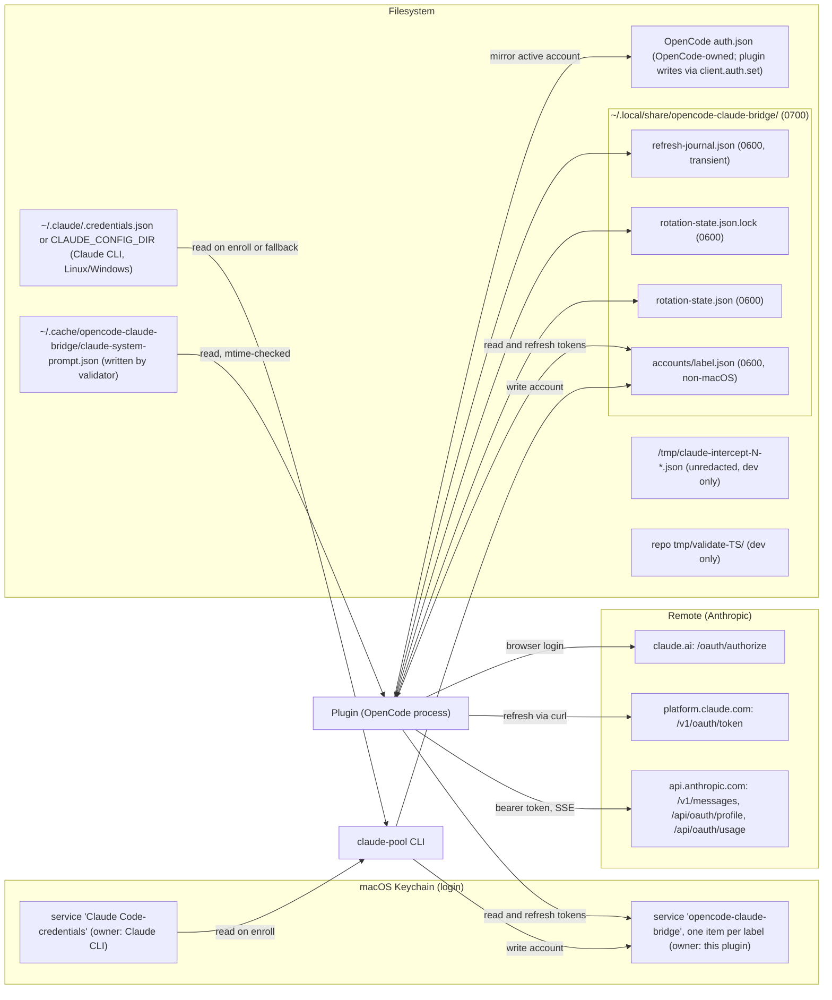

# 10 - Configuration and Files Reference

## What this chapter covers

A lookup chapter. When you need to answer "what does this setting do?", "where does this file live?", "which server does the code talk to?", or "what does this word mean?", start here. It contains:

1. Every **environment variable** the code reads (name, default, where, effect, when to use it).
2. Every **file, directory, and keychain entry** the code reads or writes, with owner, contents, permissions, and whether it holds secrets.
3. Every **external HTTP endpoint** the code calls or serves.
4. Every **constant** in `src/constants.ts`.
5. A **glossary** of terms used across this documentation set.
6. A diagram of where data lives.

All claims cite `path:LINE` and were checked against the code at version 1.10.12 (checked Mon Oct 5 2026). No real tokens appear here. Where a value is a secret, the doc says so and shows no example.

Related chapters: [README](README.md), [01-big-picture](01-big-picture.md), [02-plugin-startup-and-login](02-plugin-startup-and-login.md), [03-request-pipeline](03-request-pipeline.md), [05-account-pool-overview](05-account-pool-overview.md), [07-enrollment-and-claude-pool-cli](07-enrollment-and-claude-pool-cli.md), [08-scripts-validation-and-qa](08-scripts-validation-and-qa.md), [09-build-test-ci-release](09-build-test-ci-release.md), [11-known-issues-and-gotchas](11-known-issues-and-gotchas.md).

---

## 1. Environment variables

An **environment variable** is a named setting passed to a program by the shell that launched it (for example `ANTHROPIC_CLI_VERSION=2.1.100 opencode`). The plugin reads them when it loads, so changes need an OpenCode restart.

Important: most `ANTHROPIC_*` values in `src/constants.ts` are read **once, at import time**, into constants (`src/constants.ts:63-136`). Changing the variable after OpenCode has started has no effect. The exception is `ANTHROPIC_CLI_VERSION`, which is also checked on every call to `getCliVersion()` (`src/constants.ts:55-61`), and `ANTHROPIC_USER_AGENT`, which is read each time `getUserAgent()` runs (`src/constants.ts:100-103`).

### 1.1 Settings that change what the plugin sends (header / identity values)

These make the plugin imitate the official Claude Code CLI. Defaults track a particular Claude Code release; override only when Anthropic changes what it accepts. See [03-request-pipeline](03-request-pipeline.md).

| Variable | Default | Read at | What it changes | When you would use it |
| --- | --- | --- | --- | --- |
| `ANTHROPIC_CLI_VERSION` | Detected by running `claude --version` (tries `claude`, `~/.local/bin/claude`, `~/.claude/local/claude`), else the `version` field of `~/.claude/.credentials.json`, else `2.1.98` | `src/constants.ts:42`, `:56` | The Claude Code version the plugin claims in the `user-agent` and in `cc_version` of the billing header. If set, the 10-minute background re-check of the installed CLI is turned off (`:56`). | The CLI is not installed or detection picks the wrong version, and the API rejects newer models for an old version (the warning at `:34-36` says exactly this). |
| `ANTHROPIC_CLI_BUILD_ID` | `835` | `src/constants.ts:93` | Fallback "suffix" of `cc_version` when no per-request fingerprint or captured value exists (`src/index.ts:685-688`). | Rarely; only if the fallback suffix matters. |
| `ANTHROPIC_ENTRYPOINT` | `sdk-cli` | `src/constants.ts:96` | `cc_entrypoint` in the billing header and the `(external, <entrypoint>)` part of the user agent. | Matching what a given Claude Code entry mode sends. |
| `CLAUDE_CODE_ENTRYPOINT` | (unset) | `src/constants.ts:97` | Second-choice fallback for the same value (used only if `ANTHROPIC_ENTRYPOINT` is empty). This is the name the real Claude Code uses. | Inherit the value from a parent Claude Code process. |
| `ANTHROPIC_USER_AGENT` | `claude-cli/<version> (external, <entrypoint>)` | `src/constants.ts:101` | The entire `user-agent` header, including the one on `curl` token requests (`src/oauth.ts:56`). | Full manual control of the identity string. |
| `ANTHROPIC_BETA_FLAGS` | The 8-flag list in section 4 | `src/constants.ts:108` | Comma-separated `anthropic-beta` values sent on every request (`src/index.ts:557`). The plugin forces `claude-code-20250219` and `oauth-2025-04-20` to the front regardless (`src/index.ts:559-561`). | A flag is retired or added by Anthropic. |
| `ANTHROPIC_SDK_VERSION` | `0.94.0` | `src/constants.ts:119` | `x-stainless-package-version` header. | Matching a newer Claude Code's bundled SDK. |
| `ANTHROPIC_DEFAULT_EFFORT` | `medium` | `src/constants.ts:127` | The `output_config.effort` value injected into requests (`src/index.ts:1021`). | You want a different default thinking effort. |
| `ANTHROPIC_CLEAR_THINKING_TYPE` | `clear_thinking_20251015` | `src/constants.ts:130` | The `context_management` edit type sent (`src/index.ts:1017`). | Anthropic renames/rev's the edit type. |
| `ANTHROPIC_BILLING_CCH` | empty (computed per session) | `src/constants.ts:133` | Overrides the `cch` value; otherwise it is the first 5 hex chars of SHA-256 of the session id (`src/index.ts:682-683`). | Replaying a captured session in validation. The validator sets it (`scripts/validate-opencode-oauth.js:264`). |
| `ANTHROPIC_SESSION_ID` | empty (a random UUID is generated at startup) | `src/constants.ts:136`; used `src/index.ts:729` | The session id used in headers and for `cch`. | Replaying a captured session. The validator sets it (`scripts/validate-opencode-oauth.js:263`). |
| `ANTHROPIC_SYSTEM_PROMPT_PATH` | `$HOME/.cache/opencode-claude-bridge/claude-system-prompt.json` | `src/index.ts:365-366` | Location of the cached Claude Code system prompt. The file is re-read when its modification time changes (`src/index.ts:652-662`). | Keeping several captures or a non-standard cache location. |

### 1.2 Settings that change where the plugin talks (OAuth endpoints and identity)

Normally never changed. They exist so tests, proxies, and future Anthropic changes can be handled without a code edit. See [02-plugin-startup-and-login](02-plugin-startup-and-login.md).

| Variable | Default | Read at | What it changes | When you would use it |
| --- | --- | --- | --- | --- |
| `ANTHROPIC_CLIENT_ID` | `9d1c250a-e61b-44d9-88ed-5944d1962f5e` | `src/constants.ts:64` | The OAuth client id sent in authorize, exchange, and refresh requests. | Testing against a different OAuth app. |
| `ANTHROPIC_AUTHORIZE_URL` | `https://claude.ai/oauth/authorize` | `src/constants.ts:76` | Where the browser is sent to log in. | Testing. |
| `ANTHROPIC_TOKEN_URL` | `https://platform.claude.com/v1/oauth/token` | `src/constants.ts:72` | Where codes and refresh tokens are exchanged. Tests set it to `http://127.0.0.1:1/...` to force connection failure (`src/oauth.test.ts:9-10`). | Testing or proxying. |
| `ANTHROPIC_MANUAL_REDIRECT_URL` | `https://platform.claude.com/oauth/code/callback` | `src/constants.ts:83` | The redirect used by the paste-a-code login flow. | Testing. |
| `ANTHROPIC_PROFILE_URL` | `https://api.anthropic.com/api/oauth/profile` | `src/constants.ts:68` | Where account profile (subscription type, email) is fetched; used by the plugin (`src/index.ts:701`) and enrollment (`src/pool/enroll.ts:156`). | Testing. |
| `ANTHROPIC_SCOPES` | `org:create_api_key user:profile user:inference user:sessions:claude_code user:mcp_servers user:file_upload` | `src/constants.ts:89` | The OAuth scopes requested at login (`src/oauth.ts:210`, `:339`). | Anthropic changes required scopes. |
| `ANTHROPIC_USAGE_URL` | `https://api.anthropic.com/api/oauth/usage` | `src/pool/usage.ts:14` | Where the dashboard fetches 5-hour/7-day usage. Uses `??`, so an empty string disables the default. | Testing the dashboard. |

### 1.3 API key handling

| Variable | Default | Read / written at | What it does | When |
| --- | --- | --- | --- | --- |
| `ANTHROPIC_API_KEY` | (unset) | Read `src/index.ts:728`, `:1539`; written `:879`, `:885`, `:891` | The plugin saves your value at startup and then **overwrites** it. In API-key mode it is set to the stored key (`:879`); in OAuth mode it is set to the literal placeholder `oauth-placeholder` (`:891`) so OpenCode's Anthropic SDK does not complain about a missing key; the real `Authorization: Bearer` header is added by the plugin's fetch wrapper (`:947-948`). If OAuth is not configured, your original value is restored (`:885`). During the "Claude API Key" login option, an existing value is offered as the key (`:1539`). | Set it only if you want API-key billing instead of a subscription. Do not expect it to be left untouched in the OpenCode process. |
| `ANTHROPIC_BASE_URL` | (unset) | **Not read by this repo's `src/`.** Read by the Anthropic SDK inside OpenCode and by Claude CLI. The scripts **set** it to point both at a local capture proxy (`scripts/validate-opencode-oauth.js:232`, `:262`; `scripts/intercept-claude.sh:82`). | Redirects API traffic to a proxy. | Used by the validate/intercept tools only. |

### 1.4 Pool settings

See [05-account-pool-overview](05-account-pool-overview.md) and [07-enrollment-and-claude-pool-cli](07-enrollment-and-claude-pool-cli.md). There are exactly two `CLAUDE_POOL_*` variables.

| Variable | Default | Read at | What it changes | When you would use it |
| --- | --- | --- | --- | --- |
| `CLAUDE_POOL_AUTO_ENROLL` | (unset = enabled) | `src/index.ts:748` | When the pool is already active, the plugin checks at startup whether the Claude CLI is logged into an account the pool has not seen, and adopts it. Setting this to exactly `0` disables the check. Any other value, including `false`, leaves it enabled. Tests set `0` (`src/rotation-loop.test.ts:13`); documented in `SETUP.md:178`. | You do not want credentials copied from the Claude CLI automatically. |
| `CLAUDE_POOL_STATE_PATH` | `~/.local/share/opencode-claude-bridge/rotation-state.json` | `src/pool/rotation-state.ts:63`; set (if unset) by `scripts/qa-rotation.mjs:23-25` | Relocates **only the rotation state file** (cooldowns, disabled flags). The lock file and refresh journal stay in the default directory on purpose, because they protect the real credentials (`src/pool/rotation-state.ts:56-58`, `scripts/qa-rotation.mjs:16-19`). | Running the QA harness, or tests, without touching live state. |

### 1.5 Claude CLI locations and general system variables

| Variable | Default | Read at | What it changes | When you would use it |
| --- | --- | --- | --- | --- |
| `CLAUDE_CONFIG_DIR` | `~/.claude` | `src/keychain.ts:20` | Directory holding `.credentials.json`, the Claude CLI login file used on Linux/Windows and as a fallback on macOS. Used by `readClaudeCredentials` and by enrollment (`src/pool/enroll.ts:11`, `:128`). **Not honoured everywhere**: version detection (`src/constants.ts:27`) and the validator (`scripts/validate-opencode-oauth.js:68`) hard-code `~/.claude`. | You moved Claude's config directory. |
| `HOME` | The OS user's home | `src/index.ts:366` (cache path); indirectly by every `os.homedir()` call (`src/pool/secret-store.ts:297`, `rotation-state.ts:59,65`, `manager.ts:117`, `keychain.ts`) | Where `~` resolves. On POSIX, Node's `os.homedir()` uses `HOME` when set, so changing `HOME` relocates the whole pool store. Tests rely on this (`src/rotation-loop.test.ts:23-33`). Note `src/index.ts:366` uses `process.env.HOME || ""`, so with `HOME` unset the prompt cache path becomes a **relative** path under the current directory. | Sandboxing tests; containers with no HOME. |
| `USER` / `USERNAME` | OS | `src/index.ts:671` | Only a fallback inside `getStableDeviceId()` if `os.userInfo()` throws. The result is hashed with the hostname to a 64-character hex device id. | Never set manually. |
| `NO_COLOR` | (unset) | `src/pool/tui.ts:41` | If set to anything non-empty, the dashboard TUI emits no color escape codes (`NO_COLOR` convention). | Piping output or accessibility. |
| `TERM` | Terminal's value | `src/pool/tui.ts:41` | `TERM=dumb` also disables color. | Automatically relevant in CI logs. |
| `XDG_CONFIG_HOME` | (unset) | **Set**, not read, by the validator for the child OpenCode (`scripts/validate-opencode-oauth.js:261`) pointing to a temp directory that holds an `opencode.json` listing the plugin. | Isolating OpenCode's config during validation. |

### 1.6 Coverage notes

- The README environment table (`README.md:264-280`) lists 12 variables. It omits `ANTHROPIC_PROFILE_URL`, `ANTHROPIC_MANUAL_REDIRECT_URL`, `ANTHROPIC_SCOPES`, `ANTHROPIC_USER_AGENT`, `ANTHROPIC_CLEAR_THINKING_TYPE`, `ANTHROPIC_USAGE_URL`, `CLAUDE_CODE_ENTRYPOINT`, `CLAUDE_CONFIG_DIR`, and both `CLAUDE_POOL_*` variables. This chapter is the complete list (see [11-known-issues-and-gotchas](11-known-issues-and-gotchas.md)).
- There is **no** environment variable that turns the pool on. The pool becomes active when at least one account is enrolled (`src/index.ts:734-743`).
- Shell scripts also read variables for their own purposes only: `scripts/claude-pool.mjs` reads none from `process.env`; `scripts/intercept-claude.sh` takes the model as its first argument and sets `ANTHROPIC_API_KEY=` empty plus `ANTHROPIC_BASE_URL` for the Claude child (`scripts/intercept-claude.sh:82`).

---

## 2. Files, directories, and keychain entries

Terminology:

- **Keychain**: the macOS secure password store ("Keychain Access"). Programs read and write it through the `security` command. On Linux there is no keychain here; files are used instead.
- **0600 / 0700**: Unix permission modes. `0600` means only the owning user can read or write the file. `0700` means only the owner can enter or list the directory.
- **Atomic write**: write to a temporary file, flush it to disk, then rename it over the real file, so a crash never leaves a half-written file.

### 2.1 Account pool data (the important one)

Base directory: `~/.local/share/opencode-claude-bridge/` (built from `os.homedir()`; created `0700` by whichever component writes first - `src/pool/rotation-state.ts:104-106`, `src/pool/manager.ts:184-186`, `src/pool/secret-store.ts:107-108`).

| Path | Written by | Contents | Permissions | Secrets? |
| --- | --- | --- | --- | --- |
| Linux/other: `~/.local/share/opencode-claude-bridge/accounts/<label>.json` (label is URL-encoded, `.json` suffix) | `claude-pool enroll`, auto-enroll, and every token refresh (`src/pool/secret-store.ts:196-199`, `:292-300`) | One JSON `AccountRecord` per account: label, `enrolledAt`, email, `subscriptionType`, `rateLimitTier`, `scopes`, and `oauth` {access token, refresh token, expiry ms} (`src/pool/types.ts:40-60`, `src/pool/enroll.ts:101-120`) | File `0600` (created with `O_EXCL`, mode `0o600`, atomically replaced), directory `0700` and re-chmodded (`src/pool/secret-store.ts:107-108`, `:132`) | **Yes: access and refresh tokens in plain JSON.** |
| macOS: login keychain, service `opencode-claude-bridge`, account name = label | Same writers | The same JSON `AccountRecord` as the item's secret value, stored with `security add-generic-password -U -s opencode-claude-bridge -a <label> -l "opencode-claude-bridge:<label>" -D "Claude account pool entry" -X <hex>` (`src/pool/secret-store.ts:149-151`, service constant `src/pool/types.ts:18`). Values over 4095 characters are refused rather than truncated (`src/pool/secret-store.ts:37`, test at `secret-store.test.ts:258`). | Keychain access control (login keychain) | **Yes.** On macOS the platform check is `process.platform === "darwin"` (`src/pool/secret-store.ts:295`). |
| `~/.local/share/opencode-claude-bridge/rotation-state.json` (or `$CLAUDE_POOL_STATE_PATH`) | Pool manager on every cooldown, penalty, success, and active-account change (`src/pool/rotation-state.ts:62-71`, atomic write `:150-161`) | Version, `activeLabel`, and per account: `cooldownUntil`, `disabled`, `failureCount`, `lastReason`, `updatedAt` (`src/pool/types.ts`, `rotation-state.ts:73-75`) | File `0600`, directory `0700` (`rotation-state.ts:105-106`, `:153`, `:161`) | No tokens. Hot, frequently rewritten state, deliberately kept apart from the cold secrets (`src/pool/types.ts:8-11`). |
| `~/.local/share/opencode-claude-bridge/rotation-state.json.lock` | Pool manager while holding the cross-process lock (`src/pool/rotation-state.ts:59`, `:193`) | JSON `{pid, hostname, acquiredAt, nonce}` (`:183-188`). Created with `wx` (fails if it exists) so only one process can hold it. The lock also serialises token refreshes. | `0600` | No secrets (a process id and hostname). Always in the default directory even if `CLAUDE_POOL_STATE_PATH` is set. |
| `~/.local/share/opencode-claude-bridge/refresh-journal.json` | Pool manager during a token refresh (`src/pool/manager.ts:115-122`, `:184-200`) | The newly obtained tokens for one label, written **before** committing them to the store, deleted after commit. A leftover file means a crash between refresh and commit, and is replayed on next start. Anthropic invalidates the old refresh token on every refresh, so this window matters (`src/pool/types.ts:12-15`). | Written to a temp file `0600` then renamed; directory `0700` | **Yes (briefly).** Normally absent. |

Everything in this folder is created by this plugin. Nothing in the pool writes outside it. See [05-account-pool-overview](05-account-pool-overview.md) and [06-rotation-and-failure-handling](06-rotation-and-failure-handling.md).

### 2.2 OpenCode's own credential file

| Path | Owner | How the plugin touches it | Secrets? |
| --- | --- | --- | --- |
| OpenCode's `auth.json` (its provider-credential store; the code never names the path) | OpenCode | The plugin never opens it directly. It calls OpenCode's `client.auth.set({ path: { id: "anthropic" }, body: {...} })` (`src/index.ts:395`, `src/pool/bridge.ts:30`, `src/index.ts:1541`, `:1558`) and reads it through the `auth()` getter OpenCode passes to the loader (`src/index.ts:842`, `:897-899`). The code comments describe it as holding only **one** `anthropic` slot, which the pool treats as a **derived cache** (a "mirror") of whichever pooled account is active (`src/pool/types.ts:5-7`). | **Yes** (OAuth tokens or API key). I did not find the on-disk location in this repo's code; comments elsewhere in the repo place OpenCode data under `~/.local/share/opencode/` (`SETUP.md:251`), but treat the exact `auth.json` path as OpenCode's business. |

### 2.3 Claude CLI's credentials (read-only for the bridge)

| Location | Owner | Read by | Contents | Secrets? |
| --- | --- | --- | --- | --- |
| macOS keychain, service `Claude Code-credentials` | Claude CLI (`claude login`) | `security find-generic-password -s "Claude Code-credentials" -w` in `src/keychain.ts:27-29`, `src/pool/enroll.ts:13`, `:138-140`, and `scripts/validate-opencode-oauth.js:60` | JSON with a `claudeAiOauth` object: `accessToken`, `refreshToken`, `expiresAt`, `scopes`, `subscriptionType`, `rateLimitTier` (`src/keychain.ts:7-16`, `src/pool/types.ts:57-66`) | **Yes** |
| `$CLAUDE_CONFIG_DIR/.credentials.json`, default `~/.claude/.credentials.json` | Claude CLI on Linux/Windows | `src/keychain.ts:20`, `:41` (fallback on macOS if the keychain read fails), `src/pool/enroll.ts:128-130`; also the CLI version fallback reads `version` from it with a **hard-coded** `~/.claude` (`src/constants.ts:27-31`); and the validator (`scripts/validate-opencode-oauth.js:68`) | Same JSON shape | **Yes** |
| `claude` / `~/.local/bin/claude` / `~/.claude/local/claude` (binaries) | Claude CLI | Executed with `--version` (3 s timeout) for version detection (`src/constants.ts:6-10`, `:20-26`) | Not a data file | No |

The bridge only **reads** these. `getClaudeTokens()` explicitly never refreshes them, because the refresh token is single-use and belongs to Claude Code (`src/keychain.ts:50`). Enrollment copies the login into the pool; it does not modify the CLI entry. **Important**: since both the CLI keychain and OpenCode's `auth.json` hold only one login, you must `claude login` per account and enroll between logins (`scripts/claude-pool.mjs:4-12`).

### 2.4 Cache and temp files

| Path | Written by | Read by | Contents | Secrets? |
| --- | --- | --- | --- | --- |
| `~/.cache/opencode-claude-bridge/claude-system-prompt.json` (or `$ANTHROPIC_SYSTEM_PROMPT_PATH`) | **Only** the validator (`scripts/validate-opencode-oauth.js:16`, `:435-455`, creates the directory) | The plugin (`src/index.ts:365-366`, `:638-662`); re-read when its modification time changes | JSON with `source: "claude-code-capture"`, `updated_at`, `billing` (cc version, suffix, entrypoint), and the captured `system` blocks (Claude Code's real system prompt) | No credentials. If the file is absent the plugin works without it. |
| `<repo>/tmp/validate-<timestamp>/` | `npm run validate:oauth` (`scripts/validate-opencode-oauth.js:22`, `:476`, `:523`) | Human | `claude-N-headers.json`, `...-body.json`, `...-response.json`, `report.json`. Headers are redacted to `Bearer ...<last 8 chars>` (`:108-114`), but **request and response bodies are written verbatim** (`:154`). `tmp/` is gitignored (`.gitignore:3`). | Partial: bodies can contain your prompts and code; the authorization header is shortened. |
| `$TMPDIR/opencode-bridge-XXXX/opencode/opencode.json` | Validator, for the child OpenCode (`scripts/validate-opencode-oauth.js:242-249`) | OpenCode child | Config with `plugin: [<repo>/dist/index.js]`; deleted afterwards (`:271-272`) | No |
| `/tmp/claude-intercept-<n>-headers.json` and `-body.json` | `scripts/intercept-claude.sh` (`:25-30`; messages at `:89-93`) | Human | **Unredacted** headers (including the real `authorization` or `x-api-key`) and request body of each call the Claude CLI makes | **Yes**: full bearer token in the headers file. `/tmp` is world-listable on many systems. Delete after use. |
| `$TMPDIR/qa-rotation-XXXX/rotation-state.json` | `scripts/qa-rotation.mjs` (`:23-26`) | Same script | A private copy of rotation state; removed on exit | No |
| Test temp dirs (`rotation-loop-*`, others via `mkdtemp`) | Tests | Tests | Throwaway pool stores | Fake data only |

### 2.5 Repository / build files (not runtime)

`dist/` (compiled code, gitignored), `node_modules/`, `tmp/`. See [09-build-test-ci-release](09-build-test-ci-release.md).

### 2.6 Keychain items summary

| Service name | Account name | Owner | Meaning |
| --- | --- | --- | --- |
| `Claude Code-credentials` | (any) | Claude CLI | The CLI's single current login. Read-only for the bridge. |
| `opencode-claude-bridge` | pool label (e.g. `personal`) | This plugin | One entry per enrolled account. |

Labels are validated so they cannot look like `security(1)` options or escape a directory (`src/pool/enroll.test.ts:137-149`, `src/pool/secret-store.ts:196-198`). The `security -i` secret is sent over stdin, not argv, so it does not show up in `ps` (`src/pool/secret-store.ts:48`).

---

## 3. External HTTP endpoints

"Endpoint" means a URL the code sends requests to (or serves). All are HTTPS to Anthropic except the local login callback.

| # | Endpoint | Method | Purpose | Where in code |
| --- | --- | --- | --- | --- |
| 1 | `https://api.anthropic.com/v1/messages?beta=true` | POST | The actual chat/completion call (the "messages API"). The plugin does not hard-code the host; it uses the URL OpenCode's Anthropic provider already built (default `api.anthropic.com`, or whatever `ANTHROPIC_BASE_URL` says). It rewrites path `/messages` to `/v1/messages` and appends `beta=true` if missing, then sends via `globalThis.fetch` with the rewritten headers and body. Responses stream back as SSE. | `src/index.ts:1136-1155` (`doFetch` at `:1149`) |
| 2 | `https://platform.claude.com/v1/oauth/token` | POST (JSON body) | Exchange a login code for tokens (`grant_type=authorization_code` with `code`, `code_verifier`, `client_id`, `redirect_uri`) and refresh tokens (`grant_type=refresh_token` with `refresh_token`, `client_id`). Sent through the **`curl`** binary with the JSON body fed on stdin, so secrets stay out of `ps` output and the runtime's `fetch` does not add browser-style headers (Origin, Referer) that provoke 429s. Timeout 30 s, up to 3 attempts. | URL `src/constants.ts:71-73`; request `src/oauth.ts:45-60` (args), `:74-` (curl), `:93-` (retry), `:375-400` (`exchangeCodeForTokens`, `refreshTokens`) |
| 3 | `https://claude.ai/oauth/authorize` | GET (opened in the user's browser) | Start the login. Query includes `code=true`, `client_id`, `response_type=code`, `redirect_uri`, `scope`, `code_challenge` (PKCE, `S256`), `state`. | `src/constants.ts:75-78`; `src/oauth.ts:203-215`, `:337-345` |
| 4 | `http://localhost:<ephemeral-port>/callback` | GET (served **by the plugin**) | Local server that receives the browser redirect with `code` and `state`. Binds `localhost` on port 0 (OS picks a free port). Checks `state`; a mismatch gets a 400 and does not consume the one-shot promise. Closes itself after 5 minutes. | `src/oauth.ts:240-296` (`:249` handler, `:287` timeout, `:292` listen); redirect built at `src/oauth.ts:202`, `src/index.ts:1442` |
| 5 | `https://platform.claude.com/oauth/code/callback` | (browser redirect target, not fetched by code) | The "manual" redirect: Anthropic shows a code on this page for the user to paste when the localhost callback cannot work. Also the default `redirect_uri` in code exchange. | `src/constants.ts:82-85`; `src/oauth.ts:220`, `:338`, `:388` |
| 6 | `https://api.anthropic.com/api/oauth/profile` | GET with `Authorization: Bearer <access token>`, `anthropic-beta: oauth-2025-04-20` | Look up the account's subscription info (plugin, cached per token) and email (enrollment). Comment notes the claude.ai variant 403s behind a Cloudflare challenge. | `src/constants.ts:66-70`; `src/index.ts:701-709`; `src/pool/enroll.ts:156-163` (15 s timeout) |
| 7 | `https://api.anthropic.com/api/oauth/usage` | GET with bearer token and `anthropic-beta: oauth-2025-04-20` | Per-account utilization of the 5-hour and 7-day windows for the dashboard. Rate-limit headers do not reveal utilization. 10 s timeout. | `src/pool/usage.ts:13-14`, `:84-99`; the validator has its own copy with a hard-coded user agent `claude-cli/2.1.98` (`scripts/validate-opencode-oauth.js:90-96`) |
| 8 | `http://127.0.0.1:<port>` capture proxy | any | Local-only listeners started by `validate-opencode-oauth.js` (`:140-200`, binds `127.0.0.1` at `:197`) and `intercept-claude.sh` (port `18899`, `:9`) that forward to `api.anthropic.com` while recording. Not part of the shipped plugin's runtime. | scripts only |

Other facts:

- Only endpoints 1 (SSE responses), 6, 7 use the global `fetch`. Endpoint 2 deliberately uses `curl`, so **`curl` must be installed** for login and refresh (`src/oauth.ts:65`: "curl is not installed or not on PATH").
- The bearer token in endpoint 1 comes from the active pool account or OpenCode's stored login, and is placed in the `authorization` header while `x-api-key` is removed (`src/index.ts:947-948`).
- Retried requests: on 401 the plugin refreshes and retries once (`src/index.ts:1316`); on 429 it refreshes and retries up to twice when not pooled (`:1337`). See [03-request-pipeline](03-request-pipeline.md) and [06-rotation-and-failure-handling](06-rotation-and-failure-handling.md).

---

## 4. Constants in `src/constants.ts`

All values are exported from `src/constants.ts` (179 lines). "Used?" says whether anything outside the file references it.

| Constant (line) | Value | Purpose | Used? |
| --- | --- | --- | --- |
| `CLAUDE_BINARIES` (`:6-10`, not exported) | `claude`, `~/.local/bin/claude`, `~/.claude/local/claude` | Where to look for the CLI to get its version | internal |
| `FALLBACK_CLI_VERSION` (`:11`) | `2.1.98` | Version claimed if nothing can be detected | internal |
| `VERSION_RECHECK_MS` (`:12`) | `10 * 60_000` (10 minutes) | How often to re-run `claude --version` in the background, since Claude Code auto-updates and "the API gates models on this" (`:54`) | internal |
| `CLIENT_ID` (`:63`) | `9d1c250a-e61b-44d9-88ed-5944d1962f5e` | OAuth client id of Claude Code | `src/oauth.ts` |
| `PROFILE_URL` (`:67`) | `https://api.anthropic.com/api/oauth/profile` | Profile lookup | `index.ts`, `enroll.ts` |
| `TOKEN_URL` (`:71`) | `https://platform.claude.com/v1/oauth/token` | Token exchange and refresh | `oauth.ts` |
| `AUTHORIZE_URL` (`:75`) | `https://claude.ai/oauth/authorize` | Login page | `oauth.ts` |
| `MANUAL_REDIRECT_URL` (`:82`) | `https://platform.claude.com/oauth/code/callback` | Manual login redirect (matches Claude CLI's production config per comment `:79-81`) | `oauth.ts` |
| `SCOPES` (`:88`) | `org:create_api_key user:profile user:inference user:sessions:claude_code user:mcp_servers user:file_upload` | OAuth permissions requested (union of Console and Claude.ai scopes, `:86-87`). `user:inference` is the one that lets the token call the messages API. | `oauth.ts` |
| `CLI_BUILD_ID` (`:92`) | `835` | Fallback `cc_version` suffix | `index.ts:688` |
| `ENTRYPOINT` (`:95`) | `sdk-cli` | `cc_entrypoint` / user-agent mode | `index.ts`, `getUserAgent` |
| `getUserAgent()` (`:100`) | `claude-cli/<version> (external, <entrypoint>)` | The user-agent string | `index.ts`, `oauth.ts` |
| `BETA_FLAGS` (`:107-108`) | `interleaved-thinking-2025-05-14`, `thinking-token-count-2026-05-13`, `context-management-2025-06-27`, `prompt-caching-scope-2026-01-05`, `claude-code-20250219`, `advisor-tool-2026-03-01`, `effort-2025-11-24`, `extended-cache-ttl-2025-04-11` | The "beta flags" list copied from Claude Code 2.1.178 via request interception (comment `:105`). Each is an opt-in feature name for the `anthropic-beta` header. | `index.ts:557` |
| `OAUTH_BETA_FLAG` (`:111`) | `oauth-2025-04-20` | Required beta flag when authenticating with an OAuth token instead of an API key | `index.ts`; `enroll.ts` and `usage.ts` repeat the literal instead of importing it (`enroll.ts:14`, `usage.ts:94`) |
| `ANTHROPIC_VERSION` (`:114`) | `2023-06-01` | Value of the `anthropic-version` header (API contract version) | `index.ts:955` |
| `STAINLESS_HEADERS` (`:117-124`) | `x-stainless-lang: js`; `x-stainless-package-version`: `0.94.0` (or env); `x-stainless-os`: MacOS/Linux/Windows from `process.platform`; `x-stainless-arch`: from `process.arch`; `x-stainless-runtime: node`; `x-stainless-runtime-version`: `process.version` | Headers Anthropic's SDK (generated by "Stainless") sends; copied so requests look like Claude Code's | `index.ts:957` |
| `DEFAULT_EFFORT` (`:126`) | `medium` | Injected `output_config.effort` | `index.ts:1021` |
| `CLEAR_THINKING_TYPE` (`:129`) | `clear_thinking_20251015` | `context_management` edit type | `index.ts:1017` |
| `BILLING_CCH` (`:132`) | empty | Optional fixed `cch` | `index.ts:682` |
| `SESSION_ID` (`:135`) | empty | Optional fixed session id | `index.ts:729` |
| `TOOL_PREFIX` (`:138`) | `mcp_` | Looks like a prefix for tool names | **Unused**: no other file references it |
| `POOL_TOAST_DURATION_MS` (`:147`) | `10_000` (10 s) | How long the pool-exhaustion toast shows | `pool/notify.ts:1,36` |
| `POOL_COMMAND_NAME` (`:150`) | `claude-pool` | Name of the removed slash command | **Unused** |
| `POOL_COMMAND_TEMPLATE` (`:162-169`) | A prompt that runs ``!`node $HOME/src/opencode-claude-bridge/scripts/claude-pool.mjs dashboard` `` and asks the model to echo it | Template for the removed slash command (see `docs/archived/slash-command.md`) | **Unused**; also hard-codes a path under `$HOME/src/` |
| `POOL_COMMAND_MODEL` (`:171`) | `opencode/big-pickle` | A free model for the dashboard turn | **Unused** |
| `POOL_DASHBOARD_TOAST_DURATION_MS` (`:179`) | `30_000` (30 s) | Toast duration for the dashboard | Imported at `src/index.ts:28` but never referenced afterwards: **unused import** |

Background on header names: **Stainless** is the company whose tooling generates Anthropic's SDK; its `x-stainless-*` headers describe language, OS, and runtime. The bridge copies them to match Claude Code.

---

## 5. Diagram: where data lives

---

## 5b. External programs the code runs

Besides files and HTTP, the plugin starts other programs. If one is missing, the matching feature fails, so this is part of the "configuration" you depend on.

| Program | Used for | Where | Platforms |
| --- | --- | --- | --- |
| `curl` | Token exchange and refresh (payload on stdin, 30 s timeout) | `src/oauth.ts:45-60`, `:74-` | all |
| `security` | Read `Claude Code-credentials`; add/read/delete/list the pool's keychain items | `src/keychain.ts:27`, `src/pool/enroll.ts:138`, `src/pool/secret-store.ts:28-60`, `:129-175` | macOS |
| `claude` (and `~/.local/bin/claude`, `~/.claude/local/claude`) | `--version` to learn the Claude Code version (3 s timeout) | `src/constants.ts:18-26`, `:45-53` | all |
| `open`, `launchctl asuser ... open`, `osascript`, `xdg-open`, `cmd /c start` | Open the login URL in the user's browser (tried in order until one works) | `src/index.ts:474-493` | macOS / Linux / Windows |
| `opencode` and `claude` (as children) | Validation capture runs | `scripts/validate-opencode-oauth.js:226-270` | dev only |

---

## 5c. Quick recipes

| I want to... | Do this |
| --- | --- |
| Stop the plugin copying my Claude CLI login into the pool | `CLAUDE_POOL_AUTO_ENROLL=0` in the environment that launches OpenCode. |
| Try the pool without touching live cooldown state | `CLAUDE_POOL_STATE_PATH=/some/tmp/state.json` (the lock and journal still live in the default directory). |
| Tell the plugin which Claude Code version to claim | `ANTHROPIC_CLI_VERSION=<x.y.z>`; also silences the "CLI not found" warning path. |
| Point the plugin at a different system-prompt capture | `ANTHROPIC_SYSTEM_PROMPT_PATH=/path/to/file.json`. |
| See what the real Claude CLI sends | `scripts/intercept-claude.sh` (writes unredacted files in `/tmp`), or `npm run validate:oauth` (see [08-scripts-validation-and-qa](08-scripts-validation-and-qa.md)). |
| Reset a pool account completely | Remove its keychain item (macOS) or its `accounts/<label>.json`, remove its entry from `rotation-state.json`, then re-run `claude login` and `claude-pool enroll <label>` (or use the dashboard; the TUI removal also drops rotation state, `src/pool/tui.test.ts:64`). |
| Run with no colors | `NO_COLOR=1` or `TERM=dumb`. |

Every row above only uses behaviour confirmed in the cited code. If you change a variable and see no effect, remember most are read once when OpenCode loads the plugin (section 1).

---

## 6. Glossary

| Term | Plain-English meaning |
| --- | --- |
| **OpenCode** | An open-source terminal AI coding assistant. The host application; it loads this bridge as a plugin. |
| **Plugin** | A JavaScript module OpenCode loads at startup. This repo's default export (`src/index.ts`) is one. |
| **Claude Code / Claude CLI** | Anthropic's official command-line coding tool. Anthropic's subscription OAuth is intended for it; the bridge imitates its requests. |
| **Pro/Max subscription** | Anthropic's paid consumer plans for Claude, used here instead of per-token API billing. |
| **OAuth** | A standard way to log in to a service and receive tokens, without handing your password to the app. |
| **PKCE** (Proof Key for Code Exchange) | An OAuth add-on: the app makes a random secret `verifier`, sends only its hash (`code_challenge`, method `S256`), and later proves it by sending the verifier. Stops a stolen login code from being usable by someone else (`src/oauth.ts:197-199`). |
| **State** | A random value sent at login and checked on return; blocks forged callbacks (`src/oauth.ts:252-257`). |
| **Authorization code** | A one-time code the browser returns after login, exchanged for tokens. |
| **Access token** | A short-lived "bearer" credential sent with each API call. Has an expiry time (`expires`, epoch milliseconds). |
| **Refresh token** | A longer-lived credential used only to obtain new access tokens. Anthropic rotates it: every refresh returns a **new** refresh token and invalidates the old one, so losing it bricks the account (`src/pool/types.ts:12-15`). |
| **Scope** | A permission an OAuth token is granted (for example `user:inference`). |
| **Bearer token** | Any token sent as `Authorization: Bearer <token>`. |
| **SSE** (Server-Sent Events) | The streaming format Anthropic responses use: a stream of `event:`/`data:` text blocks separated by blank lines. `src/stream.ts` rewrites tool names and arguments inside it. |
| **Beta flag** | A named opt-in feature, sent comma-separated in the `anthropic-beta` header. |
| **Billing header** | A text block `x-anthropic-billing-header: cc_version=...; cc_entrypoint=...; cch=...;` placed first in the system prompt so Anthropic attributes the request to Claude Code usage (`src/index.ts:692`). |
| **`cc_version`** | Claude Code version plus a 3-character suffix (for example `2.1.98.835`; the suffix is a per-request fingerprint, `src/index.ts:690`). |
| **`cc_entrypoint`** | How Claude Code was launched (`sdk-cli` by default). |
| **`cch`** | A 5-character hash in the billing header, derived from the session id (`src/index.ts:682-683`). |
| **Fingerprint** | The per-request 3-character suffix of `cc_version`, computed the way Claude Code does from the first user message (`src/index.ts:685`, `README.md:139`). |
| **User agent** | The `user-agent` header string identifying the client program. |
| **System prompt** | The instructions block sent before the conversation. The bridge replaces OpenCode's with a captured Claude Code one. |
| **Tool / tool schema** | A function the model may call (Read, Edit, Bash...). A schema describes its parameters. Claude Code and OpenCode name some parameters differently; the bridge translates ([04-tools-and-translation](04-tools-and-translation.md)). |
| **Pool** | The optional set of enrolled Claude accounts the plugin rotates between. |
| **Account / label** | One enrolled Claude login, identified by a short name (for example `personal`). |
| **Enrollment** | Copying the Claude CLI's current login into the pool under a label (`claude-pool enroll <label>`). |
| **Auto-enroll** | Startup check that adopts a new CLI login into an already-active pool; disabled by `CLAUDE_POOL_AUTO_ENROLL=0`. |
| **Active account** | The account currently used for requests. |
| **Mirror** | Copying the active pool account's tokens into OpenCode's single `anthropic` slot so OpenCode sees a valid login (`mirrorFn` in `src/pool/bridge.ts:28-37`). |
| **Rotation** | Switching to another account when the current one is unusable. |
| **Cooldown** | A timed pause for an account (usually after a rate limit) with a `cooldownUntil` timestamp; the account returns automatically afterwards. |
| **Disabled** | A permanent exclusion until the user re-enrolls (for example a revoked credential). |
| **Classifier** | The pure function that turns an HTTP status and headers into a decision: retry, rotate with cooldown, disable, or pass through (`src/pool/classifier.ts`). |
| **Rate limit / 429** | The server refusing because the account used too much in a time window; Anthropic subscriptions have a 5-hour and a 7-day window. |
| **Exhausted** | Every pooled account is cooling or disabled; the plugin returns a fail-fast error. |
| **Keychain** | macOS secure credential store (section 2). |
| **Backend** | The storage implementation behind the account store: keychain (macOS) or 0600 files (others). |
| **Journal** | A small file written before a risky operation (token refresh) so a crash can be recovered by replaying it. |
| **Lock / lockfile** | A file whose existence means "someone is working"; prevents two OpenCode processes refreshing the same account at once. |
| **Stale lock** | A lock left by a process that died; reclaimed only when its holder is provably gone (`src/pool/security-fixes.test.ts:91-155`). |
| **TUI** | Terminal User Interface: the interactive `claude-pool dashboard`. |
| **Toast** | A brief on-screen pop-up message in OpenCode. |
| **Provenance** | A signed record that an npm package was built from a particular commit by a particular CI workflow ([09-build-test-ci-release](09-build-test-ci-release.md)). |
| **Intercept / capture proxy** | A small local server placed between a client and Anthropic to record exactly what is sent. |

---

## Key takeaways

- There are **30 distinct environment variables** touched by the code and scripts. 28 are read by `src/` (16 `ANTHROPIC_*` in constants, plus `ANTHROPIC_SYSTEM_PROMPT_PATH`, `ANTHROPIC_USAGE_URL`, `ANTHROPIC_API_KEY`, `CLAUDE_POOL_AUTO_ENROLL`, `CLAUDE_POOL_STATE_PATH`, `CLAUDE_CONFIG_DIR`, `CLAUDE_CODE_ENTRYPOINT`, `HOME`, `NO_COLOR`, `TERM`, `USER`/`USERNAME`). Most are read once at import. No variable turns the pool on; enrolling an account does.
- Account tokens live in the macOS keychain (service `opencode-claude-bridge`) or in `0600` files under `~/.local/share/opencode-claude-bridge/accounts/`. Rotation state, the lock, and the refresh journal sit next to them, and only the state file can be relocated.
- The bridge only reads the Claude CLI's login; OpenCode's `auth.json` is written only through OpenCode's own API.
- The one file the plugin reads but never writes is the system-prompt cache, which only `validate:oauth` produces.
- `/tmp/claude-intercept-*` files contain unredacted bearer tokens; delete them.
- Token requests go through `curl`, so `curl` must be installed.
- `TOOL_PREFIX`, `POOL_COMMAND_*`, and `POOL_DASHBOARD_TOAST_DURATION_MS` are dead code, and the README env table is incomplete.

Continue to: [11-known-issues-and-gotchas](11-known-issues-and-gotchas.md) | Back to [README](README.md)
