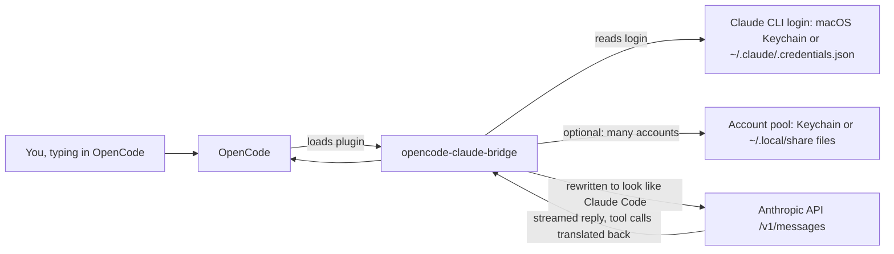

# explain/: the opencode-claude-bridge, explained

This folder is a plain-English walkthrough of the whole repository, covering every source file, script, workflow and on-disk file. It explains what each part does and why it exists. Diagrams are Mermaid, which renders on GitHub and in most Markdown viewers. Source references look like `src/index.ts:897`.

The code is the authority. Where the repository's own `README.md` or `SETUP.md` disagree with the code, these chapters follow the code and note the difference. All differences are collected in chapter 11.

## Reading order

| # | Chapter | Read it to learn |
|---|---|---|
| 01 | [The big picture](01-big-picture.md) | What the project is, the moving parts, one request end to end, glossary |
| 02 | [Plugin startup and login](02-plugin-startup-and-login.md) | What happens when OpenCode loads the plugin; OAuth login; token refresh with one account |
| 03 | [The request pipeline](03-request-pipeline.md) | Every header and body field the bridge rewrites on each API call, and why |
| 04 | [Tools and translation](04-tools-and-translation.md) | Tool definitions, name and argument translation both ways, the streaming parser, the fingerprint |
| 05 | [Account pool overview](05-account-pool-overview.md) | Multi-account storage, rotation state, the cross-process lock, the refresh-token journal |
| 06 | [Rotation and failure handling](06-rotation-and-failure-handling.md) | How 429/401/403/5xx responses are classified and how the bridge switches accounts |
| 07 | [Enrollment and the claude-pool CLI](07-enrollment-and-claude-pool-cli.md) | Adding accounts, auto-enroll, the shell hook, every CLI command, the dashboard |
| 08 | [Scripts, validation and QA](08-scripts-validation-and-qa.md) | The wire-comparison validator, the intercept proxy, the rotation test harness |
| 09 | [Build, test, CI and release](09-build-test-ci-release.md) | Repo layout, package.json, tsconfig, the test suite, GitHub Actions, publishing to npm |
| 10 | [Configuration and files reference](10-configuration-and-files-reference.md) | Every environment variable, file path, endpoint and constant |
| 11 | [Known issues and gotchas](11-known-issues-and-gotchas.md) | Bugs, risks, stale docs and loose ends found while writing these chapters |

## Suggested paths

- **"I just want to know what this is."** Read 01.
- **"I want to use it."** Read 01, then 02, then 07.
- **"I want to change the request rewriting."** Read 01, 03, 04 and 08 (the validator is how you check your change).
- **"I want to change account rotation."** Read 05, 06, then the QA harness section of 08.
- **"I want to ship a release."** Read 09.
- **"Something is broken."** Read 11, then the troubleshooting table in 07, then 10 to find the relevant file.

## One-screen summary

## Snapshot note

These chapters describe the working tree as of 2026-10-05, at commit `f6cb717`, plus the uncommitted Sonnet 5.5 changes in `src/index.ts` and `src/index.test.ts`. Line numbers shift as the code changes; if one looks off, search for the function name instead.
